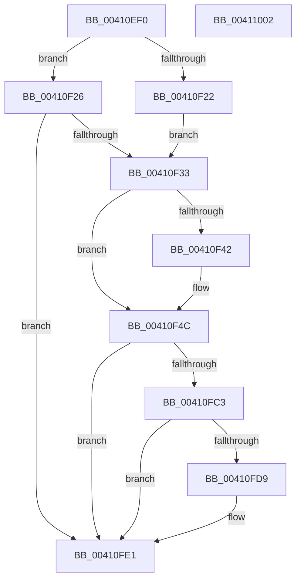

# B_TREE&lt;_SM_PAGE_KEY,ST_STORE&lt;SM_TRAITS&gt;::_ST_PAGE_ENTRY,4096,NP_CONTEXT,B_TREE_KEY_COMPARATOR&lt;_SM_PAGE_KEY&gt; &gt;::BTreeFindLeafSibling

- RVA: `0x00410EF0`–`0x00411003` (길이 `275` bytes)
- VA: `0x0000000140410EF0`
- 실행 섹션: `.text`
- PDB 이름 있음: `예`; PDB Function 태그: `아니요`
- unwind 정보 RVA: `0x0009BD88`
- 디코드: `76`개 명령, `275/275` bytes 표시
- 미해석 바이트: `0` (있으면 어셈블리에 `.byte`로 보존)

> 이 문서는 커널 이미지의 기계어와 PDB 기호를 분석해 생성했습니다. 4번과 5번은 함수 원형과 자료형을 바이너리 사용 방식에서 추정한 C 해석이며 원본 소스 복구 결과는 아닙니다.

## 1. Dependencies

- 직접 호출 지점: **5**; 고유 호출 대상: **5**
- 직접 호출자로 확인된 함수: **3**
- RIP 상대 이미지 참조: **1**

### Outgoing calls
- `0x00410F53` → [_chkstk](../6B/_chkstk_function_006BA960.md) (function, `0x006BA960`)
- `0x00410F88` → [B_TREE<_SM_PAGE_KEY,ST_STORE<SM_TRAITS>::_ST_PAGE_ENTRY,4096,NP_CONTEXT,B_TREE_KEY_COMPARATOR<_SM_PAGE_KEY> >::BTreeSearchKey](../3A/B_TREE__SM_PAGE_KEY_ST_STORE_SM_TRAITS__ST_PAGE_ENTRY_4096_NP_CONTEXT_B_TREE_KEY_COMPARATOR__SM_PAGE_function_003AC3C0.md) (function, `0x003AC3C0`)
- `0x00410FB6` → [B_TREE<_SM_PAGE_KEY,ST_STORE<SM_TRAITS>::_ST_PAGE_ENTRY,4096,NP_CONTEXT,B_TREE_KEY_COMPARATOR<_SM_PAGE_KEY> >::BTreeFindLeafSiblingEx](../3A/B_TREE__SM_PAGE_KEY_ST_STORE_SM_TRAITS__ST_PAGE_ENTRY_4096_NP_CONTEXT_B_TREE_KEY_COMPARATOR__SM_PAGE_function_003AA60C.md) (function, `0x003AA60C`)
- `0x00410FDC` → [NP_CONTEXT::NpLeafDerefInternal](../3A/NP_CONTEXT_NpLeafDerefInternal_function_003A9A70.md) (function, `0x003A9A70`)
- `0x00410FEB` → [_security_check_cookie](../6A/_security_check_cookie_function_006AC640.md) (function, `0x006AC640`)

### Direct callers
- [ST_STORE&lt;SM_TRAITS&gt;::StDmPageRemove](../20/ST_STORE_SM_TRAITS_StDmPageRemove_function_002049A0.md) at `0x00204AB9`
- [sub_00410CA4](Unknown_function_00410CA4.md) at `0x00410CDA`
- [ST_STORE&lt;SM_TRAITS&gt;::StDmEtwPageRundown](../60/ST_STORE_SM_TRAITS_StDmEtwPageRundown_function_0060D544.md) at `0x0060D5ED`

### Static image references
- `0x00410F07` → RVA `0x00E0A740` (`.data`; read)

## 2. Other-region calls and transfers

- 다른 실행 섹션으로 향하는 call: **0**
- 별도 외부 분기/꼬리 이동을 확인하지 못했습니다.

## 3. Assembly (complete function range)

```asm
00410EF0  40 55                           push rbp
00410EF2  48 83 EC 50                     sub rsp, 0x50
00410EF6  48 8D 6C 24 20                  lea rbp, [rsp + 0x20]
00410EFB  48 89 5D 40                     mov qword ptr [rbp + 0x40], rbx
00410EFF  48 89 75 48                     mov qword ptr [rbp + 0x48], rsi
00410F03  48 89 7D 50                     mov qword ptr [rbp + 0x50], rdi
00410F07  48 8B 05 32 98 9F 00            mov rax, qword ptr [rip + 0x9f9832]
00410F0E  48 33 C5                        xor rax, rbp
00410F11  48 89 45 28                     mov qword ptr [rbp + 0x28], rax
00410F15  48 8B 01                        mov rax, qword ptr [rcx]
00410F18  33 DB                           xor ebx, ebx
00410F1A  48 8B F9                        mov rdi, rcx
00410F1D  48 85 C0                        test rax, rax
00410F20  75 04                           jne 0x140410f26
00410F22  33 F6                           xor esi, esi
00410F24  EB 0D                           jmp 0x140410f33
00410F26  0F B6 70 02                     movzx esi, byte ptr [rax + 2]
00410F2A  83 FE 01                        cmp esi, 1
00410F2D  0F 84 AE 00 00 00               je 0x140410fe1
00410F33  8B C6                           mov eax, esi
00410F35  48 C1 E0 04                     shl rax, 4
00410F39  48 8D 48 0F                     lea rcx, [rax + 0xf]
00410F3D  48 3B C8                        cmp rcx, rax
00410F40  77 0A                           ja 0x140410f4c
00410F42  48 B9 F0 FF FF FF FF FF FF 0F   movabs rcx, 0xffffffffffffff0
00410F4C  48 83 E1 F0                     and rcx, 0xfffffffffffffff0
00410F50  48 8B C1                        mov rax, rcx
00410F53  E8 08 9A 2A 00                  call 0x1406ba960
00410F58  8B 52 10                        mov edx, dword ptr [rdx + 0x10]
00410F5B  4C 8D 45 00                     lea r8, [rbp]
00410F5F  83 65 24 00                     and dword ptr [rbp + 0x24], 0
00410F63  48 2B E1                        sub rsp, rcx
00410F66  83 65 18 00                     and dword ptr [rbp + 0x18], 0
00410F6A  0F 57 C0                        xorps xmm0, xmm0
00410F6D  48 8B CF                        mov rcx, rdi
00410F70  C7 45 20 01 00 00 00            mov dword ptr [rbp + 0x20], 1
00410F77  F3 0F 7F 45 08                  movdqu xmmword ptr [rbp + 8], xmm0
00410F7C  48 8D 5C 24 20                  lea rbx, [rsp + 0x20]
00410F81  89 75 1C                        mov dword ptr [rbp + 0x1c], esi
00410F84  48 89 5D 00                     mov qword ptr [rbp], rbx
00410F88  E8 33 B4 F9 FF                  call 0x1403ac3c0
00410F8D  8D 4E FE                        lea ecx, [rsi - 2]
00410F90  48 03 C9                        add rcx, rcx
00410F93  48 8B 54 CB 08                  mov rdx, qword ptr [rbx + rcx*8 + 8]
00410F98  48 8B 04 CB                     mov rax, qword ptr [rbx + rcx*8]
00410F9C  48 8D 72 F8                     lea rsi, [rdx - 8]
00410FA0  48 8D 48 10                     lea rcx, [rax + 0x10]
00410FA4  48 83 C0 08                     add rax, 8
00410FA8  48 3B D1                        cmp rdx, rcx
00410FAB  48 8D 55 00                     lea rdx, [rbp]
00410FAF  48 8B CF                        mov rcx, rdi
00410FB2  48 0F 46 F0                     cmovbe rsi, rax
00410FB6  E8 51 96 F9 FF                  call 0x1403aa60c
00410FBB  48 8B D8                        mov rbx, rax
00410FBE  48 85 F6                        test rsi, rsi
00410FC1  74 1E                           je 0x140410fe1
00410FC3  4C 8D 47 10                     lea r8, [rdi + 0x10]
00410FC7  48 F7 DF                        neg rdi
00410FCA  48 1B C9                        sbb rcx, rcx
00410FCD  49 23 C8                        and rcx, r8
00410FD0  4C 8B 01                        mov r8, qword ptr [rcx]
00410FD3  41 83 38 FF                     cmp dword ptr [r8], -1
00410FD7  74 08                           je 0x140410fe1
00410FD9  48 8B D6                        mov rdx, rsi
00410FDC  E8 8F 8A F9 FF                  call 0x1403a9a70
00410FE1  48 8B C3                        mov rax, rbx
00410FE4  48 8B 4D 28                     mov rcx, qword ptr [rbp + 0x28]
00410FE8  48 33 CD                        xor rcx, rbp
00410FEB  E8 50 B6 29 00                  call 0x1406ac640
00410FF0  48 8B 5D 40                     mov rbx, qword ptr [rbp + 0x40]
00410FF4  48 8B 75 48                     mov rsi, qword ptr [rbp + 0x48]
00410FF8  48 8B 7D 50                     mov rdi, qword ptr [rbp + 0x50]
00410FFC  48 8D 65 30                     lea rsp, [rbp + 0x30]
00411000  5D                              pop rbp
00411001  C3                              ret
00411002  CC                              int3
```

## 4. C-style interpretation (structured pseudocode)

```c
__int64 __fastcall B_TREE__SM_PAGE_KEY_ST_STORE_SM_TRAITS____ST_PAGE_ENTRY_4096_NP_CONTEXT_B_TREE_KEY_COMPARATOR__SM_PA(__int64 a1, __int64 a2)
{
    __int64 result;
    __int64 v_rbx;
    __int64 v_rdi;
    __int64 v_rsi;
    __int64 v_rsp;
    unsigned __int64 v_stack_m10;
    unsigned int v_stack_m14;
    unsigned int v_stack_m18;
    unsigned int v_stack_m1C;
    unsigned int v_stack_m20;
    unsigned __int64 v_stack_m30;
    unsigned __int64 v_stack_m38;
    unsigned __int64 v_stack_m8;
    unsigned __int64 v_stack_p10;
    unsigned __int64 v_stack_p18;
    unsigned __int64 v_stack_p8;

    v_rsp = (v_rsp) - (80);
    v_stack_p8 = v_rbx;
    v_stack_p10 = v_rsi;
    v_stack_p18 = v_rdi;
    result = (*(unsigned __int64 *)(v_rip + 10459186)) ^ (v_stack_m38);
    v_stack_m10 = result;
    v_rbx = 0;
    if (*(unsigned __int64 *)(a1) != 0) goto loc_00410F26;
    v_rsi = 0;
    goto loc_00410F33;
loc_00410F26:
    if (((unsigned int)(*(unsigned __int8 *)(*(unsigned __int64 *)(a1) + 2))) == 1) goto loc_00410FE1;
loc_00410F33:
    result = ((unsigned int)((unsigned int)(*(unsigned __int8 *)(*(unsigned __int64 *)(a1) + 2)))) << (4);
    if ((result + 15) <= result) {
    }
    a1 = (result + 15) & (-16);
    result = _chkstk(a1, a2, a3, a4);
    v_rsp = (v_rsp) - (a1);
    v_stack_m18 = 1;
    v_stack_m30 = v_xmm0;
    v_stack_m1C = (unsigned int)(*(unsigned __int8 *)(*(unsigned __int64 *)(a1) + 2));
    v_stack_m38 = v_stack_m38;
    result = B_TREE__SM_PAGE_KEY_ST_STORE_SM_TRAITS____ST_PAGE_ENTRY_4096_NP_CONTEXT_B_TREE_KEY_COMPARATOR__SM_PA(a1, (unsigned int)(*(unsigned int *)(a2 + 16)), v_stack_m38, a4);
    a1 = (*(unsigned __int8 *)(*(unsigned __int64 *)(a1) + 2) - 2) + (*(unsigned __int8 *)(*(unsigned __int64 *)(a1) + 2) - 2);
    result = (*(unsigned __int64 *)(v_stack_m38 + a1 * 8)) + (8);
    v_rsi = *(unsigned __int64 *)(v_stack_m38 + a1 * 8 + 8) - 8;
    if ((*(unsigned __int64 *)(v_stack_m38 + a1 * 8 + 8)) <= (*(unsigned __int64 *)(v_stack_m38 + a1 * 8) + 16)) { v_rsi = result; }
    result = B_TREE__SM_PAGE_KEY_ST_STORE_SM_TRAITS____ST_PAGE_ENTRY_4096_NP_CONTEXT_B_TREE_KEY_COMPARATOR__SM_PA(a1, v_stack_m38, v_stack_m38, a4);
    if (v_rsi == 0) goto loc_00410FE1;
    v_rdi = -(a1);
    a1 = (a1) & (a1 + 16);
    if ((*(unsigned int *)(*(unsigned __int64 *)(a1))) != -1) {
        a2 = v_rsi;
        result = NP_CONTEXT__NpLeafDerefInternal(a1, a2, *(unsigned __int64 *)(a1), a4);
    }
    a1 = (v_stack_m10) ^ (v_stack_m38);
    result = _security_check_cookie(a1, a2, *(unsigned __int64 *)(a1), a4);
    return result;
}
```

## 5. (Beta) C Style

```c
int64_t B_TREE__SM_PAGE_KEY_ST_STORE_SM_TRAITS____ST_PAGE_ENTRY_4096_NP_CONTEXT_B_TREE_KEY_COMPARATOR__SM_PA(void *Arg1, int64_t Arg2)
{
    uint8_t *arg1 = (uint8_t *)Arg1;

    int64_t result;
    int64_t local_rbx;
    int64_t local_rdi;
    int64_t local_rsi;
    int64_t local_rsp;
    uint64_t v_stack_m10;
    uint32_t v_stack_m14;
    uint32_t v_stack_m18;
    uint32_t v_stack_m1C;
    uint32_t v_stack_m20;
    uint64_t v_stack_m30;
    uint64_t v_stack_m38;
    uint64_t v_stack_m8;
    uint64_t v_stack_p10;
    uint64_t v_stack_p18;
    uint64_t v_stack_p8;

    local_rsp = (local_rsp) - (80);
    v_stack_p8 = local_rbx;
    v_stack_p10 = local_rsi;
    v_stack_p18 = local_rdi;
    result = (*(uint64_t *)(v_rip + 0x9F9832)) ^ (v_stack_m38);
    v_stack_m10 = result;
    local_rbx = 0;
    if (*(uint64_t *)(arg1) != 0) goto loc_00410F26;
    local_rsi = 0;
    goto loc_00410F33;
loc_00410F26:
    if (((uint32_t)(*(uint8_t *)(*(uint64_t *)(arg1) + 0x2))) == 1) goto loc_00410FE1;
loc_00410F33:
    result = ((uint32_t)((uint32_t)(*(uint8_t *)(*(uint64_t *)(arg1) + 0x2)))) << (4);
    if ((result + 15) <= result) {
    }
    Arg1 = (result + 15) & (-16);
    result = _chkstk(Arg1, Arg2, a3, a4);
    local_rsp = (local_rsp) - (Arg1);
    v_stack_m18 = 1;
    v_stack_m30 = v_xmm0;
    v_stack_m1C = (uint32_t)(*(uint8_t *)(*(uint64_t *)(arg1) + 0x2));
    v_stack_m38 = v_stack_m38;
    result = B_TREE__SM_PAGE_KEY_ST_STORE_SM_TRAITS____ST_PAGE_ENTRY_4096_NP_CONTEXT_B_TREE_KEY_COMPARATOR__SM_PA(Arg1, (uint32_t)(*(uint32_t *)(Arg2 + 0x10)), v_stack_m38, a4);
    Arg1 = (*(uint8_t *)(*(uint64_t *)(arg1) + 0x2) - 2) + (*(uint8_t *)(*(uint64_t *)(arg1) + 0x2) - 2);
    result = (*(uint64_t *)(v_stack_m38 + arg1 * 8)) + (8);
    local_rsi = *(uint64_t *)(v_stack_m38 + arg1 * 8 + 0x8) - 8;
    if ((*(uint64_t *)(v_stack_m38 + arg1 * 8 + 0x8)) <= (*(uint64_t *)(v_stack_m38 + arg1 * 8) + 16)) { local_rsi = result; }
    result = B_TREE__SM_PAGE_KEY_ST_STORE_SM_TRAITS____ST_PAGE_ENTRY_4096_NP_CONTEXT_B_TREE_KEY_COMPARATOR__SM_PA(Arg1, v_stack_m38, v_stack_m38, a4);
    if (local_rsi == 0) goto loc_00410FE1;
    local_rdi = -(Arg1);
    Arg1 = (Arg1) & (Arg1 + 16);
    if ((*(uint32_t *)(*(uint64_t *)(arg1))) != -1) {
        Arg2 = local_rsi;
        result = NP_CONTEXT__NpLeafDerefInternal(Arg1, Arg2, *(uint64_t *)(arg1), a4);
    }
    Arg1 = (v_stack_m10) ^ (v_stack_m38);
    result = _security_check_cookie(Arg1, Arg2, *(uint64_t *)(arg1), a4);
    return result;
}
```

### 관측된 메모리 오프셋

구조체 형식이 확인되지 않은 접근은 인자 기준의 오프셋으로만 기록했습니다.

| 기준 인자 | 오프셋 표현 | 폭 (bit) | 접근 |
|---|---:|---:|---|
| `Arg1` | `+ 0x0` | `64` | `R` |
| `Arg1` | `+ 0x10` | `64` | `R` |

## 6. Execution-region graph

[열기: 2D/3D 그래프와 함수 탐색 컨트롤 패널](../../../control-panel.html?section=text&rva=0x00410EF0&view=graph)

- 2D 그래프는 위에서 아래로 흐르고, 3D 그래프는 빈 공간을 드래그해 회전합니다. Shift+드래그는 이동, 휠은 확대·축소, 함수 노드 선택은 대상 보고서 이동입니다.

### Static fallback


