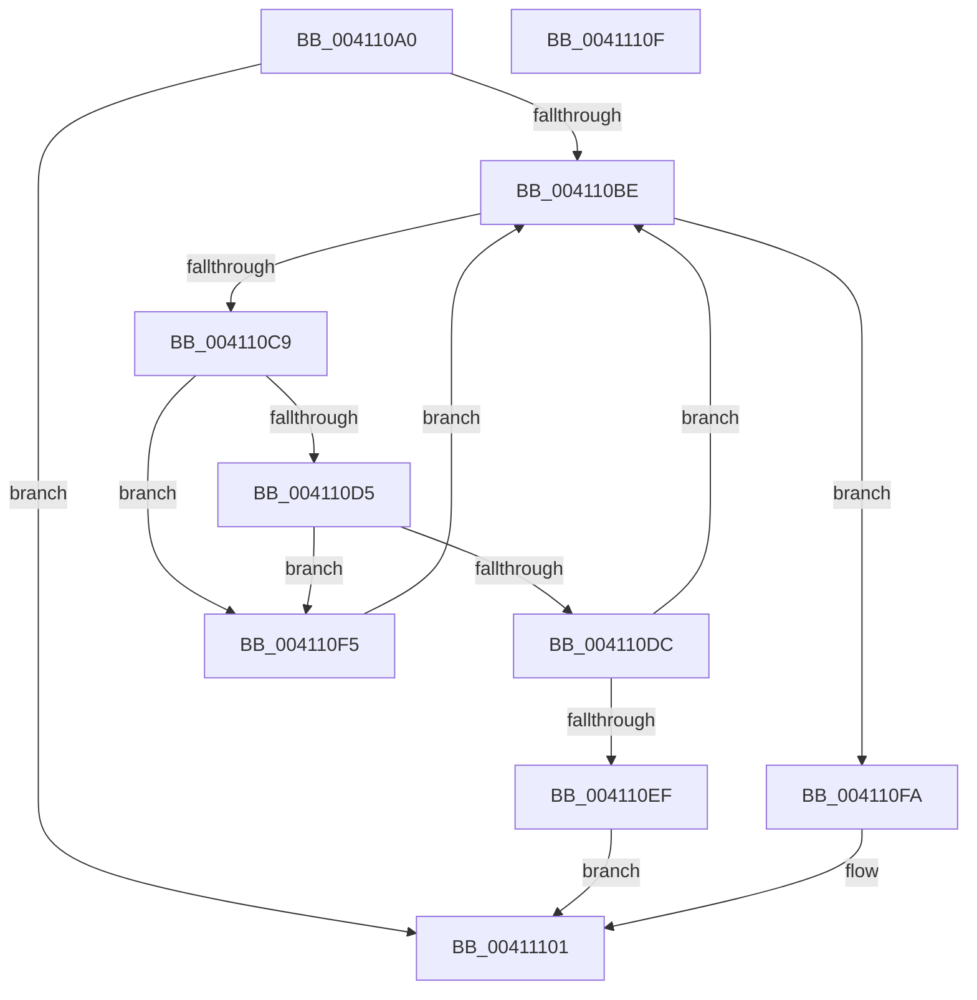

# B_TREE&lt;_SM_PAGE_KEY,ST_STORE&lt;SM_TRAITS&gt;::_ST_PAGE_ENTRY,4096,NP_CONTEXT,B_TREE_KEY_COMPARATOR&lt;_SM_PAGE_KEY&gt; &gt;::BTreeIteratorAttachEx

- RVA: `0x004110A0`–`0x00411110` (길이 `112` bytes)
- VA: `0x00000001404110A0`
- 실행 섹션: `.text`
- PDB 이름 있음: `예`; PDB Function 태그: `아니요`
- unwind 정보 RVA: `0x0005CAAC`
- 디코드: `36`개 명령, `112/112` bytes 표시
- 미해석 바이트: `0` (있으면 어셈블리에 `.byte`로 보존)

> 이 문서는 커널 이미지의 기계어와 PDB 기호를 분석해 생성했습니다. 4번과 5번은 함수 원형과 자료형을 바이너리 사용 방식에서 추정한 C 해석이며 원본 소스 복구 결과는 아닙니다.

## 1. Dependencies

- 직접 호출 지점: **1**; 고유 호출 대상: **1**
- 직접 호출자로 확인된 함수: **2**
- RIP 상대 이미지 참조: **0**

### Outgoing calls
- `0x004110E2` → [NP_CONTEXT::NpLeafRefInternal](../3A/NP_CONTEXT_NpLeafRefInternal_function_003AA340.md) (function, `0x003AA340`)

### Direct callers
- [sub_00410B56](Unknown_function_00410B56.md) at `0x00410B9D`
- [ST_STORE&lt;SM_TRAITS&gt;::StDmEtwPageRundown](../60/ST_STORE_SM_TRAITS_StDmEtwPageRundown_function_0060D544.md) at `0x0060D591`

### Static image references
- 디코드된 RIP-relative 메모리 참조가 없습니다.

## 2. Other-region calls and transfers

- 다른 실행 섹션으로 향하는 call: **0**
- 별도 외부 분기/꼬리 이동을 확인하지 못했습니다.

## 3. Assembly (complete function range)

```asm
004110A0  48 89 5C 24 08                  mov qword ptr [rsp + 8], rbx
004110A5  57                              push rdi
004110A6  48 83 EC 20                     sub rsp, 0x20
004110AA  4C 8B 02                        mov r8, qword ptr [rdx]
004110AD  0F 57 C0                        xorps xmm0, xmm0
004110B0  48 8B FA                        mov rdi, rdx
004110B3  48 8B D9                        mov rbx, rcx
004110B6  0F 11 01                        movups xmmword ptr [rcx], xmm0
004110B9  4D 85 C0                        test r8, r8
004110BC  74 43                           je 0x140411101
004110BE  41 80 78 03 00                  cmp byte ptr [r8 + 3], 0
004110C3  49 8D 50 08                     lea rdx, [r8 + 8]
004110C7  75 31                           jne 0x1404110fa
004110C9  48 8D 4F 10                     lea rcx, [rdi + 0x10]
004110CD  48 8B 01                        mov rax, qword ptr [rcx]
004110D0  83 38 FF                        cmp dword ptr [rax], -1
004110D3  74 20                           je 0x1404110f5
004110D5  41 80 78 02 02                  cmp byte ptr [r8 + 2], 2
004110DA  75 19                           jne 0x1404110f5
004110DC  41 B8 02 00 00 00               mov r8d, 2
004110E2  E8 59 92 F9 FF                  call 0x1403aa340
004110E7  4C 8B C0                        mov r8, rax
004110EA  48 85 C0                        test rax, rax
004110ED  75 CF                           jne 0x1404110be
004110EF  49 83 C8 FF                     or r8, 0xffffffffffffffff
004110F3  EB 0C                           jmp 0x140411101
004110F5  4C 8B 02                        mov r8, qword ptr [rdx]
004110F8  EB C4                           jmp 0x1404110be
004110FA  4C 89 03                        mov qword ptr [rbx], r8
004110FD  48 89 53 08                     mov qword ptr [rbx + 8], rdx
00411101  48 8B 5C 24 30                  mov rbx, qword ptr [rsp + 0x30]
00411106  49 8B C0                        mov rax, r8
00411109  48 83 C4 20                     add rsp, 0x20
0041110D  5F                              pop rdi
0041110E  C3                              ret
0041110F  CC                              int3
```

## 4. C-style interpretation (structured pseudocode)

```c
__int64 __fastcall B_TREE__SM_PAGE_KEY_ST_STORE_SM_TRAITS____ST_PAGE_ENTRY_4096_NP_CONTEXT_B_TREE_KEY_COMPARATOR__SM_PA(__int64 a1, __int64 a2)
{
    __int64 result;
    __int64 v_rsp;
    unsigned __int64 v_stack_p8;

    v_stack_p8 = v_rbx;
    v_rsp = (v_rsp) - (32);
    *(unsigned __int64 *)(a1) = v_xmm0;
    if (*(unsigned __int64 *)(a2) == 0) goto loc_00411101;
loc_004110BE:
    if ((*(unsigned __int8 *)(*(unsigned __int64 *)(a2) + 3)) != 0) goto loc_004110FA;
    if ((*(unsigned int *)(*(unsigned __int64 *)(a2 + 16))) == -1) goto loc_004110F5;
    if ((*(unsigned __int8 *)(*(unsigned __int64 *)(a2) + 2)) != 2) goto loc_004110F5;
    result = NP_CONTEXT__NpLeafRefInternal(a2 + 16, *(unsigned __int64 *)(a2) + 8, 2, a4);
    if (result != 0) goto loc_004110BE;
    a3 = (result) | (-1);
    goto loc_00411101;
loc_004110F5:
    goto loc_004110BE;
loc_004110FA:
    *(unsigned __int64 *)(a1) = *(unsigned __int64 *)(*(unsigned __int64 *)(a2) + 8);
    *(unsigned __int64 *)(a1 + 8) = *(unsigned __int64 *)(a2) + 8;
loc_00411101:
    v_rsp = (v_rsp) + (32);
    return *(unsigned __int64 *)(*(unsigned __int64 *)(a2) + 8);
}
```

## 5. (Beta) C Style

```c
int64_t B_TREE__SM_PAGE_KEY_ST_STORE_SM_TRAITS____ST_PAGE_ENTRY_4096_NP_CONTEXT_B_TREE_KEY_COMPARATOR__SM_PA(void *Arg1, void *Arg2)
{
    uint8_t *arg1 = (uint8_t *)Arg1;
    uint8_t *arg2 = (uint8_t *)Arg2;

    int64_t result;
    int64_t local_rsp;
    uint64_t v_stack_p8;

    v_stack_p8 = local_rbx;
    local_rsp = (local_rsp) - (32);
    *(uint64_t *)(arg1) = v_xmm0;
    if (*(uint64_t *)(arg2) == 0) goto loc_00411101;
loc_004110BE:
    if ((*(uint8_t *)(*(uint64_t *)(arg2) + 0x3)) != 0) goto loc_004110FA;
    if ((*(uint32_t *)(*(uint64_t *)(arg2 + 0x10))) == -1) goto loc_004110F5;
    if ((*(uint8_t *)(*(uint64_t *)(arg2) + 0x2)) != 2) goto loc_004110F5;
    result = NP_CONTEXT__NpLeafRefInternal(Arg2 + 16, *(uint64_t *)(arg2) + 8, 2, a4);
    if (result != 0) goto loc_004110BE;
    a3 = (result) | (-1);
    goto loc_00411101;
loc_004110F5:
    goto loc_004110BE;
loc_004110FA:
    *(uint64_t *)(arg1) = *(uint64_t *)(*(uint64_t *)(arg2) + 0x8);
    *(uint64_t *)(arg1 + 0x8) = *(uint64_t *)(arg2) + 8;
loc_00411101:
    local_rsp = (local_rsp) + (32);
    return *(uint64_t *)(*(uint64_t *)(arg2) + 0x8);
}
```

### 관측된 메모리 오프셋

구조체 형식이 확인되지 않은 접근은 인자 기준의 오프셋으로만 기록했습니다.

| 기준 인자 | 오프셋 표현 | 폭 (bit) | 접근 |
|---|---:|---:|---|
| `Arg1` | `+ 0x0` | `64` | `W` |
| `Arg1` | `+ 0x0` | `128` | `R` |
| `Arg1` | `+ 0x8` | `64` | `W` |
| `Arg2` | `+ 0x0` | `64` | `R` |
| `Arg2` | `+ 0x10` | `64` | `R` |

## 6. Execution-region graph

[열기: 2D/3D 그래프와 함수 탐색 컨트롤 패널](../../../control-panel.html?section=text&rva=0x004110A0&view=graph)

- 2D 그래프는 위에서 아래로 흐르고, 3D 그래프는 빈 공간을 드래그해 회전합니다. Shift+드래그는 이동, 휠은 확대·축소, 함수 노드 선택은 대상 보고서 이동입니다.

### Static fallback


