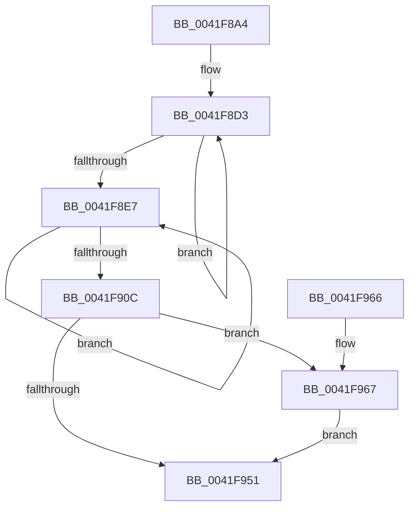

# CcAdjustVacbLevelLockCount

- RVA: `0x0041F8A4`–`0x0041F991` (길이 `237` bytes)
- VA: `0x000000014041F8A4`
- 실행 섹션: `.text`
- PDB 이름 있음: `예`; PDB Function 태그: `아니요`
- unwind 정보 RVA: `0x0009FE6C`
- 디코드: `69`개 명령, `237/237` bytes 표시
- 미해석 바이트: `0` (있으면 어셈블리에 `.byte`로 보존)

> 이 문서는 커널 이미지의 기계어와 PDB 기호를 분석해 생성했습니다. 4번과 5번은 함수 원형과 자료형을 바이너리 사용 방식에서 추정한 C 해석이며 원본 소스 복구 결과는 아닙니다.

## 1. Dependencies

- 직접 호출 지점: **2**; 고유 호출 대상: **2**
- 직접 호출자로 확인된 함수: **4**
- RIP 상대 이미지 참조: **0**

### Outgoing calls
- `0x0041F974` → [ReferenceVacbLevel](../44/ReferenceVacbLevel_function_0044F4C4.md) (function, `0x0044F4C4`)
- `0x0041F98A` → [CcSetVacbLargeOffset](../27/CcSetVacbLargeOffset_function_002733D0.md) (function, `0x002733D0`)

### Direct callers
- [CcPinFileData](../33/CcPinFileData_function_0033FB40.md) at `0x003402B2`
- [CcUnpinFileDataEx](../35/CcUnpinFileDataEx_function_00359DEC.md) at `0x0035A0F3`
- [CcDeleteBcbs](../38/CcDeleteBcbs_function_00389BF0.md) at `0x00389C95`
- [CcAllocateInitializeBcb](CcAllocateInitializeBcb_function_0041F5A4.md) at `0x0041F69A`

### Static image references
- 디코드된 RIP-relative 메모리 참조가 없습니다.

## 2. Other-region calls and transfers

- 다른 실행 섹션으로 향하는 call: **0**
- 별도 외부 분기/꼬리 이동을 확인하지 못했습니다.

## 3. Assembly (complete function range)

```asm
0041F8A4  48 89 5C 24 08                  mov qword ptr [rsp + 8], rbx
0041F8A9  48 89 6C 24 10                  mov qword ptr [rsp + 0x10], rbp
0041F8AE  48 89 74 24 18                  mov qword ptr [rsp + 0x18], rsi
0041F8B3  57                              push rdi
0041F8B4  48 83 EC 30                     sub rsp, 0x30
0041F8B8  4C 8B D1                        mov r10, rcx
0041F8BB  45 33 C9                        xor r9d, r9d
0041F8BE  48 8B DA                        mov rbx, rdx
0041F8C1  48 8B FA                        mov rdi, rdx
0041F8C4  49 8B 52 58                     mov rdx, qword ptr [r10 + 0x58]
0041F8C8  41 8D 49 19                     lea ecx, [r9 + 0x19]
0041F8CC  49 8B 72 20                     mov rsi, qword ptr [r10 + 0x20]
0041F8D0  8D 69 E8                        lea ebp, [rcx - 0x18]
0041F8D3  44 8B D9                        mov r11d, ecx
0041F8D6  48 8B C5                        mov rax, rbp
0041F8D9  83 C1 07                        add ecx, 7
0041F8DC  44 03 CD                        add r9d, ebp
0041F8DF  48 D3 E0                        shl rax, cl
0041F8E2  48 3B F0                        cmp rsi, rax
0041F8E5  7F EC                           jg 0x14041f8d3
0041F8E7  41 8B CB                        mov ecx, r11d
0041F8EA  48 8B C3                        mov rax, rbx
0041F8ED  48 D3 F8                        sar rax, cl
0041F8F0  41 83 C3 F9                     add r11d, -7
0041F8F4  8B C0                           mov eax, eax
0041F8F6  48 8B 14 C2                     mov rdx, qword ptr [rdx + rax*8]
0041F8FA  48 8B C5                        mov rax, rbp
0041F8FD  48 D3 E0                        shl rax, cl
0041F900  48 2B C5                        sub rax, rbp
0041F903  48 23 D8                        and rbx, rax
0041F906  41 83 C1 FF                     add r9d, -1
0041F90A  75 DB                           jne 0x14041f8e7
0041F90C  41 8B 82 98 00 00 00            mov eax, dword ptr [r10 + 0x98]
0041F913  41 BB 00 04 00 00               mov r11d, 0x400
0041F919  41 B9 00 02 00 00               mov r9d, 0x200
0041F91F  41 23 C1                        and eax, r9d
0041F922  F7 D8                           neg eax
0041F924  48 1B C9                        sbb rcx, rcx
0041F927  49 23 CB                        and rcx, r11
0041F92A  49 03 CB                        add rcx, r11
0041F92D  44 01 04 11                     add dword ptr [rcx + rdx], r8d
0041F931  41 8B 82 98 00 00 00            mov eax, dword ptr [r10 + 0x98]
0041F938  41 23 C1                        and eax, r9d
0041F93B  F7 D8                           neg eax
0041F93D  48 1B C0                        sbb rax, rax
0041F940  49 23 C3                        and rax, r11
0041F943  49 03 C3                        add rax, r11
0041F946  8B 0C 10                        mov ecx, dword ptr [rax + rdx]
0041F949  8B 44 10 04                     mov eax, dword ptr [rax + rdx + 4]
0041F94D  0B C1                           or eax, ecx
0041F94F  74 16                           je 0x14041f967
0041F951  48 8B 5C 24 40                  mov rbx, qword ptr [rsp + 0x40]
0041F956  48 8B 6C 24 48                  mov rbp, qword ptr [rsp + 0x48]
0041F95B  48 8B 74 24 50                  mov rsi, qword ptr [rsp + 0x50]
0041F960  48 83 C4 30                     add rsp, 0x30
0041F964  5F                              pop rdi
0041F965  C3                              ret
0041F966  CC                              int3
0041F967  44 8B CD                        mov r9d, ebp
0041F96A  89 6C 24 20                     mov dword ptr [rsp + 0x20], ebp
0041F96E  45 33 C0                        xor r8d, r8d
0041F971  49 8B CA                        mov rcx, r10
0041F974  E8 4B FB 02 00                  call 0x14044f4c4
0041F979  45 33 C9                        xor r9d, r9d
0041F97C  48 81 E7 00 00 00 FE            and rdi, 0xfffffffffe000000
0041F983  48 8B D7                        mov rdx, rdi
0041F986  4D 8D 41 FE                     lea r8, [r9 - 2]
0041F98A  E8 41 3A E5 FF                  call 0x1402733d0
0041F98F  EB C0                           jmp 0x14041f951
```

## 4. C-style interpretation (structured pseudocode)

```c
__int64 __fastcall CcAdjustVacbLevelLockCount(__int64 a1, __int64 a2, int a3, int a4)
{
    __int64 result;
    __int64 v_r11;
    __int64 v_rbx;
    __int64 v_rdi;
    __int64 v_rsp;
    unsigned __int64 v_stack_p10;
    unsigned __int64 v_stack_p18;
    unsigned int v_stack_p20;
    unsigned __int64 v_stack_p8;

    v_stack_p8 = v_rbx;
    v_stack_p10 = v_rbp;
    v_stack_p18 = v_rsi;
    v_rsp = (v_rsp) - (48);
    a4 = 0;
loc_0041F8D3:
    a1 = (unsigned int)((a4 + 25) + (7));
    a4 = (unsigned int)((a4) + ((unsigned int)(a4 + 25 - 24)));
    result = (a4 + 25 - 24) << ((unsigned __int8)(a1));
    if ((*(unsigned __int64 *)(a1 + 32)) > result) goto loc_0041F8D3;
loc_0041F8E7:
    result = (a2) >> ((unsigned __int8)((unsigned int)((unsigned int)((unsigned int)((unsigned int)(a4 + 25))))));
    v_r11 = (unsigned int)(((unsigned int)((unsigned int)(a4 + 25))) + (-7));
    result = (a4 + 25 - 24) << ((unsigned __int8)((unsigned int)((unsigned int)((unsigned int)((unsigned int)(a4 + 25))))));
    result = (result) - (a4 + 25 - 24);
    v_rbx = (a2) & (result);
    a4 = (unsigned int)((a4) + (-1));
    if (condition_is_not_equal) goto loc_0041F8E7;
    result = (unsigned int)(((unsigned int)(*(unsigned int *)(a1 + 152))) & (512));
    result = (unsigned int)(-(result));
    a1 = ((unsigned int)((unsigned int)((unsigned int)((unsigned int)(a4 + 25))))) & ((unsigned int)(0x400ULL));
    a1 = (a1) + ((unsigned int)(0x400ULL));
    result = (unsigned int)(((unsigned int)(*(unsigned int *)(a1 + 152))) & (512));
    result = (unsigned int)(-(result));
    result = (result) & ((unsigned int)(0x400ULL));
    result = (result) + ((unsigned int)(0x400ULL));
    result = (unsigned int)(((unsigned int)(*(unsigned int *)(result + *(unsigned __int64 *)(*(unsigned __int64 *)(a1 + 88) + (unsigned int)((unsigned int)(result)) * 8) * 1 + 4))) | ((unsigned int)((unsigned int)(*(unsigned int *)(result + *(unsigned __int64 *)(*(unsigned __int64 *)(a1 + 88) + (unsigned int)((unsigned int)(result)) * 8) * 1)))));
    if (condition_is_equal) goto loc_0041F967;
loc_0041F951:
    v_rsp = (v_rsp) + (48);
    return result;
loc_0041F967:
    v_stack_p20 = (unsigned int)(v_stack_p10);
    a3 = 0;
    result = ReferenceVacbLevel(a1, *(unsigned __int64 *)(*(unsigned __int64 *)(a1 + 88) + (unsigned int)((unsigned int)(result)) * 8), a3, (unsigned int)((unsigned int)(v_stack_p10)));
    a4 = 0;
    v_rdi = (a2) & (0xFFFFFFFFFE000000ULL);
    result = CcSetVacbLargeOffset(a1, v_rdi, a4 - 2, a4);
    goto loc_0041F951;
}
```

## 5. (Beta) C Style

```c
int64_t CcAdjustVacbLevelLockCount(void *Arg1, int64_t Arg2, int32_t Arg3, int32_t Arg4)
{
    uint8_t *arg1 = (uint8_t *)Arg1;

    int64_t result;
    int64_t local_r11;
    int64_t local_rbx;
    int64_t local_rdi;
    int64_t local_rsp;
    uint64_t v_stack_p10;
    uint64_t v_stack_p18;
    uint32_t v_stack_p20;
    uint64_t v_stack_p8;

    v_stack_p8 = local_rbx;
    v_stack_p10 = local_rbp;
    v_stack_p18 = local_rsi;
    local_rsp = (local_rsp) - (48);
    Arg4 = 0;
loc_0041F8D3:
    Arg1 = (uint32_t)((Arg4 + 25) + (7));
    Arg4 = (uint32_t)((Arg4) + ((uint32_t)(Arg4 + 25 - 24)));
    result = (Arg4 + 25 - 24) << ((uint8_t)(Arg1));
    if ((*(uint64_t *)(arg1 + 0x20)) > result) goto loc_0041F8D3;
loc_0041F8E7:
    result = (Arg2) >> ((uint8_t)((uint32_t)((uint32_t)((uint32_t)((uint32_t)(Arg4 + 25))))));
    local_r11 = (uint32_t)(((uint32_t)((uint32_t)(Arg4 + 25))) + (-7));
    result = (Arg4 + 25 - 24) << ((uint8_t)((uint32_t)((uint32_t)((uint32_t)((uint32_t)(Arg4 + 25))))));
    result = (result) - (Arg4 + 25 - 24);
    local_rbx = (Arg2) & (result);
    Arg4 = (uint32_t)((Arg4) + (-1));
    if (condition_is_not_equal) goto loc_0041F8E7;
    result = (uint32_t)(((uint32_t)(*(uint32_t *)(arg1 + 0x98))) & (512));
    result = (uint32_t)(-(result));
    Arg1 = ((uint32_t)((uint32_t)((uint32_t)((uint32_t)(Arg4 + 25))))) & ((uint32_t)(0x400ULL));
    Arg1 = (Arg1) + ((uint32_t)(0x400ULL));
    result = (uint32_t)(((uint32_t)(*(uint32_t *)(arg1 + 0x98))) & (512));
    result = (uint32_t)(-(result));
    result = (result) & ((uint32_t)(0x400ULL));
    result = (result) + ((uint32_t)(0x400ULL));
    result = (uint32_t)(((uint32_t)(*(uint32_t *)(result + *(uint64_t *)(*(uint64_t *)(arg1 + 0x58) + (uint32_t)((uint32_t)(result)) * 8) * 1 + 0x4))) | ((uint32_t)((uint32_t)(*(uint32_t *)(result + *(uint64_t *)(*(uint64_t *)(arg1 + 0x58) + (uint32_t)((uint32_t)(result)) * 8) * 1)))));
    if (condition_is_equal) goto loc_0041F967;
loc_0041F951:
    local_rsp = (local_rsp) + (48);
    return result;
loc_0041F967:
    v_stack_p20 = (uint32_t)(v_stack_p10);
    Arg3 = 0;
    result = ReferenceVacbLevel(Arg1, *(uint64_t *)(*(uint64_t *)(arg1 + 0x58) + (uint32_t)((uint32_t)(result)) * 8), Arg3, (uint32_t)((uint32_t)(v_stack_p10)));
    Arg4 = 0;
    local_rdi = (Arg2) & (0xFFFFFFFFFE000000ULL);
    result = CcSetVacbLargeOffset(Arg1, local_rdi, Arg4 - 2, Arg4);
    goto loc_0041F951;
}
```

### 관측된 메모리 오프셋

구조체 형식이 확인되지 않은 접근은 인자 기준의 오프셋으로만 기록했습니다.

| 기준 인자 | 오프셋 표현 | 폭 (bit) | 접근 |
|---|---:|---:|---|
| `Arg1` | `+ 0x20` | `64` | `R` |
| `Arg1` | `+ 0x58` | `64` | `R` |
| `Arg1` | `+ 0x98` | `32` | `R` |

## 6. Execution-region graph

[열기: 2D/3D 그래프와 함수 탐색 컨트롤 패널](../../../control-panel.html?section=text&rva=0x0041F8A4&view=graph)

- 2D 그래프는 위에서 아래로 흐르고, 3D 그래프는 빈 공간을 드래그해 회전합니다. Shift+드래그는 이동, 휠은 확대·축소, 함수 노드 선택은 대상 보고서 이동입니다.

### Static fallback


