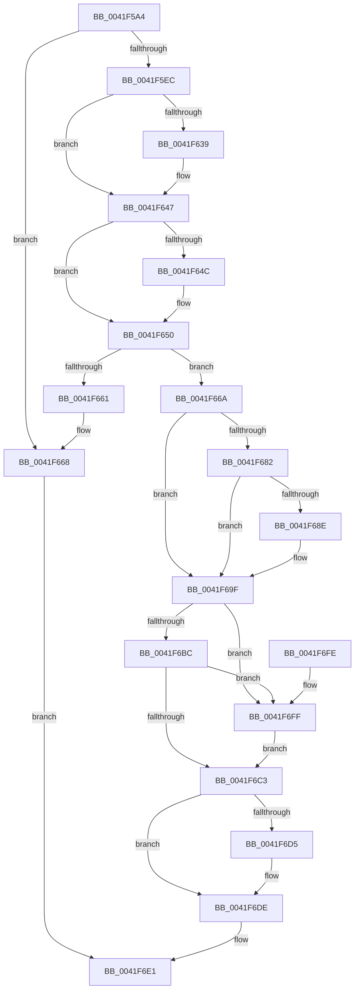

# CcAllocateInitializeBcb

- RVA: `0x0041F5A4`–`0x0041F709` (길이 `357` bytes)
- VA: `0x000000014041F5A4`
- 실행 섹션: `.text`
- PDB 이름 있음: `예`; PDB Function 태그: `아니요`
- unwind 정보 RVA: `0x0009FE3C`
- 디코드: `102`개 명령, `357/357` bytes 표시
- 미해석 바이트: `0` (있으면 어셈블리에 `.byte`로 보존)

> 이 문서는 커널 이미지의 기계어와 PDB 기호를 분석해 생성했습니다. 4번과 5번은 함수 원형과 자료형을 바이너리 사용 방식에서 추정한 C 해석이며 원본 소스 복구 결과는 아닙니다.

## 1. Dependencies

- 직접 호출 지점: **8**; 고유 호출 대상: **8**
- 직접 호출자로 확인된 함수: **1**
- RIP 상대 이미지 참조: **0**

### Outgoing calls
- `0x0041F5DC` → [ExAllocatePoolWithTag](../../poolcode/B8/ExAllocatePoolWithTag_function_00B82010.md) (function, `0x00B82010`)
- `0x0041F618` → [ExInitializeResourceLite2](ExInitializeResourceLite2_function_0041F710.md) (function, `0x0041F710`)
- `0x0041F629` → [KeAbPreAcquire](../21/KeAbPreAcquire_function_00210230.md) (function, `0x00210230`)
- `0x0041F642` → [ExfAcquirePushLockExclusiveEx](../20/ExfAcquirePushLockExclusiveEx_function_0020FC90.md) (function, `0x0020FC90`)
- `0x0041F69A` → [CcAdjustVacbLevelLockCount](CcAdjustVacbLevelLockCount_function_0041F8A4.md) (function, `0x0041F8A4`)
- `0x0041F6C6` → [KeAbPostRelease](../2E/KeAbPostRelease_function_002E1600.md) (function, `0x002E1600`)
- `0x0041F6D9` → [ExDisableResourceBoostLite](ExDisableResourceBoostLite_function_0041F840.md) (function, `0x0041F840`)
- `0x0041F702` → [ExfReleasePushLock](../26/ExfReleasePushLock_function_002638D0.md) (function, `0x002638D0`)

### Direct callers
- [CcPinFileData](../33/CcPinFileData_function_0033FB40.md) at `0x0034024B`

### Static image references
- 디코드된 RIP-relative 메모리 참조가 없습니다.

## 2. Other-region calls and transfers

- 다른 실행 섹션으로 향하는 call: **1**
  - `0x0041F5DC` → [ExAllocatePoolWithTag](../../poolcode/B8/ExAllocatePoolWithTag_function_00B82010.md) (`.text` → `POOLCODE`)
- 별도 외부 분기/꼬리 이동을 확인하지 못했습니다.

## 3. Assembly (complete function range)

```asm
0041F5A4  48 89 5C 24 08                  mov qword ptr [rsp + 8], rbx
0041F5A9  48 89 6C 24 10                  mov qword ptr [rsp + 0x10], rbp
0041F5AE  48 89 74 24 18                  mov qword ptr [rsp + 0x18], rsi
0041F5B3  57                              push rdi
0041F5B4  41 54                           push r12
0041F5B6  41 55                           push r13
0041F5B8  41 56                           push r14
0041F5BA  41 57                           push r15
0041F5BC  48 83 EC 20                     sub rsp, 0x20
0041F5C0  4D 8B F0                        mov r14, r8
0041F5C3  4C 8B FA                        mov r15, rdx
0041F5C6  48 8B F9                        mov rdi, rcx
0041F5C9  BA C0 00 00 00                  mov edx, 0xc0
0041F5CE  B9 00 06 00 00                  mov ecx, 0x600
0041F5D3  41 B8 43 63 42 63               mov r8d, 0x63426343
0041F5D9  49 8B D9                        mov rbx, r9
0041F5DC  E8 2F 2A 76 00                  call 0x140b82010
0041F5E1  45 33 ED                        xor r13d, r13d
0041F5E4  48 8B F0                        mov rsi, rax
0041F5E7  48 85 C0                        test rax, rax
0041F5EA  74 7C                           je 0x14041f668
0041F5EC  66 C7 00 FD 02                  mov word ptr [rax], 0x2fd
0041F5F1  48 8D 4E 48                     lea rcx, [rsi + 0x48]
0041F5F5  49 8B 06                        mov rax, qword ptr [r14]
0041F5F8  83 CA FF                        or edx, 0xffffffff
0041F5FB  48 89 46 08                     mov qword ptr [rsi + 8], rax
0041F5FF  8B 03                           mov eax, dword ptr [rbx]
0041F601  89 46 04                        mov dword ptr [rsi + 4], eax
0041F604  49 8B 06                        mov rax, qword ptr [r14]
0041F607  48 03 03                        add rax, qword ptr [rbx]
0041F60A  FF 46 40                        inc dword ptr [rsi + 0x40]
0041F60D  48 89 46 20                     mov qword ptr [rsi + 0x20], rax
0041F611  48 89 BE B0 00 00 00            mov qword ptr [rsi + 0xb0], rdi
0041F618  E8 F3 00 00 00                  call 0x14041f710
0041F61D  48 8D 5F 68                     lea rbx, [rdi + 0x68]
0041F621  45 33 C0                        xor r8d, r8d
0041F624  48 8B CB                        mov rcx, rbx
0041F627  33 D2                           xor edx, edx
0041F629  E8 02 0C DF FF                  call 0x140210230
0041F62E  F0 48 0F BA 2B 00               lock bts qword ptr [rbx], 0
0041F634  48 8B E8                        mov rbp, rax
0041F637  73 0E                           jae 0x14041f647
0041F639  4C 8B C3                        mov r8, rbx
0041F63C  48 8B D0                        mov rdx, rax
0041F63F  48 8B CB                        mov rcx, rbx
0041F642  E8 49 06 DF FF                  call 0x14020fc90
0041F647  48 85 ED                        test rbp, rbp
0041F64A  74 04                           je 0x14041f650
0041F64C  C6 45 0A 01                     mov byte ptr [rbp + 0xa], 1
0041F650  49 8D 4F 10                     lea rcx, [r15 + 0x10]
0041F654  48 8B 51 08                     mov rdx, qword ptr [rcx + 8]
0041F658  48 8D 46 10                     lea rax, [rsi + 0x10]
0041F65C  48 39 0A                        cmp qword ptr [rdx], rcx
0041F65F  74 09                           je 0x14041f66a
0041F661  B9 03 00 00 00                  mov ecx, 3
0041F666  CD 29                           int 0x29
0041F668  EB 77                           jmp 0x14041f6e1
0041F66A  48 89 08                        mov qword ptr [rax], rcx
0041F66D  48 89 50 08                     mov qword ptr [rax + 8], rdx
0041F671  48 89 02                        mov qword ptr [rdx], rax
0041F674  48 89 41 08                     mov qword ptr [rcx + 8], rax
0041F678  48 81 7F 20 00 00 00 02         cmp qword ptr [rdi + 0x20], 0x2000000
0041F680  7E 1D                           jle 0x14041f69f
0041F682  F7 87 98 00 00 00 00 02 00 00   test dword ptr [rdi + 0x98], 0x200
0041F68C  74 11                           je 0x14041f69f
0041F68E  49 8B 16                        mov rdx, qword ptr [r14]
0041F691  41 B8 01 00 00 00               mov r8d, 1
0041F697  48 8B CF                        mov rcx, rdi
0041F69A  E8 05 02 00 00                  call 0x14041f8a4
0041F69F  0F 0D 0B                        prefetchw byte ptr [rbx]
0041F6A2  48 8B 03                        mov rax, qword ptr [rbx]
0041F6A5  48 8B C8                        mov rcx, rax
0041F6A8  48 83 E1 F0                     and rcx, 0xfffffffffffffff0
0041F6AC  48 83 F9 10                     cmp rcx, 0x10
0041F6B0  48 8D 50 F0                     lea rdx, [rax - 0x10]
0041F6B4  49 0F 46 D5                     cmovbe rdx, r13
0041F6B8  A8 02                           test al, 2
0041F6BA  75 43                           jne 0x14041f6ff
0041F6BC  F0 48 0F B1 13                  lock cmpxchg qword ptr [rbx], rdx
0041F6C1  75 3C                           jne 0x14041f6ff
0041F6C3  48 8B CB                        mov rcx, rbx
0041F6C6  E8 35 1F EC FF                  call 0x1402e1600
0041F6CB  8B 87 98 00 00 00               mov eax, dword ptr [rdi + 0x98]
0041F6D1  A8 02                           test al, 2
0041F6D3  74 09                           je 0x14041f6de
0041F6D5  48 8D 4E 48                     lea rcx, [rsi + 0x48]
0041F6D9  E8 62 01 00 00                  call 0x14041f840
0041F6DE  48 8B C6                        mov rax, rsi
0041F6E1  48 8B 5C 24 50                  mov rbx, qword ptr [rsp + 0x50]
0041F6E6  48 8B 6C 24 58                  mov rbp, qword ptr [rsp + 0x58]
0041F6EB  48 8B 74 24 60                  mov rsi, qword ptr [rsp + 0x60]
0041F6F0  48 83 C4 20                     add rsp, 0x20
0041F6F4  41 5F                           pop r15
0041F6F6  41 5E                           pop r14
0041F6F8  41 5D                           pop r13
0041F6FA  41 5C                           pop r12
0041F6FC  5F                              pop rdi
0041F6FD  C3                              ret
0041F6FE  CC                              int3
0041F6FF  48 8B CB                        mov rcx, rbx
0041F702  E8 C9 41 E4 FF                  call 0x1402638d0
0041F707  EB BA                           jmp 0x14041f6c3
```

## 4. C-style interpretation (structured pseudocode)

```c
__int64 __fastcall CcAllocateInitializeBcb(__int64 a1, __int64 a2, __int64 a3, __int64 a4)
{
    __int64 result;
    __int64 v_r13;
    __int64 v_rsp;
    unsigned __int64 v_stack_p10;
    unsigned __int64 v_stack_p18;
    unsigned __int64 v_stack_p8;

    v_stack_p8 = v_rbx;
    v_stack_p10 = v_rbp;
    v_stack_p18 = v_rsi;
    v_rsp = (v_rsp) - (32);
    result = ExAllocatePoolWithTag((unsigned int)(0x600ULL), 192, (unsigned int)(0x63426343ULL), a4);
    v_r13 = 0;
    if (result == 0) goto loc_0041F668;
    *(unsigned __int16 *)(result) = 765;
    a2 = (unsigned int)((192) | (0xFFFFFFFFULL));
    *(unsigned __int64 *)(result + 8) = *(unsigned __int64 *)(a3);
    *(unsigned int *)(result + 4) = (unsigned int)((unsigned int)(*(unsigned int *)(a4)));
    result = (*(unsigned __int64 *)(a3)) + (*(unsigned __int64 *)(a4));
    *(unsigned __int64 *)(result + 32) = result;
    *(unsigned __int64 *)(result + 176) = a1;
    result = ExInitializeResourceLite2(result + 72, a2, (unsigned int)(0x63426343ULL), a4);
    a3 = 0;
    a2 = 0;
    result = KeAbPreAcquire(a1 + 104, a2, a3, a4);
    if (!(condition_is_above_or_equal)) {
        a3 = a1 + 104;
        a2 = result;
        a1 = a1 + 104;
        result = ExfAcquirePushLockExclusiveEx(a1, a2, a3, a4);
    }
    if (result != 0) {
        *(unsigned __int8 *)(result + 10) = 1;
    }
    if ((*(unsigned __int64 *)(*(unsigned __int64 *)(a2 + 16 + 8))) == (a2 + 16)) goto loc_0041F66A;
loc_0041F668:
    goto loc_0041F6E1;
loc_0041F66A:
    *(unsigned __int64 *)(result + 16) = 3;
    *(unsigned __int64 *)(result + 16 + 8) = *(unsigned __int64 *)(a2 + 16 + 8);
    *(unsigned __int64 *)(*(unsigned __int64 *)(a2 + 16 + 8)) = result + 16;
    *(unsigned __int64 *)(3 + 8) = result + 16;
    if ((*(unsigned __int64 *)(a1 + 32)) <= 0x2000000ULL) goto loc_0041F69F;
    result = result + 16;
    if (((*(unsigned int *)(a1 + 152)) & (512)) != 0) {
        a2 = *(unsigned __int64 *)(a3);
        a3 = 1;
        a1 = a1;
        result = CcAdjustVacbLevelLockCount(a1, a2, a3, a4);
    }
    a1 = (*(unsigned __int64 *)(a1 + 104)) & (-16);
    a2 = *(unsigned __int64 *)(a1 + 104) - 16;
    if (a1 <= 16) { a2 = 0; }
    if ((((unsigned __int8)(*(unsigned __int64 *)(a1 + 104))) & (2)) != 0) goto loc_0041F6FF;
    if ((((unsigned __int8)(*(unsigned __int64 *)(a1 + 104))) & (2)) != 0) goto loc_0041F6FF;
loc_0041F6C3:
    result = KeAbPostRelease(a1 + 104, a2, a3, a4);
    result = (unsigned int)(*(unsigned int *)(a1 + 152));
    if ((((unsigned __int8)((unsigned int)(*(unsigned int *)(a1 + 152)))) & (2)) != 0) {
        a1 = result + 72;
        result = ExDisableResourceBoostLite(a1, a2, a3, a4);
    }
loc_0041F6E1:
    v_rsp = (v_rsp) + (32);
    return result;
loc_0041F6FF:
    result = ExfReleasePushLock(v_stack_p8, a2, a3, a4);
    goto loc_0041F6C3;
}
```

## 5. (Beta) C Style

```c
int64_t CcAllocateInitializeBcb(void *Arg1, void *Arg2, void *Arg3, void *Arg4)
{
    uint8_t *arg1 = (uint8_t *)Arg1;
    uint8_t *arg2 = (uint8_t *)Arg2;
    uint8_t *arg3 = (uint8_t *)Arg3;
    uint8_t *arg4 = (uint8_t *)Arg4;

    int64_t result;
    int64_t local_r13;
    int64_t local_rsp;
    uint64_t v_stack_p10;
    uint64_t v_stack_p18;
    uint64_t v_stack_p8;

    v_stack_p8 = local_rbx;
    v_stack_p10 = local_rbp;
    v_stack_p18 = local_rsi;
    local_rsp = (local_rsp) - (32);
    result = ExAllocatePoolWithTag((uint32_t)(0x600ULL), 192, (uint32_t)(0x63426343ULL), Arg4);
    local_r13 = 0;
    if (result == 0) goto loc_0041F668;
    *(uint16_t *)(result) = 765;
    Arg2 = (uint32_t)((192) | (0xFFFFFFFFULL));
    *(uint64_t *)(result + 0x8) = *(uint64_t *)(arg3);
    *(uint32_t *)(result + 0x4) = (uint32_t)((uint32_t)(*(uint32_t *)(arg4)));
    result = (*(uint64_t *)(arg3)) + (*(uint64_t *)(arg4));
    *(uint64_t *)(result + 0x20) = result;
    *(void **)(result + 0xB0) = Arg1;
    result = ExInitializeResourceLite2(result + 72, Arg2, (uint32_t)(0x63426343ULL), Arg4);
    Arg3 = 0;
    Arg2 = 0;
    result = KeAbPreAcquire(Arg1 + 104, Arg2, Arg3, Arg4);
    if (!(condition_is_above_or_equal)) {
        Arg3 = Arg1 + 104;
        Arg2 = result;
        Arg1 = Arg1 + 104;
        result = ExfAcquirePushLockExclusiveEx(Arg1, Arg2, Arg3, Arg4);
    }
    if (result != 0) {
        *(uint8_t *)(result + 0xA) = 1;
    }
    if ((*(uint64_t *)(*(uint64_t *)(arg2 + 0x10 + 0x8))) == (Arg2 + 16)) goto loc_0041F66A;
loc_0041F668:
    goto loc_0041F6E1;
loc_0041F66A:
    *(uint64_t *)(result + 0x10) = 3;
    *(uint64_t *)(result + 0x10 + 0x8) = *(uint64_t *)(arg2 + 0x10 + 0x8);
    *(uint64_t *)(*(uint64_t *)(arg2 + 0x10 + 0x8)) = result + 16;
    *(uint64_t *)(3 + 0x8) = result + 16;
    if ((*(uint64_t *)(arg1 + 0x20)) <= 0x2000000ULL) goto loc_0041F69F;
    result = result + 16;
    if (((*(uint32_t *)(arg1 + 0x98)) & (512)) != 0) {
        Arg2 = *(uint64_t *)(arg3);
        Arg3 = 1;
        Arg1 = Arg1;
        result = CcAdjustVacbLevelLockCount(Arg1, Arg2, Arg3, Arg4);
    }
    Arg1 = (*(uint64_t *)(arg1 + 0x68)) & (-16);
    Arg2 = *(uint64_t *)(arg1 + 0x68) - 16;
    if (Arg1 <= 16) { Arg2 = 0; }
    if ((((uint8_t)(*(uint64_t *)(arg1 + 0x68))) & (2)) != 0) goto loc_0041F6FF;
    if ((((uint8_t)(*(uint64_t *)(arg1 + 0x68))) & (2)) != 0) goto loc_0041F6FF;
loc_0041F6C3:
    result = KeAbPostRelease(Arg1 + 104, Arg2, Arg3, Arg4);
    result = (uint32_t)(*(uint32_t *)(arg1 + 0x98));
    if ((((uint8_t)((uint32_t)(*(uint32_t *)(arg1 + 0x98)))) & (2)) != 0) {
        Arg1 = result + 72;
        result = ExDisableResourceBoostLite(Arg1, Arg2, Arg3, Arg4);
    }
loc_0041F6E1:
    local_rsp = (local_rsp) + (32);
    return result;
loc_0041F6FF:
    result = ExfReleasePushLock(v_stack_p8, Arg2, Arg3, Arg4);
    goto loc_0041F6C3;
}
```

### 관측된 메모리 오프셋

구조체 형식이 확인되지 않은 접근은 인자 기준의 오프셋으로만 기록했습니다.

| 기준 인자 | 오프셋 표현 | 폭 (bit) | 접근 |
|---|---:|---:|---|
| `Arg1` | `+ 0x0` | `8` | `R` |
| `Arg1` | `+ 0x0` | `64` | `R` |
| `Arg1` | `+ 0x0` | `64` | `R/W` |
| `Arg1` | `+ 0x20` | `64` | `R` |
| `Arg1` | `+ 0x68` | `64` | `R` |
| `Arg1` | `+ 0x98` | `32` | `R` |
| `Arg2` | `+ 0x8` | `64` | `R` |
| `Arg2` | `+ 0x8` | `64` | `W` |
| `Arg2` | `+ 0x10` | `64` | `R` |
| `Arg3` | `+ 0x0` | `64` | `R` |
| `Arg4` | `+ 0x0` | `32` | `R` |
| `Arg4` | `+ 0x0` | `64` | `R` |

## 6. Execution-region graph

[열기: 2D/3D 그래프와 함수 탐색 컨트롤 패널](../../../control-panel.html?section=text&rva=0x0041F5A4&view=graph)

- 2D 그래프는 위에서 아래로 흐르고, 3D 그래프는 빈 공간을 드래그해 회전합니다. Shift+드래그는 이동, 휠은 확대·축소, 함수 노드 선택은 대상 보고서 이동입니다.

### Static fallback


