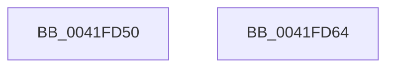

# CmCleanupThreadInfo

- RVA: `0x0041FD50`–`0x0041FD65` (길이 `21` bytes)
- VA: `0x000000014041FD50`
- 실행 섹션: `.text`
- PDB 이름 있음: `예`; PDB Function 태그: `아니요`
- unwind 정보 RVA: `0x000DB714`
- 디코드: `5`개 명령, `21/21` bytes 표시
- 미해석 바이트: `0` (있으면 어셈블리에 `.byte`로 보존)

> 이 문서는 커널 이미지의 기계어와 PDB 기호를 분석해 생성했습니다. 4번과 5번은 함수 원형과 자료형을 바이너리 사용 방식에서 추정한 C 해석이며 원본 소스 복구 결과는 아닙니다.

## 1. Dependencies

- 직접 호출 지점: **0**; 고유 호출 대상: **0**
- 직접 호출자로 확인된 함수: **77**
- RIP 상대 이미지 참조: **0**

### Outgoing calls
- 직접 디코드된 call 명령이 없습니다.

### Direct callers
- [ExpWatchProductTypeWork](../../page/6F/ExpWatchProductTypeWork_function_006FFCA0.md) at `0x007002A8`
- [CmpVolumeManagerCreateContextsForWellKnownVolumes](../../page/70/CmpVolumeManagerCreateContextsForWellKnownVolumes_function_007023B0.md) at `0x0070242F`
- [PspDeleteExternalServerSiloState](../../page/77/PspDeleteExternalServerSiloState_function_0077FB88.md) at `0x0077FC05`
- [CmpFinishSystemHivesLoad](../../page/7D/CmpFinishSystemHivesLoad_function_007DA210.md) at `0x007DAC3E`
- [CmpLoadHiveThread](../../page/7D/CmpLoadHiveThread_function_007DB040.md) at `0x007DB3FE`
- [CmOpenKeyForBugCheckRecovery](../../page/7D/CmOpenKeyForBugCheckRecovery_function_007DF3C0.md) at `0x007DF54B`
- [NtCompactKeys](../../page/7D/NtCompactKeys_function_007DF730.md) at `0x007DF99B`
- [NtCompressKey](../../page/7D/NtCompressKey_function_007DF9D0.md) at `0x007DFB92`
- [NtFreezeRegistry](../../page/7D/NtFreezeRegistry_function_007DFBD0.md) at `0x007DFC69`
- [NtInitializeRegistry](../../page/7D/NtInitializeRegistry_function_007DFC90.md) at `0x007DFD44`
- [NtLockRegistryKey](../../page/7D/NtLockRegistryKey_function_007DFD60.md) at `0x007DFE07`
- [NtOpenRegistryTransaction](../../page/7D/NtOpenRegistryTransaction_function_007DFE40.md) at `0x007DFF54`
- [NtQueryOpenSubKeys](../../page/7D/NtQueryOpenSubKeys_function_007DFF80.md) at `0x007E0153`
- [NtQueryOpenSubKeysEx](../../page/7E/NtQueryOpenSubKeysEx_function_007E0190.md) at `0x007E047D`
- [NtRenameKey](../../page/7E/NtRenameKey_function_007E04B0.md) at `0x007E0928`
- [NtReplaceKey](../../page/7E/NtReplaceKey_function_007E0970.md) at `0x007E0BB7`
- [NtRestoreKey](../../page/7E/NtRestoreKey_function_007E0CC0.md) at `0x007E0EF4`
- [NtRollbackRegistryTransaction](../../page/7E/NtRollbackRegistryTransaction_function_007E0F30.md) at `0x007E1017`
- [NtSaveMergedKeys](../../page/7E/NtSaveMergedKeys_function_007E1070.md) at `0x007E118D`
- [NtThawRegistry](../../page/7E/NtThawRegistry_function_007E1320.md) at `0x007E13A6`
- [NtUnloadKey2](../../page/7E/NtUnloadKey2_function_007E13D0.md) at `0x007E140C`
- [CmUnRegisterCallback](../../page/7E/CmUnRegisterCallback_function_007E1510.md) at `0x007E1624`
- [CmpEnumerateCallback](../../page/7E/CmpEnumerateCallback_function_007E18D0.md) at `0x007E197E`
- [CmpCloneHwProfile](../../page/7E/CmpCloneHwProfile_function_007E303C.md) at `0x007E3808`
- [CmShutdownSystem](../../page/7E/CmShutdownSystem_function_007E5174.md) at `0x007E51BD`
- [CmInitServerSiloState](../../page/7E/CmInitServerSiloState_function_007E5B14.md) at `0x007E5B7F`
- [CmReconcileAndValidateAllHives](../../page/7E/CmReconcileAndValidateAllHives_function_007E7D90.md) at `0x007E7DFF`
- [CmpFreezeThawWorker](../../page/7E/CmpFreezeThawWorker_function_007E8670.md) at `0x007E86A7`
- [CmpBuildMachineHiveCache](../../page/7E/CmpBuildMachineHiveCache_function_007E8B74.md) at `0x007E8C90`
- [CmpMachineHiveCachePopulateEntry](../../page/7E/CmpMachineHiveCachePopulateEntry_function_007E8E88.md) at `0x007E8F29`
- [CmpLazyCommitWorker](../../page/7E/CmpLazyCommitWorker_function_007EE030.md) at `0x007EE1D9`
- [CmpHiveCachePnpNotificationCallback](../../page/7F/CmpHiveCachePnpNotificationCallback_function_007F5D80.md) at `0x007F5E84`
- [CmpHiveCachePopulateHiveEntryThread](../../page/7F/CmpHiveCachePopulateHiveEntryThread_function_007F5FD0.md) at `0x007F63B1`
- [NtSetInformationKey](../../page/84/NtSetInformationKey_function_00843720.md) at `0x00843BA3`
- [NtSetValueKey](../../page/84/NtSetValueKey_function_00844EA0.md) at `0x00845609`
- [NtDeleteValueKey](../../page/84/NtDeleteValueKey_function_00848770.md) at `0x00848C12`
- [NtDeleteKey](../../page/84/NtDeleteKey_function_00849920.md) at `0x00849C4A`
- [sub_0084D378](../../page/84/Unknown_function_0084D378.md) at `0x0084D381`
- [CmpCloseKeyObject](../../page/86/CmpCloseKeyObject_function_00863AD0.md) at `0x00863B70`
- [sub_0086560A](../../page/86/Unknown_function_0086560A.md) at `0x00865B1F`
- [sub_00865C54](../../page/86/Unknown_function_00865C54.md) at `0x00865C58`
- [NtQueryKey](../../page/86/NtQueryKey_function_008676E0.md) at `0x00867BB4`
- [CmpSecurityMethod](../../page/87/CmpSecurityMethod_function_00870CC0.md) at `0x00871072`
- [NtOpenKeyTransactedEx](../../page/87/NtOpenKeyTransactedEx_function_00874EC0.md) at `0x00874FE5`
- [CmLoadDifferencingKey](../../page/87/CmLoadDifferencingKey_function_00875670.md) at `0x00875F54`
- [CmpParseKey](../../page/89/CmpParseKey_function_0089DDC0.md) at `0x0089E1FE`
- [NtQueryMultipleValueKey](../../page/8B/NtQueryMultipleValueKey_function_008B13B0.md) at `0x008B1929`
- [NtEnumerateKey](../../page/8B/NtEnumerateKey_function_008B1F70.md) at `0x008B2370`
- [NtQueryValueKey](../../page/8B/NtQueryValueKey_function_008B2A00.md) at `0x008B2F92`
- [NtEnumerateValueKey](../../page/8B/NtEnumerateValueKey_function_008B3B50.md) at `0x008B4236`
- [CmNotifyRunDown](../../page/90/CmNotifyRunDown_function_00906984.md) at `0x00906A3A`
- [sub_0093691A](../../page/93/Unknown_function_0093691A.md) at `0x00936B7B`
- [sub_00936BC3](../../page/93/Unknown_function_00936BC3.md) at `0x00936BC8`
- [CmpRegisterCallbackInternal](../../page/97/CmpRegisterCallbackInternal_function_0097D54C.md) at `0x0097D635`
- [NtCommitRegistryTransaction](../../page/9A/NtCommitRegistryTransaction_function_009AEAF0.md) at `0x009AEBAE`
- [NtUnloadKeyEx](../../page/9A/NtUnloadKeyEx_function_009AEC50.md) at `0x009AEC88`
- [NtUnloadKey](../../page/9A/NtUnloadKey_function_009AF2B0.md) at `0x009AF2E8`
- [CmpCloseLightWeightTransaction](../../page/9B/CmpCloseLightWeightTransaction_function_009B1100.md) at `0x009B112D`
- [CmpRollbackLightWeightTransaction](../../page/9B/CmpRollbackLightWeightTransaction_function_009B1158.md) at `0x009B11A5`
- [CmKtmNotification](../../page/9B/CmKtmNotification_function_009B1950.md) at `0x009B1B78`
- [CmpLateUnloadHiveWorker](../../page/9B/CmpLateUnloadHiveWorker_function_009B20D0.md) at `0x009B2257`
- [CmpDelayCloseWorker](../../page/9D/CmpDelayCloseWorker_function_009DB8E0.md) at `0x009DBC52`
- [sub_009DC508](../../page/9D/Unknown_function_009DC508.md) at `0x009DC511`
- [NtNotifyChangeMultipleKeys](../../page/9D/NtNotifyChangeMultipleKeys_function_009DC6B0.md) at `0x009DC778`
- [NtNotifyChangeMultipleKeys](../../page/9D/NtNotifyChangeMultipleKeys_function_009DC6B0.md) at `0x009DC8B3`
- [NtNotifyChangeMultipleKeys](../../page/9D/NtNotifyChangeMultipleKeys_function_009DC6B0.md) at `0x009DC8E4`
- [NtNotifyChangeMultipleKeys](../../page/9D/NtNotifyChangeMultipleKeys_function_009DC6B0.md) at `0x009DD2D7`
- [CmpFreeSiloContextCallback](../../page/9E/CmpFreeSiloContextCallback_function_009E7BA0.md) at `0x009E7BDD`
- [CmGetRootKeyObjectForSilo](../../page/9E/CmGetRootKeyObjectForSilo_function_009E7CCC.md) at `0x009E7D2A`
- [CmInitSiloNamespace](../../page/9E/CmInitSiloNamespace_function_009E7DD8.md) at `0x009E7E1A`
- [NtOpenKeyEx](../../page/A4/NtOpenKeyEx_function_00A45CC0.md) at `0x00A45D4E`
- [NtCreateRegistryTransaction](../../page/A6/NtCreateRegistryTransaction_function_00A61370.md) at `0x00A614DB`
- [CmpForceFlushWorker](../../page/A6/CmpForceFlushWorker_function_00A6B030.md) at `0x00A6B086`
- [NtCreateKey](../../page/A7/NtCreateKey_function_00A7A150.md) at `0x00A7A1ED`
- [NtSaveKeyEx](../../page/A8/NtSaveKeyEx_function_00A853C0.md) at `0x00A854D0`
- [CmEtwRunDown](../../page/A8/CmEtwRunDown_function_00A85AC0.md) at `0x00A85D07`
- [NtFlushKey](../../page/A8/NtFlushKey_function_00A8A030.md) at `0x00A8A21B`
- [NtCreateKeyTransacted](../../page/AA/NtCreateKeyTransacted_function_00AAF830.md) at `0x00AAF996`
- [CmpDelayFreeRMWorker](../../page/AB/CmpDelayFreeRMWorker_function_00AB65B0.md) at `0x00AB6676`
- [CmSaveKeyToBuffer](../../pagecmrc/BC/CmSaveKeyToBuffer_function_00BC9010.md) at `0x00BC9100`

### Static image references
- 디코드된 RIP-relative 메모리 참조가 없습니다.

## 2. Other-region calls and transfers

- 다른 실행 섹션으로 향하는 call: **0**
- 별도 외부 분기/꼬리 이동을 확인하지 못했습니다.

## 3. Assembly (complete function range)

```asm
0041FD50  65 48 8B 14 25 88 01 00 00      mov rdx, qword ptr gs:[0x188]
0041FD59  48 8B 01                        mov rax, qword ptr [rcx]
0041FD5C  48 89 82 E8 06 00 00            mov qword ptr [rdx + 0x6e8], rax
0041FD63  C3                              ret
0041FD64  CC                              int3
```

## 4. C-style interpretation (structured pseudocode)

```c
__int64 __fastcall CmCleanupThreadInfo(__int64 a1)
{
    *(unsigned __int64 *)(*(unsigned __int64 *)(gs_base + (0 + 392)) + 1768) = *(unsigned __int64 *)(a1);
    return *(unsigned __int64 *)(a1);
}
```

## 5. (Beta) C Style

```c
int64_t CmCleanupThreadInfo(void *Arg1)
{
    uint8_t *arg1 = (uint8_t *)Arg1;

    *(uint64_t *)(*(uint64_t *)(gs_base + (0 + 0x188)) + 0x6E8) = *(uint64_t *)(arg1);
    return *(uint64_t *)(arg1);
}
```

### 관측된 메모리 오프셋

구조체 형식이 확인되지 않은 접근은 인자 기준의 오프셋으로만 기록했습니다.

| 기준 인자 | 오프셋 표현 | 폭 (bit) | 접근 |
|---|---:|---:|---|
| `Arg1` | `+ 0x0` | `64` | `R` |

## 6. Execution-region graph

[열기: 2D/3D 그래프와 함수 탐색 컨트롤 패널](../../../control-panel.html?section=text&rva=0x0041FD50&view=graph)

- 2D 그래프는 위에서 아래로 흐르고, 3D 그래프는 빈 공간을 드래그해 회전합니다. Shift+드래그는 이동, 휠은 확대·축소, 함수 노드 선택은 대상 보고서 이동입니다.

### Static fallback


