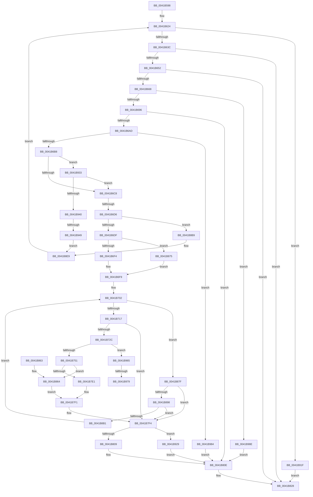

# CmDeleteLayeredKey

- RVA: `0x0041B598`–`0x0041B995` (길이 `1,021` bytes)
- VA: `0x000000014041B598`
- 실행 섹션: `.text`
- PDB 이름 있음: `예`; PDB Function 태그: `예`
- unwind 정보 RVA: `0x0009D510`
- 디코드: `258`개 명령, `1,021/1,021` bytes 표시
- 미해석 바이트: `0` (있으면 어셈블리에 `.byte`로 보존)

> 이 문서는 커널 이미지의 기계어와 PDB 기호를 분석해 생성했습니다. 4번과 5번은 함수 원형과 자료형을 바이너리 사용 방식에서 추정한 C 해석이며 원본 소스 복구 결과는 아닙니다.

## 1. Dependencies

- 직접 호출 지점: **50**; 고유 호출 대상: **31**
- 직접 호출자로 확인된 함수: **1**
- RIP 상대 이미지 참조: **0**

### Outgoing calls
- `0x0041B5F5` → [CmpInitializeKcbStack](../../page/9A/CmpInitializeKcbStack_function_009A2CD0.md) (function, `0x009A2CD0`)
- `0x0041B5FE` → [CmpInitializeKcbStack](../../page/9A/CmpInitializeKcbStack_function_009A2CD0.md) (function, `0x009A2CD0`)
- `0x0041B60A` → [HvpGetCellContextInitialize](../../page/85/HvpGetCellContextInitialize_function_00855F10.md) (function, `0x00855F10`)
- `0x0041B613` → [HvpGetCellContextInitialize](../../page/85/HvpGetCellContextInitialize_function_00855F10.md) (function, `0x00855F10`)
- `0x0041B61C` → [CmpInitializeDiscardReplaceContext](../../page/A5/CmpInitializeDiscardReplaceContext_function_00A5FFC8.md) (function, `0x00A5FFC8`)
- `0x0041B643` → [CmpStartKcbStackForTopLayerKcb](../../page/84/CmpStartKcbStackForTopLayerKcb_function_00848390.md) (function, `0x00848390`)
- `0x0041B659` → [CmpStartKcbStackForTopLayerKcb](../../page/84/CmpStartKcbStackForTopLayerKcb_function_00848390.md) (function, `0x00848390`)
- `0x0041B66B` → [CmpLockHashEntryExclusiveByKcb](../../page/84/CmpLockHashEntryExclusiveByKcb_function_00849780.md) (function, `0x00849780`)
- `0x0041B674` → [CmpLockKcbStackTopExclusiveRestShared](../../page/84/CmpLockKcbStackTopExclusiveRestShared_function_00846B04.md) (function, `0x00846B04`)
- `0x0041B67D` → [CmpLockKcbStackExclusive](../../page/94/CmpLockKcbStackExclusive_function_009491C0.md) (function, `0x009491C0`)
- `0x0041B687` → [CmpIsKeyDeletedForKeyBody](../../pagecmrc/BC/CmpIsKeyDeletedForKeyBody_function_00BC9480.md) (function, `0x00BC9480`)
- `0x0041B69E` → [CmpGetSubKeyCountForKcbStack](../../page/94/CmpGetSubKeyCountForKcbStack_function_00944628.md) (function, `0x00944628`)
- `0x0041B6F4` → [HvpGetCellFlat](../../page/85/HvpGetCellFlat_function_00854C60.md) (function, `0x00854C60`)
- `0x0041B71D` → [CmpMarkKeyDirty](../../page/84/CmpMarkKeyDirty_function_0084B1FC.md) (function, `0x0084B1FC`)
- `0x0041B73A` → [CmpFindSubKeyByNumber](../../page/85/CmpFindSubKeyByNumber_function_0085C930.md) (function, `0x0085C930`)
- `0x0041B757` → [CmpFreeKeyValues](../../page/A8/CmpFreeKeyValues_function_00A8B3E4.md) (function, `0x00A8B3E4`)
- `0x0041B78E` → [CmpIncrementKcbSequenceNumber](../../page/A4/CmpIncrementKcbSequenceNumber_function_00A49D7C.md) (function, `0x00A49D7C`)
- `0x0041B79C` → [CmpRebuildKcbCacheFromNode](../../page/84/CmpRebuildKcbCacheFromNode_function_0084C5A8.md) (function, `0x0084C5A8`)
- `0x0041B7AF` → [CmpReportNotifyForKcbStack](../../page/8C/CmpReportNotifyForKcbStack_function_008C718C.md) (function, `0x008C718C`)
- `0x0041B7BD` → [CmpFlushNotifiesOnAllUnbackedHigherLayerKcbs](../../page/A5/CmpFlushNotifiesOnAllUnbackedHigherLayerKcbs_function_00A547AC.md) (function, `0x00A547AC`)
- `0x0041B7D0` → [CmpFlushNotifiesOnKeyBodyList](../../page/9B/CmpFlushNotifiesOnKeyBodyList_function_009B3594.md) (function, `0x009B3594`)
- `0x0041B7E4` → [CmpMarkKeyUnbacked](../../page/9B/CmpMarkKeyUnbacked_function_009B3C4C.md) (function, `0x009B3C4C`)
- `0x0041B7EC` → [CmpDiscardKcb](../../page/9B/CmpDiscardKcb_function_009B2F34.md) (function, `0x009B2F34`)
- `0x0041B809` → [HvpReleaseCellPaged](../../page/85/HvpReleaseCellPaged_function_00855F40.md) (function, `0x00855F40`)
- `0x0041B812` → [CmpUnlockKcbStack](../../page/84/CmpUnlockKcbStack_function_00848460.md) (function, `0x00848460`)
- `0x0041B81B` → [CmpUnlockKcbStack](../../page/84/CmpUnlockKcbStack_function_00848460.md) (function, `0x00848460`)
- `0x0041B823` → [CmpUnlockHashEntryByKcb](../../page/86/CmpUnlockHashEntryByKcb_function_00864370.md) (function, `0x00864370`)
- `0x0041B82F` → [CmpCleanupDiscardReplaceContext](../../page/A5/CmpCleanupDiscardReplaceContext_function_00A54FF8.md) (function, `0x00A54FF8`)
- `0x0041B838` → [CmpCleanupKcbStack](../../page/94/CmpCleanupKcbStack_function_009470A0.md) (function, `0x009470A0`)
- `0x0041B841` → [CmpCleanupKcbStack](../../page/94/CmpCleanupKcbStack_function_009470A0.md) (function, `0x009470A0`)
- `0x0041B86B` → [CmpCommitDiscardAndReplaceKcbAndUnbackedHigherLayers](../../page/A5/CmpCommitDiscardAndReplaceKcbAndUnbackedHigherLayers_function_00A55070.md) (function, `0x00A55070`)
- `0x0041B875` → [HvpGetCellPaged](../../page/85/HvpGetCellPaged_function_00854CB0.md) (function, `0x00854CB0`)
- `0x0041B889` → [CmpFindSubKeyByNumber](../../page/85/CmpFindSubKeyByNumber_function_0085C930.md) (function, `0x0085C930`)
- `0x0041B8A2` → [CmpMarkKeyDirty](../../page/84/CmpMarkKeyDirty_function_0084B1FC.md) (function, `0x0084B1FC`)
- `0x0041B8BD` → [CmpUnlockKcbStack](../../page/84/CmpUnlockKcbStack_function_00848460.md) (function, `0x00848460`)
- `0x0041B8C6` → [CmpUnlockKcbStack](../../page/84/CmpUnlockKcbStack_function_00848460.md) (function, `0x00848460`)
- `0x0041B8CE` → [CmpUnlockHashEntryByKcb](../../page/86/CmpUnlockHashEntryByKcb_function_00864370.md) (function, `0x00864370`)
- `0x0041B8DA` → [CmpCleanupDiscardReplaceContext](../../page/A5/CmpCleanupDiscardReplaceContext_function_00A54FF8.md) (function, `0x00A54FF8`)
- `0x0041B8E4` → [CmpDrainDelayDerefContext](CmpDrainDelayDerefContext_function_0041B9A0.md) (function, `0x0041B9A0`)
- `0x0041B8E9` → [CmpUnlockRegistry](../../pagecmrc/BC/CmpUnlockRegistry_function_00BC9A84.md) (function, `0x00BC9A84`)
- `0x0041B8F2` → [CmpCleanupKcbStack](../../page/94/CmpCleanupKcbStack_function_009470A0.md) (function, `0x009470A0`)
- `0x0041B8FB` → [CmpInitializeKcbStack](../../page/9A/CmpInitializeKcbStack_function_009A2CD0.md) (function, `0x009A2CD0`)
- `0x0041B904` → [CmpCleanupKcbStack](../../page/94/CmpCleanupKcbStack_function_009470A0.md) (function, `0x009470A0`)
- `0x0041B90D` → [CmpInitializeKcbStack](../../page/9A/CmpInitializeKcbStack_function_009A2CD0.md) (function, `0x009A2CD0`)
- `0x0041B912` → [CmpLockRegistryExclusive](../../page/84/CmpLockRegistryExclusive_function_0084F9B4.md) (function, `0x0084F9B4`)
- `0x0041B929` → [HvpReleaseCellFlat](../../page/85/HvpReleaseCellFlat_function_0085CC20.md) (function, `0x0085CC20`)
- `0x0041B94D` → [CmpUnlockKcbStack](../../page/84/CmpUnlockKcbStack_function_00848460.md) (function, `0x00848460`)
- `0x0041B956` → [CmpUnlockKcbStack](../../page/84/CmpUnlockKcbStack_function_00848460.md) (function, `0x00848460`)
- `0x0041B95E` → [CmpUnlockHashEntryByKcb](../../page/86/CmpUnlockHashEntryByKcb_function_00864370.md) (function, `0x00864370`)
- `0x0041B979` → [HvpGetCellFlat](../../page/85/HvpGetCellFlat_function_00854C60.md) (function, `0x00854C60`)

### Direct callers
- [CmDeleteKey](../../page/84/CmDeleteKey_function_00848E5C.md) at `0x0084946A`

### Static image references
- 디코드된 RIP-relative 메모리 참조가 없습니다.

## 2. Other-region calls and transfers

- 다른 실행 섹션으로 향하는 call: **49**
  - `0x0041B5F5` → [CmpInitializeKcbStack](../../page/9A/CmpInitializeKcbStack_function_009A2CD0.md) (`.text` → `PAGE`)
  - `0x0041B5FE` → [CmpInitializeKcbStack](../../page/9A/CmpInitializeKcbStack_function_009A2CD0.md) (`.text` → `PAGE`)
  - `0x0041B60A` → [HvpGetCellContextInitialize](../../page/85/HvpGetCellContextInitialize_function_00855F10.md) (`.text` → `PAGE`)
  - `0x0041B613` → [HvpGetCellContextInitialize](../../page/85/HvpGetCellContextInitialize_function_00855F10.md) (`.text` → `PAGE`)
  - `0x0041B61C` → [CmpInitializeDiscardReplaceContext](../../page/A5/CmpInitializeDiscardReplaceContext_function_00A5FFC8.md) (`.text` → `PAGE`)
  - `0x0041B643` → [CmpStartKcbStackForTopLayerKcb](../../page/84/CmpStartKcbStackForTopLayerKcb_function_00848390.md) (`.text` → `PAGE`)
  - `0x0041B659` → [CmpStartKcbStackForTopLayerKcb](../../page/84/CmpStartKcbStackForTopLayerKcb_function_00848390.md) (`.text` → `PAGE`)
  - `0x0041B66B` → [CmpLockHashEntryExclusiveByKcb](../../page/84/CmpLockHashEntryExclusiveByKcb_function_00849780.md) (`.text` → `PAGE`)
  - `0x0041B674` → [CmpLockKcbStackTopExclusiveRestShared](../../page/84/CmpLockKcbStackTopExclusiveRestShared_function_00846B04.md) (`.text` → `PAGE`)
  - `0x0041B67D` → [CmpLockKcbStackExclusive](../../page/94/CmpLockKcbStackExclusive_function_009491C0.md) (`.text` → `PAGE`)
  - `0x0041B687` → [CmpIsKeyDeletedForKeyBody](../../pagecmrc/BC/CmpIsKeyDeletedForKeyBody_function_00BC9480.md) (`.text` → `PAGECMRC`)
  - `0x0041B69E` → [CmpGetSubKeyCountForKcbStack](../../page/94/CmpGetSubKeyCountForKcbStack_function_00944628.md) (`.text` → `PAGE`)
  - `0x0041B6F4` → [HvpGetCellFlat](../../page/85/HvpGetCellFlat_function_00854C60.md) (`.text` → `PAGE`)
  - `0x0041B71D` → [CmpMarkKeyDirty](../../page/84/CmpMarkKeyDirty_function_0084B1FC.md) (`.text` → `PAGE`)
  - `0x0041B73A` → [CmpFindSubKeyByNumber](../../page/85/CmpFindSubKeyByNumber_function_0085C930.md) (`.text` → `PAGE`)
  - `0x0041B757` → [CmpFreeKeyValues](../../page/A8/CmpFreeKeyValues_function_00A8B3E4.md) (`.text` → `PAGE`)
  - `0x0041B78E` → [CmpIncrementKcbSequenceNumber](../../page/A4/CmpIncrementKcbSequenceNumber_function_00A49D7C.md) (`.text` → `PAGE`)
  - `0x0041B79C` → [CmpRebuildKcbCacheFromNode](../../page/84/CmpRebuildKcbCacheFromNode_function_0084C5A8.md) (`.text` → `PAGE`)
  - `0x0041B7AF` → [CmpReportNotifyForKcbStack](../../page/8C/CmpReportNotifyForKcbStack_function_008C718C.md) (`.text` → `PAGE`)
  - `0x0041B7BD` → [CmpFlushNotifiesOnAllUnbackedHigherLayerKcbs](../../page/A5/CmpFlushNotifiesOnAllUnbackedHigherLayerKcbs_function_00A547AC.md) (`.text` → `PAGE`)
  - `0x0041B7D0` → [CmpFlushNotifiesOnKeyBodyList](../../page/9B/CmpFlushNotifiesOnKeyBodyList_function_009B3594.md) (`.text` → `PAGE`)
  - `0x0041B7E4` → [CmpMarkKeyUnbacked](../../page/9B/CmpMarkKeyUnbacked_function_009B3C4C.md) (`.text` → `PAGE`)
  - `0x0041B7EC` → [CmpDiscardKcb](../../page/9B/CmpDiscardKcb_function_009B2F34.md) (`.text` → `PAGE`)
  - `0x0041B809` → [HvpReleaseCellPaged](../../page/85/HvpReleaseCellPaged_function_00855F40.md) (`.text` → `PAGE`)
  - `0x0041B812` → [CmpUnlockKcbStack](../../page/84/CmpUnlockKcbStack_function_00848460.md) (`.text` → `PAGE`)
  - `0x0041B81B` → [CmpUnlockKcbStack](../../page/84/CmpUnlockKcbStack_function_00848460.md) (`.text` → `PAGE`)
  - `0x0041B823` → [CmpUnlockHashEntryByKcb](../../page/86/CmpUnlockHashEntryByKcb_function_00864370.md) (`.text` → `PAGE`)
  - `0x0041B82F` → [CmpCleanupDiscardReplaceContext](../../page/A5/CmpCleanupDiscardReplaceContext_function_00A54FF8.md) (`.text` → `PAGE`)
  - `0x0041B838` → [CmpCleanupKcbStack](../../page/94/CmpCleanupKcbStack_function_009470A0.md) (`.text` → `PAGE`)
  - `0x0041B841` → [CmpCleanupKcbStack](../../page/94/CmpCleanupKcbStack_function_009470A0.md) (`.text` → `PAGE`)
  - `0x0041B86B` → [CmpCommitDiscardAndReplaceKcbAndUnbackedHigherLayers](../../page/A5/CmpCommitDiscardAndReplaceKcbAndUnbackedHigherLayers_function_00A55070.md) (`.text` → `PAGE`)
  - `0x0041B875` → [HvpGetCellPaged](../../page/85/HvpGetCellPaged_function_00854CB0.md) (`.text` → `PAGE`)
  - `0x0041B889` → [CmpFindSubKeyByNumber](../../page/85/CmpFindSubKeyByNumber_function_0085C930.md) (`.text` → `PAGE`)
  - `0x0041B8A2` → [CmpMarkKeyDirty](../../page/84/CmpMarkKeyDirty_function_0084B1FC.md) (`.text` → `PAGE`)
  - `0x0041B8BD` → [CmpUnlockKcbStack](../../page/84/CmpUnlockKcbStack_function_00848460.md) (`.text` → `PAGE`)
  - `0x0041B8C6` → [CmpUnlockKcbStack](../../page/84/CmpUnlockKcbStack_function_00848460.md) (`.text` → `PAGE`)
  - `0x0041B8CE` → [CmpUnlockHashEntryByKcb](../../page/86/CmpUnlockHashEntryByKcb_function_00864370.md) (`.text` → `PAGE`)
  - `0x0041B8DA` → [CmpCleanupDiscardReplaceContext](../../page/A5/CmpCleanupDiscardReplaceContext_function_00A54FF8.md) (`.text` → `PAGE`)
  - `0x0041B8E9` → [CmpUnlockRegistry](../../pagecmrc/BC/CmpUnlockRegistry_function_00BC9A84.md) (`.text` → `PAGECMRC`)
  - `0x0041B8F2` → [CmpCleanupKcbStack](../../page/94/CmpCleanupKcbStack_function_009470A0.md) (`.text` → `PAGE`)
  - `0x0041B8FB` → [CmpInitializeKcbStack](../../page/9A/CmpInitializeKcbStack_function_009A2CD0.md) (`.text` → `PAGE`)
  - `0x0041B904` → [CmpCleanupKcbStack](../../page/94/CmpCleanupKcbStack_function_009470A0.md) (`.text` → `PAGE`)
  - `0x0041B90D` → [CmpInitializeKcbStack](../../page/9A/CmpInitializeKcbStack_function_009A2CD0.md) (`.text` → `PAGE`)
  - `0x0041B912` → [CmpLockRegistryExclusive](../../page/84/CmpLockRegistryExclusive_function_0084F9B4.md) (`.text` → `PAGE`)
  - `0x0041B929` → [HvpReleaseCellFlat](../../page/85/HvpReleaseCellFlat_function_0085CC20.md) (`.text` → `PAGE`)
  - `0x0041B94D` → [CmpUnlockKcbStack](../../page/84/CmpUnlockKcbStack_function_00848460.md) (`.text` → `PAGE`)
  - `0x0041B956` → [CmpUnlockKcbStack](../../page/84/CmpUnlockKcbStack_function_00848460.md) (`.text` → `PAGE`)
  - `0x0041B95E` → [CmpUnlockHashEntryByKcb](../../page/86/CmpUnlockHashEntryByKcb_function_00864370.md) (`.text` → `PAGE`)
  - `0x0041B979` → [HvpGetCellFlat](../../page/85/HvpGetCellFlat_function_00854C60.md) (`.text` → `PAGE`)
- call이 아닌 외부 분기/꼬리 이동: **4**
  - `0x0041B6D0` → [sub_006ED542 + 0x1E](../6E/Unknown_function_006ED542.md) (`tail-transfer`)
  - `0x0041B943` → [sub_006ED542](../6E/Unknown_function_006ED542.md) (`tail-transfer`)
  - `0x0041B973` → [sub_006ED542 + 0x125](../6E/Unknown_function_006ED542.md) (`tail-transfer`)
  - `0x0041B97F` → [sub_006ED542 + 0x12A](../6E/Unknown_function_006ED542.md) (`tail-transfer`)

## 3. Assembly (complete function range)

```asm
0041B598  48 89 5C 24 18                  mov qword ptr [rsp + 0x18], rbx
0041B59D  48 89 54 24 10                  mov qword ptr [rsp + 0x10], rdx
0041B5A2  55                              push rbp
0041B5A3  56                              push rsi
0041B5A4  57                              push rdi
0041B5A5  41 54                           push r12
0041B5A7  41 55                           push r13
0041B5A9  41 56                           push r14
0041B5AB  41 57                           push r15
0041B5AD  48 8D 6C 24 D9                  lea rbp, [rsp - 0x27]
0041B5B2  48 81 EC A0 00 00 00            sub rsp, 0xa0
0041B5B9  0F 57 C0                        xorps xmm0, xmm0
0041B5BC  0F 57 C9                        xorps xmm1, xmm1
0041B5BF  33 DB                           xor ebx, ebx
0041B5C1  4C 8B E9                        mov r13, rcx
0041B5C4  48 8D 4D D7                     lea rcx, [rbp - 0x29]
0041B5C8  89 5D 7F                        mov dword ptr [rbp + 0x7f], ebx
0041B5CB  0F 11 45 D7                     movups xmmword ptr [rbp - 0x29], xmm0
0041B5CF  48 89 5D A7                     mov qword ptr [rbp - 0x59], rbx
0041B5D3  49 8B F0                        mov rsi, r8
0041B5D6  0F 11 45 E7                     movups xmmword ptr [rbp - 0x19], xmm0
0041B5DA  89 5D 67                        mov dword ptr [rbp + 0x67], ebx
0041B5DD  0F 11 4D B7                     movups xmmword ptr [rbp - 0x49], xmm1
0041B5E1  48 89 5D AF                     mov qword ptr [rbp - 0x51], rbx
0041B5E5  0F 11 4D C7                     movups xmmword ptr [rbp - 0x39], xmm1
0041B5E9  0F 11 45 F7                     movups xmmword ptr [rbp - 9], xmm0
0041B5ED  0F 11 4D 07                     movups xmmword ptr [rbp + 7], xmm1
0041B5F1  0F 11 4D 17                     movups xmmword ptr [rbp + 0x17], xmm1
0041B5F5  E8 D6 76 58 00                  call 0x1409a2cd0
0041B5FA  48 8D 4D B7                     lea rcx, [rbp - 0x49]
0041B5FE  E8 CD 76 58 00                  call 0x1409a2cd0
0041B603  48 8D 4D AF                     lea rcx, [rbp - 0x51]
0041B607  44 8A F3                        mov r14b, bl
0041B60A  E8 01 A9 43 00                  call 0x140855f10
0041B60F  48 8D 4D A7                     lea rcx, [rbp - 0x59]
0041B613  E8 F8 A8 43 00                  call 0x140855f10
0041B618  48 8D 4D 07                     lea rcx, [rbp + 7]
0041B61C  E8 A7 49 64 00                  call 0x140a5ffc8
0041B621  44 8A E3                        mov r12b, bl
0041B624  49 8B 7D 08                     mov rdi, qword ptr [r13 + 8]
0041B628  F7 87 B8 00 00 00 00 00 08 00   test dword ptr [rdi + 0xb8], 0x80000
0041B632  4C 8B 7F 48                     mov r15, qword ptr [rdi + 0x48]
0041B636  0F 85 E3 02 00 00               jne 0x14041b91f
0041B63C  48 8B D7                        mov rdx, rdi
0041B63F  48 8D 4D D7                     lea rcx, [rbp - 0x29]
0041B643  E8 48 CD 42 00                  call 0x140848390
0041B648  8B D8                           mov ebx, eax
0041B64A  85 C0                           test eax, eax
0041B64C  0F 88 D6 01 00 00               js 0x14041b828
0041B652  49 8B D7                        mov rdx, r15
0041B655  48 8D 4D B7                     lea rcx, [rbp - 0x49]
0041B659  E8 32 CD 42 00                  call 0x140848390
0041B65E  8B D8                           mov ebx, eax
0041B660  85 C0                           test eax, eax
0041B662  0F 88 C0 01 00 00               js 0x14041b828
0041B668  48 8B CF                        mov rcx, rdi
0041B66B  E8 10 E1 42 00                  call 0x140849780
0041B670  48 8D 4D B7                     lea rcx, [rbp - 0x49]
0041B674  E8 8B B4 42 00                  call 0x140846b04
0041B679  48 8D 4D D7                     lea rcx, [rbp - 0x29]
0041B67D  E8 3E DB 52 00                  call 0x1409491c0
0041B682  33 D2                           xor edx, edx
0041B684  49 8B CD                        mov rcx, r13
0041B687  E8 F4 DD 7A 00                  call 0x140bc9480
0041B68C  33 C9                           xor ecx, ecx
0041B68E  84 C0                           test al, al
0041B690  0F 85 F8 02 00 00               jne 0x14041b98e
0041B696  4C 8D 45 7F                     lea r8, [rbp + 0x7f]
0041B69A  48 8D 4D D7                     lea rcx, [rbp - 0x29]
0041B69E  E8 85 8F 52 00                  call 0x140944628
0041B6A3  8B D8                           mov ebx, eax
0041B6A5  85 C0                           test eax, eax
0041B6A7  0F 88 61 01 00 00               js 0x14041b80e
0041B6AD  33 DB                           xor ebx, ebx
0041B6AF  39 5D 7F                        cmp dword ptr [rbp + 0x7f], ebx
0041B6B2  0F 85 CC 02 00 00               jne 0x14041b984
0041B6B8  48 8B 87 C0 00 00 00            mov rax, qword ptr [rdi + 0xc0]
0041B6BF  48 85 C0                        test rax, rax
0041B6C2  0F 85 6B 02 00 00               jne 0x14041b933
0041B6C8  8B 57 28                        mov edx, dword ptr [rdi + 0x28]
0041B6CB  83 C8 FF                        or eax, 0xffffffff
0041B6CE  3B D0                           cmp edx, eax
0041B6D0  0F 84 8A 1E 2D 00               je 0x1406ed560
0041B6D6  45 84 F6                        test r14b, r14b
0041B6D9  0F 84 DA 01 00 00               je 0x14041b8b9
0041B6DF  48 8B 4F 20                     mov rcx, qword ptr [rdi + 0x20]
0041B6E3  4C 8D 45 AF                     lea r8, [rbp - 0x51]
0041B6E7  F6 81 8C 00 00 00 01            test byte ptr [rcx + 0x8c], 1
0041B6EE  0F 84 81 01 00 00               je 0x14041b875
0041B6F4  E8 67 95 43 00                  call 0x140854c60
0041B6F9  45 33 ED                        xor r13d, r13d
0041B6FC  4C 8B F0                        mov r14, rax
0041B6FF  45 8B FD                        mov r15d, r13d
0041B702  41 8B 46 14                     mov eax, dword ptr [r14 + 0x14]
0041B706  41 03 46 18                     add eax, dword ptr [r14 + 0x18]
0041B70A  48 8B 4F 20                     mov rcx, qword ptr [rdi + 0x20]
0041B70E  44 3B F8                        cmp r15d, eax
0041B711  0F 82 68 01 00 00               jb 0x14041b87f
0041B717  8B 57 28                        mov edx, dword ptr [rdi + 0x28]
0041B71A  41 B0 01                        mov r8b, 1
0041B71D  E8 DA FA 42 00                  call 0x14084b1fc
0041B722  8B D8                           mov ebx, eax
0041B724  85 C0                           test eax, eax
0041B726  0F 88 C8 00 00 00               js 0x14041b7f4
0041B72C  48 8B 4F 20                     mov rcx, qword ptr [rdi + 0x20]
0041B730  4C 8D 4D 67                     lea r9, [rbp + 0x67]
0041B734  45 33 C0                        xor r8d, r8d
0041B737  49 8B D6                        mov rdx, r14
0041B73A  E8 F1 11 44 00                  call 0x14085c930
0041B73F  44 8B 7D 67                     mov r15d, dword ptr [rbp + 0x67]
0041B743  48 8B 4F 20                     mov rcx, qword ptr [rdi + 0x20]
0041B747  41 83 FF FF                     cmp r15d, -1
0041B74B  0F 85 14 02 00 00               jne 0x14041b965
0041B751  8B 57 28                        mov edx, dword ptr [rdi + 0x28]
0041B754  4D 8B C6                        mov r8, r14
0041B757  E8 88 FC 66 00                  call 0x140a8b3e4
0041B75C  41 8A 46 0D                     mov al, byte ptr [r14 + 0xd]
0041B760  48 8B CF                        mov rcx, rdi
0041B763  66 41 83 66 02 20               and word ptr [r14 + 2], 0x20
0041B769  24 FD                           and al, 0xfd
0041B76B  45 88 6E 37                     mov byte ptr [r14 + 0x37], r13b
0041B76F  0C 01                           or al, 1
0041B771  41 81 66 34 FF FF 00 FF         and dword ptr [r14 + 0x34], 0xff00ffff
0041B779  41 88 46 0D                     mov byte ptr [r14 + 0xd], al
0041B77D  4D 89 6E 04                     mov qword ptr [r14 + 4], r13
0041B781  4D 89 6E 38                     mov qword ptr [r14 + 0x38], r13
0041B785  45 89 6E 40                     mov dword ptr [r14 + 0x40], r13d
0041B789  66 45 89 6E 34                  mov word ptr [r14 + 0x34], r13w
0041B78E  E8 E9 E5 62 00                  call 0x140a49d7c
0041B793  41 B1 01                        mov r9b, 1
0041B796  4C 8B C6                        mov r8, rsi
0041B799  49 8B D6                        mov rdx, r14
0041B79C  E8 07 0E 43 00                  call 0x14084c5a8
0041B7A1  4C 8B 4D 6F                     mov r9, qword ptr [rbp + 0x6f]
0041B7A5  48 8D 4D B7                     lea rcx, [rbp - 0x49]
0041B7A9  33 D2                           xor edx, edx
0041B7AB  44 8D 42 01                     lea r8d, [rdx + 1]
0041B7AF  E8 D8 B9 4A 00                  call 0x1408c718c
0041B7B4  41 B1 01                        mov r9b, 1
0041B7B7  4C 8B C6                        mov r8, rsi
0041B7BA  48 8B CF                        mov rcx, rdi
0041B7BD  E8 EA 8F 63 00                  call 0x140a547ac
0041B7C2  41 B1 01                        mov r9b, 1
0041B7C5  4C 8B C6                        mov r8, rsi
0041B7C8  BA 08 00 00 00                  mov edx, 8
0041B7CD  48 8B CF                        mov rcx, rdi
0041B7D0  E8 BF 7D 59 00                  call 0x1409b3594
0041B7D5  48 8B CF                        mov rcx, rdi
0041B7D8  45 84 E4                        test r12b, r12b
0041B7DB  0F 85 83 00 00 00               jne 0x14041b864
0041B7E1  48 8B D6                        mov rdx, rsi
0041B7E4  E8 63 84 59 00                  call 0x1409b3c4c
0041B7E9  48 8B CF                        mov rcx, rdi
0041B7EC  E8 43 77 59 00                  call 0x1409b2f34
0041B7F1  41 8B DD                        mov ebx, r13d
0041B7F4  48 8B 4F 20                     mov rcx, qword ptr [rdi + 0x20]
0041B7F8  48 8D 55 AF                     lea rdx, [rbp - 0x51]
0041B7FC  F6 81 8C 00 00 00 01            test byte ptr [rcx + 0x8c], 1
0041B803  0F 85 20 01 00 00               jne 0x14041b929
0041B809  E8 32 A7 43 00                  call 0x140855f40
0041B80E  48 8D 4D D7                     lea rcx, [rbp - 0x29]
0041B812  E8 49 CC 42 00                  call 0x140848460
0041B817  48 8D 4D B7                     lea rcx, [rbp - 0x49]
0041B81B  E8 40 CC 42 00                  call 0x140848460
0041B820  48 8B CF                        mov rcx, rdi
0041B823  E8 48 8B 44 00                  call 0x140864370
0041B828  48 8B D6                        mov rdx, rsi
0041B82B  48 8D 4D 07                     lea rcx, [rbp + 7]
0041B82F  E8 C4 97 63 00                  call 0x140a54ff8
0041B834  48 8D 4D D7                     lea rcx, [rbp - 0x29]
0041B838  E8 63 B8 52 00                  call 0x1409470a0
0041B83D  48 8D 4D B7                     lea rcx, [rbp - 0x49]
0041B841  E8 5A B8 52 00                  call 0x1409470a0
0041B846  8B C3                           mov eax, ebx
0041B848  48 8B 9C 24 F0 00 00 00         mov rbx, qword ptr [rsp + 0xf0]
0041B850  48 81 C4 A0 00 00 00            add rsp, 0xa0
0041B857  41 5F                           pop r15
0041B859  41 5E                           pop r14
0041B85B  41 5D                           pop r13
0041B85D  41 5C                           pop r12
0041B85F  5F                              pop rdi
0041B860  5E                              pop rsi
0041B861  5D                              pop rbp
0041B862  C3                              ret
0041B863  CC                              int3
0041B864  4C 8B C6                        mov r8, rsi
0041B867  48 8D 55 07                     lea rdx, [rbp + 7]
0041B86B  E8 00 98 63 00                  call 0x140a55070
0041B870  E9 7C FF FF FF                  jmp 0x14041b7f1
0041B875  E8 36 94 43 00                  call 0x140854cb0
0041B87A  E9 7A FE FF FF                  jmp 0x14041b6f9
0041B87F  4C 8D 4D 67                     lea r9, [rbp + 0x67]
0041B883  45 8B C7                        mov r8d, r15d
0041B886  49 8B D6                        mov rdx, r14
0041B889  E8 A2 10 44 00                  call 0x14085c930
0041B88E  8B D8                           mov ebx, eax
0041B890  85 C0                           test eax, eax
0041B892  0F 88 5C FF FF FF               js 0x14041b7f4
0041B898  8B 55 67                        mov edx, dword ptr [rbp + 0x67]
0041B89B  41 B0 01                        mov r8b, 1
0041B89E  48 8B 4F 20                     mov rcx, qword ptr [rdi + 0x20]
0041B8A2  E8 55 F9 42 00                  call 0x14084b1fc
0041B8A7  8B D8                           mov ebx, eax
0041B8A9  85 C0                           test eax, eax
0041B8AB  0F 88 43 FF FF FF               js 0x14041b7f4
0041B8B1  41 FF C7                        inc r15d
0041B8B4  E9 49 FE FF FF                  jmp 0x14041b702
0041B8B9  48 8D 4D D7                     lea rcx, [rbp - 0x29]
0041B8BD  E8 9E CB 42 00                  call 0x140848460
0041B8C2  48 8D 4D B7                     lea rcx, [rbp - 0x49]
0041B8C6  E8 95 CB 42 00                  call 0x140848460
0041B8CB  48 8B CF                        mov rcx, rdi
0041B8CE  E8 9D 8A 44 00                  call 0x140864370
0041B8D3  48 8B D6                        mov rdx, rsi
0041B8D6  48 8D 4D 07                     lea rcx, [rbp + 7]
0041B8DA  E8 19 97 63 00                  call 0x140a54ff8
0041B8DF  33 D2                           xor edx, edx
0041B8E1  48 8B CE                        mov rcx, rsi
0041B8E4  E8 B7 00 00 00                  call 0x14041b9a0
0041B8E9  E8 96 E1 7A 00                  call 0x140bc9a84
0041B8EE  48 8D 4D B7                     lea rcx, [rbp - 0x49]
0041B8F2  E8 A9 B7 52 00                  call 0x1409470a0
0041B8F7  48 8D 4D B7                     lea rcx, [rbp - 0x49]
0041B8FB  E8 D0 73 58 00                  call 0x1409a2cd0
0041B900  48 8D 4D D7                     lea rcx, [rbp - 0x29]
0041B904  E8 97 B7 52 00                  call 0x1409470a0
0041B909  48 8D 4D D7                     lea rcx, [rbp - 0x29]
0041B90D  E8 BE 73 58 00                  call 0x1409a2cd0
0041B912  E8 9D 40 43 00                  call 0x14084f9b4
0041B917  41 B6 01                        mov r14b, 1
0041B91A  E9 05 FD FF FF                  jmp 0x14041b624
0041B91F  BB 21 01 00 C0                  mov ebx, 0xc0000121
0041B924  E9 FF FE FF FF                  jmp 0x14041b828
0041B929  E8 F2 12 44 00                  call 0x14085cc20
0041B92E  E9 DB FE FF FF                  jmp 0x14041b80e
0041B933  48 83 C0 20                     add rax, 0x20
0041B937  48 39 00                        cmp qword ptr [rax], rax
0041B93A  0F 84 88 FD FF FF               je 0x14041b6c8
0041B940  45 84 F6                        test r14b, r14b
0041B943  0F 85 F9 1B 2D 00               jne 0x1406ed542
0041B949  48 8D 4D D7                     lea rcx, [rbp - 0x29]
0041B94D  E8 0E CB 42 00                  call 0x140848460
0041B952  48 8D 4D B7                     lea rcx, [rbp - 0x49]
0041B956  E8 05 CB 42 00                  call 0x140848460
0041B95B  48 8B CF                        mov rcx, rdi
0041B95E  E8 0D 8A 44 00                  call 0x140864370
0041B963  EB 84                           jmp 0x14041b8e9
0041B965  F6 81 8C 00 00 00 01            test byte ptr [rcx + 0x8c], 1
0041B96C  4C 8D 45 A7                     lea r8, [rbp - 0x59]
0041B970  41 8B D7                        mov edx, r15d
0041B973  0F 84 EE 1C 2D 00               je 0x1406ed667
0041B979  E8 E2 92 43 00                  call 0x140854c60
0041B97E  90                              nop
0041B97F  E9 E8 1C 2D 00                  jmp 0x1406ed66c
0041B984  BB 21 01 00 C0                  mov ebx, 0xc0000121
0041B989  E9 80 FE FF FF                  jmp 0x14041b80e
0041B98E  8B D9                           mov ebx, ecx
0041B990  E9 79 FE FF FF                  jmp 0x14041b80e
```

## 4. C-style interpretation (structured pseudocode)

```c
__int64 __fastcall CmDeleteLayeredKey(__int64 a1, __int64 a2, __int64 a3)
{
    __int64 result;
    __int64 v_r13;
    __int64 v_r15;
    __int64 v_rbx;
    __int64 v_rsp;
    unsigned __int64 v_stack_m48;
    unsigned __int64 v_stack_m58;
    unsigned __int64 v_stack_m5F;
    unsigned __int64 v_stack_m68;
    unsigned __int64 v_stack_m78;
    unsigned __int64 v_stack_m88;
    unsigned __int64 v_stack_m98;
    unsigned __int64 v_stack_mA8;
    unsigned __int64 v_stack_mB0;
    unsigned __int64 v_stack_mB8;
    unsigned __int64 v_stack_p10;
    unsigned __int64 v_stack_p18;
    unsigned int v_stack_p20;
    unsigned int v_stack_p8;

    v_stack_p18 = v_rbx;
    v_stack_p10 = a2;
    v_rsp = (v_rsp) - (160);
    v_rbx = 0;
    v_stack_p20 = 0;
    v_stack_m88 = v_xmm0;
    v_stack_mB8 = 0;
    v_stack_m78 = v_xmm0;
    v_stack_p8 = 0;
    v_stack_mA8 = v_xmm1;
    v_stack_mB0 = 0;
    v_stack_m98 = v_xmm1;
    v_stack_m68 = v_xmm0;
    v_stack_m58 = v_xmm1;
    v_stack_m48 = v_xmm1;
    result = CmpInitializeKcbStack(v_stack_m88, a2, a3, a4);
    result = CmpInitializeKcbStack(v_stack_mA8, a2, a3, a4);
    result = HvpGetCellContextInitialize(v_stack_mB0, a2, a3, a4);
    result = HvpGetCellContextInitialize(v_stack_mB8, a2, a3, a4);
    result = CmpInitializeDiscardReplaceContext(v_stack_m58, a2, a3, a4);
loc_0041B624:
    if (((*(unsigned int *)(*(unsigned __int64 *)(a1 + 8) + 184)) & (0x80000ULL)) != 0) goto loc_0041B91F;
    result = CmpStartKcbStackForTopLayerKcb(v_stack_m88, *(unsigned __int64 *)(a1 + 8), a3, a4);
    if (sign_flag) goto loc_0041B828;
    result = CmpStartKcbStackForTopLayerKcb(v_stack_mA8, *(unsigned __int64 *)(*(unsigned __int64 *)(a1 + 8) + 72), a3, a4);
    if (sign_flag) goto loc_0041B828;
    result = CmpLockHashEntryExclusiveByKcb(*(unsigned __int64 *)(a1 + 8), *(unsigned __int64 *)(*(unsigned __int64 *)(a1 + 8) + 72), a3, a4);
    result = CmpLockKcbStackTopExclusiveRestShared(v_stack_mA8, *(unsigned __int64 *)(*(unsigned __int64 *)(a1 + 8) + 72), a3, a4);
    result = CmpLockKcbStackExclusive(v_stack_m88, *(unsigned __int64 *)(*(unsigned __int64 *)(a1 + 8) + 72), a3, a4);
    a2 = 0;
    result = CmpIsKeyDeletedForKeyBody(a1, a2, a3, a4);
    a1 = 0;
    if ((unsigned __int8)(result) != 0) goto loc_0041B98E;
    result = CmpGetSubKeyCountForKcbStack(v_stack_m88, a2, v_stack_p20, a4);
    if (sign_flag) goto loc_0041B80E;
    v_rbx = 0;
    if (v_stack_p20 != 0) goto loc_0041B984;
    if (*(unsigned __int64 *)(*(unsigned __int64 *)(a1 + 8) + 192) != 0) goto loc_0041B933;
loc_0041B6C8:
    result = (unsigned int)((*(unsigned __int64 *)(*(unsigned __int64 *)(a1 + 8) + 192)) | (0xFFFFFFFFULL));
    if (0 == 0) goto loc_0041B8B9;
    if (((*(unsigned __int8 *)(*(unsigned __int64 *)(*(unsigned __int64 *)(a1 + 8) + 32) + 140)) & (1)) == 0) goto loc_0041B875;
    result = HvpGetCellFlat(*(unsigned __int64 *)(*(unsigned __int64 *)(a1 + 8) + 32), (unsigned int)(*(unsigned int *)(*(unsigned __int64 *)(a1 + 8) + 40)), v_stack_mB0, a4);
loc_0041B6F9:
    v_r13 = 0;
loc_0041B702:
    result = (unsigned int)(((unsigned int)(*(unsigned int *)(result + 20))) + (*(unsigned int *)(result + 24)));
    if (0 < ((unsigned int)(result))) goto loc_0041B87F;
    result = CmpMarkKeyDirty(*(unsigned __int64 *)(*(unsigned __int64 *)(a1 + 8) + 32), (unsigned int)(*(unsigned int *)(*(unsigned __int64 *)(a1 + 8) + 40)), 1, a4);
    if (sign_flag) goto loc_0041B7F4;
    a3 = 0;
    result = CmpFindSubKeyByNumber(*(unsigned __int64 *)(*(unsigned __int64 *)(a1 + 8) + 32), result, a3, v_stack_p8);
    if (((unsigned int)((unsigned int)(v_stack_p8))) != -1) goto loc_0041B965;
    result = CmpFreeKeyValues(*(unsigned __int64 *)(*(unsigned __int64 *)(a1 + 8) + 32), (unsigned int)(*(unsigned int *)(*(unsigned __int64 *)(a1 + 8) + 40)), result, v_stack_p8);
    result = (unsigned __int8)((*(unsigned __int8 *)(result + 13)) & (253));
    *(unsigned __int8 *)(result + 55) = 0;
    result = (unsigned __int8)((result) | (1));
    *(unsigned __int8 *)(result + 13) = (unsigned __int8)(result);
    *(unsigned __int64 *)(result + 4) = 0;
    *(unsigned __int64 *)(result + 56) = 0;
    *(unsigned int *)(result + 64) = 0;
    *(unsigned __int16 *)(result + 52) = 0;
    result = CmpIncrementKcbSequenceNumber(*(unsigned __int64 *)(a1 + 8), (unsigned int)(*(unsigned int *)(*(unsigned __int64 *)(a1 + 8) + 40)), result, v_stack_p8);
    result = CmpRebuildKcbCacheFromNode(*(unsigned __int64 *)(a1 + 8), result, 0, 1);
    a2 = 0;
    result = CmpReportNotifyForKcbStack(v_stack_mA8, a2, a2 + 1, v_stack_p10);
    result = CmpFlushNotifiesOnAllUnbackedHigherLayerKcbs(*(unsigned __int64 *)(a1 + 8), a2, 0, 1);
    result = CmpFlushNotifiesOnKeyBodyList(*(unsigned __int64 *)(a1 + 8), 8, 0, 1);
    if (0 != 0) goto loc_0041B864;
    result = CmpMarkKeyUnbacked(*(unsigned __int64 *)(a1 + 8), 0, 0, 1);
    result = CmpDiscardKcb(*(unsigned __int64 *)(a1 + 8), 0, 0, 1);
loc_0041B7F1:
loc_0041B7F4:
    if (((*(unsigned __int8 *)(*(unsigned __int64 *)(*(unsigned __int64 *)(a1 + 8) + 32) + 140)) & (1)) != 0) goto loc_0041B929;
    result = HvpReleaseCellPaged(*(unsigned __int64 *)(*(unsigned __int64 *)(a1 + 8) + 32), v_stack_mB0, 0, 1);
loc_0041B80E:
    result = CmpUnlockKcbStack(v_stack_m88, v_stack_mB0, 0, 1);
    result = CmpUnlockKcbStack(v_stack_mA8, v_stack_mB0, 0, 1);
    result = CmpUnlockHashEntryByKcb(*(unsigned __int64 *)(a1 + 8), v_stack_mB0, 0, 1);
loc_0041B828:
    result = CmpCleanupDiscardReplaceContext(v_stack_m58, 0, 0, 1);
    result = CmpCleanupKcbStack(v_stack_m88, 0, 0, 1);
    result = CmpCleanupKcbStack(v_stack_mA8, 0, 0, 1);
    v_rsp = (v_rsp) + (160);
    return 0;
loc_0041B864:
    result = CmpCommitDiscardAndReplaceKcbAndUnbackedHigherLayers(v_stack_mA8, v_stack_m58, 0, 1);
    goto loc_0041B7F1;
loc_0041B875:
    result = HvpGetCellPaged(v_stack_mA8, v_stack_m58, 0, 1);
    goto loc_0041B6F9;
loc_0041B87F:
    result = CmpFindSubKeyByNumber(v_stack_mA8, result, (unsigned int)((unsigned int)((unsigned int)(v_stack_p8))), v_stack_p8);
    if (sign_flag) goto loc_0041B7F4;
    result = CmpMarkKeyDirty(*(unsigned __int64 *)(*(unsigned __int64 *)(a1 + 8) + 32), (unsigned int)(v_stack_p8), 1, v_stack_p8);
    if (sign_flag) goto loc_0041B7F4;
    v_r15 = (unsigned int)(((unsigned int)(v_stack_p8)) + 1);
    goto loc_0041B702;
loc_0041B8B9:
    result = CmpUnlockKcbStack(v_stack_m88, (unsigned int)(v_stack_p8), 1, v_stack_p8);
    result = CmpUnlockKcbStack(v_stack_mA8, (unsigned int)(v_stack_p8), 1, v_stack_p8);
    result = CmpUnlockHashEntryByKcb(*(unsigned __int64 *)(a1 + 8), (unsigned int)(v_stack_p8), 1, v_stack_p8);
    result = CmpCleanupDiscardReplaceContext(v_stack_m58, 0, 1, v_stack_p8);
    a2 = 0;
    result = CmpDrainDelayDerefContext(0, a2, 1, v_stack_p8);
loc_0041B8E9:
    result = CmpUnlockRegistry(0, a2, 1, v_stack_p8);
    result = CmpCleanupKcbStack(v_stack_mA8, a2, 1, v_stack_p8);
    result = CmpInitializeKcbStack(v_stack_mA8, a2, 1, v_stack_p8);
    result = CmpCleanupKcbStack(v_stack_m88, a2, 1, v_stack_p8);
    result = CmpInitializeKcbStack(v_stack_m88, a2, 1, v_stack_p8);
    result = CmpLockRegistryExclusive(v_stack_m88, a2, 1, v_stack_p8);
    goto loc_0041B624;
loc_0041B91F:
    goto loc_0041B828;
loc_0041B929:
    result = HvpReleaseCellFlat(v_stack_m88, a2, 1, v_stack_p8);
    goto loc_0041B80E;
loc_0041B933:
    result = (result) + (32);
    if ((*(unsigned __int64 *)(result)) == result) goto loc_0041B6C8;
    result = CmpUnlockKcbStack(v_stack_m88, a2, 1, v_stack_p8);
    result = CmpUnlockKcbStack(v_stack_mA8, a2, 1, v_stack_p8);
    result = CmpUnlockHashEntryByKcb(*(unsigned __int64 *)(a1 + 8), a2, 1, v_stack_p8);
    goto loc_0041B8E9;
loc_0041B965:
    result = HvpGetCellFlat(*(unsigned __int64 *)(a1 + 8), (unsigned int)((unsigned int)(v_r15)), v_stack_mB8, v_stack_p8);
loc_0041B984:
    goto loc_0041B80E;
loc_0041B98E:
    goto loc_0041B80E;
}
```

## 5. (Beta) C Style

```c
int64_t CmDeleteLayeredKey(void *Arg1, int64_t Arg2, int64_t Arg3)
{
    uint8_t *arg1 = (uint8_t *)Arg1;

    int64_t result;
    int64_t local_r13;
    int64_t local_r15;
    int64_t local_rbx;
    int64_t local_rsp;
    uint64_t v_stack_m48;
    uint64_t v_stack_m58;
    uint64_t v_stack_m5F;
    uint64_t v_stack_m68;
    uint64_t v_stack_m78;
    uint64_t v_stack_m88;
    uint64_t v_stack_m98;
    uint64_t v_stack_mA8;
    uint64_t v_stack_mB0;
    uint64_t v_stack_mB8;
    uint64_t v_stack_p10;
    uint64_t v_stack_p18;
    uint32_t v_stack_p20;
    uint32_t v_stack_p8;

    v_stack_p18 = local_rbx;
    v_stack_p10 = Arg2;
    local_rsp = (local_rsp) - (160);
    local_rbx = 0;
    v_stack_p20 = 0;
    v_stack_m88 = v_xmm0;
    v_stack_mB8 = 0;
    v_stack_m78 = v_xmm0;
    v_stack_p8 = 0;
    v_stack_mA8 = v_xmm1;
    v_stack_mB0 = 0;
    v_stack_m98 = v_xmm1;
    v_stack_m68 = v_xmm0;
    v_stack_m58 = v_xmm1;
    v_stack_m48 = v_xmm1;
    result = CmpInitializeKcbStack(v_stack_m88, Arg2, Arg3, a4);
    result = CmpInitializeKcbStack(v_stack_mA8, Arg2, Arg3, a4);
    result = HvpGetCellContextInitialize(v_stack_mB0, Arg2, Arg3, a4);
    result = HvpGetCellContextInitialize(v_stack_mB8, Arg2, Arg3, a4);
    result = CmpInitializeDiscardReplaceContext(v_stack_m58, Arg2, Arg3, a4);
loc_0041B624:
    if (((*(uint32_t *)(*(uint64_t *)(arg1 + 0x8) + 0xB8)) & (0x80000ULL)) != 0) goto loc_0041B91F;
    result = CmpStartKcbStackForTopLayerKcb(v_stack_m88, *(uint64_t *)(arg1 + 0x8), Arg3, a4);
    if (sign_flag) goto loc_0041B828;
    result = CmpStartKcbStackForTopLayerKcb(v_stack_mA8, *(uint64_t *)(*(uint64_t *)(arg1 + 0x8) + 0x48), Arg3, a4);
    if (sign_flag) goto loc_0041B828;
    result = CmpLockHashEntryExclusiveByKcb(*(uint64_t *)(arg1 + 0x8), *(uint64_t *)(*(uint64_t *)(arg1 + 0x8) + 0x48), Arg3, a4);
    result = CmpLockKcbStackTopExclusiveRestShared(v_stack_mA8, *(uint64_t *)(*(uint64_t *)(arg1 + 0x8) + 0x48), Arg3, a4);
    result = CmpLockKcbStackExclusive(v_stack_m88, *(uint64_t *)(*(uint64_t *)(arg1 + 0x8) + 0x48), Arg3, a4);
    Arg2 = 0;
    result = CmpIsKeyDeletedForKeyBody(Arg1, Arg2, Arg3, a4);
    Arg1 = 0;
    if ((uint8_t)(result) != 0) goto loc_0041B98E;
    result = CmpGetSubKeyCountForKcbStack(v_stack_m88, Arg2, v_stack_p20, a4);
    if (sign_flag) goto loc_0041B80E;
    local_rbx = 0;
    if (v_stack_p20 != 0) goto loc_0041B984;
    if (*(uint64_t *)(*(uint64_t *)(arg1 + 0x8) + 0xC0) != 0) goto loc_0041B933;
loc_0041B6C8:
    result = (uint32_t)((*(uint64_t *)(*(uint64_t *)(arg1 + 0x8) + 0xC0)) | (0xFFFFFFFFULL));
    if (0 == 0) goto loc_0041B8B9;
    if (((*(uint8_t *)(*(uint64_t *)(*(uint64_t *)(arg1 + 0x8) + 0x20) + 0x8C)) & (1)) == 0) goto loc_0041B875;
    result = HvpGetCellFlat(*(uint64_t *)(*(uint64_t *)(arg1 + 0x8) + 0x20), (uint32_t)(*(uint32_t *)(*(uint64_t *)(arg1 + 0x8) + 0x28)), v_stack_mB0, a4);
loc_0041B6F9:
    local_r13 = 0;
loc_0041B702:
    result = (uint32_t)(((uint32_t)(*(uint32_t *)(result + 0x14))) + (*(uint32_t *)(result + 0x18)));
    if (0 < ((uint32_t)(result))) goto loc_0041B87F;
    result = CmpMarkKeyDirty(*(uint64_t *)(*(uint64_t *)(arg1 + 0x8) + 0x20), (uint32_t)(*(uint32_t *)(*(uint64_t *)(arg1 + 0x8) + 0x28)), 1, a4);
    if (sign_flag) goto loc_0041B7F4;
    Arg3 = 0;
    result = CmpFindSubKeyByNumber(*(uint64_t *)(*(uint64_t *)(arg1 + 0x8) + 0x20), result, Arg3, v_stack_p8);
    if (((uint32_t)((uint32_t)(v_stack_p8))) != -1) goto loc_0041B965;
    result = CmpFreeKeyValues(*(uint64_t *)(*(uint64_t *)(arg1 + 0x8) + 0x20), (uint32_t)(*(uint32_t *)(*(uint64_t *)(arg1 + 0x8) + 0x28)), result, v_stack_p8);
    result = (uint8_t)((*(uint8_t *)(result + 0xD)) & (253));
    *(uint8_t *)(result + 0x37) = 0;
    result = (uint8_t)((result) | (1));
    *(uint8_t *)(result + 0xD) = (uint8_t)(result);
    *(uint64_t *)(result + 0x4) = 0;
    *(uint64_t *)(result + 0x38) = 0;
    *(uint32_t *)(result + 0x40) = 0;
    *(uint16_t *)(result + 0x34) = 0;
    result = CmpIncrementKcbSequenceNumber(*(uint64_t *)(arg1 + 0x8), (uint32_t)(*(uint32_t *)(*(uint64_t *)(arg1 + 0x8) + 0x28)), result, v_stack_p8);
    result = CmpRebuildKcbCacheFromNode(*(uint64_t *)(arg1 + 0x8), result, 0, 1);
    Arg2 = 0;
    result = CmpReportNotifyForKcbStack(v_stack_mA8, Arg2, Arg2 + 1, v_stack_p10);
    result = CmpFlushNotifiesOnAllUnbackedHigherLayerKcbs(*(uint64_t *)(arg1 + 0x8), Arg2, 0, 1);
    result = CmpFlushNotifiesOnKeyBodyList(*(uint64_t *)(arg1 + 0x8), 8, 0, 1);
    if (0 != 0) goto loc_0041B864;
    result = CmpMarkKeyUnbacked(*(uint64_t *)(arg1 + 0x8), 0, 0, 1);
    result = CmpDiscardKcb(*(uint64_t *)(arg1 + 0x8), 0, 0, 1);
loc_0041B7F1:
loc_0041B7F4:
    if (((*(uint8_t *)(*(uint64_t *)(*(uint64_t *)(arg1 + 0x8) + 0x20) + 0x8C)) & (1)) != 0) goto loc_0041B929;
    result = HvpReleaseCellPaged(*(uint64_t *)(*(uint64_t *)(arg1 + 0x8) + 0x20), v_stack_mB0, 0, 1);
loc_0041B80E:
    result = CmpUnlockKcbStack(v_stack_m88, v_stack_mB0, 0, 1);
    result = CmpUnlockKcbStack(v_stack_mA8, v_stack_mB0, 0, 1);
    result = CmpUnlockHashEntryByKcb(*(uint64_t *)(arg1 + 0x8), v_stack_mB0, 0, 1);
loc_0041B828:
    result = CmpCleanupDiscardReplaceContext(v_stack_m58, 0, 0, 1);
    result = CmpCleanupKcbStack(v_stack_m88, 0, 0, 1);
    result = CmpCleanupKcbStack(v_stack_mA8, 0, 0, 1);
    local_rsp = (local_rsp) + (160);
    return 0;
loc_0041B864:
    result = CmpCommitDiscardAndReplaceKcbAndUnbackedHigherLayers(v_stack_mA8, v_stack_m58, 0, 1);
    goto loc_0041B7F1;
loc_0041B875:
    result = HvpGetCellPaged(v_stack_mA8, v_stack_m58, 0, 1);
    goto loc_0041B6F9;
loc_0041B87F:
    result = CmpFindSubKeyByNumber(v_stack_mA8, result, (uint32_t)((uint32_t)((uint32_t)(v_stack_p8))), v_stack_p8);
    if (sign_flag) goto loc_0041B7F4;
    result = CmpMarkKeyDirty(*(uint64_t *)(*(uint64_t *)(arg1 + 0x8) + 0x20), (uint32_t)(v_stack_p8), 1, v_stack_p8);
    if (sign_flag) goto loc_0041B7F4;
    local_r15 = (uint32_t)(((uint32_t)(v_stack_p8)) + 1);
    goto loc_0041B702;
loc_0041B8B9:
    result = CmpUnlockKcbStack(v_stack_m88, (uint32_t)(v_stack_p8), 1, v_stack_p8);
    result = CmpUnlockKcbStack(v_stack_mA8, (uint32_t)(v_stack_p8), 1, v_stack_p8);
    result = CmpUnlockHashEntryByKcb(*(uint64_t *)(arg1 + 0x8), (uint32_t)(v_stack_p8), 1, v_stack_p8);
    result = CmpCleanupDiscardReplaceContext(v_stack_m58, 0, 1, v_stack_p8);
    Arg2 = 0;
    result = CmpDrainDelayDerefContext(0, Arg2, 1, v_stack_p8);
loc_0041B8E9:
    result = CmpUnlockRegistry(0, Arg2, 1, v_stack_p8);
    result = CmpCleanupKcbStack(v_stack_mA8, Arg2, 1, v_stack_p8);
    result = CmpInitializeKcbStack(v_stack_mA8, Arg2, 1, v_stack_p8);
    result = CmpCleanupKcbStack(v_stack_m88, Arg2, 1, v_stack_p8);
    result = CmpInitializeKcbStack(v_stack_m88, Arg2, 1, v_stack_p8);
    result = CmpLockRegistryExclusive(v_stack_m88, Arg2, 1, v_stack_p8);
    goto loc_0041B624;
loc_0041B91F:
    goto loc_0041B828;
loc_0041B929:
    result = HvpReleaseCellFlat(v_stack_m88, Arg2, 1, v_stack_p8);
    goto loc_0041B80E;
loc_0041B933:
    result = (result) + (32);
    if ((*(uint64_t *)(result)) == result) goto loc_0041B6C8;
    result = CmpUnlockKcbStack(v_stack_m88, Arg2, 1, v_stack_p8);
    result = CmpUnlockKcbStack(v_stack_mA8, Arg2, 1, v_stack_p8);
    result = CmpUnlockHashEntryByKcb(*(uint64_t *)(arg1 + 0x8), Arg2, 1, v_stack_p8);
    goto loc_0041B8E9;
loc_0041B965:
    result = HvpGetCellFlat(*(uint64_t *)(arg1 + 0x8), (uint32_t)((uint32_t)(local_r15)), v_stack_mB8, v_stack_p8);
loc_0041B984:
    goto loc_0041B80E;
loc_0041B98E:
    goto loc_0041B80E;
}
```

### 관측된 메모리 오프셋

구조체 형식이 확인되지 않은 접근은 인자 기준의 오프셋으로만 기록했습니다.

| 기준 인자 | 오프셋 표현 | 폭 (bit) | 접근 |
|---|---:|---:|---|
| `Arg1` | `+ 0x8` | `64` | `R` |

## 6. Execution-region graph

[열기: 2D/3D 그래프와 함수 탐색 컨트롤 패널](../../../control-panel.html?section=text&rva=0x0041B598&view=graph)

- 2D 그래프는 위에서 아래로 흐르고, 3D 그래프는 빈 공간을 드래그해 회전합니다. Shift+드래그는 이동, 휠은 확대·축소, 함수 노드 선택은 대상 보고서 이동입니다.

### Static fallback


