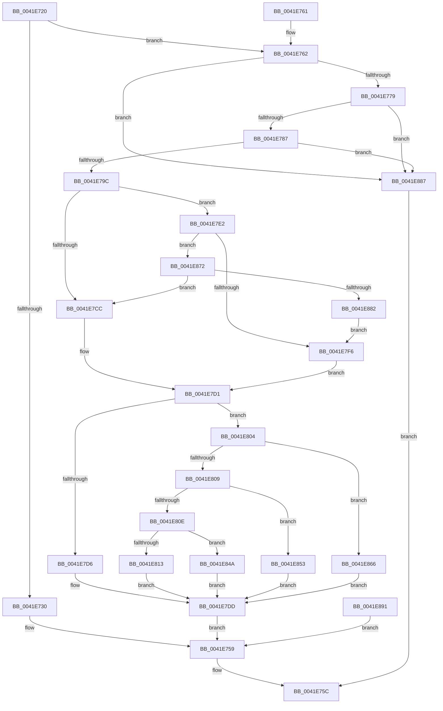

# EtwActivityIdControl

- RVA: `0x0041E720`–`0x0041E899` (길이 `377` bytes)
- VA: `0x000000014041E720`
- 실행 섹션: `.text`
- PDB 이름 있음: `예`; PDB Function 태그: `아니요`
- unwind 정보 RVA: `0x0009FB90`
- 디코드: `82`개 명령, `377/377` bytes 표시
- 미해석 바이트: `0` (있으면 어셈블리에 `.byte`로 보존)

> 이 문서는 커널 이미지의 기계어와 PDB 기호를 분석해 생성했습니다. 4번과 5번은 함수 원형과 자료형을 바이너리 사용 방식에서 추정한 C 해석이며 원본 소스 복구 결과는 아닙니다.

## 1. Dependencies

- 직접 호출 지점: **0**; 고유 호출 대상: **0**
- 직접 호출자로 확인된 함수: **25**
- RIP 상대 이미지 참조: **0**

### Outgoing calls
- 직접 디코드된 call 명령이 없습니다.

### Direct callers
- [IopInitActivityIdIrp](../45/IopInitActivityIdIrp_function_0045B014.md) at `0x0045B189`
- [IoSetActivityIdIrp](../45/IoSetActivityIdIrp_function_0045B220.md) at `0x0045B31A`
- [IoCaptureLiveDump](../4E/IoCaptureLiveDump_function_004E085C.md) at `0x004E0BAE`
- [IoCaptureLiveDump](../4E/IoCaptureLiveDump_function_004E085C.md) at `0x004E0BBF`
- [IoCaptureLiveDump](../4E/IoCaptureLiveDump_function_004E085C.md) at `0x004E10B0`
- [IoWriteDeferredLiveDumpData](../59/IoWriteDeferredLiveDumpData_function_00598CD0.md) at `0x00598E3D`
- [PopAdaptiveStandbyActivatorCallback](../5D/PopAdaptiveStandbyActivatorCallback_function_005DC590.md) at `0x005DC5D2`
- [sub_006D81E4](../6D/Unknown_function_006D81E4.md) at `0x006D81F6`
- [PopAdaptiveStandbyActionWorker](../../page/76/PopAdaptiveStandbyActionWorker_function_0076C9B0.md) at `0x0076C9E4`
- [PopAdaptiveStandbyHandlePowerMessage](../../page/76/PopAdaptiveStandbyHandlePowerMessage_function_0076DB70.md) at `0x0076DBB0`
- [PopAdaptiveStandbyInitialize](../../page/76/PopAdaptiveStandbyInitialize_function_0076DDF8.md) at `0x0076DE69`
- [PopAdaptiveStandbyInitializeActivator](../../page/76/PopAdaptiveStandbyInitializeActivator_function_0076E174.md) at `0x0076E1AD`
- [PopAdaptiveStandbyNotifyShellPhaseState](../../page/76/PopAdaptiveStandbyNotifyShellPhaseState_function_0076E2CC.md) at `0x0076E311`
- [PopAdaptiveStandbyPolicyTimerWorker](../../page/76/PopAdaptiveStandbyPolicyTimerWorker_function_0076E410.md) at `0x0076E43A`
- [PopAdaptiveStandbyPowerSettingCallback](../../page/76/PopAdaptiveStandbyPowerSettingCallback_function_0076E530.md) at `0x0076E571`
- [PopAdaptiveStandbyWnfCallback](../../page/76/PopAdaptiveStandbyWnfCallback_function_0076F910.md) at `0x0076F983`
- [VrpPreRenameKey](../../page/83/VrpPreRenameKey_function_0083B9B8.md) at `0x0083B9EC`
- [VrpRegistryCallback](../../page/86/VrpRegistryCallback_function_00867450.md) at `0x008674C4`
- [VrpPreOpenOrCreate](../../page/93/VrpPreOpenOrCreate_function_00932B84.md) at `0x00932BF3`
- [VrpPostQueryKey](../../page/93/VrpPostQueryKey_function_009338F0.md) at `0x00933935`
- [VrpPostEnumerateKey](../../page/93/VrpPostEnumerateKey_function_00933EA8.md) at `0x00933F2C`
- [VrpIoctlDeviceDispatch](../../page/93/VrpIoctlDeviceDispatch_function_00934C50.md) at `0x00934CC0`
- [VrpPostOpenOrCreate](../../page/93/VrpPostOpenOrCreate_function_00936510.md) at `0x00936550`
- [VrpPreQueryKeyName](../../page/A1/VrpPreQueryKeyName_function_00A16DB8.md) at `0x00A16DFB`
- [VrpPreLoadKey](../../page/A8/VrpPreLoadKey_function_00A8A43C.md) at `0x00A8A4F5`
- [VrpPostUnloadKey](../../page/AD/VrpPostUnloadKey_function_00AD60DC.md) at `0x00AD610D`
- [VrpPreFlushKey](../../page/AD/VrpPreFlushKey_function_00AD6154.md) at `0x00AD617E`

### Static image references
- 디코드된 RIP-relative 메모리 참조가 없습니다.

## 2. Other-region calls and transfers

- 다른 실행 섹션으로 향하는 call: **0**
- 별도 외부 분기/꼬리 이동을 확인하지 못했습니다.

## 3. Assembly (complete function range)

```asm
0041E720  48 83 EC 28                     sub rsp, 0x28
0041E724  C7 04 24 00 00 00 00            mov dword ptr [rsp], 0
0041E72B  83 F9 03                        cmp ecx, 3
0041E72E  75 32                           jne 0x14041e762
0041E730  65 48 8B 04 25 20 00 00 00      mov rax, qword ptr gs:[0x20]
0041E739  48 8B 80 A8 8B 00 00            mov rax, qword ptr [rax + 0x8ba8]
0041E740  41 B8 01 00 00 00               mov r8d, 1
0041E746  F0 4C 0F C1 40 08               lock xadd qword ptr [rax + 8], r8
0041E74C  49 FF C0                        inc r8
0041E74F  4C 89 42 08                     mov qword ptr [rdx + 8], r8
0041E753  48 8B 00                        mov rax, qword ptr [rax]
0041E756  48 89 02                        mov qword ptr [rdx], rax
0041E759  8B 04 24                        mov eax, dword ptr [rsp]
0041E75C  48 83 C4 28                     add rsp, 0x28
0041E760  C3                              ret
0041E761  CC                              int3
0041E762  65 4C 8B 04 25 88 01 00 00      mov r8, qword ptr gs:[0x188]
0041E76B  41 F7 40 74 00 04 00 00         test dword ptr [r8 + 0x74], 0x400
0041E773  0F 85 0E 01 00 00               jne 0x14041e887
0041E779  41 80 B8 4A 02 00 00 01         cmp byte ptr [r8 + 0x24a], 1
0041E781  0F 84 00 01 00 00               je 0x14041e887
0041E787  4D 8B 88 F0 00 00 00            mov r9, qword ptr [r8 + 0xf0]
0041E78E  4C 89 4C 24 40                  mov qword ptr [rsp + 0x40], r9
0041E793  4D 85 C9                        test r9, r9
0041E796  0F 84 EB 00 00 00               je 0x14041e887
0041E79C  49 8D 81 10 17 00 00            lea rax, [r9 + 0x1710]
0041E7A3  48 89 44 24 08                  mov qword ptr [rsp + 8], rax
0041E7A8  65 48 8B 04 25 88 01 00 00      mov rax, qword ptr gs:[0x188]
0041E7B1  48 89 44 24 48                  mov qword ptr [rsp + 0x48], rax
0041E7B6  4C 8B 80 B8 00 00 00            mov r8, qword ptr [rax + 0xb8]
0041E7BD  4C 89 44 24 10                  mov qword ptr [rsp + 0x10], r8
0041E7C2  49 83 B8 10 03 00 00 00         cmp qword ptr [r8 + 0x310], 0
0041E7CA  75 16                           jne 0x14041e7e2
0041E7CC  4C 8B 4C 24 08                  mov r9, qword ptr [rsp + 8]
0041E7D1  83 F9 01                        cmp ecx, 1
0041E7D4  75 2E                           jne 0x14041e804
0041E7D6  41 0F 10 01                     movups xmm0, xmmword ptr [r9]
0041E7DA  0F 11 02                        movups xmmword ptr [rdx], xmm0
0041E7DD  E9 77 FF FF FF                  jmp 0x14041e759
0041E7E2  41 0F B7 80 EC 06 00 00         movzx eax, word ptr [r8 + 0x6ec]
0041E7EA  41 B8 4C 01 00 00               mov r8d, 0x14c
0041E7F0  66 41 3B C0                     cmp ax, r8w
0041E7F4  75 7C                           jne 0x14041e872
0041E7F6  49 81 C1 50 2F 00 00            add r9, 0x2f50
0041E7FD  4C 89 4C 24 08                  mov qword ptr [rsp + 8], r9
0041E802  EB CD                           jmp 0x14041e7d1
0041E804  83 E9 02                        sub ecx, 2
0041E807  74 5D                           je 0x14041e866
0041E809  83 E9 02                        sub ecx, 2
0041E80C  74 45                           je 0x14041e853
0041E80E  83 F9 01                        cmp ecx, 1
0041E811  75 37                           jne 0x14041e84a
0041E813  41 0F 10 01                     movups xmm0, xmmword ptr [r9]
0041E817  0F 11 02                        movups xmmword ptr [rdx], xmm0
0041E81A  65 48 8B 04 25 20 00 00 00      mov rax, qword ptr gs:[0x20]
0041E823  48 8B 80 A8 8B 00 00            mov rax, qword ptr [rax + 0x8ba8]
0041E82A  41 B8 01 00 00 00               mov r8d, 1
0041E830  F0 4C 0F C1 40 08               lock xadd qword ptr [rax + 8], r8
0041E836  49 FF C0                        inc r8
0041E839  48 8B 4C 24 08                  mov rcx, qword ptr [rsp + 8]
0041E83E  4C 89 41 08                     mov qword ptr [rcx + 8], r8
0041E842  48 8B 00                        mov rax, qword ptr [rax]
0041E845  48 89 01                        mov qword ptr [rcx], rax
0041E848  EB 93                           jmp 0x14041e7dd
0041E84A  C7 04 24 0D 00 00 C0            mov dword ptr [rsp], 0xc000000d
0041E851  EB 8A                           jmp 0x14041e7dd
0041E853  41 0F 10 09                     movups xmm1, xmmword ptr [r9]
0041E857  0F 10 02                        movups xmm0, xmmword ptr [rdx]
0041E85A  41 0F 11 01                     movups xmmword ptr [r9], xmm0
0041E85E  0F 11 0A                        movups xmmword ptr [rdx], xmm1
0041E861  E9 77 FF FF FF                  jmp 0x14041e7dd
0041E866  0F 10 02                        movups xmm0, xmmword ptr [rdx]
0041E869  41 0F 11 01                     movups xmmword ptr [r9], xmm0
0041E86D  E9 6B FF FF FF                  jmp 0x14041e7dd
0041E872  41 B8 C4 01 00 00               mov r8d, 0x1c4
0041E878  66 41 3B C0                     cmp ax, r8w
0041E87C  0F 85 4A FF FF FF               jne 0x14041e7cc
0041E882  E9 6F FF FF FF                  jmp 0x14041e7f6
0041E887  B8 BB 00 00 C0                  mov eax, 0xc00000bb
0041E88C  E9 CB FE FF FF                  jmp 0x14041e75c
0041E891  89 04 24                        mov dword ptr [rsp], eax
0041E894  E9 C0 FE FF FF                  jmp 0x14041e759
```

## 4. C-style interpretation (structured pseudocode)

```c
__int64 __fastcall EtwActivityIdControl(int a1, __int64 a2)
{
    __int64 v_rsp;
    unsigned int v_stack_m28;
    unsigned int v_stack_p0;
    unsigned __int64 v_stack_p10;
    unsigned __int64 v_stack_p40;
    unsigned __int64 v_stack_p48;
    unsigned __int64 v_stack_p8;

    v_rsp = (v_rsp) - (40);
    v_stack_m28 = 0;
    if (a1 != 3) goto loc_0041E762;
    a3 = (1) + 1;
    *(unsigned __int64 *)(a2 + 8) = a3;
    *(unsigned __int64 *)(a2) = *(unsigned __int64 *)(*(unsigned __int64 *)(*(unsigned __int64 *)(gs_base + (0 + 32)) + 35752));
loc_0041E759:
loc_0041E75C:
    v_rsp = (v_rsp) + (40);
    return (unsigned int)(v_stack_m28);
loc_0041E762:
    if (((*(unsigned int *)(*(unsigned __int64 *)(gs_base + (0 + 392)) + 116)) & (0x400ULL)) != 0) goto loc_0041E887;
    if ((*(unsigned __int8 *)(*(unsigned __int64 *)(gs_base + (0 + 392)) + 586)) == 1) goto loc_0041E887;
    v_stack_p40 = *(unsigned __int64 *)(*(unsigned __int64 *)(gs_base + (0 + 392)) + 240);
    if (*(unsigned __int64 *)(*(unsigned __int64 *)(gs_base + (0 + 392)) + 240) == 0) goto loc_0041E887;
    v_stack_p8 = *(unsigned __int64 *)(*(unsigned __int64 *)(gs_base + (0 + 392)) + 240) + 5904;
    v_stack_p48 = *(unsigned __int64 *)(gs_base + (0 + 392));
    v_stack_p10 = *(unsigned __int64 *)(*(unsigned __int64 *)(gs_base + (0 + 392)) + 184);
    if ((*(unsigned __int64 *)(*(unsigned __int64 *)(*(unsigned __int64 *)(gs_base + (0 + 392)) + 184) + 784)) != 0) goto loc_0041E7E2;
loc_0041E7CC:
loc_0041E7D1:
    if (a1 != 1) goto loc_0041E804;
    *(unsigned __int64 *)(a2) = v_xmm0;
loc_0041E7DD:
    goto loc_0041E759;
loc_0041E7E2:
    if (((unsigned __int16)(*(unsigned __int16 *)(*(unsigned __int64 *)(*(unsigned __int64 *)(gs_base + (0 + 392)) + 184) + 1772))) != 332) goto loc_0041E872;
loc_0041E7F6:
    a4 = (v_stack_p8) + (0x2F50ULL);
    v_stack_p8 = a4;
    goto loc_0041E7D1;
loc_0041E804:
    a1 = (unsigned int)((a1) - (2));
    if (condition_is_equal) goto loc_0041E866;
    a1 = (unsigned int)((a1) - (2));
    if (condition_is_equal) goto loc_0041E853;
    if (a1 != 1) goto loc_0041E84A;
    *(unsigned __int64 *)(a2) = v_xmm0;
    a3 = (1) + 1;
    *(unsigned __int64 *)(v_stack_p8 + 8) = a3;
    *(unsigned __int64 *)(v_stack_p8) = *(unsigned __int64 *)(*(unsigned __int64 *)(*(unsigned __int64 *)(gs_base + (0 + 32)) + 35752));
    goto loc_0041E7DD;
loc_0041E84A:
    v_stack_p0 = 0xC000000DULL;
    goto loc_0041E7DD;
loc_0041E853:
    *(unsigned __int64 *)(a4) = v_xmm0;
    *(unsigned __int64 *)(a2) = v_xmm1;
    goto loc_0041E7DD;
loc_0041E866:
    *(unsigned __int64 *)(a4) = v_xmm0;
    goto loc_0041E7DD;
loc_0041E872:
    if (((unsigned __int16)(*(unsigned __int64 *)(*(unsigned __int64 *)(*(unsigned __int64 *)(gs_base + (0 + 32)) + 35752)))) != 452) goto loc_0041E7CC;
    goto loc_0041E7F6;
loc_0041E887:
    goto loc_0041E75C;
}
```

## 5. (Beta) C Style

```c
int64_t EtwActivityIdControl(int32_t Arg1, void *Arg2)
{
    uint8_t *arg2 = (uint8_t *)Arg2;

    int64_t local_rsp;
    uint32_t v_stack_m28;
    uint32_t v_stack_p0;
    uint64_t v_stack_p10;
    uint64_t v_stack_p40;
    uint64_t v_stack_p48;
    uint64_t v_stack_p8;

    local_rsp = (local_rsp) - (40);
    v_stack_m28 = 0;
    if (Arg1 != 3) goto loc_0041E762;
    a3 = (1) + 1;
    *(uint64_t *)(arg2 + 0x8) = a3;
    *(uint64_t *)(arg2) = *(uint64_t *)(*(uint64_t *)(*(uint64_t *)(gs_base + (0 + 0x20)) + 0x8BA8));
loc_0041E759:
loc_0041E75C:
    local_rsp = (local_rsp) + (40);
    return (uint32_t)(v_stack_m28);
loc_0041E762:
    if (((*(uint32_t *)(*(uint64_t *)(gs_base + (0 + 0x188)) + 0x74)) & (0x400ULL)) != 0) goto loc_0041E887;
    if ((*(uint8_t *)(*(uint64_t *)(gs_base + (0 + 0x188)) + 0x24A)) == 1) goto loc_0041E887;
    v_stack_p40 = *(uint64_t *)(*(uint64_t *)(gs_base + (0 + 0x188)) + 0xF0);
    if (*(uint64_t *)(*(uint64_t *)(gs_base + (0 + 0x188)) + 0xF0) == 0) goto loc_0041E887;
    v_stack_p8 = *(uint64_t *)(*(uint64_t *)(gs_base + (0 + 0x188)) + 0xF0) + 5904;
    v_stack_p48 = *(uint64_t *)(gs_base + (0 + 0x188));
    v_stack_p10 = *(uint64_t *)(*(uint64_t *)(gs_base + (0 + 0x188)) + 0xB8);
    if ((*(uint64_t *)(*(uint64_t *)(*(uint64_t *)(gs_base + (0 + 0x188)) + 0xB8) + 0x310)) != 0) goto loc_0041E7E2;
loc_0041E7CC:
loc_0041E7D1:
    if (Arg1 != 1) goto loc_0041E804;
    *(uint64_t *)(arg2) = v_xmm0;
loc_0041E7DD:
    goto loc_0041E759;
loc_0041E7E2:
    if (((uint16_t)(*(uint16_t *)(*(uint64_t *)(*(uint64_t *)(gs_base + (0 + 0x188)) + 0xB8) + 0x6EC))) != 332) goto loc_0041E872;
loc_0041E7F6:
    a4 = (v_stack_p8) + (0x2F50ULL);
    v_stack_p8 = a4;
    goto loc_0041E7D1;
loc_0041E804:
    Arg1 = (uint32_t)((Arg1) - (2));
    if (condition_is_equal) goto loc_0041E866;
    Arg1 = (uint32_t)((Arg1) - (2));
    if (condition_is_equal) goto loc_0041E853;
    if (Arg1 != 1) goto loc_0041E84A;
    *(uint64_t *)(arg2) = v_xmm0;
    a3 = (1) + 1;
    *(uint64_t *)(v_stack_p8 + 0x8) = a3;
    *(uint64_t *)(v_stack_p8) = *(uint64_t *)(*(uint64_t *)(*(uint64_t *)(gs_base + (0 + 0x20)) + 0x8BA8));
    goto loc_0041E7DD;
loc_0041E84A:
    v_stack_p0 = 0xC000000DULL;
    goto loc_0041E7DD;
loc_0041E853:
    *(uint64_t *)(a4) = v_xmm0;
    *(uint64_t *)(arg2) = v_xmm1;
    goto loc_0041E7DD;
loc_0041E866:
    *(uint64_t *)(a4) = v_xmm0;
    goto loc_0041E7DD;
loc_0041E872:
    if (((uint16_t)(*(uint64_t *)(*(uint64_t *)(*(uint64_t *)(gs_base + (0 + 0x20)) + 0x8BA8)))) != 452) goto loc_0041E7CC;
    goto loc_0041E7F6;
loc_0041E887:
    goto loc_0041E75C;
}
```

### 관측된 메모리 오프셋

구조체 형식이 확인되지 않은 접근은 인자 기준의 오프셋으로만 기록했습니다.

| 기준 인자 | 오프셋 표현 | 폭 (bit) | 접근 |
|---|---:|---:|---|
| `Arg2` | `+ 0x0` | `64` | `W` |
| `Arg2` | `+ 0x0` | `128` | `R` |
| `Arg2` | `+ 0x8` | `64` | `W` |

## 6. Execution-region graph

[열기: 2D/3D 그래프와 함수 탐색 컨트롤 패널](../../../control-panel.html?section=text&rva=0x0041E720&view=graph)

- 2D 그래프는 위에서 아래로 흐르고, 3D 그래프는 빈 공간을 드래그해 회전합니다. Shift+드래그는 이동, 휠은 확대·축소, 함수 노드 선택은 대상 보고서 이동입니다.

### Static fallback


