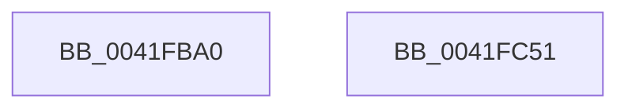

# EtwCovSampHash

- RVA: `0x0041FBA0`–`0x0041FC52` (길이 `178` bytes)
- VA: `0x000000014041FBA0`
- 실행 섹션: `.text`
- PDB 이름 있음: `예`; PDB Function 태그: `아니요`
- unwind 정보 RVA: `0x000DB714`
- 디코드: `48`개 명령, `178/178` bytes 표시
- 미해석 바이트: `0` (있으면 어셈블리에 `.byte`로 보존)

> 이 문서는 커널 이미지의 기계어와 PDB 기호를 분석해 생성했습니다. 4번과 5번은 함수 원형과 자료형을 바이너리 사용 방식에서 추정한 C 해석이며 원본 소스 복구 결과는 아닙니다.

## 1. Dependencies

- 직접 호출 지점: **0**; 고유 호출 대상: **0**
- 직접 호출자로 확인된 함수: **2**
- RIP 상대 이미지 참조: **0**

### Outgoing calls
- 직접 디코드된 call 명령이 없습니다.

### Direct callers
- [EtwpCovSampContextAddSamples](../../page/8D/EtwpCovSampContextAddSamples_function_008D7C9C.md) at `0x008D7D6B`
- [EtwpCovSampContextGetModule](../../page/8D/EtwpCovSampContextGetModule_function_008D7FEC.md) at `0x008D8417`
- [EtwpCovSampContextGetModule](../../page/8D/EtwpCovSampContextGetModule_function_008D7FEC.md) at `0x008D8449`
- [EtwpCovSampContextGetModule](../../page/8D/EtwpCovSampContextGetModule_function_008D7FEC.md) at `0x008D8456`
- [EtwpCovSampContextGetModule](../../page/8D/EtwpCovSampContextGetModule_function_008D7FEC.md) at `0x008D8468`

### Static image references
- 디코드된 RIP-relative 메모리 참조가 없습니다.

## 2. Other-region calls and transfers

- 다른 실행 섹션으로 향하는 call: **0**
- 별도 외부 분기/꼬리 이동을 확인하지 못했습니다.

## 3. Assembly (complete function range)

```asm
0041FBA0  4C 8B D9                        mov r11, rcx
0041FBA3  0F B6 C1                        movzx eax, cl
0041FBA6  33 C2                           xor eax, edx
0041FBA8  48 89 54 24 10                  mov qword ptr [rsp + 0x10], rdx
0041FBAD  44 69 C8 93 01 00 01            imul r9d, eax, 0x1000193
0041FBB4  48 8B C1                        mov rax, rcx
0041FBB7  48 C1 E8 20                     shr rax, 0x20
0041FBBB  0F B6 D0                        movzx edx, al
0041FBBE  48 8B C1                        mov rax, rcx
0041FBC1  33 54 24 14                     xor edx, dword ptr [rsp + 0x14]
0041FBC5  48 C1 E8 28                     shr rax, 0x28
0041FBC9  0F B6 C0                        movzx eax, al
0041FBCC  44 69 C2 93 01 00 01            imul r8d, edx, 0x1000193
0041FBD3  44 33 C0                        xor r8d, eax
0041FBD6  48 8B C1                        mov rax, rcx
0041FBD9  48 C1 E8 08                     shr rax, 8
0041FBDD  45 33 C1                        xor r8d, r9d
0041FBE0  0F B6 C8                        movzx ecx, al
0041FBE3  49 8B C3                        mov rax, r11
0041FBE6  48 C1 E8 10                     shr rax, 0x10
0041FBEA  41 33 C9                        xor ecx, r9d
0041FBED  0F B6 C0                        movzx eax, al
0041FBF0  69 D1 93 01 00 01               imul edx, ecx, 0x1000193
0041FBF6  45 69 D0 93 01 00 01            imul r10d, r8d, 0x1000193
0041FBFD  33 D0                           xor edx, eax
0041FBFF  49 8B C3                        mov rax, r11
0041FC02  48 C1 E8 30                     shr rax, 0x30
0041FC06  41 33 D2                        xor edx, r10d
0041FC09  0F B6 C8                        movzx ecx, al
0041FC0C  49 8B C3                        mov rax, r11
0041FC0F  48 C1 E8 38                     shr rax, 0x38
0041FC13  41 33 CA                        xor ecx, r10d
0041FC16  44 69 CA 93 01 00 01            imul r9d, edx, 0x1000193
0041FC1D  69 D1 93 01 00 01               imul edx, ecx, 0x1000193
0041FC23  49 C1 EB 18                     shr r11, 0x18
0041FC27  33 D0                           xor edx, eax
0041FC29  41 0F B6 C3                     movzx eax, r11b
0041FC2D  41 33 C1                        xor eax, r9d
0041FC30  41 33 D1                        xor edx, r9d
0041FC33  44 69 C2 93 01 00 01            imul r8d, edx, 0x1000193
0041FC3A  69 C0 93 01 00 01               imul eax, eax, 0x1000193
0041FC40  41 8B C8                        mov ecx, r8d
0041FC43  48 33 C1                        xor rax, rcx
0041FC46  41 8B C8                        mov ecx, r8d
0041FC49  48 C1 E1 20                     shl rcx, 0x20
0041FC4D  48 0B C1                        or rax, rcx
0041FC50  C3                              ret
0041FC51  CC                              int3
```

## 4. C-style interpretation (structured pseudocode)

```c
__int64 __fastcall EtwCovSampHash(__int64 a1, __int64 a2)
{
    __int64 result;
    __int64 v_r10;
    __int64 v_r11;
    unsigned __int64 v_stack_p10;
    unsigned int v_stack_p14;

    result = (unsigned int)(((unsigned __int8)(a1)) ^ ((unsigned int)(a2)));
    v_stack_p10 = a2;
    a4 = (unsigned int)((a4) * ((unsigned int)(result)));
    result = (a1) >> (32);
    a2 = (unsigned int)(((unsigned __int8)(result)) ^ (v_stack_p14));
    result = (a1) >> (40);
    a3 = (unsigned int)((a3) * ((unsigned int)(a2)));
    a3 = (unsigned int)((a3) ^ ((unsigned int)((unsigned __int8)(result))));
    result = (a1) >> (8);
    a3 = (unsigned int)((a3) ^ ((unsigned int)(a4)));
    result = (a1) >> (16);
    a1 = (unsigned int)(((unsigned __int8)(result)) ^ ((unsigned int)(a4)));
    a2 = (unsigned int)((a2) * ((unsigned int)(a1)));
    v_r10 = (unsigned int)((v_r10) * ((unsigned int)(a3)));
    a2 = (unsigned int)((a2) ^ ((unsigned int)((unsigned __int8)(result))));
    result = (a1) >> (48);
    a2 = (unsigned int)((a2) ^ ((unsigned int)(v_r10)));
    result = (a1) >> (56);
    a1 = (unsigned int)(((unsigned __int8)(result)) ^ ((unsigned int)(v_r10)));
    a4 = (unsigned int)((a4) * ((unsigned int)(a2)));
    a2 = (unsigned int)((a2) * ((unsigned int)(a1)));
    v_r11 = (a1) >> (24);
    a2 = (unsigned int)((a2) ^ ((unsigned int)(result)));
    result = (unsigned int)(((unsigned __int8)(v_r11)) ^ ((unsigned int)(a4)));
    a2 = (unsigned int)((a2) ^ ((unsigned int)(a4)));
    a3 = (unsigned int)((a3) * ((unsigned int)(a2)));
    result = (unsigned int)((result) * ((unsigned int)(result)));
    result = (result) ^ ((unsigned int)((unsigned int)(a3)));
    a1 = ((unsigned int)((unsigned int)(a3))) << (32);
    result = (result) | (a1);
    return result;
}
```

## 5. (Beta) C Style

```c
int64_t EtwCovSampHash(int64_t Arg1, int64_t Arg2)
{
    int64_t result;
    int64_t local_r10;
    int64_t local_r11;
    uint64_t v_stack_p10;
    uint32_t v_stack_p14;

    result = (uint32_t)(((uint8_t)(Arg1)) ^ ((uint32_t)(Arg2)));
    v_stack_p10 = Arg2;
    a4 = (uint32_t)((a4) * ((uint32_t)(result)));
    result = (Arg1) >> (32);
    Arg2 = (uint32_t)(((uint8_t)(result)) ^ (v_stack_p14));
    result = (Arg1) >> (40);
    a3 = (uint32_t)((a3) * ((uint32_t)(Arg2)));
    a3 = (uint32_t)((a3) ^ ((uint32_t)((uint8_t)(result))));
    result = (Arg1) >> (8);
    a3 = (uint32_t)((a3) ^ ((uint32_t)(a4)));
    result = (Arg1) >> (16);
    Arg1 = (uint32_t)(((uint8_t)(result)) ^ ((uint32_t)(a4)));
    Arg2 = (uint32_t)((Arg2) * ((uint32_t)(Arg1)));
    local_r10 = (uint32_t)((local_r10) * ((uint32_t)(a3)));
    Arg2 = (uint32_t)((Arg2) ^ ((uint32_t)((uint8_t)(result))));
    result = (Arg1) >> (48);
    Arg2 = (uint32_t)((Arg2) ^ ((uint32_t)(local_r10)));
    result = (Arg1) >> (56);
    Arg1 = (uint32_t)(((uint8_t)(result)) ^ ((uint32_t)(local_r10)));
    a4 = (uint32_t)((a4) * ((uint32_t)(Arg2)));
    Arg2 = (uint32_t)((Arg2) * ((uint32_t)(Arg1)));
    local_r11 = (Arg1) >> (24);
    Arg2 = (uint32_t)((Arg2) ^ ((uint32_t)(result)));
    result = (uint32_t)(((uint8_t)(local_r11)) ^ ((uint32_t)(a4)));
    Arg2 = (uint32_t)((Arg2) ^ ((uint32_t)(a4)));
    a3 = (uint32_t)((a3) * ((uint32_t)(Arg2)));
    result = (uint32_t)((result) * ((uint32_t)(result)));
    result = (result) ^ ((uint32_t)((uint32_t)(a3)));
    Arg1 = ((uint32_t)((uint32_t)(a3))) << (32);
    result = (result) | (Arg1);
    return result;
}
```

## 6. Execution-region graph

[열기: 2D/3D 그래프와 함수 탐색 컨트롤 패널](../../../control-panel.html?section=text&rva=0x0041FBA0&view=graph)

- 2D 그래프는 위에서 아래로 흐르고, 3D 그래프는 빈 공간을 드래그해 회전합니다. Shift+드래그는 이동, 휠은 확대·축소, 함수 노드 선택은 대상 보고서 이동입니다.

### Static fallback


