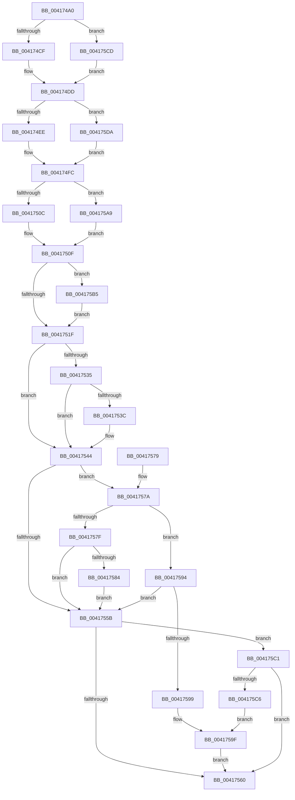

# EtwTraceContextSwap

- RVA: `0x004174A0`–`0x004175E7` (길이 `327` bytes)
- VA: `0x00000001404174A0`
- 실행 섹션: `.text`
- PDB 이름 있음: `예`; PDB Function 태그: `아니요`
- unwind 정보 RVA: `0x0009CD58`
- 디코드: `83`개 명령, `327/327` bytes 표시
- 미해석 바이트: `0` (있으면 어셈블리에 `.byte`로 보존)

> 이 문서는 커널 이미지의 기계어와 PDB 기호를 분석해 생성했습니다. 4번과 5번은 함수 원형과 자료형을 바이너리 사용 방식에서 추정한 C 해석이며 원본 소스 복구 결과는 아닙니다.

## 1. Dependencies

- 직접 호출 지점: **6**; 고유 호출 대상: **3**
- 직접 호출자로 확인된 함수: **1**
- RIP 상대 이미지 참조: **2**

### Outgoing calls
- `0x0041753F` → [EtwpCoverageSamplerContextSwap](../4F/EtwpCoverageSamplerContextSwap_function_004FC9F8.md) (function, `0x004FC9F8`)
- `0x00417551` → [EtwpLogContextSwapEvent](EtwpLogContextSwapEvent_function_004175F0.md) (function, `0x004175F0`)
- `0x0041758D` → [EtwpLogContextSwapEvent](EtwpLogContextSwapEvent_function_004175F0.md) (function, `0x004175F0`)
- `0x004175A2` → [EtwpLogContextSwapEvent](EtwpLogContextSwapEvent_function_004175F0.md) (function, `0x004175F0`)
- `0x004175CD` → [PsGetEffectiveServerSilo](../22/PsGetEffectiveServerSilo_function_002257F0.md) (function, `0x002257F0`)
- `0x004175DA` → [PsGetEffectiveServerSilo](../22/PsGetEffectiveServerSilo_function_002257F0.md) (function, `0x002257F0`)

### Direct callers
- [SwapContext](../6B/SwapContext_function_006B9820.md) at `0x006B9E21`

### Static image references
- `0x004174FC` → RVA `0x00FCF940` (`CACHEALI`; read)
- `0x00417526` → RVA `0x00FC6AA8` (`ALMOSTRO`; read)

## 2. Other-region calls and transfers

- 다른 실행 섹션으로 향하는 call: **0**
- 별도 외부 분기/꼬리 이동을 확인하지 못했습니다.

## 3. Assembly (complete function range)

```asm
004174A0  48 89 5C 24 08                  mov qword ptr [rsp + 8], rbx
004174A5  48 89 6C 24 10                  mov qword ptr [rsp + 0x10], rbp
004174AA  48 89 74 24 18                  mov qword ptr [rsp + 0x18], rsi
004174AF  57                              push rdi
004174B0  41 56                           push r14
004174B2  41 57                           push r15
004174B4  48 83 EC 20                     sub rsp, 0x20
004174B8  48 8B F9                        mov rdi, rcx
004174BB  48 8B DA                        mov rbx, rdx
004174BE  48 8B 89 98 06 00 00            mov rcx, qword ptr [rcx + 0x698]
004174C5  48 83 F9 FD                     cmp rcx, -3
004174C9  0F 85 FE 00 00 00               jne 0x1404175cd
004174CF  48 8B 87 20 02 00 00            mov rax, qword ptr [rdi + 0x220]
004174D6  48 8B B0 F0 05 00 00            mov rsi, qword ptr [rax + 0x5f0]
004174DD  48 8B 8B 98 06 00 00            mov rcx, qword ptr [rbx + 0x698]
004174E4  48 83 F9 FD                     cmp rcx, -3
004174E8  0F 85 EC 00 00 00               jne 0x1404175da
004174EE  48 8B 83 20 02 00 00            mov rax, qword ptr [rbx + 0x220]
004174F5  48 8B A8 F0 05 00 00            mov rbp, qword ptr [rax + 0x5f0]
004174FC  48 8D 05 3D 84 BB 00            lea rax, [rip + 0xbb843d]
00417503  48 85 F6                        test rsi, rsi
00417506  0F 85 9D 00 00 00               jne 0x1404175a9
0041750C  48 8B C8                        mov rcx, rax
0041750F  4C 8B B1 40 03 00 00            mov r14, qword ptr [rcx + 0x340]
00417516  48 85 ED                        test rbp, rbp
00417519  0F 85 96 00 00 00               jne 0x1404175b5
0041751F  4C 8B B8 40 03 00 00            mov r15, qword ptr [rax + 0x340]
00417526  48 8B 05 7B F5 BA 00            mov rax, qword ptr [rip + 0xbaf57b]
0041752D  48 05 EC 12 00 00               add rax, 0x12ec
00417533  74 0F                           je 0x140417544
00417535  8B 40 04                        mov eax, dword ptr [rax + 4]
00417538  A8 04                           test al, 4
0041753A  74 08                           je 0x140417544
0041753C  48 8B CB                        mov rcx, rbx
0041753F  E8 B4 54 0E 00                  call 0x1404fc9f8
00417544  48 8B 0D 5D F5 BA 00            mov rcx, qword ptr [rip + 0xbaf55d]
0041754B  4C 8B C3                        mov r8, rbx
0041754E  48 8B D7                        mov rdx, rdi
00417551  E8 9A 00 00 00                  call 0x1404175f0
00417556  48 85 F6                        test rsi, rsi
00417559  75 1F                           jne 0x14041757a
0041755B  48 85 ED                        test rbp, rbp
0041755E  75 61                           jne 0x1404175c1
00417560  48 8B 5C 24 40                  mov rbx, qword ptr [rsp + 0x40]
00417565  48 8B 6C 24 48                  mov rbp, qword ptr [rsp + 0x48]
0041756A  48 8B 74 24 50                  mov rsi, qword ptr [rsp + 0x50]
0041756F  48 83 C4 20                     add rsp, 0x20
00417573  41 5F                           pop r15
00417575  41 5E                           pop r14
00417577  5F                              pop rdi
00417578  C3                              ret
00417579  CC                              int3
0041757A  48 3B F5                        cmp rsi, rbp
0041757D  74 15                           je 0x140417594
0041757F  4D 85 F6                        test r14, r14
00417582  74 D7                           je 0x14041755b
00417584  45 33 C0                        xor r8d, r8d
00417587  48 8B D7                        mov rdx, rdi
0041758A  49 8B CE                        mov rcx, r14
0041758D  E8 5E 00 00 00                  call 0x1404175f0
00417592  EB C7                           jmp 0x14041755b
00417594  4D 85 F6                        test r14, r14
00417597  74 C2                           je 0x14041755b
00417599  48 8B D7                        mov rdx, rdi
0041759C  49 8B CE                        mov rcx, r14
0041759F  4C 8B C3                        mov r8, rbx
004175A2  E8 49 00 00 00                  call 0x1404175f0
004175A7  EB B7                           jmp 0x140417560
004175A9  48 8B 8E E0 05 00 00            mov rcx, qword ptr [rsi + 0x5e0]
004175B0  E9 5A FF FF FF                  jmp 0x14041750f
004175B5  48 8B 85 E0 05 00 00            mov rax, qword ptr [rbp + 0x5e0]
004175BC  E9 5E FF FF FF                  jmp 0x14041751f
004175C1  4D 85 FF                        test r15, r15
004175C4  74 9A                           je 0x140417560
004175C6  33 D2                           xor edx, edx
004175C8  49 8B CF                        mov rcx, r15
004175CB  EB D2                           jmp 0x14041759f
004175CD  E8 1E E2 E0 FF                  call 0x1402257f0
004175D2  48 8B F0                        mov rsi, rax
004175D5  E9 03 FF FF FF                  jmp 0x1404174dd
004175DA  E8 11 E2 E0 FF                  call 0x1402257f0
004175DF  48 8B E8                        mov rbp, rax
004175E2  E9 15 FF FF FF                  jmp 0x1404174fc
```

## 4. C-style interpretation (structured pseudocode)

```c
__int64 __fastcall EtwTraceContextSwap(__int64 a1, __int64 a2)
{
    __int64 result;
    __int64 v_rsp;
    unsigned __int64 v_stack_p10;
    unsigned __int64 v_stack_p18;
    unsigned __int64 v_stack_p8;

    v_stack_p8 = v_rbx;
    v_stack_p10 = v_rbp;
    v_stack_p18 = v_rsi;
    v_rsp = (v_rsp) - (32);
    if ((*(unsigned __int64 *)(a1 + 1688)) != -3) goto loc_004175CD;
loc_004174DD:
    if ((*(unsigned __int64 *)(a2 + 1688)) != -3) goto loc_004175DA;
loc_004174FC:
    if (*(unsigned __int64 *)(*(unsigned __int64 *)(a1 + 544) + 1520) != 0) goto loc_004175A9;
loc_0041750F:
    if (*(unsigned __int64 *)(*(unsigned __int64 *)(a2 + 544) + 1520) != 0) goto loc_004175B5;
loc_0041751F:
    result = (*(unsigned __int64 *)(v_rip + 12252539)) + (0x12ECULL);
    if (condition_is_equal) goto loc_00417544;
    result = (unsigned int)(*(unsigned int *)(result + 4));
    if ((((unsigned __int8)((unsigned int)(*(unsigned int *)(result + 4)))) & (4)) != 0) {
        a1 = a2;
        result = EtwpCoverageSamplerContextSwap(a1, a2, a3, a4);
    }
    result = EtwpLogContextSwapEvent(*(unsigned __int64 *)(v_rip + 12252509), a1, a2, a4);
    if (*(unsigned __int64 *)(*(unsigned __int64 *)(a1 + 544) + 1520) != 0) goto loc_0041757A;
loc_0041755B:
    if (*(unsigned __int64 *)(*(unsigned __int64 *)(a2 + 544) + 1520) != 0) goto loc_004175C1;
loc_00417560:
    v_rsp = (v_rsp) + (32);
    return result;
loc_0041757A:
    if (v_stack_p18 == v_stack_p10) goto loc_00417594;
    if (*(unsigned __int64 *)(v_rip + 12289085 + 832) == 0) goto loc_0041755B;
    a3 = 0;
    result = EtwpLogContextSwapEvent(*(unsigned __int64 *)(v_rip + 12289085 + 832), a1, a3, a4);
    goto loc_0041755B;
loc_00417594:
    if (*(unsigned __int64 *)(v_rip + 12289085 + 832) == 0) goto loc_0041755B;
loc_0041759F:
    result = EtwpLogContextSwapEvent(*(unsigned __int64 *)(v_rip + 12289085 + 832), a1, v_stack_p8, a4);
    goto loc_00417560;
loc_004175A9:
    goto loc_0041750F;
loc_004175B5:
    goto loc_0041751F;
loc_004175C1:
    if (*(unsigned __int64 *)(v_rip + 12289085 + 832) == 0) goto loc_00417560;
    a2 = 0;
    goto loc_0041759F;
loc_004175CD:
    result = PsGetEffectiveServerSilo(*(unsigned __int64 *)(v_rip + 12289085 + 832), a2, v_stack_p8, a4);
    goto loc_004174DD;
loc_004175DA:
    result = PsGetEffectiveServerSilo(*(unsigned __int64 *)(v_rip + 12289085 + 832), a2, v_stack_p8, a4);
    goto loc_004174FC;
}
```

## 5. (Beta) C Style

```c
int64_t EtwTraceContextSwap(void *Arg1, void *Arg2)
{
    uint8_t *arg1 = (uint8_t *)Arg1;
    uint8_t *arg2 = (uint8_t *)Arg2;

    int64_t result;
    int64_t local_rsp;
    uint64_t v_stack_p10;
    uint64_t v_stack_p18;
    uint64_t v_stack_p8;

    v_stack_p8 = local_rbx;
    v_stack_p10 = local_rbp;
    v_stack_p18 = local_rsi;
    local_rsp = (local_rsp) - (32);
    if ((*(uint64_t *)(arg1 + 0x698)) != -3) goto loc_004175CD;
loc_004174DD:
    if ((*(uint64_t *)(arg2 + 0x698)) != -3) goto loc_004175DA;
loc_004174FC:
    if (*(uint64_t *)(*(uint64_t *)(arg1 + 0x220) + 0x5F0) != 0) goto loc_004175A9;
loc_0041750F:
    if (*(uint64_t *)(*(uint64_t *)(arg2 + 0x220) + 0x5F0) != 0) goto loc_004175B5;
loc_0041751F:
    result = (*(uint64_t *)(v_rip + 0xBAF57B)) + (0x12ECULL);
    if (condition_is_equal) goto loc_00417544;
    result = (uint32_t)(*(uint32_t *)(result + 0x4));
    if ((((uint8_t)((uint32_t)(*(uint32_t *)(result + 0x4)))) & (4)) != 0) {
        Arg1 = Arg2;
        result = EtwpCoverageSamplerContextSwap(Arg1, Arg2, a3, a4);
    }
    result = EtwpLogContextSwapEvent(*(uint64_t *)(v_rip + 0xBAF55D), Arg1, Arg2, a4);
    if (*(uint64_t *)(*(uint64_t *)(arg1 + 0x220) + 0x5F0) != 0) goto loc_0041757A;
loc_0041755B:
    if (*(uint64_t *)(*(uint64_t *)(arg2 + 0x220) + 0x5F0) != 0) goto loc_004175C1;
loc_00417560:
    local_rsp = (local_rsp) + (32);
    return result;
loc_0041757A:
    if (v_stack_p18 == v_stack_p10) goto loc_00417594;
    if (*(uint64_t *)(v_rip + 0xBB843D + 0x340) == 0) goto loc_0041755B;
    a3 = 0;
    result = EtwpLogContextSwapEvent(*(uint64_t *)(v_rip + 0xBB843D + 0x340), Arg1, a3, a4);
    goto loc_0041755B;
loc_00417594:
    if (*(uint64_t *)(v_rip + 0xBB843D + 0x340) == 0) goto loc_0041755B;
loc_0041759F:
    result = EtwpLogContextSwapEvent(*(uint64_t *)(v_rip + 0xBB843D + 0x340), Arg1, v_stack_p8, a4);
    goto loc_00417560;
loc_004175A9:
    goto loc_0041750F;
loc_004175B5:
    goto loc_0041751F;
loc_004175C1:
    if (*(uint64_t *)(v_rip + 0xBB843D + 0x340) == 0) goto loc_00417560;
    Arg2 = 0;
    goto loc_0041759F;
loc_004175CD:
    result = PsGetEffectiveServerSilo(*(uint64_t *)(v_rip + 0xBB843D + 0x340), Arg2, v_stack_p8, a4);
    goto loc_004174DD;
loc_004175DA:
    result = PsGetEffectiveServerSilo(*(uint64_t *)(v_rip + 0xBB843D + 0x340), Arg2, v_stack_p8, a4);
    goto loc_004174FC;
}
```

### 관측된 메모리 오프셋

구조체 형식이 확인되지 않은 접근은 인자 기준의 오프셋으로만 기록했습니다.

| 기준 인자 | 오프셋 표현 | 폭 (bit) | 접근 |
|---|---:|---:|---|
| `Arg1` | `+ 0x220` | `64` | `R` |
| `Arg1` | `+ 0x698` | `64` | `R` |
| `Arg2` | `+ 0x220` | `64` | `R` |
| `Arg2` | `+ 0x698` | `64` | `R` |

## 6. Execution-region graph

[열기: 2D/3D 그래프와 함수 탐색 컨트롤 패널](../../../control-panel.html?section=text&rva=0x004174A0&view=graph)

- 2D 그래프는 위에서 아래로 흐르고, 3D 그래프는 빈 공간을 드래그해 회전합니다. Shift+드래그는 이동, 휠은 확대·축소, 함수 노드 선택은 대상 보고서 이동입니다.

### Static fallback


