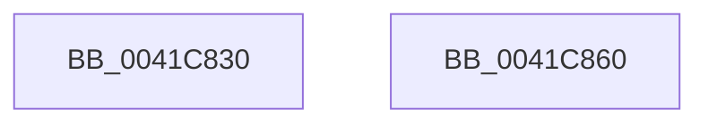

# EtwWriteTransfer

- RVA: `0x0041C830`–`0x0041C861` (길이 `49` bytes)
- VA: `0x000000014041C830`
- 실행 섹션: `.text`
- PDB 이름 있음: `예`; PDB Function 태그: `아니요`
- unwind 정보 RVA: `0x00063458`
- 디코드: `13`개 명령, `49/49` bytes 표시
- 미해석 바이트: `0` (있으면 어셈블리에 `.byte`로 보존)

> 이 문서는 커널 이미지의 기계어와 PDB 기호를 분석해 생성했습니다. 4번과 5번은 함수 원형과 자료형을 바이너리 사용 방식에서 추정한 C 해석이며 원본 소스 복구 결과는 아닙니다.

## 1. Dependencies

- 직접 호출 지점: **1**; 고유 호출 대상: **1**
- 직접 호출자로 확인된 함수: **11**
- RIP 상대 이미지 참조: **0**

### Outgoing calls
- `0x0041C856` → [EtwWriteEx](../25/EtwWriteEx_function_0025F0D0.md) (function, `0x0025F0D0`)

### Direct callers
- [CmpInitHiveFromFile](../../page/87/CmpInitHiveFromFile_function_008794D4.md) at `0x0087963E`
- [CmpInitHiveFromFile](../../page/87/CmpInitHiveFromFile_function_008794D4.md) at `0x008797AB`
- [CmpLogHiveFileInaccessible](../../page/87/CmpLogHiveFileInaccessible_function_0087AEAC.md) at `0x0087B0C6`
- [PsOpenProcess](../../page/89/PsOpenProcess_function_00894A30.md) at `0x00894F9B`
- [EtwpWriteAppStateChange](../../page/8A/EtwpWriteAppStateChange_function_008A3840.md) at `0x008A3915`
- [VrpPostQueryKey](../../page/93/VrpPostQueryKey_function_009338F0.md) at `0x00933C19`
- [VrpPostEnumerateKey](../../page/93/VrpPostEnumerateKey_function_00933EA8.md) at `0x009343C9`
- [CmpFlushHive](../../page/9B/CmpFlushHive_function_009B3DC0.md) at `0x009B3F1D`
- [CmpFlushHive](../../page/9B/CmpFlushHive_function_009B3DC0.md) at `0x009B4084`
- [CmpFlushHive](../../page/9B/CmpFlushHive_function_009B3DC0.md) at `0x009B41BC`
- [PsOpenThread](../../page/9C/PsOpenThread_function_009C5CC0.md) at `0x009C6212`
- [CmpLogFlushPhaseEnd](../../page/A4/CmpLogFlushPhaseEnd_function_00A4D268.md) at `0x00A4D333`
- [CmpLogFlushPhaseStart](../../page/A4/CmpLogFlushPhaseStart_function_00A4F450.md) at `0x00A4F509`
- [FlushEventEntryList](../../page/A6/FlushEventEntryList_function_00A601A4.md) at `0x00A6020B`

### Static image references
- 디코드된 RIP-relative 메모리 참조가 없습니다.

## 2. Other-region calls and transfers

- 다른 실행 섹션으로 향하는 call: **0**
- 별도 외부 분기/꼬리 이동을 확인하지 못했습니다.

## 3. Assembly (complete function range)

```asm
0041C830  48 83 EC 48                     sub rsp, 0x48
0041C834  48 8B 44 24 78                  mov rax, qword ptr [rsp + 0x78]
0041C839  48 89 44 24 38                  mov qword ptr [rsp + 0x38], rax
0041C83E  8B 44 24 70                     mov eax, dword ptr [rsp + 0x70]
0041C842  89 44 24 30                     mov dword ptr [rsp + 0x30], eax
0041C846  4C 89 4C 24 28                  mov qword ptr [rsp + 0x28], r9
0041C84B  45 33 C9                        xor r9d, r9d
0041C84E  4C 89 44 24 20                  mov qword ptr [rsp + 0x20], r8
0041C853  45 33 C0                        xor r8d, r8d
0041C856  E8 75 28 E4 FF                  call 0x14025f0d0
0041C85B  48 83 C4 48                     add rsp, 0x48
0041C85F  C3                              ret
0041C860  CC                              int3
```

## 4. C-style interpretation (structured pseudocode)

```c
__int64 __fastcall EtwWriteTransfer(__int64 a1, __int64 a2, __int64 a3, __int64 a4, unsigned int a5, __int64 a6)
{
    __int64 result;
    __int64 v_rsp;
    unsigned __int64 v_stack_m10;
    unsigned int v_stack_m18;
    unsigned __int64 v_stack_m20;
    unsigned __int64 v_stack_m28;

    v_rsp = (v_rsp) - (72);
    v_stack_m10 = a6;
    v_stack_m18 = (unsigned int)((unsigned int)(a5));
    v_stack_m20 = a4;
    a4 = 0;
    v_stack_m28 = a3;
    a3 = 0;
    result = EtwWriteEx(a1, a2, a3, a4);
    v_rsp = (v_rsp) + (72);
    return result;
}
```

## 5. (Beta) C Style

```c
int64_t EtwWriteTransfer(int64_t Arg1, int64_t Arg2, int64_t Arg3, int64_t Arg4, uint32_t Arg5, int64_t Arg6)
{
    int64_t result;
    int64_t local_rsp;
    uint64_t v_stack_m10;
    uint32_t v_stack_m18;
    uint64_t v_stack_m20;
    uint64_t v_stack_m28;

    local_rsp = (local_rsp) - (72);
    v_stack_m10 = Arg6;
    v_stack_m18 = (uint32_t)((uint32_t)(Arg5));
    v_stack_m20 = Arg4;
    Arg4 = 0;
    v_stack_m28 = Arg3;
    Arg3 = 0;
    result = EtwWriteEx(Arg1, Arg2, Arg3, Arg4);
    local_rsp = (local_rsp) + (72);
    return result;
}
```

## 6. Execution-region graph

[열기: 2D/3D 그래프와 함수 탐색 컨트롤 패널](../../../control-panel.html?section=text&rva=0x0041C830&view=graph)

- 2D 그래프는 위에서 아래로 흐르고, 3D 그래프는 빈 공간을 드래그해 회전합니다. Shift+드래그는 이동, 휠은 확대·축소, 함수 노드 선택은 대상 보고서 이동입니다.

### Static fallback


