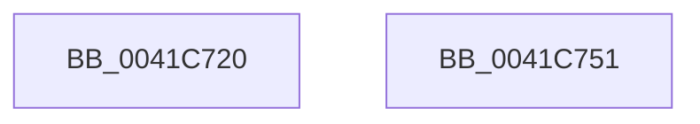

# EtwWrite

- RVA: `0x0041C720`–`0x0041C752` (길이 `50` bytes)
- VA: `0x000000014041C720`
- 실행 섹션: `.text`
- PDB 이름 있음: `예`; PDB Function 태그: `아니요`
- unwind 정보 RVA: `0x00063458`
- 디코드: `12`개 명령, `50/50` bytes 표시
- 미해석 바이트: `0` (있으면 어셈블리에 `.byte`로 보존)

> 이 문서는 커널 이미지의 기계어와 PDB 기호를 분석해 생성했습니다. 4번과 5번은 함수 원형과 자료형을 바이너리 사용 방식에서 추정한 C 해석이며 원본 소스 복구 결과는 아닙니다.

## 1. Dependencies

- 직접 호출 지점: **1**; 고유 호출 대상: **1**
- 직접 호출자로 확인된 함수: **280**
- RIP 상대 이미지 참조: **0**

### Outgoing calls
- `0x0041C747` → [EtwWriteEx](../25/EtwWriteEx_function_0025F0D0.md) (function, `0x0025F0D0`)

### Direct callers
- [PopPowerAggregatorDiagTraceDozeTimerDisarmed](../../page/6F/PopPowerAggregatorDiagTraceDozeTimerDisarmed_function_006FE5E0.md) at `0x006FE64F`
- [PopDiagTracePolicyChange](../../page/70/PopDiagTracePolicyChange_function_00705718.md) at `0x007057FE`
- [HalpSetAcpiRealTimeClock](../../page/70/HalpSetAcpiRealTimeClock_function_00705BFC.md) at `0x00705D39`
- [HalpTimerTraceTimingHardware](../../page/70/HalpTimerTraceTimingHardware_function_00706350.md) at `0x00706581`
- [HalpTimerTraceTimingHardware](../../page/70/HalpTimerTraceTimingHardware_function_00706350.md) at `0x007065AF`
- [HalpTimerWatchdogLogReset](../../page/70/HalpTimerWatchdogLogReset_function_00707F84.md) at `0x00707FB4`
- [IopCrashDumpPolicyChangeWnfCallback](../../page/71/IopCrashDumpPolicyChangeWnfCallback_function_00719E40.md) at `0x00719FAF`
- [IopCrashDumpPolicyChangeWnfCallback](../../page/71/IopCrashDumpPolicyChangeWnfCallback_function_00719E40.md) at `0x0071A0A1`
- [IopDumpTraceForceDumpDisabled](../../page/71/IopDumpTraceForceDumpDisabled_function_0071A138.md) at `0x0071A193`
- [IopInitializeDumpPolicySettings](../../page/71/IopInitializeDumpPolicySettings_function_0071A444.md) at `0x0071A69D`
- [IopTraceCrashDumpDisabledOnBoot](../../page/71/IopTraceCrashDumpDisabledOnBoot_function_0071A81C.md) at `0x0071A877`
- [IopLogAuditIoRegisterNotificationEvent](../../page/71/IopLogAuditIoRegisterNotificationEvent_function_0071E2E8.md) at `0x0071E38E`
- [PnpDiagRundownInterruptResourceForEachDevice](../../page/72/PnpDiagRundownInterruptResourceForEachDevice_function_0072B8F0.md) at `0x0072BA44`
- [PnprLogFailureEvent](../../page/73/PnprLogFailureEvent_function_0073A180.md) at `0x0073A28B`
- [PnprLogStartEvent](../../page/73/PnprLogStartEvent_function_0073A2AC.md) at `0x0073A35D`
- [PnprLogSuccessEvent](../../page/73/PnprLogSuccessEvent_function_0073A380.md) at `0x0073A602`
- [PopDiagTraceAcDcStateChange](../../page/76/PopDiagTraceAcDcStateChange_function_0076035C.md) at `0x007603FA`
- [PopDiagTraceAdaptiveBootOverridePrepared](../../page/76/PopDiagTraceAdaptiveBootOverridePrepared_function_00760470.md) at `0x0076051C`
- [PopDiagTraceBatteryCountChange](../../page/76/PopDiagTraceBatteryCountChange_function_00760B54.md) at `0x00760BEB`
- [PopDiagTraceBatteryTriggerMet](../../page/76/PopDiagTraceBatteryTriggerMet_function_00760C60.md) at `0x00760E14`
- [PopDiagTraceCoolingExtensionActiveUpdate](../../page/76/PopDiagTraceCoolingExtensionActiveUpdate_function_00760FFC.md) at `0x00761094`
- [PopDiagTraceDirectedDripsInitialization](../../page/76/PopDiagTraceDirectedDripsInitialization_function_007610D0.md) at `0x007611C9`
- [PopDiagTraceDirectedDripsNotifyAppsAndServices](../../page/76/PopDiagTraceDirectedDripsNotifyAppsAndServices_function_007611EC.md) at `0x007612C6`
- [PopDiagTraceFxDeviceStartPowerManagement](../../page/76/PopDiagTraceFxDeviceStartPowerManagement_function_00761610.md) at `0x0076168E`
- [PopDiagTraceFxDeviceUnregistration](../../page/76/PopDiagTraceFxDeviceUnregistration_function_007616AC.md) at `0x00761734`
- [PopDiagTraceFxPerfRegistration](../../page/76/PopDiagTraceFxPerfRegistration_function_0076183C.md) at `0x007618AC`
- [PopDiagTraceFxPerfSetRegistration](../../page/76/PopDiagTraceFxPerfSetRegistration_function_007618CC.md) at `0x007619F7`
- [PopDiagTraceHibernateRevoked](../../page/76/PopDiagTraceHibernateRevoked_function_00761A18.md) at `0x00761A93`
- [PopDiagTraceIoCoalescingOn](../../page/76/PopDiagTraceIoCoalescingOn_function_00761AB4.md) at `0x00761B90`
- [PopDiagTraceModernStandbyStateNotification](../../page/76/PopDiagTraceModernStandbyStateNotification_function_00761BB4.md) at `0x00761C88`
- [PopDiagTracePassiveCooling](../../page/76/PopDiagTracePassiveCooling_function_00761CAC.md) at `0x00761ED5`
- [PopDiagTracePowerLimitExtension](../../page/76/PopDiagTracePowerLimitExtension_function_0076233C.md) at `0x00762531`
- [PopDiagTracePowerLimitExtensionValueUpdate](../../page/76/PopDiagTracePowerLimitExtensionValueUpdate_function_00762580.md) at `0x00762696`
- [PopDiagTracePowerLimitRequest](../../page/76/PopDiagTracePowerLimitRequest_function_007626D0.md) at `0x00762987`
- [PopDiagTracePowerLimitRequestValueUpdate](../../page/76/PopDiagTracePowerLimitRequestValueUpdate_function_007629E8.md) at `0x00762B92`
- [PopDiagTracePreSleepNotification](../../page/76/PopDiagTracePreSleepNotification_function_00762BE4.md) at `0x00762C9D`
- [PopDiagTraceSetHiberFileFailurePoint](../../page/76/PopDiagTraceSetHiberFileFailurePoint_function_00762D50.md) at `0x00762DE3`
- [PopDiagTraceSkipTick](../../page/76/PopDiagTraceSkipTick_function_00762EA8.md) at `0x00762F39`
- [PopDiagTraceSleepStudyBlockerData](../../page/76/PopDiagTraceSleepStudyBlockerData_function_00762F60.md) at `0x00762FA8`
- [PopDiagTraceSleepStudyStart](../../page/76/PopDiagTraceSleepStudyStart_function_00762FC0.md) at `0x00763100`
- [PopDiagTraceStateTransitionFailurePoint](../../page/76/PopDiagTraceStateTransitionFailurePoint_function_00763468.md) at `0x0076351B`
- [PopDiagTraceThermalRequestActiveUpdate](../../page/76/PopDiagTraceThermalRequestActiveUpdate_function_00763684.md) at `0x0076371C`
- [PopTraceEsBgActivityPolicyUpdate](../../page/76/PopTraceEsBgActivityPolicyUpdate_function_007639E8.md) at `0x00763AEC`
- [PopTraceNetRefreshTimerArmed](../../page/76/PopTraceNetRefreshTimerArmed_function_00763CD4.md) at `0x00763D5A`
- [PopTraceSystemIdleS0LowPowerDoze](../../page/76/PopTraceSystemIdleS0LowPowerDoze_function_00763E18.md) at `0x00763E88`
- [PopTraceSystemIdleS0LowPowerDozeTimerArmed](../../page/76/PopTraceSystemIdleS0LowPowerDozeTimerArmed_function_00763EA8.md) at `0x00763F41`
- [PopTraceSystemIdleS0LowPowerDozeTimerCancelled](../../page/76/PopTraceSystemIdleS0LowPowerDozeTimerCancelled_function_00763F68.md) at `0x00763FD7`
- [PopNetDisarmRefreshTimer](../../page/76/PopNetDisarmRefreshTimer_function_00768AD8.md) at `0x00768B24`
- [PpmEventHiddenProcessorPerformance](../../page/76/PpmEventHiddenProcessorPerformance_function_0076A424.md) at `0x0076A4FF`
- [PpmEventStaticPolicyRundown](../../page/76/PpmEventStaticPolicyRundown_function_0076A528.md) at `0x0076A6EF`
- [PpmEventTraceProcessorPerformanceRundownHv](../../page/76/PpmEventTraceProcessorPerformanceRundownHv_function_0076A718.md) at `0x0076A8D7`
- [PopAdaptiveStandbyTraceSessionMetadata](../../page/76/PopAdaptiveStandbyTraceSessionMetadata_function_0076F29C.md) at `0x0076F40C`
- [PopDirectedDripsDiagTraceProblemDevice](../../page/77/PopDirectedDripsDiagTraceProblemDevice_function_0077135C.md) at `0x00771481`
- [PpmEventStaticPolicyRundownEx](../../page/77/PpmEventStaticPolicyRundownEx_function_00772C88.md) at `0x00772E32`
- [PpmEventTraceParkNodeRundownEx](../../page/77/PpmEventTraceParkNodeRundownEx_function_00772E5C.md) at `0x007731A5`
- [SepLogTokenSidManagement](../../page/79/SepLogTokenSidManagement_function_0079DA10.md) at `0x0079DD82`
- [EtwpEventWriteDebugLookupFailed](../../page/7B/EtwpEventWriteDebugLookupFailed_function_007B5AA8.md) at `0x007B5B68`
- [EtwpEventWriteEnableInfo](../../page/7B/EtwpEventWriteEnableInfo_function_007B5B8C.md) at `0x007B5C62`
- [EtwpEventWriteGuidEntry](../../page/7B/EtwpEventWriteGuidEntry_function_007B5C84.md) at `0x007B5CE5`
- [EtwpEventWriteProviderAccessCheckStatus](../../page/7B/EtwpEventWriteProviderAccessCheckStatus_function_007B5D04.md) at `0x007B5DC4`
- [EtwpEventWriteRegEntry](../../page/7B/EtwpEventWriteRegEntry_function_007B5DE8.md) at `0x007B5EBC`
- [EtwpEventWriteRegistrationStatus](../../page/7B/EtwpEventWriteRegistrationStatus_function_007B5EE0.md) at `0x007B5F43`
- [EtwpEventWriteTemplateBackingFile](../../page/7B/EtwpEventWriteTemplateBackingFile_function_007B5F64.md) at `0x007B5FE4`
- [EtwpEventWriteTemplateInvalidGroupMask](../../page/7B/EtwpEventWriteTemplateInvalidGroupMask_function_007B6008.md) at `0x007B60C9`
- [EtwpEventWriteTemplateMaxFileSize](../../page/7B/EtwpEventWriteTemplateMaxFileSize_function_007B60F0.md) at `0x007B61AE`
- [EtwpEventWriteTemplateSessionAndHandle](../../page/7B/EtwpEventWriteTemplateSessionAndHandle_function_007B61D0.md) at `0x007B6240`
- [EtwpEventWriteTemplateSessionDesiredAccess](../../page/7B/EtwpEventWriteTemplateSessionDesiredAccess_function_007B6260.md) at `0x007B62D7`
- [EtwpEventWriteTemplateSessionFromCapturedData](../../page/7B/EtwpEventWriteTemplateSessionFromCapturedData_function_007B62F8.md) at `0x007B63A2`
- [EtwpEventWriteTemplateSessionMaxLoggers](../../page/7B/EtwpEventWriteTemplateSessionMaxLoggers_function_007B63C4.md) at `0x007B642D`
- [EtwTraceJobServerSiloStateChange](../../page/7B/EtwTraceJobServerSiloStateChange_function_007B7EB8.md) at `0x007B7F47`
- [EtwTraceLeapSecondDataParseFailure](../../page/7B/EtwTraceLeapSecondDataParseFailure_function_007B7F70.md) at `0x007B802C`
- [EtwTraceLeapSecondDataUpdate](../../page/7B/EtwTraceLeapSecondDataUpdate_function_007B8050.md) at `0x007B8182`
- [EtwTraceTimeZoneBiasChange](../../page/7B/EtwTraceTimeZoneBiasChange_function_007B8300.md) at `0x007B83E4`
- [EtwpTraceSystemShutdown](../../page/7B/EtwpTraceSystemShutdown_function_007B8A18.md) at `0x007B8AF9`
- [EtwTimLogBlockNonCetBinaries](../../page/7B/EtwTimLogBlockNonCetBinaries_function_007BA5B8.md) at `0x007BA82F`
- [EtwTimLogControlProtectionUserModeReturnMismatch](../../page/7B/EtwTimLogControlProtectionUserModeReturnMismatch_function_007BA9D4.md) at `0x007BAF21`
- [EtwTimLogProhibitLowILImageMap](../../page/7B/EtwTimLogProhibitLowILImageMap_function_007BB1F4.md) at `0x007BB412`
- [EtwTimLogProhibitNonMicrosoftBinaries](../../page/7B/EtwTimLogProhibitNonMicrosoftBinaries_function_007BB550.md) at `0x007BB7B4`
- [EtwTimLogUserCetSetContextIpValidationFailure](../../page/7B/EtwTimLogUserCetSetContextIpValidationFailure_function_007BB920.md) at `0x007BBB99`
- [EtwpSavePersistedLogger](../../page/7B/EtwpSavePersistedLogger_function_007BF374.md) at `0x007BF428`
- [EtwpTraceSavePersistedLoggerStop](../../page/7B/EtwpTraceSavePersistedLoggerStop_function_007BFA54.md) at `0x007BFB40`
- [sub_007C7F80](../../page/7C/Unknown_function_007C7F80.md) at `0x007C7F9F`
- [WheapLogInitEvent](../../page/7D/WheapLogInitEvent_function_007D83F8.md) at `0x007D84DE`
- [WheapLogPageOfflineAttemptEvent](../../page/7D/WheapLogPageOfflineAttemptEvent_function_007D857C.md) at `0x007D8646`
- [CmSaveKey](../../page/7D/CmSaveKey_function_007DDBDC.md) at `0x007DDE5E`
- [CmSaveKey](../../page/7D/CmSaveKey_function_007DDBDC.md) at `0x007DDEDB`
- [CmpLogReorganizeEvent](../../page/7E/CmpLogReorganizeEvent_function_007E22A4.md) at `0x007E2336`
- [CmpTraceHiveMountLogEntryApplied](../../page/7E/CmpTraceHiveMountLogEntryApplied_function_007E6588.md) at `0x007E6604`
- [CmpTraceHiveRestoreStart](../../page/7E/CmpTraceHiveRestoreStart_function_007E6624.md) at `0x007E66FB`
- [CmpTraceHiveRestoreStop](../../page/7E/CmpTraceHiveRestoreStop_function_007E6738.md) at `0x007E67A7`
- [CmpTraceHiveSaveStop](../../page/7E/CmpTraceHiveSaveStop_function_007E67C8.md) at `0x007E6837`
- [CmpTraceShutdownFlushStart](../../page/7E/CmpTraceShutdownFlushStart_function_007E6858.md) at `0x007E68A5`
- [CmpTraceShutdownFlushStop](../../page/7E/CmpTraceShutdownFlushStop_function_007E68C4.md) at `0x007E6911`
- [CmpTraceShutdownRundownComplete](../../page/7E/CmpTraceShutdownRundownComplete_function_007E6930.md) at `0x007E697D`
- [CmpTraceShutdownStart](../../page/7E/CmpTraceShutdownStart_function_007E699C.md) at `0x007E69E9`
- [CmpTraceShutdownStop](../../page/7E/CmpTraceShutdownStop_function_007E6A08.md) at `0x007E6A55`
- [EtwpEventWriteTemplateSessAndProv](../../page/86/EtwpEventWriteTemplateSessAndProv_function_00863D18.md) at `0x00863D81`
- [CmpTraceHiveLoadStop](../../page/87/CmpTraceHiveLoadStop_function_008769F0.md) at `0x00876A72`
- [CmpTraceHiveLoadStart](../../page/87/CmpTraceHiveLoadStart_function_00876F38.md) at `0x00876FEF`
- [CmpLogEvent](../../page/87/CmpLogEvent_function_0087A664.md) at `0x0087A6F8`
- [CmpLogClearAccessBitsEvent](../../page/87/CmpLogClearAccessBitsEvent_function_0087C64C.md) at `0x0087C6DE`
- [CmpLogTxrInitEvent](../../page/87/CmpLogTxrInitEvent_function_0087D27C.md) at `0x0087D365`
- [EtwTiLogProtectExecVm](../../page/88/EtwTiLogProtectExecVm_function_00881A48.md) at `0x00881D82`
- [EtwTiLogAllocExecVm](../../page/88/EtwTiLogAllocExecVm_function_00882944.md) at `0x00882AFD`
- [PsOpenProcess](../../page/89/PsOpenProcess_function_00894A30.md) at `0x00895056`
- [NtMapViewOfSection](../../page/89/NtMapViewOfSection_function_008986E0.md) at `0x00898B8E`
- [EtwpPsProvTraceProcess](../../page/8A/EtwpPsProvTraceProcess_function_008A3954.md) at `0x008A3CF9`
- [PfSnLogEndTrace](../../page/8B/PfSnLogEndTrace_function_008B0A70.md) at `0x008B0B4E`
- [sub_008C2328](../../page/8C/Unknown_function_008C2328.md) at `0x008C27F4`
- [EtwTiLogImpersonateClient](../../page/8C/EtwTiLogImpersonateClient_function_008CC9D0.md) at `0x008CCBCF`
- [PopDiagTraceSystemIdleContextUpdate](../../page/91/PopDiagTraceSystemIdleContextUpdate_function_00911D8C.md) at `0x00911E49`
- [PopPowerAggregatorDiagTraceHandlerInvoke](../../page/91/PopPowerAggregatorDiagTraceHandlerInvoke_function_009120F0.md) at `0x00912165`
- [PopPowerAggregatorDiagTraceEvent](../../page/91/PopPowerAggregatorDiagTraceEvent_function_00912184.md) at `0x009121CC`
- [PopDiagTraceWin32kCalloutEnd](../../page/91/PopDiagTraceWin32kCalloutEnd_function_009127C4.md) at `0x00912880`
- [PopDiagTraceSessionState](../../page/91/PopDiagTraceSessionState_function_00912C5C.md) at `0x00912CE1`
- [PopDiagTracePowerRequestClose](../../page/91/PopDiagTracePowerRequestClose_function_009131A0.md) at `0x00913210`
- [PopDiagTraceAdaptiveSessionState](../../page/91/PopDiagTraceAdaptiveSessionState_function_00913AF8.md) at `0x00913C26`
- [PopNotifyConsoleUserPresent](../../page/91/PopNotifyConsoleUserPresent_function_00913C50.md) at `0x00913E61`
- [PopDiagTraceNotifyConsoleUserPresent](../../page/91/PopDiagTraceNotifyConsoleUserPresent_function_00913ED0.md) at `0x00913F89`
- [PopDiagTracePowerStateEvent](../../page/91/PopDiagTracePowerStateEvent_function_009145CC.md) at `0x00914651`
- [PopPowerAggregatorDiagTraceHandleIntent](../../page/91/PopPowerAggregatorDiagTraceHandleIntent_function_00914A04.md) at `0x00914B2D`
- [PopDiagTraceWin32kCalloutStart](../../page/91/PopDiagTraceWin32kCalloutStart_function_0091564C.md) at `0x009157D3`
- [PopDiagTracePowerSettingStop](../../page/91/PopDiagTracePowerSettingStop_function_009163FC.md) at `0x00916482`
- [PopDiagTracePowerSettingStart](../../page/91/PopDiagTracePowerSettingStart_function_009164C4.md) at `0x00916598`
- [EtwpLogMemInfoWsHelper](../../page/91/EtwpLogMemInfoWsHelper_function_0091E304.md) at `0x0091E39D`
- [EtwpRegisterKMProvider](../../page/92/EtwpRegisterKMProvider_function_009209A4.md) at `0x00920AB7`
- [DbgkpStartSystemErrorHandler](../../page/92/DbgkpStartSystemErrorHandler_function_00920F78.md) at `0x0092105F`
- [PfSnLogAsyncWorker](../../page/93/PfSnLogAsyncWorker_function_00939B0C.md) at `0x00939C03`
- [PfSnLogPrefetchMetadata](../../page/93/PfSnLogPrefetchMetadata_function_0093B3E4.md) at `0x0093B4D3`
- [PfSnLogPrefetchSectionsStop](../../page/93/PfSnLogPrefetchSectionsStop_function_0093BF54.md) at `0x0093C082`
- [PfSnLogPrefetchSectionsStart](../../page/93/PfSnLogPrefetchSectionsStart_function_0093C1BC.md) at `0x0093C2C2`
- [PfSnLogGetReadListsStart](../../page/93/PfSnLogGetReadListsStart_function_0093C2F0.md) at `0x0093C3CE`
- [PfSnLogGetReadListsStop](../../page/93/PfSnLogGetReadListsStop_function_0093C3FC.md) at `0x0093C4BB`
- [PfSnLogScenarioDecision](../../page/95/PfSnLogScenarioDecision_function_0095F2BC.md) at `0x0095F4E1`
- [PopPowerAggregatorNotifyCsStateExited](../../page/98/PopPowerAggregatorNotifyCsStateExited_function_0098A434.md) at `0x0098A656`
- [PopPowerAggregatorDiagTraceInternalStateChange](../../page/98/PopPowerAggregatorDiagTraceInternalStateChange_function_0098A6C4.md) at `0x0098A739`
- [IopLoadDriver](../../page/99/IopLoadDriver_function_00997B54.md) at `0x00997F7E`
- [sub_0099CB19](../../page/99/Unknown_function_0099CB19.md) at `0x0099CCF6`
- [EtwTiLogDeviceObjectLoadUnload](../../page/9A/EtwTiLogDeviceObjectLoadUnload_function_009A5234.md) at `0x009A5342`
- [CmpTraceHiveFlushWrotePrimaryFile](../../page/9B/CmpTraceHiveFlushWrotePrimaryFile_function_009B166C.md) at `0x009B16FB`
- [CmpTraceHiveFlushWroteLogFile](../../page/9B/CmpTraceHiveFlushWroteLogFile_function_009B2D5C.md) at `0x009B2DEE`
- [CmpTraceHiveUnloadStop](../../page/9B/CmpTraceHiveUnloadStop_function_009B38B8.md) at `0x009B393A`
- [CmpTraceHiveUnloadStart](../../page/9B/CmpTraceHiveUnloadStart_function_009B3AC8.md) at `0x009B3B9D`
- [CmpTraceHiveFlushStop](../../page/9B/CmpTraceHiveFlushStop_function_009B4920.md) at `0x009B49A2`
- [CmpTraceHiveFlushStart](../../page/9B/CmpTraceHiveFlushStart_function_009B49B0.md) at `0x009B4AD3`
- [CmpTraceHiveMountStop](../../page/9B/CmpTraceHiveMountStop_function_009B8038.md) at `0x009B80BA`
- [CmpTraceHiveMountStart](../../page/9B/CmpTraceHiveMountStart_function_009B80C8.md) at `0x009B8128`
- [CmpTraceHiveMountBaseFileMounted](../../page/9B/CmpTraceHiveMountBaseFileMounted_function_009B8D0C.md) at `0x009B8DE8`
- [EtwTiLogReadWriteVm](../../page/9B/EtwTiLogReadWriteVm_function_009BB7C8.md) at `0x009BBA5F`
- [EtwpEventWriteTemplateSession](../../page/9B/EtwpEventWriteTemplateSession_function_009BD120.md) at `0x009BD285`
- [PoTraceSystemTimerResolution](../../page/9C/PoTraceSystemTimerResolution_function_009C5480.md) at `0x009C5666`
- [PoTraceSystemTimerResolution](../../page/9C/PoTraceSystemTimerResolution_function_009C5480.md) at `0x009C5709`
- [PsOpenThread](../../page/9C/PsOpenThread_function_009C5CC0.md) at `0x009C6308`
- [EtwpAddRegEntryToGroup](../../page/9F/EtwpAddRegEntryToGroup_function_009F39D4.md) at `0x009F4276`
- [EtwTracePsIoAttribution](../../page/9F/EtwTracePsIoAttribution_function_009F7E44.md) at `0x009F7EFE`
- [EtwTracePsIoRateControl](../../page/9F/EtwTracePsIoRateControl_function_009F81B0.md) at `0x009F836C`
- [EtwTraceLpacAccessFailure](../../page/9F/EtwTraceLpacAccessFailure_function_009FEF40.md) at `0x009FEFB8`
- [EtwpPsProvTraceThread](../../page/9F/EtwpPsProvTraceThread_function_009FFE5C.md) at `0x00A0016A`
- [EtwpCloseRegistrationObject](../../page/A0/EtwpCloseRegistrationObject_function_00A0CEB0.md) at `0x00A0CF2A`
- [EtwTraceWorkingSetSwap](../../page/A1/EtwTraceWorkingSetSwap_function_00A17D80.md) at `0x00A17E4E`
- [PopDiagTraceConsoleDisplayState](../../page/A3/PopDiagTraceConsoleDisplayState_function_00A31978.md) at `0x00A319E7`
- [PopDiagTraceSystemIdleEventAssessment](../../page/A3/PopDiagTraceSystemIdleEventAssessment_function_00A31D34.md) at `0x00A31DF8`
- [PopDiagTraceSystemIdleAction](../../page/A3/PopDiagTraceSystemIdleAction_function_00A31F34.md) at `0x00A31FCE`
- [PopDiagTraceSystemIdleAssessment](../../page/A3/PopDiagTraceSystemIdleAssessment_function_00A31FF4.md) at `0x00A3208E`
- [NtCreateSymbolicLinkObject](../../page/A3/NtCreateSymbolicLinkObject_function_00A33870.md) at `0x00A33B2A`
- [ObCreateSymbolicLink](../../page/A3/ObCreateSymbolicLink_function_00A33B98.md) at `0x00A33F1F`
- [EtwTiLogSuspendResumeThread](../../page/A3/EtwTiLogSuspendResumeThread_function_00A34DE0.md) at `0x00A34F1D`
- [PopDiagTraceControlCallback](../../page/A3/PopDiagTraceControlCallback_function_00A38CB0.md) at `0x00A38D8C`
- [PopDiagTracePowerRequestCreate](../../page/A3/PopDiagTracePowerRequestCreate_function_00A38EEC.md) at `0x00A3926D`
- [PopDiagTracePlatformRoleRundown](../../page/A3/PopDiagTracePlatformRoleRundown_function_00A392B0.md) at `0x00A39330`
- [PopDiagTracePowerSetting](../../page/A3/PopDiagTracePowerSetting_function_00A393E0.md) at `0x00A394A0`
- [PopDiagTracePowerStateEventRundown](../../page/A3/PopDiagTracePowerStateEventRundown_function_00A394D4.md) at `0x00A39594`
- [PopDiagTraceDeviceComplianceRundown](../../page/A3/PopDiagTraceDeviceComplianceRundown_function_00A3976C.md) at `0x00A3980E`
- [PopDiagTraceDynamicTickStatusRundown](../../page/A3/PopDiagTraceDynamicTickStatusRundown_function_00A39830.md) at `0x00A398B4`
- [PopDiagTraceSystemIdleRundown](../../page/A3/PopDiagTraceSystemIdleRundown_function_00A3997C.md) at `0x00A399E9`
- [PopTraceStandbyConnectivityRundown](../../page/A3/PopTraceStandbyConnectivityRundown_function_00A39A08.md) at `0x00A39A9C`
- [PopDiagTraceCoolingExtension](../../page/A3/PopDiagTraceCoolingExtension_function_00A39C28.md) at `0x00A39DAC`
- [EtwTimLogProhibitChildProcessCreation](../../page/A4/EtwTimLogProhibitChildProcessCreation_function_00A43694.md) at `0x00A43931`
- [PopDirectedDripsDiagTraceDisengageReasonChange](../../page/A4/PopDirectedDripsDiagTraceDisengageReasonChange_function_00A4DA34.md) at `0x00A4DAEF`
- [PopDiagTraceThermalCoolingMode](../../page/A4/PopDiagTraceThermalCoolingMode_function_00A4E96C.md) at `0x00A4EAC0`
- [PpmEventTraceProcessorPerformance](../../page/A5/PpmEventTraceProcessorPerformance_function_00A5237C.md) at `0x00A526AA`
- [PpmEventTracePpmProfileStatusRundown](../../page/A5/PpmEventTracePpmProfileStatusRundown_function_00A5277C.md) at `0x00A527FC`
- [PpmEventTraceProfiles](../../page/A5/PpmEventTraceProfiles_function_00A528A0.md) at `0x00A52AA1`
- [PpmEventTraceProfileChange](../../page/A5/PpmEventTraceProfileChange_function_00A52F08.md) at `0x00A52FA8`
- [PoDiagTraceDeviceRundown](../../page/A5/PoDiagTraceDeviceRundown_function_00A55538.md) at `0x00A55602`
- [PopDiagTraceDeviceVerboseRundown](../../page/A5/PopDiagTraceDeviceVerboseRundown_function_00A559E4.md) at `0x00A55C20`
- [PopDiagTraceDeviceVerboseRundown](../../page/A5/PopDiagTraceDeviceVerboseRundown_function_00A559E4.md) at `0x00A55C7B`
- [EtwTiLogMapExecView](../../page/A5/EtwTiLogMapExecView_function_00A573E0.md) at `0x00A57560`
- [EtwWriteEndScenario](../../page/A5/EtwWriteEndScenario_function_00A5B7F0.md) at `0x00A5B870`
- [WdipSemWriteTimeoutEvent](../../page/A5/WdipSemWriteTimeoutEvent_function_00A5C0C4.md) at `0x00A5C152`
- [EtwTraceWorkingSetInSwapStoreFail](../../page/A6/EtwTraceWorkingSetInSwapStoreFail_function_00A61DBC.md) at `0x00A61E59`
- [PfSnLogOpenVolumesForPrefetch](../../page/A6/PfSnLogOpenVolumesForPrefetch_function_00A629EC.md) at `0x00A62AB7`
- [CmpPublishEventForPcaResolver](../../page/A6/CmpPublishEventForPcaResolver_function_00A66AC0.md) at `0x00A66BBF`
- [EtwTraceTimeZoneInformationRefresh](../../page/A6/EtwTraceTimeZoneInformationRefresh_function_00A6C078.md) at `0x00A6C1DF`
- [PpmEventTraceProfileSetting](../../page/A6/PpmEventTraceProfileSetting_function_00A6E1FC.md) at `0x00A6E310`
- [PpmInfoTraceProfileSettings](../../page/A6/PpmInfoTraceProfileSettings_function_00A6E854.md) at `0x00A6E9FF`
- [PpmInfoTraceProfileSettings](../../page/A6/PpmInfoTraceProfileSettings_function_00A6E854.md) at `0x00A6EB1E`
- [PopDiagTraceFxDeviceRegistration](../../page/A6/PopDiagTraceFxDeviceRegistration_function_00A6FB28.md) at `0x00A6FBFE`
- [PopDiagTraceFxComponentRegistration](../../page/A6/PopDiagTraceFxComponentRegistration_function_00A6FC20.md) at `0x00A6FCCE`
- [PopDiagTraceAppPowerMessage](../../page/A7/PopDiagTraceAppPowerMessage_function_00A7080C.md) at `0x00A708E7`
- [PopDiagTraceDirectedDripsWorker](../../page/A7/PopDiagTraceDirectedDripsWorker_function_00A71BF0.md) at `0x00A71C8B`
- [EtwUnregister](../../page/A7/EtwUnregister_function_00A723D0.md) at `0x00A72637`
- [PopDiagTraceHiberStats](../../page/A7/PopDiagTraceHiberStats_function_00A72FB4.md) at `0x00A733BC`
- [PopDiagTracePerfTrackData](../../page/A7/PopDiagTracePerfTrackData_function_00A733CC.md) at `0x00A73581`
- [PopDiagTracePerfTrackData](../../page/A7/PopDiagTracePerfTrackData_function_00A733CC.md) at `0x00A73727`
- [PopDiagTraceFxComponentAccounting](../../page/A7/PopDiagTraceFxComponentAccounting_function_00A758D4.md) at `0x00A759F7`
- [PpmEventQosClassPolicy](../../page/A7/PpmEventQosClassPolicy_function_00A76108.md) at `0x00A762A3`
- [PpmEventHeteroConfigUpdate](../../page/A7/PpmEventHeteroConfigUpdate_function_00A77430.md) at `0x00A7758A`
- [PopDiagTraceServiceNotification](../../page/A7/PopDiagTraceServiceNotification_function_00A7BBB0.md) at `0x00A7BC57`
- [PopDiagTraceAppPowerMessageEnd](../../page/A7/PopDiagTraceAppPowerMessageEnd_function_00A7DFA0.md) at `0x00A7E016`
- [EtwpPsProvTraceJob](../../page/A7/EtwpPsProvTraceJob_function_00A7F548.md) at `0x00A7F5E7`
- [PnpDiagRundownParentDevNodeForEachDevice](../../page/A7/PnpDiagRundownParentDevNodeForEachDevice_function_00A7F920.md) at `0x00A7F9B1`
- [PnpDiagRundownParentPdoForEachDevice](../../page/A7/PnpDiagRundownParentPdoForEachDevice_function_00A7FA90.md) at `0x00A7FB03`
- [PopDirectedDripsDiagRundownDevices](../../page/A8/PopDirectedDripsDiagRundownDevices_function_00A80E08.md) at `0x00A813F7`
- [PopDirectedDripsDiagRundownDevices](../../page/A8/PopDirectedDripsDiagRundownDevices_function_00A80E08.md) at `0x00A81528`
- [EtwpTimLogMitigationForProcess](../../page/A8/EtwpTimLogMitigationForProcess_function_00A81E6C.md) at `0x00A81FF4`
- [PpmEventTraceProcessorIdle](../../page/A8/PpmEventTraceProcessorIdle_function_00A857D4.md) at `0x00A859DE`
- [EtwpEventWriteProviderEnabled](../../page/A8/EtwpEventWriteProviderEnabled_function_00A85D74.md) at `0x00A85E1D`
- [EtwTraceFreezeThawProcess](../../page/A8/EtwTraceFreezeThawProcess_function_00A862A4.md) at `0x00A86337`
- [PspLogAuditSetContextThreadEvent](../../page/A8/PspLogAuditSetContextThreadEvent_function_00A88528.md) at `0x00A88576`
- [PpmEventTraceParkNodeRundown](../../page/A8/PpmEventTraceParkNodeRundown_function_00A8A8D0.md) at `0x00A8AA07`
- [PopDiagTraceFxDevicePreparation](../../page/A8/PopDiagTraceFxDevicePreparation_function_00A8AD78.md) at `0x00A8AE74`
- [PpmEventTraceProcessorPerformanceDomainRundown](../../page/A8/PpmEventTraceProcessorPerformanceDomainRundown_function_00A8FCC4.md) at `0x00A8FF17`
- [PopSleepstudySendSessionChangeEvent](../../page/A9/PopSleepstudySendSessionChangeEvent_function_00A92720.md) at `0x00A928B0`
- [PopSleepstudySendSessionChangeEvent](../../page/A9/PopSleepstudySendSessionChangeEvent_function_00A92720.md) at `0x00A928D8`
- [PpmEventHeteroPolicy](../../page/A9/PpmEventHeteroPolicy_function_00A97794.md) at `0x00A979A3`
- [HalpQueryAcpiRealTimeClock](../../page/A9/HalpQueryAcpiRealTimeClock_function_00A98230.md) at `0x00A9837F`
- [EtwTiLogDriverObjectLoad](../../page/A9/EtwTiLogDriverObjectLoad_function_00A985E0.md) at `0x00A986BC`
- [EtwpStartLogger](../../page/A9/EtwpStartLogger_function_00A99D80.md) at `0x00A9A54A`
- [WdipSemWriteEvent](../../page/A9/WdipSemWriteEvent_function_00A9B6D4.md) at `0x00A9B71F`
- [PopDiagTracePowerTransitionTime](../../page/A9/PopDiagTracePowerTransitionTime_function_00A9B84C.md) at `0x00A9B972`
- [CmpTraceHiveFlushStartWaitForActive](../../page/AA/CmpTraceHiveFlushStartWaitForActive_function_00AA01DC.md) at `0x00AA0229`
- [CmpTraceHiveFlushFinishWaitForActive](../../page/AA/CmpTraceHiveFlushFinishWaitForActive_function_00AA0248.md) at `0x00AA02A8`
- [PspLogAuditSetLoadImageNotifyRoutineEvent](../../page/AA/PspLogAuditSetLoadImageNotifyRoutineEvent_function_00AA1A54.md) at `0x00AA1AC0`
- [EtwpEventWriteCaptureState](../../page/AA/EtwpEventWriteCaptureState_function_00AA23F8.md) at `0x00AA2490`
- [PopDiagTraceSessionStateCounted](../../page/AA/PopDiagTraceSessionStateCounted_function_00AA2C2C.md) at `0x00AA2CDD`
- [PpmEventQosSupport](../../page/AA/PpmEventQosSupport_function_00AA3B50.md) at `0x00AA3C21`
- [PopDiagTraceDevicesSuspend](../../page/AA/PopDiagTraceDevicesSuspend_function_00AA4950.md) at `0x00AA49EA`
- [PspLogAuditTerminateRemoteProcessEvent](../../page/AA/PspLogAuditTerminateRemoteProcessEvent_function_00AA5004.md) at `0x00AA5086`
- [EtwpEventWriteTemplateAdmin](../../page/AA/EtwpEventWriteTemplateAdmin_function_00AA5880.md) at `0x00AA591E`
- [PoRundownSystemTimer](../../page/AA/PoRundownSystemTimer_function_00AACB3C.md) at `0x00AACC1A`
- [PopDiagTraceFxPluginRegistration](../../page/AA/PopDiagTraceFxPluginRegistration_function_00AAE10C.md) at `0x00AAE1B5`
- [PopDiagTraceCoolingExtensionPassiveUpdate](../../page/AA/PopDiagTraceCoolingExtensionPassiveUpdate_function_00AAE490.md) at `0x00AAE537`
- [PopPowerAggregatorDiagTracePdcSleepTransition](../../page/AB/PopPowerAggregatorDiagTracePdcSleepTransition_function_00AB12AC.md) at `0x00AB1359`
- [PpmEventTraceAccountingBucketIntervalsRundown](../../page/AB/PpmEventTraceAccountingBucketIntervalsRundown_function_00AB137C.md) at `0x00AB1443`
- [PopDiagTraceExecutePowerAction](../../page/AB/PopDiagTraceExecutePowerAction_function_00AB173C.md) at `0x00AB18F6`
- [PpmEventTracePlatformIdleAccounting](../../page/AB/PpmEventTracePlatformIdleAccounting_function_00AB6128.md) at `0x00AB6330`
- [EtwWriteStartScenario](../../page/AB/EtwWriteStartScenario_function_00AB75B0.md) at `0x00AB76AE`
- [PopDiagTraceTripPointExceeded](../../page/AB/PopDiagTraceTripPointExceeded_function_00AB7EEC.md) at `0x00AB7FAD`
- [PopDiagTraceUsermodeThermalEvent](../../page/AB/PopDiagTraceUsermodeThermalEvent_function_00AB80C8.md) at `0x00AB8182`
- [PopPowerAggregatorDiagTraceSuspendResume](../../page/AB/PopPowerAggregatorDiagTraceSuspendResume_function_00AB97D0.md) at `0x00AB9859`
- [EtwTimLogRedirectionTrustPolicy](../../page/AB/EtwTimLogRedirectionTrustPolicy_function_00ABA7E0.md) at `0x00ABAE87`
- [PpmEventTraceCoordinatedIdleStates](../../page/AB/PpmEventTraceCoordinatedIdleStates_function_00ABBF5C.md) at `0x00ABC0A5`
- [PpmEventTraceProfileEnable](../../page/AB/PpmEventTraceProfileEnable_function_00ABD348.md) at `0x00ABD3C1`
- [PpmEventEnergyEstimationRundown](../../page/AB/PpmEventEnergyEstimationRundown_function_00ABF478.md) at `0x00ABF530`
- [PopDiagTraceCsConsumption](../../page/AB/PopDiagTraceCsConsumption_function_00ABFECC.md) at `0x00ABFFEE`
- [PpmEventTraceDripsAccountingSnapshot](../../page/AC/PpmEventTraceDripsAccountingSnapshot_function_00AC0010.md) at `0x00AC00D1`
- [PopDiagTraceSleepStudyStop](../../page/AC/PopDiagTraceSleepStudyStop_function_00AC016C.md) at `0x00AC067A`
- [PopDiagTracePolicyInitiatePowerActionApiCall](../../page/AC/PopDiagTracePolicyInitiatePowerActionApiCall_function_00AC139C.md) at `0x00AC1436`
- [PopDirectedDripsDiagTraceBroadcastVisit](../../page/AC/PopDirectedDripsDiagTraceBroadcastVisit_function_00ACA95C.md) at `0x00ACAAD7`
- [PopDiagTraceSetThreadExecutionState](../../page/AC/PopDiagTraceSetThreadExecutionState_function_00ACC418.md) at `0x00ACC5A1`
- [EtwpEventWriteTemplateSessionEnd](../../page/AC/EtwpEventWriteTemplateSessionEnd_function_00ACEC4C.md) at `0x00ACED03`
- [PopDiagTraceCsExitReason](../../page/AC/PopDiagTraceCsExitReason_function_00ACFB24.md) at `0x00AD01D2`
- [PopDiagTraceCsExitReason](../../page/AC/PopDiagTraceCsExitReason_function_00ACFB24.md) at `0x00AD021C`
- [PopDiagTraceActiveCooling](../../page/AD/PopDiagTraceActiveCooling_function_00AD72A8.md) at `0x00AD7497`
- [CmpTraceHiveSaveStart](../../page/AD/CmpTraceHiveSaveStart_function_00AD8A5C.md) at `0x00AD8AED`
- [PopBatteryTracePercentageRemaining](../../page/AD/PopBatteryTracePercentageRemaining_function_00AD8B24.md) at `0x00AD8BD3`
- [PopTraceStandbyConnectivityUpdate](../../page/AD/PopTraceStandbyConnectivityUpdate_function_00AD901C.md) at `0x00AD9145`
- [PopDiagTraceThermalRequest](../../page/AD/PopDiagTraceThermalRequest_function_00ADF828.md) at `0x00ADFAAC`
- [sub_00B1B7C0](../../page/B1/Unknown_function_00B1B7C0.md) at `0x00B1B826`
- [sub_00B20A40](../../page/B2/Unknown_function_00B20A40.md) at `0x00B20B32`
- [sub_00B3A29A](../../page/B3/Unknown_function_00B3A29A.md) at `0x00B3A2ED`
- [sub_00B4042A](../../page/B4/Unknown_function_00B4042A.md) at `0x00B4050B`
- [sub_00B41E06](../../page/B4/Unknown_function_00B41E06.md) at `0x00B41E86`
- [sub_00B426A8](../../page/B4/Unknown_function_00B426A8.md) at `0x00B4272C`
- [sub_00B4322A](../../page/B4/Unknown_function_00B4322A.md) at `0x00B4353C`
- [sub_00B43DE2](../../page/B4/Unknown_function_00B43DE2.md) at `0x00B43F6A`
- [sub_00B43DE2](../../page/B4/Unknown_function_00B43DE2.md) at `0x00B43FEE`
- [sub_00B47E0E](../../page/B4/Unknown_function_00B47E0E.md) at `0x00B47E7A`
- [sub_00B49642](../../page/B4/Unknown_function_00B49642.md) at `0x00B4969D`
- [sub_00B4A23E](../../page/B4/Unknown_function_00B4A23E.md) at `0x00B4A28F`
- [sub_00B4A29A](../../page/B4/Unknown_function_00B4A29A.md) at `0x00B4A374`
- [sub_00B4AA28](../../page/B4/Unknown_function_00B4AA28.md) at `0x00B4AA7F`
- [PopDiagTraceDriverVeto](../../pagelk/B7/PopDiagTraceDriverVeto_function_00B70F48.md) at `0x00B71086`
- [PopDiagTraceHibernateErrorStatus](../../pagelk/B7/PopDiagTraceHibernateErrorStatus_function_00B713B4.md) at `0x00B71423`
- [PopDiagTraceMtrrError](../../pagelk/B7/PopDiagTraceMtrrError_function_00B71444.md) at `0x00B714B1`
- [BapdRecordFirmwareBootStats](../../pagelk/B7/BapdRecordFirmwareBootStats_function_00B72474.md) at `0x00B72665`
- [PopDiagTraceDevicesLevel](../../pagelk/B7/PopDiagTraceDevicesLevel_function_00B76778.md) at `0x00B7681C`
- [EtwTraceSystemTimeChange](../../pagelk/B7/EtwTraceSystemTimeChange_function_00B7C93C.md) at `0x00B7CC53`
- [PopDiagTracePostSleepNotification](../../pagelk/B7/PopDiagTracePostSleepNotification_function_00B7DC3C.md) at `0x00B7DD71`
- [sub_00B80A42](../../pagelk/B8/Unknown_function_00B80A42.md) at `0x00B80AAB`

### Static image references
- 디코드된 RIP-relative 메모리 참조가 없습니다.

## 2. Other-region calls and transfers

- 다른 실행 섹션으로 향하는 call: **0**
- 별도 외부 분기/꼬리 이동을 확인하지 못했습니다.

## 3. Assembly (complete function range)

```asm
0041C720  48 83 EC 48                     sub rsp, 0x48
0041C724  48 8B 44 24 70                  mov rax, qword ptr [rsp + 0x70]
0041C729  48 89 44 24 38                  mov qword ptr [rsp + 0x38], rax
0041C72E  44 89 4C 24 30                  mov dword ptr [rsp + 0x30], r9d
0041C733  45 33 C9                        xor r9d, r9d
0041C736  48 C7 44 24 28 00 00 00 00      mov qword ptr [rsp + 0x28], 0
0041C73F  4C 89 44 24 20                  mov qword ptr [rsp + 0x20], r8
0041C744  45 33 C0                        xor r8d, r8d
0041C747  E8 84 29 E4 FF                  call 0x14025f0d0
0041C74C  48 83 C4 48                     add rsp, 0x48
0041C750  C3                              ret
0041C751  CC                              int3
```

## 4. C-style interpretation (structured pseudocode)

```c
__int64 __fastcall EtwWrite(__int64 a1, __int64 a2, __int64 a3, int a4, __int64 a5)
{
    __int64 result;
    __int64 v_rsp;
    unsigned __int64 v_stack_m10;
    unsigned int v_stack_m18;
    unsigned __int64 v_stack_m20;
    unsigned __int64 v_stack_m28;

    v_rsp = (v_rsp) - (72);
    v_stack_m10 = a5;
    v_stack_m18 = a4;
    a4 = 0;
    v_stack_m20 = 0;
    v_stack_m28 = a3;
    a3 = 0;
    result = EtwWriteEx(a1, a2, a3, a4);
    v_rsp = (v_rsp) + (72);
    return result;
}
```

## 5. (Beta) C Style

```c
int64_t EtwWrite(int64_t Arg1, int64_t Arg2, int64_t Arg3, int32_t Arg4, int64_t Arg5)
{
    int64_t result;
    int64_t local_rsp;
    uint64_t v_stack_m10;
    uint32_t v_stack_m18;
    uint64_t v_stack_m20;
    uint64_t v_stack_m28;

    local_rsp = (local_rsp) - (72);
    v_stack_m10 = Arg5;
    v_stack_m18 = Arg4;
    Arg4 = 0;
    v_stack_m20 = 0;
    v_stack_m28 = Arg3;
    Arg3 = 0;
    result = EtwWriteEx(Arg1, Arg2, Arg3, Arg4);
    local_rsp = (local_rsp) + (72);
    return result;
}
```

## 6. Execution-region graph

[열기: 2D/3D 그래프와 함수 탐색 컨트롤 패널](../../../control-panel.html?section=text&rva=0x0041C720&view=graph)

- 2D 그래프는 위에서 아래로 흐르고, 3D 그래프는 빈 공간을 드래그해 회전합니다. Shift+드래그는 이동, 휠은 확대·축소, 함수 노드 선택은 대상 보고서 이동입니다.

### Static fallback


