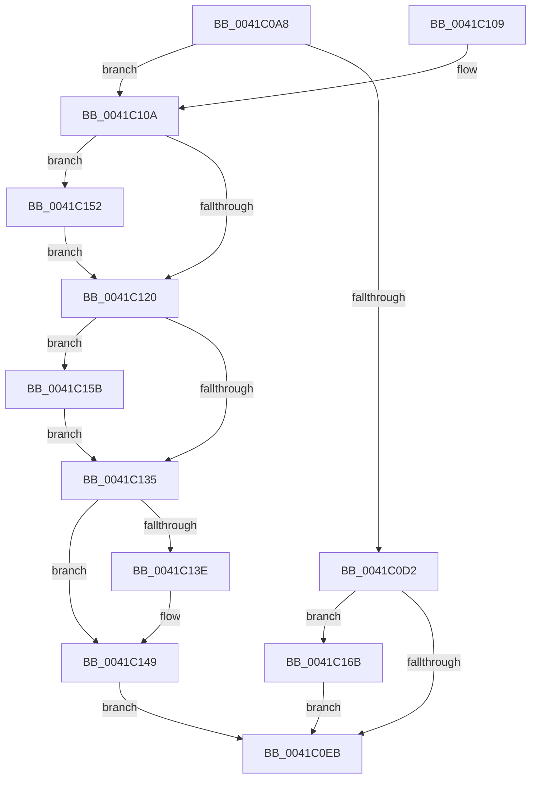

# EtwpApplyStackWalkIdFilter

- RVA: `0x0041C0A8`–`0x0041C17E` (길이 `214` bytes)
- VA: `0x000000014041C0A8`
- 실행 섹션: `.text`
- PDB 이름 있음: `예`; PDB Function 태그: `아니요`
- unwind 정보 RVA: `0x0009D70C`
- 디코드: `58`개 명령, `214/214` bytes 표시
- 미해석 바이트: `0` (있으면 어셈블리에 `.byte`로 보존)

> 이 문서는 커널 이미지의 기계어와 PDB 기호를 분석해 생성했습니다. 4번과 5번은 함수 원형과 자료형을 바이너리 사용 방식에서 추정한 C 해석이며 원본 소스 복구 결과는 아닙니다.

## 1. Dependencies

- 직접 호출 지점: **4**; 고유 호출 대상: **3**
- 직접 호출자로 확인된 함수: **2**
- RIP 상대 이미지 참조: **1**

### Outgoing calls
- `0x0041C144` → [KiLowerIrqlProcessIrqlFlags](../4F/KiLowerIrqlProcessIrqlFlags_function_004F5698.md) (function, `0x004F5698`)
- `0x0041C154` → [KiRaiseIrqlProcessIrqlFlags](../4F/KiRaiseIrqlProcessIrqlFlags_function_004F56FC.md) (function, `0x004F56FC`)
- `0x0041C15E` → [EtwpPerfectHashFunctionSearch](EtwpPerfectHashFunctionSearch_function_0041C190.md) (function, `0x0041C190`)
- `0x0041C16E` → [EtwpPerfectHashFunctionSearch](EtwpPerfectHashFunctionSearch_function_0041C190.md) (function, `0x0041C190`)

### Direct callers
- [EtwpEventWriteFull](../22/EtwpEventWriteFull_function_00225C10.md) at `0x00226520`
- [EtwpApplyStackWalkFilterOnUserEvent](../../page/A5/EtwpApplyStackWalkFilterOnUserEvent_function_00A5F7BC.md) at `0x00A5F7D2`

### Static image references
- `0x0041C117` → RVA `0x00FC6D20` (`ALMOSTRO`; read)

## 2. Other-region calls and transfers

- 다른 실행 섹션으로 향하는 call: **0**
- 별도 외부 분기/꼬리 이동을 확인하지 못했습니다.

## 3. Assembly (complete function range)

```asm
0041C0A8  48 8B C4                        mov rax, rsp
0041C0AB  48 89 58 08                     mov qword ptr [rax + 8], rbx
0041C0AF  48 89 68 10                     mov qword ptr [rax + 0x10], rbp
0041C0B3  48 89 70 18                     mov qword ptr [rax + 0x18], rsi
0041C0B7  48 89 78 20                     mov qword ptr [rax + 0x20], rdi
0041C0BB  41 56                           push r14
0041C0BD  48 83 EC 20                     sub rsp, 0x20
0041C0C1  41 8B E8                        mov ebp, r8d
0041C0C4  4C 8B F2                        mov r14, rdx
0041C0C7  0F B7 F1                        movzx esi, cx
0041C0CA  40 B7 01                        mov dil, 1
0041C0CD  45 84 C9                        test r9b, r9b
0041C0D0  75 38                           jne 0x14041c10a
0041C0D2  48 8B 82 80 02 00 00            mov rax, qword ptr [rdx + 0x280]
0041C0D9  48 6B CD 68                     imul rcx, rbp, 0x68
0041C0DD  48 8B 54 01 30                  mov rdx, qword ptr [rcx + rax + 0x30]
0041C0E2  48 85 D2                        test rdx, rdx
0041C0E5  0F 85 80 00 00 00               jne 0x14041c16b
0041C0EB  48 8B 5C 24 30                  mov rbx, qword ptr [rsp + 0x30]
0041C0F0  40 8A C7                        mov al, dil
0041C0F3  48 8B 7C 24 48                  mov rdi, qword ptr [rsp + 0x48]
0041C0F8  48 8B 6C 24 38                  mov rbp, qword ptr [rsp + 0x38]
0041C0FD  48 8B 74 24 40                  mov rsi, qword ptr [rsp + 0x40]
0041C102  48 83 C4 20                     add rsp, 0x20
0041C106  41 5E                           pop r14
0041C108  C3                              ret
0041C109  CC                              int3
0041C10A  44 0F 20 C3                     mov rbx, cr8
0041C10E  BA 02 00 00 00                  mov edx, 2
0041C113  44 0F 22 C2                     mov cr8, rdx
0041C117  83 3D 02 AC BA 00 00            cmp dword ptr [rip + 0xbaac02], 0
0041C11E  75 32                           jne 0x14041c152
0041C120  49 8B 86 80 02 00 00            mov rax, qword ptr [r14 + 0x280]
0041C127  48 6B CD 68                     imul rcx, rbp, 0x68
0041C12B  48 8B 54 01 30                  mov rdx, qword ptr [rcx + rax + 0x30]
0041C130  48 85 D2                        test rdx, rdx
0041C133  75 26                           jne 0x14041c15b
0041C135  83 3D E4 AB BA 00 00            cmp dword ptr [rip + 0xbaabe4], 0
0041C13C  74 0B                           je 0x14041c149
0041C13E  44 0F 20 C1                     mov rcx, cr8
0041C142  8A D3                           mov dl, bl
0041C144  E8 4F 95 0D 00                  call 0x1404f5698
0041C149  0F B6 C3                        movzx eax, bl
0041C14C  44 0F 22 C0                     mov cr8, rax
0041C150  EB 99                           jmp 0x14041c0eb
0041C152  8A CB                           mov cl, bl
0041C154  E8 A3 95 0D 00                  call 0x1404f56fc
0041C159  EB C5                           jmp 0x14041c120
0041C15B  0F B7 CE                        movzx ecx, si
0041C15E  E8 2D 00 00 00                  call 0x14041c190
0041C163  38 02                           cmp byte ptr [rdx], al
0041C165  40 0F 94 C7                     sete dil
0041C169  EB CA                           jmp 0x14041c135
0041C16B  0F B7 CE                        movzx ecx, si
0041C16E  E8 1D 00 00 00                  call 0x14041c190
0041C173  38 02                           cmp byte ptr [rdx], al
0041C175  40 0F 94 C7                     sete dil
0041C179  E9 6D FF FF FF                  jmp 0x14041c0eb
```

## 4. C-style interpretation (structured pseudocode)

```c
__int64 __fastcall EtwpApplyStackWalkIdFilter(unsigned __int16 a1, __int64 a2, int a3, unsigned __int8 a4)
{
    __int64 result;
    __int64 v_rdi;
    __int64 v_rsp;
    unsigned __int64 v_stack_p10;
    unsigned __int64 v_stack_p18;
    unsigned __int64 v_stack_p20;
    unsigned __int64 v_stack_p8;

    *(unsigned __int64 *)(v_rsp + 8) = v_rbx;
    *(unsigned __int64 *)(v_rsp + 16) = v_rbp;
    *(unsigned __int64 *)(v_rsp + 24) = v_rsi;
    *(unsigned __int64 *)(v_rsp + 32) = v_rdi;
    v_rsp = (v_rsp) - (32);
    if (a4 != 0) goto loc_0041C10A;
    a1 = (a1) * ((unsigned int)(a3));
    if (*(unsigned __int64 *)(a1 + *(unsigned __int64 *)(a2 + 640) * 1 + 48) != 0) goto loc_0041C16B;
loc_0041C0EB:
    v_rsp = (v_rsp) + (32);
    return 1;
loc_0041C10A:
    if ((*(unsigned int *)(v_rip + 12233730)) != 0) goto loc_0041C152;
loc_0041C120:
    a1 = (a1) * (v_stack_p10);
    if (*(unsigned __int64 *)(a1 + *(unsigned __int64 *)(a2 + 640) * 1 + 48) != 0) goto loc_0041C15B;
loc_0041C135:
    result = *(unsigned __int64 *)(a2 + 640);
    if ((*(unsigned int *)(v_rip + 12233700)) != 0) {
        a1 = 2;
        a2 = (unsigned __int8)(v_cr8);
        result = KiLowerIrqlProcessIrqlFlags(a1, a2, a3, a4);
    }
    goto loc_0041C0EB;
loc_0041C152:
    result = KiRaiseIrqlProcessIrqlFlags((unsigned __int8)(v_cr8), a2, a3, a4);
    goto loc_0041C120;
loc_0041C15B:
    result = EtwpPerfectHashFunctionSearch((unsigned __int16)(v_stack_p18), a2, a3, a4);
    v_rdi = ((*(unsigned __int8 *)(a2)) == ((unsigned __int8)(result))) ? 1 : 0;
    goto loc_0041C135;
loc_0041C16B:
    result = EtwpPerfectHashFunctionSearch((unsigned __int16)(v_stack_p18), a2, a3, a4);
    v_rdi = ((*(unsigned __int8 *)(a2)) == ((unsigned __int8)(result))) ? 1 : 0;
    goto loc_0041C0EB;
}
```

## 5. (Beta) C Style

```c
int64_t EtwpApplyStackWalkIdFilter(void *Arg1, void *Arg2, int32_t Arg3, uint8_t Arg4)
{
    uint8_t *arg1 = (uint8_t *)Arg1;
    uint8_t *arg2 = (uint8_t *)Arg2;

    int64_t result;
    int64_t local_rdi;
    int64_t local_rsp;
    uint64_t v_stack_p10;
    uint64_t v_stack_p18;
    uint64_t v_stack_p20;
    uint64_t v_stack_p8;

    *(uint64_t *)(local_rsp + 0x8) = local_rbx;
    *(uint64_t *)(local_rsp + 0x10) = local_rbp;
    *(uint64_t *)(local_rsp + 0x18) = local_rsi;
    *(uint64_t *)(local_rsp + 0x20) = local_rdi;
    local_rsp = (local_rsp) - (32);
    if (Arg4 != 0) goto loc_0041C10A;
    Arg1 = (Arg1) * ((uint32_t)(Arg3));
    if (*(uint64_t *)(arg1 + *(uint64_t *)(arg2 + 0x280) * 1 + 0x30) != 0) goto loc_0041C16B;
loc_0041C0EB:
    local_rsp = (local_rsp) + (32);
    return 1;
loc_0041C10A:
    if ((*(uint32_t *)(v_rip + 0xBAAC02)) != 0) goto loc_0041C152;
loc_0041C120:
    Arg1 = (Arg1) * (v_stack_p10);
    if (*(uint64_t *)(arg1 + *(uint64_t *)(arg2 + 0x280) * 1 + 0x30) != 0) goto loc_0041C15B;
loc_0041C135:
    result = *(uint64_t *)(arg2 + 0x280);
    if ((*(uint32_t *)(v_rip + 0xBAABE4)) != 0) {
        Arg1 = 2;
        Arg2 = (uint8_t)(v_cr8);
        result = KiLowerIrqlProcessIrqlFlags(Arg1, Arg2, Arg3, Arg4);
    }
    goto loc_0041C0EB;
loc_0041C152:
    result = KiRaiseIrqlProcessIrqlFlags((uint8_t)(v_cr8), Arg2, Arg3, Arg4);
    goto loc_0041C120;
loc_0041C15B:
    result = EtwpPerfectHashFunctionSearch((uint16_t)(v_stack_p18), Arg2, Arg3, Arg4);
    local_rdi = ((*(uint8_t *)(arg2)) == ((uint8_t)(result))) ? 1 : 0;
    goto loc_0041C135;
loc_0041C16B:
    result = EtwpPerfectHashFunctionSearch((uint16_t)(v_stack_p18), Arg2, Arg3, Arg4);
    local_rdi = ((*(uint8_t *)(arg2)) == ((uint8_t)(result))) ? 1 : 0;
    goto loc_0041C0EB;
}
```

### 관측된 메모리 오프셋

구조체 형식이 확인되지 않은 접근은 인자 기준의 오프셋으로만 기록했습니다.

| 기준 인자 | 오프셋 표현 | 폭 (bit) | 접근 |
|---|---:|---:|---|
| `Arg1` | `+ 0x30 + rax*1` | `64` | `R` |
| `Arg2` | `+ 0x280` | `64` | `R` |

## 6. Execution-region graph

[열기: 2D/3D 그래프와 함수 탐색 컨트롤 패널](../../../control-panel.html?section=text&rva=0x0041C0A8&view=graph)

- 2D 그래프는 위에서 아래로 흐르고, 3D 그래프는 빈 공간을 드래그해 회전합니다. Shift+드래그는 이동, 휠은 확대·축소, 함수 노드 선택은 대상 보고서 이동입니다.

### Static fallback


