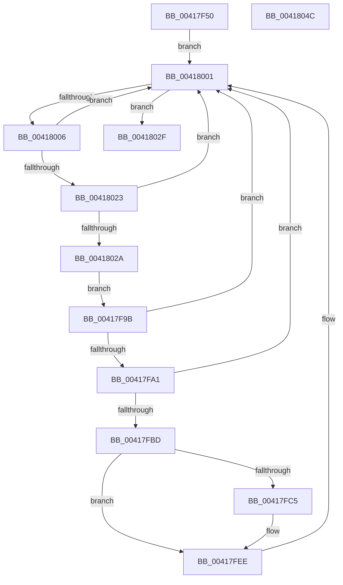

# EtwpCCSwapFlush

- RVA: `0x00417F50`–`0x0041804D` (길이 `253` bytes)
- VA: `0x0000000140417F50`
- 실행 섹션: `.text`
- PDB 이름 있음: `예`; PDB Function 태그: `아니요`
- unwind 정보 RVA: `0x0009CDAC`
- 디코드: `63`개 명령, `253/253` bytes 표시
- 미해석 바이트: `0` (있으면 어셈블리에 `.byte`로 보존)

> 이 문서는 커널 이미지의 기계어와 PDB 기호를 분석해 생성했습니다. 4번과 5번은 함수 원형과 자료형을 바이너리 사용 방식에서 추정한 C 해석이며 원본 소스 복구 결과는 아닙니다.

## 1. Dependencies

- 직접 호출 지점: **4**; 고유 호출 대상: **4**
- 직접 호출자로 확인된 함수: **1**
- RIP 상대 이미지 참조: **2**

### Outgoing calls
- `0x00417FB3` → [EtwpOpenLogger](../2F/EtwpOpenLogger_function_002F77F0.md) (function, `0x002F77F0`)
- `0x00417FE9` → [EtwpLogKernelEvent](../25/EtwpLogKernelEvent_function_0025CC00.md) (function, `0x0025CC00`)
- `0x00417FFC` → [EtwpCloseLogger](EtwpCloseLogger_function_00418060.md) (function, `0x00418060`)
- `0x00418037` → [_security_check_cookie](../6A/_security_check_cookie_function_006AC640.md) (function, `0x006AC640`)

### Direct callers
- [EtwpCCSwapTrace](EtwpCCSwapTrace_function_00417BBC.md) at `0x00417C75`

### Static image references
- `0x00417F5F` → RVA `0x00E0A740` (`.data`; read)
- `0x00417F8C` → RVA `0x00FC6AA8` (`ALMOSTRO`; read)

## 2. Other-region calls and transfers

- 다른 실행 섹션으로 향하는 call: **0**
- 별도 외부 분기/꼬리 이동을 확인하지 못했습니다.

## 3. Assembly (complete function range)

```asm
00417F50  48 89 5C 24 08                  mov qword ptr [rsp + 8], rbx
00417F55  48 89 74 24 10                  mov qword ptr [rsp + 0x10], rsi
00417F5A  57                              push rdi
00417F5B  48 83 EC 50                     sub rsp, 0x50
00417F5F  48 8B 05 DA 27 9F 00            mov rax, qword ptr [rip + 0x9f27da]
00417F66  48 33 C4                        xor rax, rsp
00417F69  48 89 44 24 48                  mov qword ptr [rsp + 0x48], rax
00417F6E  48 8D 41 10                     lea rax, [rcx + 0x10]
00417F72  C6 44 24 30 00                  mov byte ptr [rsp + 0x30], 0
00417F77  48 89 44 24 38                  mov qword ptr [rsp + 0x38], rax
00417F7C  8B F2                           mov esi, edx
00417F7E  8B 01                           mov eax, dword ptr [rcx]
00417F80  83 E8 10                        sub eax, 0x10
00417F83  83 64 24 44 00                  and dword ptr [rsp + 0x44], 0
00417F88  89 44 24 40                     mov dword ptr [rsp + 0x40], eax
00417F8C  48 8B 05 15 EB BA 00            mov rax, qword ptr [rip + 0xbaeb15]
00417F93  8B 98 A8 11 00 00               mov ebx, dword ptr [rax + 0x11a8]
00417F99  EB 66                           jmp 0x140418001
00417F9B  0F BA E0 08                     bt eax, 8
00417F9F  73 60                           jae 0x140418001
00417FA1  0F B6 BC 4A 98 11 00 00         movzx edi, byte ptr [rdx + rcx*2 + 0x1198]
00417FA9  4C 8D 4C 24 30                  lea r9, [rsp + 0x30]
00417FAE  8B CF                           mov ecx, edi
00417FB0  45 33 C0                        xor r8d, r8d
00417FB3  E8 38 F8 ED FF                  call 0x1402f77f0
00417FB8  48 85 C0                        test rax, rax
00417FBB  74 44                           je 0x140418001
00417FBD  39 B0 C8 00 00 00               cmp dword ptr [rax + 0xc8], esi
00417FC3  75 29                           jne 0x140417fee
00417FC5  48 8B 15 DC EA BA 00            mov rdx, qword ptr [rip + 0xbaeadc]
00417FCC  48 8D 4C 24 38                  lea rcx, [rsp + 0x38]
00417FD1  C7 44 24 28 02 02 00 00         mov dword ptr [rsp + 0x28], 0x202
00417FD9  41 B9 01 00 00 00               mov r9d, 1
00417FDF  44 8B C7                        mov r8d, edi
00417FE2  66 C7 44 24 20 25 05            mov word ptr [rsp + 0x20], 0x525
00417FE9  E8 12 4C E4 FF                  call 0x14025cc00
00417FEE  44 8A 44 24 30                  mov r8b, byte ptr [rsp + 0x30]
00417FF3  8B CF                           mov ecx, edi
00417FF5  48 8B 15 AC EA BA 00            mov rdx, qword ptr [rip + 0xbaeaac]
00417FFC  E8 5F 00 00 00                  call 0x140418060
00418001  0F BC CB                        bsf ecx, ebx
00418004  74 29                           je 0x14041802f
00418006  48 8B 15 9B EA BA 00            mov rdx, qword ptr [rip + 0xbaea9b]
0041800D  8D 43 FF                        lea eax, [rbx - 1]
00418010  23 D8                           and ebx, eax
00418012  8B C1                           mov eax, ecx
00418014  48 C1 E0 05                     shl rax, 5
00418018  48 05 CC 11 00 00               add rax, 0x11cc
0041801E  48 03 C2                        add rax, rdx
00418021  74 DE                           je 0x140418001
00418023  8B 40 04                        mov eax, dword ptr [rax + 4]
00418026  A8 04                           test al, 4
00418028  74 D7                           je 0x140418001
0041802A  E9 6C FF FF FF                  jmp 0x140417f9b
0041802F  48 8B 4C 24 48                  mov rcx, qword ptr [rsp + 0x48]
00418034  48 33 CC                        xor rcx, rsp
00418037  E8 04 46 29 00                  call 0x1406ac640
0041803C  48 8B 5C 24 60                  mov rbx, qword ptr [rsp + 0x60]
00418041  48 8B 74 24 68                  mov rsi, qword ptr [rsp + 0x68]
00418046  48 83 C4 50                     add rsp, 0x50
0041804A  5F                              pop rdi
0041804B  C3                              ret
0041804C  CC                              int3
```

## 4. C-style interpretation (structured pseudocode)

```c
__int64 __fastcall EtwpCCSwapFlush(__int64 a1, __int64 a2, int a3)
{
    __int64 result;
    __int64 v_rbx;
    __int64 v_rsp;
    unsigned __int64 v_stack_m10;
    unsigned int v_stack_m14;
    unsigned int v_stack_m18;
    unsigned __int64 v_stack_m20;
    unsigned __int8 v_stack_m28;
    unsigned int v_stack_m30;
    unsigned __int16 v_stack_m38;
    unsigned __int64 v_stack_p10;
    unsigned __int64 v_stack_p8;

    v_stack_p8 = v_rbx;
    v_stack_p10 = v_rsi;
    v_rsp = (v_rsp) - (80);
    result = (*(unsigned __int64 *)(v_rip + 10430426)) ^ (v_rsp);
    v_stack_m10 = result;
    v_stack_m28 = 0;
    v_stack_m20 = a1 + 16;
    result = (unsigned int)(((unsigned int)(*(unsigned int *)(a1))) - (16));
    v_stack_m18 = (unsigned int)(result);
    goto loc_00418001;
loc_00417F9B:
    if (condition_is_above_or_equal) goto loc_00418001;
    a3 = 0;
    result = EtwpOpenLogger((unsigned int)((unsigned int)(*(unsigned __int8 *)(a2 + a1 * 2 + 4504))), a2, a3, v_stack_m28);
    if (result == 0) goto loc_00418001;
    if ((*(unsigned int *)(result + 200)) == ((unsigned int)((unsigned int)((unsigned int)(a2))))) {
        a2 = *(unsigned __int64 *)(v_rip + 12249820);
        a1 = v_stack_m20;
        v_stack_m30 = 514;
        a4 = 1;
        a3 = (unsigned int)(*(unsigned __int8 *)(a2 + a1 * 2 + 4504));
        v_stack_m38 = 0x525ULL;
        result = EtwpLogKernelEvent(a1, a2, a3, a4);
    }
    result = EtwpCloseLogger((unsigned int)((unsigned int)(*(unsigned __int8 *)(a2 + a1 * 2 + 4504))), *(unsigned __int64 *)(v_rip + 12249772), v_stack_m28, a4);
loc_00418001:
    if ((*(unsigned int *)(result + 200)) == ((unsigned int)((unsigned int)((unsigned int)(a2))))) goto loc_0041802F;
    v_rbx = (unsigned int)(((unsigned int)(*(unsigned int *)(*(unsigned __int64 *)(v_rip + 12249877) + 4520))) & ((unsigned int)((unsigned int)(*(unsigned int *)(*(unsigned __int64 *)(v_rip + 12249877) + 4520)) - 1)));
    result = ((unsigned int)((unsigned int)((unsigned int)((unsigned int)(*(unsigned __int8 *)(a2 + a1 * 2 + 4504)))))) << (5);
    result = (result) + (0x11CCULL);
    result = (result) + (*(unsigned __int64 *)(v_rip + 12249755));
    if (condition_is_equal) goto loc_00418001;
    if ((((unsigned __int8)((unsigned int)(*(unsigned int *)(result + 4)))) & (4)) == 0) goto loc_00418001;
    goto loc_00417F9B;
loc_0041802F:
    a1 = (v_stack_m10) ^ (v_rsp);
    result = _security_check_cookie(a1, *(unsigned __int64 *)(v_rip + 12249755), v_stack_m28, a4);
    v_rsp = (v_rsp) + (80);
    return result;
}
```

## 5. (Beta) C Style

```c
int64_t EtwpCCSwapFlush(void *Arg1, int64_t Arg2, int32_t Arg3)
{
    uint8_t *arg1 = (uint8_t *)Arg1;

    int64_t result;
    int64_t local_rbx;
    int64_t local_rsp;
    uint64_t v_stack_m10;
    uint32_t v_stack_m14;
    uint32_t v_stack_m18;
    uint64_t v_stack_m20;
    uint8_t v_stack_m28;
    uint32_t v_stack_m30;
    uint16_t v_stack_m38;
    uint64_t v_stack_p10;
    uint64_t v_stack_p8;

    v_stack_p8 = local_rbx;
    v_stack_p10 = local_rsi;
    local_rsp = (local_rsp) - (80);
    result = (*(uint64_t *)(v_rip + 0x9F27DA)) ^ (local_rsp);
    v_stack_m10 = result;
    v_stack_m28 = 0;
    v_stack_m20 = Arg1 + 16;
    result = (uint32_t)(((uint32_t)(*(uint32_t *)(arg1))) - (16));
    v_stack_m18 = (uint32_t)(result);
    goto loc_00418001;
loc_00417F9B:
    if (condition_is_above_or_equal) goto loc_00418001;
    Arg3 = 0;
    result = EtwpOpenLogger((uint32_t)((uint32_t)(*(uint8_t *)(Arg2 + arg1 * 2 + 0x1198))), Arg2, Arg3, v_stack_m28);
    if (result == 0) goto loc_00418001;
    if ((*(uint32_t *)(result + 0xC8)) == ((uint32_t)((uint32_t)((uint32_t)(Arg2))))) {
        Arg2 = *(uint64_t *)(v_rip + 0xBAEADC);
        Arg1 = v_stack_m20;
        v_stack_m30 = 514;
        a4 = 1;
        Arg3 = (uint32_t)(*(uint8_t *)(Arg2 + arg1 * 2 + 0x1198));
        v_stack_m38 = 0x525ULL;
        result = EtwpLogKernelEvent(Arg1, Arg2, Arg3, a4);
    }
    result = EtwpCloseLogger((uint32_t)((uint32_t)(*(uint8_t *)(Arg2 + arg1 * 2 + 0x1198))), *(uint64_t *)(v_rip + 0xBAEAAC), v_stack_m28, a4);
loc_00418001:
    if ((*(uint32_t *)(result + 0xC8)) == ((uint32_t)((uint32_t)((uint32_t)(Arg2))))) goto loc_0041802F;
    local_rbx = (uint32_t)(((uint32_t)(*(uint32_t *)(*(uint64_t *)(v_rip + 0xBAEB15) + 0x11A8))) & ((uint32_t)((uint32_t)(*(uint32_t *)(*(uint64_t *)(v_rip + 0xBAEB15) + 0x11A8)) - 1)));
    result = ((uint32_t)((uint32_t)((uint32_t)((uint32_t)(*(uint8_t *)(Arg2 + arg1 * 2 + 0x1198)))))) << (5);
    result = (result) + (0x11CCULL);
    result = (result) + (*(uint64_t *)(v_rip + 0xBAEA9B));
    if (condition_is_equal) goto loc_00418001;
    if ((((uint8_t)((uint32_t)(*(uint32_t *)(result + 0x4)))) & (4)) == 0) goto loc_00418001;
    goto loc_00417F9B;
loc_0041802F:
    Arg1 = (v_stack_m10) ^ (local_rsp);
    result = _security_check_cookie(Arg1, *(uint64_t *)(v_rip + 0xBAEA9B), v_stack_m28, a4);
    local_rsp = (local_rsp) + (80);
    return result;
}
```

### 관측된 메모리 오프셋

구조체 형식이 확인되지 않은 접근은 인자 기준의 오프셋으로만 기록했습니다.

| 기준 인자 | 오프셋 표현 | 폭 (bit) | 접근 |
|---|---:|---:|---|
| `Arg1` | `+ 0x0` | `32` | `R` |
| `Arg1` | `+ 0x10` | `64` | `R` |

## 6. Execution-region graph

[열기: 2D/3D 그래프와 함수 탐색 컨트롤 패널](../../../control-panel.html?section=text&rva=0x00417F50&view=graph)

- 2D 그래프는 위에서 아래로 흐르고, 3D 그래프는 빈 공간을 드래그해 회전합니다. Shift+드래그는 이동, 휠은 확대·축소, 함수 노드 선택은 대상 보고서 이동입니다.

### Static fallback


