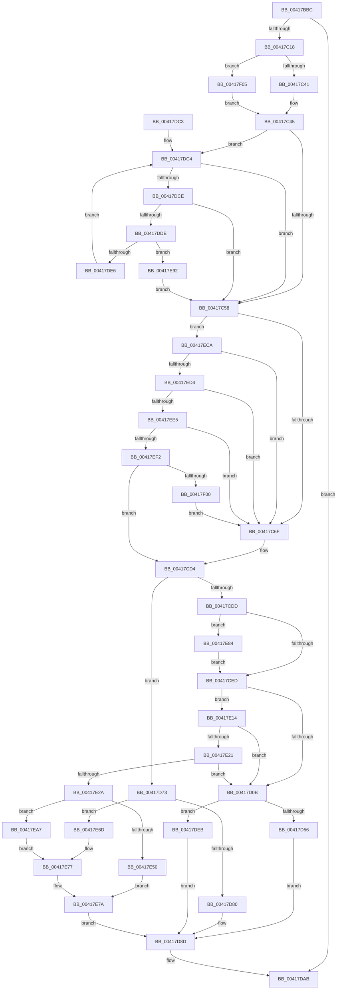

# EtwpCCSwapTrace

- RVA: `0x00417BBC`–`0x00417F49` (길이 `909` bytes)
- VA: `0x0000000140417BBC`
- 실행 섹션: `.text`
- PDB 이름 있음: `예`; PDB Function 태그: `아니요`
- unwind 정보 RVA: `0x0009CD90`
- 디코드: `223`개 명령, `909/909` bytes 표시
- 미해석 바이트: `0` (있으면 어셈블리에 `.byte`로 보존)

> 이 문서는 커널 이미지의 기계어와 PDB 기호를 분석해 생성했습니다. 4번과 5번은 함수 원형과 자료형을 바이너리 사용 방식에서 추정한 C 해석이며 원본 소스 복구 결과는 아닙니다.

## 1. Dependencies

- 직접 호출 지점: **4**; 고유 호출 대상: **3**
- 직접 호출자로 확인된 함수: **1**
- RIP 상대 이미지 참조: **0**

### Outgoing calls
- `0x00417C75` → [EtwpCCSwapFlush](EtwpCCSwapFlush_function_00417F50.md) (function, `0x00417F50`)
- `0x00417CAF` → [memset](../6C/memset_function_006C6C40.md) (function, `0x006C6C40`)
- `0x00417D99` → [memcpy](../6C/memcpy_function_006C6840.md) (function, `0x006C6840`)
- `0x00417F22` → [memset](../6C/memset_function_006C6C40.md) (function, `0x006C6C40`)

### Direct callers
- [EtwpLogContextSwapEvent](EtwpLogContextSwapEvent_function_004175F0.md) at `0x004179F8`

### Static image references
- 디코드된 RIP-relative 메모리 참조가 없습니다.

## 2. Other-region calls and transfers

- 다른 실행 섹션으로 향하는 call: **0**
- 별도 외부 분기/꼬리 이동을 확인하지 못했습니다.

## 3. Assembly (complete function range)

```asm
00417BBC  48 8B C4                        mov rax, rsp
00417BBF  48 89 58 08                     mov qword ptr [rax + 8], rbx
00417BC3  4C 89 48 20                     mov qword ptr [rax + 0x20], r9
00417BC7  44 89 40 18                     mov dword ptr [rax + 0x18], r8d
00417BCB  48 89 50 10                     mov qword ptr [rax + 0x10], rdx
00417BCF  55                              push rbp
00417BD0  56                              push rsi
00417BD1  57                              push rdi
00417BD2  41 54                           push r12
00417BD4  41 55                           push r13
00417BD6  41 56                           push r14
00417BD8  41 57                           push r15
00417BDA  48 8B EC                        mov rbp, rsp
00417BDD  48 83 EC 40                     sub rsp, 0x40
00417BE1  65 48 8B 04 25 20 00 00 00      mov rax, qword ptr gs:[0x20]
00417BEA  33 F6                           xor esi, esi
00417BEC  45 8B D0                        mov r10d, r8d
00417BEF  4D 8B D9                        mov r11, r9
00417BF2  4C 8B F1                        mov r14, rcx
00417BF5  48 89 75 E0                     mov qword ptr [rbp - 0x20], rsi
00417BF9  45 8B C8                        mov r9d, r8d
00417BFC  4C 8B A8 A8 8B 00 00            mov r13, qword ptr [rax + 0x8ba8]
00417C03  4C 89 55 F8                     mov qword ptr [rbp - 8], r10
00417C07  4B 8B 9C D5 98 01 00 00         mov rbx, qword ptr [r13 + r10*8 + 0x198]
00417C0F  48 85 DB                        test rbx, rbx
00417C12  0F 84 93 01 00 00               je 0x140417dab
00417C18  4C 8D 7B 10                     lea r15, [rbx + 0x10]
00417C1C  49 8B 13                        mov rdx, qword ptr [r11]
00417C1F  48 8D 7B 18                     lea rdi, [rbx + 0x18]
00417C23  4C 89 7D E8                     mov qword ptr [rbp - 0x18], r15
00417C27  4C 8D 63 04                     lea r12, [rbx + 4]
00417C2B  48 89 7D F0                     mov qword ptr [rbp - 0x10], rdi
00417C2F  49 BB 20 03 00 00 80 F7 FF FF   movabs r11, 0xfffff78000000320
00417C39  39 33                           cmp dword ptr [rbx], esi
00417C3B  0F 84 C4 02 00 00               je 0x140417f05
00417C41  48 2B 53 08                     sub rdx, qword ptr [rbx + 8]
00417C45  45 8B BE 10 05 00 00            mov r15d, dword ptr [r14 + 0x510]
00417C4C  44 8B C6                        mov r8d, esi
00417C4F  45 85 FF                        test r15d, r15d
00417C52  0F 85 6C 01 00 00               jne 0x140417dc4
00417C58  41 8B 03                        mov eax, dword ptr [r11]
00417C5B  BF 08 00 00 00                  mov edi, 8
00417C60  41 2B 04 24                     sub eax, dword ptr [r12]
00417C64  3D F4 01 00 00                  cmp eax, 0x1f4
00417C69  0F 86 5B 02 00 00               jbe 0x140417eca
00417C6F  41 8B D2                        mov edx, r10d
00417C72  48 8B CB                        mov rcx, rbx
00417C75  E8 D6 02 00 00                  call 0x140417f50
00417C7A  48 8B 45 58                     mov rax, qword ptr [rbp + 0x58]
00417C7E  33 D2                           xor edx, edx
00417C80  48 8B 08                        mov rcx, qword ptr [rax]
00417C83  44 8D 42 40                     lea r8d, [rdx + 0x40]
00417C87  48 B8 20 03 00 00 80 F7 FF FF   movabs rax, 0xfffff78000000320
00417C91  8B 00                           mov eax, dword ptr [rax]
00417C93  41 89 04 24                     mov dword ptr [r12], eax
00417C97  48 8B 45 E8                     mov rax, qword ptr [rbp - 0x18]
00417C9B  4C 8B 65 F0                     mov r12, qword ptr [rbp - 0x10]
00417C9F  48 89 4B 08                     mov qword ptr [rbx + 8], rcx
00417CA3  C7 03 68 00 00 00               mov dword ptr [rbx], 0x68
00417CA9  48 89 08                        mov qword ptr [rax], rcx
00417CAC  49 8B CC                        mov rcx, r12
00417CAF  E8 8C EF 2A 00                  call 0x1406c6c40
00417CB4  48 8B 45 F8                     mov rax, qword ptr [rbp - 8]
00417CB8  48 8B D6                        mov rdx, rsi
00417CBB  44 8B C6                        mov r8d, esi
00417CBE  49 BB 20 03 00 00 80 F7 FF FF   movabs r11, 0xfffff78000000320
00417CC8  42 88 B4 28 90 01 00 00         mov byte ptr [rax + r13 + 0x190], sil
00417CD0  45 89 3C 24                     mov dword ptr [r12], r15d
00417CD4  45 85 FF                        test r15d, r15d
00417CD7  0F 84 96 00 00 00               je 0x140417d73
00417CDD  48 8B 4D 48                     mov rcx, qword ptr [rbp + 0x48]
00417CE1  39 B1 10 05 00 00               cmp dword ptr [rcx + 0x510], esi
00417CE7  0F 85 97 01 00 00               jne 0x140417e84
00417CED  45 0F BE 8E C3 00 00 00         movsx r9d, byte ptr [r14 + 0xc3]
00417CF5  41 8B C0                        mov eax, r8d
00417CF8  0F BE 4C 18 58                  movsx ecx, byte ptr [rax + rbx + 0x58]
00417CFD  41 8B C1                        mov eax, r9d
00417D00  2B C1                           sub eax, ecx
00417D02  83 FE 01                        cmp esi, 1
00417D05  0F 86 09 01 00 00               jbe 0x140417e14
00417D0B  8B 4D E4                        mov ecx, dword ptr [rbp - 0x1c]
00417D0E  8D 04 95 00 00 00 00            lea eax, [rdx*4]
00417D15  83 C8 03                        or eax, 3
00417D18  83 E1 F0                        and ecx, 0xfffffff0
00417D1B  89 45 E0                        mov dword ptr [rbp - 0x20], eax
00417D1E  41 83 E0 0F                     and r8d, 0xf
00417D22  41 0B C8                        or ecx, r8d
00417D25  B8 FF FF 01 00                  mov eax, 0x1ffff
00417D2A  3B F0                           cmp esi, eax
00417D2C  0F 42 C6                        cmovb eax, esi
00417D2F  41 83 E1 1F                     and r9d, 0x1f
00417D33  C1 E0 05                        shl eax, 5
00417D36  81 E1 FF 03 00 00               and ecx, 0x3ff
00417D3C  41 0B C1                        or eax, r9d
00417D3F  C1 E0 0A                        shl eax, 0xa
00417D42  0B C1                           or eax, ecx
00417D44  89 45 E4                        mov dword ptr [rbp - 0x1c], eax
00417D47  41 8A 86 84 01 00 00            mov al, byte ptr [r14 + 0x184]
00417D4E  3C 05                           cmp al, 5
00417D50  0F 85 95 00 00 00               jne 0x140417deb
00417D56  8B 45 E4                        mov eax, dword ptr [rbp - 0x1c]
00417D59  41 0F B6 8E 83 02 00 00         movzx ecx, byte ptr [r14 + 0x283]
00417D61  25 0F FC FF FF                  and eax, 0xfffffc0f
00417D66  83 E1 3F                        and ecx, 0x3f
00417D69  C1 E1 04                        shl ecx, 4
00417D6C  0B C8                           or ecx, eax
00417D6E  89 4D E4                        mov dword ptr [rbp - 0x1c], ecx
00417D71  EB 1A                           jmp 0x140417d8d
00417D73  48 81 FA 00 40 00 00            cmp rdx, 0x4000
00417D7A  0F 8D ED 00 00 00               jge 0x140417e6d
00417D80  66 C1 E2 02                     shl dx, 2
00417D84  BF 02 00 00 00                  mov edi, 2
00417D89  66 89 55 E0                     mov word ptr [rbp - 0x20], dx
00417D8D  8B 0B                           mov ecx, dword ptr [rbx]
00417D8F  48 8D 55 E0                     lea rdx, [rbp - 0x20]
00417D93  48 03 CB                        add rcx, rbx
00417D96  44 8B C7                        mov r8d, edi
00417D99  E8 A2 EA 2A 00                  call 0x1406c6840
00417D9E  48 8B 45 58                     mov rax, qword ptr [rbp + 0x58]
00417DA2  01 3B                           add dword ptr [rbx], edi
00417DA4  48 8B 00                        mov rax, qword ptr [rax]
00417DA7  48 89 43 08                     mov qword ptr [rbx + 8], rax
00417DAB  48 8B 9C 24 80 00 00 00         mov rbx, qword ptr [rsp + 0x80]
00417DB3  48 83 C4 40                     add rsp, 0x40
00417DB7  41 5F                           pop r15
00417DB9  41 5E                           pop r14
00417DBB  41 5D                           pop r13
00417DBD  41 5C                           pop r12
00417DBF  5F                              pop rdi
00417DC0  5E                              pop rsi
00417DC1  5D                              pop rbp
00417DC2  C3                              ret
00417DC3  CC                              int3
00417DC4  41 83 F8 10                     cmp r8d, 0x10
00417DC8  0F 83 8A FE FF FF               jae 0x140417c58
00417DCE  41 8B C8                        mov ecx, r8d
00417DD1  8B 44 8B 18                     mov eax, dword ptr [rbx + rcx*4 + 0x18]
00417DD5  41 3B C7                        cmp eax, r15d
00417DD8  0F 84 7A FE FF FF               je 0x140417c58
00417DDE  85 C0                           test eax, eax
00417DE0  0F 84 AC 00 00 00               je 0x140417e92
00417DE6  41 FF C0                        inc r8d
00417DE9  EB D9                           jmp 0x140417dc4
00417DEB  41 0F B6 8E 84 01 00 00         movzx ecx, byte ptr [r14 + 0x184]
00417DF3  8B 45 E4                        mov eax, dword ptr [rbp - 0x1c]
00417DF6  C1 E1 04                        shl ecx, 4
00417DF9  25 0F FC FF FF                  and eax, 0xfffffc0f
00417DFE  81 E9 41 01 00 00               sub ecx, 0x141
00417E04  81 E1 F0 03 00 00               and ecx, 0x3f0
00417E0A  0B C1                           or eax, ecx
00417E0C  89 45 E4                        mov dword ptr [rbp - 0x1c], eax
00417E0F  E9 79 FF FF FF                  jmp 0x140417d8d
00417E14  48 81 FA 00 00 02 00            cmp rdx, 0x20000
00417E1B  0F 8D EA FE FF FF               jge 0x140417d0b
00417E21  83 F8 07                        cmp eax, 7
00417E24  0F 87 E1 FE FF FF               ja 0x140417d0b
00417E2A  C1 E2 09                        shl edx, 9
00417E2D  83 E0 07                        and eax, 7
00417E30  0B D0                           or edx, eax
00417E32  41 83 E0 0F                     and r8d, 0xf
00417E36  41 8A 86 84 01 00 00            mov al, byte ptr [r14 + 0x184]
00417E3D  C1 E2 04                        shl edx, 4
00417E40  41 0B D0                        or edx, r8d
00417E43  C1 E2 02                        shl edx, 2
00417E46  83 CA 02                        or edx, 2
00417E49  89 55 E0                        mov dword ptr [rbp - 0x20], edx
00417E4C  3C 05                           cmp al, 5
00417E4E  75 57                           jne 0x140417ea7
00417E50  8B 45 E0                        mov eax, dword ptr [rbp - 0x20]
00417E53  41 0F B6 8E 83 02 00 00         movzx ecx, byte ptr [r14 + 0x283]
00417E5B  25 FF 81 FF FF                  and eax, 0xffff81ff
00417E60  83 E1 3F                        and ecx, 0x3f
00417E63  C1 E1 09                        shl ecx, 9
00417E66  0B C8                           or ecx, eax
00417E68  89 4D E0                        mov dword ptr [rbp - 0x20], ecx
00417E6B  EB 0D                           jmp 0x140417e7a
00417E6D  8D 04 95 00 00 00 00            lea eax, [rdx*4]
00417E74  83 C8 01                        or eax, 1
00417E77  89 45 E0                        mov dword ptr [rbp - 0x20], eax
00417E7A  BF 04 00 00 00                  mov edi, 4
00417E7F  E9 09 FF FF FF                  jmp 0x140417d8d
00417E84  41 8B 33                        mov esi, dword ptr [r11]
00417E87  2B B1 B4 01 00 00               sub esi, dword ptr [rcx + 0x1b4]
00417E8D  E9 5B FE FF FF                  jmp 0x140417ced
00417E92  44 89 7C 8B 18                  mov dword ptr [rbx + rcx*4 + 0x18], r15d
00417E97  41 8A 86 33 02 00 00            mov al, byte ptr [r14 + 0x233]
00417E9E  88 44 19 58                     mov byte ptr [rcx + rbx + 0x58], al
00417EA2  E9 B1 FD FF FF                  jmp 0x140417c58
00417EA7  41 0F B6 8E 84 01 00 00         movzx ecx, byte ptr [r14 + 0x184]
00417EAF  8B 45 E0                        mov eax, dword ptr [rbp - 0x20]
00417EB2  C1 E1 09                        shl ecx, 9
00417EB5  25 FF 81 FF FF                  and eax, 0xffff81ff
00417EBA  81 E9 01 28 00 00               sub ecx, 0x2801
00417EC0  81 E1 00 7E 00 00               and ecx, 0x7e00
00417EC6  0B C1                           or eax, ecx
00417EC8  EB AD                           jmp 0x140417e77
00417ECA  41 83 F8 10                     cmp r8d, 0x10
00417ECE  0F 84 9B FD FF FF               je 0x140417c6f
00417ED4  8B 03                           mov eax, dword ptr [rbx]
00417ED6  48 03 C7                        add rax, rdi
00417ED9  48 3D 00 04 00 00               cmp rax, 0x400
00417EDF  0F 87 8A FD FF FF               ja 0x140417c6f
00417EE5  48 81 FA 00 00 00 40            cmp rdx, 0x40000000
00417EEC  0F 8F 7D FD FF FF               jg 0x140417c6f
00417EF2  43 38 B4 29 90 01 00 00         cmp byte ptr [r9 + r13 + 0x190], sil
00417EFA  0F 84 D4 FD FF FF               je 0x140417cd4
00417F00  E9 6A FD FF FF                  jmp 0x140417c6f
00417F05  41 8B 03                        mov eax, dword ptr [r11]
00417F08  48 8B CF                        mov rcx, rdi
00417F0B  48 89 53 08                     mov qword ptr [rbx + 8], rdx
00417F0F  49 89 17                        mov qword ptr [r15], rdx
00417F12  33 D2                           xor edx, edx
00417F14  41 89 04 24                     mov dword ptr [r12], eax
00417F18  C7 03 68 00 00 00               mov dword ptr [rbx], 0x68
00417F1E  44 8D 42 40                     lea r8d, [rdx + 0x40]
00417F22  E8 19 ED 2A 00                  call 0x1406c6c40
00417F27  4C 8B 4D F8                     mov r9, qword ptr [rbp - 8]
00417F2B  48 8B D6                        mov rdx, rsi
00417F2E  44 8B 55 50                     mov r10d, dword ptr [rbp + 0x50]
00417F32  49 BB 20 03 00 00 80 F7 FF FF   movabs r11, 0xfffff78000000320
00417F3C  4C 89 7D E8                     mov qword ptr [rbp - 0x18], r15
00417F40  48 89 7D F0                     mov qword ptr [rbp - 0x10], rdi
00417F44  E9 FC FC FF FF                  jmp 0x140417c45
```

## 4. C-style interpretation (structured pseudocode)

```c
__int64 __fastcall EtwpCCSwapTrace(__int64 a1, __int64 a2, int a3, __int64 a4)
{
    __int64 result;
    __int64 v_rsi;
    __int64 v_rsp;
    unsigned __int64 v_stack_m40;
    unsigned __int64 v_stack_m48;
    unsigned __int64 v_stack_m50;
    unsigned int v_stack_m54;
    unsigned __int64 v_stack_m58;
    unsigned __int64 v_stack_p10;
    unsigned int v_stack_p18;
    unsigned __int64 v_stack_p20;
    unsigned __int64 v_stack_p8;

    *(unsigned __int64 *)(v_rsp + 8) = v_rbx;
    *(unsigned __int64 *)(v_rsp + 32) = a4;
    *(unsigned int *)(v_rsp + 24) = a3;
    *(unsigned __int64 *)(v_rsp + 16) = a2;
    v_rsp = (v_rsp) - (64);
    v_rsi = 0;
    v_stack_m58 = 0;
    v_stack_m40 = (unsigned int)(a3);
    if (*(unsigned __int64 *)(*(unsigned __int64 *)(*(unsigned __int64 *)(gs_base + (0 + 32)) + 35752) + (unsigned int)(a3) * 8 + 408) == 0) goto loc_00417DAB;
    v_stack_m50 = *(unsigned __int64 *)(*(unsigned __int64 *)(*(unsigned __int64 *)(gs_base + (0 + 32)) + 35752) + (unsigned int)(a3) * 8 + 408) + 16;
    v_stack_m48 = *(unsigned __int64 *)(*(unsigned __int64 *)(*(unsigned __int64 *)(gs_base + (0 + 32)) + 35752) + (unsigned int)(a3) * 8 + 408) + 24;
    if ((*(unsigned int *)(*(unsigned __int64 *)(*(unsigned __int64 *)(*(unsigned __int64 *)(gs_base + (0 + 32)) + 35752) + (unsigned int)(a3) * 8 + 408))) == 0) goto loc_00417F05;
    a2 = (*(unsigned __int64 *)(a4)) - (*(unsigned __int64 *)(*(unsigned __int64 *)(*(unsigned __int64 *)(*(unsigned __int64 *)(gs_base + (0 + 32)) + 35752) + (unsigned int)(a3) * 8 + 408) + 8));
loc_00417C45:
    if ((unsigned int)((unsigned int)(*(unsigned int *)(a1 + 1296))) != 0) goto loc_00417DC4;
loc_00417C58:
    result = (unsigned int)(((unsigned int)(*(unsigned int *)(a4))) - (*(unsigned int *)(*(unsigned __int64 *)(*(unsigned __int64 *)(*(unsigned __int64 *)(gs_base + (0 + 32)) + 35752) + (unsigned int)(a3) * 8 + 408) + 4)));
    if (((unsigned int)(result)) <= 500) goto loc_00417ECA;
loc_00417C6F:
    result = EtwpCCSwapFlush(*(unsigned __int64 *)(*(unsigned __int64 *)(*(unsigned __int64 *)(gs_base + (0 + 32)) + 35752) + (unsigned int)(a3) * 8 + 408), (unsigned int)((unsigned int)((unsigned int)(a3))), 0, (unsigned int)(a3));
    a2 = 0;
    *(unsigned int *)(*(unsigned __int64 *)(*(unsigned __int64 *)(*(unsigned __int64 *)(gs_base + (0 + 32)) + 35752) + (unsigned int)(a3) * 8 + 408) + 4) = (unsigned int)((unsigned int)(*(unsigned int *)(v_stack_p20)));
    *(unsigned __int64 *)(*(unsigned __int64 *)(*(unsigned __int64 *)(*(unsigned __int64 *)(gs_base + (0 + 32)) + 35752) + (unsigned int)(a3) * 8 + 408) + 8) = *(unsigned __int64 *)(v_stack_p20);
    *(unsigned int *)(*(unsigned __int64 *)(*(unsigned __int64 *)(*(unsigned __int64 *)(gs_base + (0 + 32)) + 35752) + (unsigned int)(a3) * 8 + 408)) = 104;
    *(unsigned __int64 *)(v_stack_m50) = *(unsigned __int64 *)(v_stack_p20);
    result = memset(v_stack_m48, a2, a2 + 64, (unsigned int)(a3));
    *(unsigned __int8 *)(v_stack_m40 + *(unsigned __int64 *)(*(unsigned __int64 *)(gs_base + (0 + 32)) + 35752) * 1 + 400) = 0;
    *(unsigned int *)(v_stack_m48) = (unsigned int)((unsigned int)(*(unsigned int *)(a1 + 1296)));
loc_00417CD4:
    if ((unsigned int)((unsigned int)(*(unsigned int *)(a1 + 1296))) == 0) goto loc_00417D73;
    if ((*(unsigned int *)(v_stack_p10 + 1296)) != 0) goto loc_00417E84;
loc_00417CED:
    result = (unsigned int)(((unsigned int)((unsigned int)((__int8)(*(unsigned __int8 *)(a1 + 195))))) - ((unsigned int)((__int8)(*(unsigned __int8 *)(0 + *(unsigned __int64 *)(*(unsigned __int64 *)(*(unsigned __int64 *)(gs_base + (0 + 32)) + 35752) + (unsigned int)(a3) * 8 + 408) * 1 + 88)))));
    if (0 <= 1) goto loc_00417E14;
loc_00417D0B:
    result = (unsigned int)((0 * 4) | (3));
    a1 = (unsigned int)(((unsigned int)(v_stack_m54)) & (0xFFFFFFF0ULL));
    v_stack_m58 = (unsigned int)(result);
    a3 = (unsigned int)((0) & (15));
    a1 = (unsigned int)((a1) | (a3));
    result = (unsigned int)(0x1FFFFULL);
    if (0 < ((unsigned int)((unsigned int)(0x1FFFFULL)))) { result = 0; }
    a4 = (unsigned int)(((__int8)(*(unsigned __int8 *)(a1 + 195))) & (31));
    result = (unsigned int)((result) << (5));
    a1 = (unsigned int)((a1) & (0x3FFULL));
    result = (unsigned int)((result) | ((unsigned int)(a4)));
    result = (unsigned int)((result) << (10));
    result = (unsigned int)((result) | ((unsigned int)(a1)));
    v_stack_m54 = (unsigned int)(result);
    if (((unsigned __int8)(*(unsigned __int8 *)(a1 + 388))) != 5) goto loc_00417DEB;
    result = (unsigned int)(((unsigned int)(v_stack_m54)) & (0xFFFFFC0FULL));
    a1 = (unsigned int)((*(unsigned __int8 *)(a1 + 643)) & (63));
    a1 = (unsigned int)((a1) << (4));
    a1 = (unsigned int)((a1) | ((unsigned int)(result)));
    v_stack_m54 = (unsigned int)(a1);
    goto loc_00417D8D;
loc_00417D73:
    if (0 >= 0x4000ULL) goto loc_00417E6D;
    a2 = (unsigned __int16)((0) << (2));
    v_stack_m58 = (unsigned __int16)(a2);
loc_00417D8D:
    a1 = ((unsigned int)(*(unsigned int *)(*(unsigned __int64 *)(*(unsigned __int64 *)(*(unsigned __int64 *)(gs_base + (0 + 32)) + 35752) + (unsigned int)(a3) * 8 + 408)))) + (*(unsigned __int64 *)(*(unsigned __int64 *)(*(unsigned __int64 *)(gs_base + (0 + 32)) + 35752) + (unsigned int)(a3) * 8 + 408));
    result = memcpy(a1, v_stack_m58, 2, a4);
    *(unsigned __int64 *)(*(unsigned __int64 *)(*(unsigned __int64 *)(*(unsigned __int64 *)(gs_base + (0 + 32)) + 35752) + (unsigned int)(a3) * 8 + 408) + 8) = *(unsigned __int64 *)(v_stack_p20);
loc_00417DAB:
    v_rsp = (v_rsp) + (64);
    return *(unsigned __int64 *)(v_stack_p20);
loc_00417DC4:
    if (2 >= 16) goto loc_00417C58;
    if (((unsigned int)((unsigned int)(*(unsigned int *)(v_stack_p8 + 2 * 4 + 24)))) == ((unsigned int)((unsigned int)(*(unsigned int *)(a1 + 1296))))) goto loc_00417C58;
    if ((unsigned int)((unsigned int)(*(unsigned int *)(v_stack_p8 + 2 * 4 + 24))) == 0) goto loc_00417E92;
    a3 = (unsigned int)((2) + 1);
    goto loc_00417DC4;
loc_00417DEB:
    a1 = (unsigned int)((*(unsigned __int8 *)(a1 + 388)) << (4));
    result = (unsigned int)(((unsigned int)(v_stack_m54)) & (0xFFFFFC0FULL));
    a1 = (unsigned int)((a1) - (321));
    a1 = (unsigned int)((a1) & (0x3F0ULL));
    result = (unsigned int)((result) | ((unsigned int)(a1)));
    v_stack_m54 = (unsigned int)(result);
    goto loc_00417D8D;
loc_00417E14:
    if (v_stack_m58 >= 0x20000ULL) goto loc_00417D0B;
    if (((unsigned int)(result)) > 7) goto loc_00417D0B;
    a2 = (unsigned int)((v_stack_m58) << (9));
    result = (unsigned int)((result) & (7));
    a2 = (unsigned int)((a2) | ((unsigned int)(result)));
    a3 = (unsigned int)((a3) & (15));
    a2 = (unsigned int)((a2) << (4));
    a2 = (unsigned int)((a2) | (a3));
    a2 = (unsigned int)((a2) << (2));
    a2 = (unsigned int)((a2) | (2));
    v_stack_m58 = (unsigned int)(a2);
    if (((unsigned __int8)(*(unsigned __int8 *)(a1 + 388))) != 5) goto loc_00417EA7;
    result = (unsigned int)(((unsigned int)(v_stack_m58)) & (0xFFFF81FFULL));
    a1 = (unsigned int)((*(unsigned __int8 *)(a1 + 643)) & (63));
    a1 = (unsigned int)((a1) << (9));
    a1 = (unsigned int)((a1) | ((unsigned int)(result)));
    v_stack_m58 = (unsigned int)(a1);
    goto loc_00417E7A;
loc_00417E6D:
    result = (unsigned int)((a2 * 4) | (1));
loc_00417E77:
    v_stack_m58 = (unsigned int)(result);
loc_00417E7A:
    goto loc_00417D8D;
loc_00417E84:
    v_rsi = (unsigned int)(((unsigned int)(*(unsigned int *)(a4))) - (*(unsigned int *)(a1 + 436)));
    goto loc_00417CED;
loc_00417E92:
    *(unsigned int *)(v_stack_p8 + a1 * 4 + 24) = (unsigned int)((unsigned int)(*(unsigned int *)(a1 + 1296)));
    *(unsigned __int8 *)(a1 + v_stack_p8 * 1 + 88) = (unsigned __int8)(*(unsigned __int8 *)(a1 + 563));
    goto loc_00417C58;
loc_00417EA7:
    a1 = (unsigned int)((*(unsigned __int8 *)(a1 + 388)) << (9));
    result = (unsigned int)(((unsigned int)(v_stack_m58)) & (0xFFFF81FFULL));
    a1 = (unsigned int)((a1) - (0x2801ULL));
    a1 = (unsigned int)((a1) & (0x7E00ULL));
    result = (unsigned int)((result) | ((unsigned int)(a1)));
    goto loc_00417E77;
loc_00417ECA:
    if (a3 == 16) goto loc_00417C6F;
    result = ((unsigned int)(*(unsigned int *)(v_stack_p8))) + (4);
    if (result > 0x400ULL) goto loc_00417C6F;
    if (a2 > 0x40000000ULL) goto loc_00417C6F;
    if ((*(unsigned __int8 *)(a4 + *(unsigned __int64 *)(*(unsigned __int64 *)(gs_base + (0 + 32)) + 35752) * 1 + 400)) == ((unsigned __int8)(v_rsi))) goto loc_00417CD4;
    goto loc_00417C6F;
loc_00417F05:
    *(unsigned __int64 *)(v_stack_p8 + 8) = a2;
    *(unsigned __int64 *)((unsigned int)(*(unsigned int *)(a1 + 1296))) = a2;
    a2 = 0;
    *(unsigned int *)(v_stack_m48) = (unsigned int)((unsigned int)(*(unsigned int *)(a4)));
    *(unsigned int *)(v_stack_p8) = 104;
    result = memset(4, a2, a2 + 64, a4);
    v_stack_m50 = (unsigned int)(*(unsigned int *)(a1 + 1296));
    v_stack_m48 = 4;
    goto loc_00417C45;
}
```

## 5. (Beta) C Style

```c
int64_t EtwpCCSwapTrace(void *Arg1, int64_t Arg2, int32_t Arg3, void *Arg4)
{
    uint8_t *arg1 = (uint8_t *)Arg1;
    uint8_t *arg4 = (uint8_t *)Arg4;

    int64_t result;
    int64_t local_rsi;
    int64_t local_rsp;
    uint64_t v_stack_m40;
    uint64_t v_stack_m48;
    uint64_t v_stack_m50;
    uint32_t v_stack_m54;
    uint64_t v_stack_m58;
    uint64_t v_stack_p10;
    uint32_t v_stack_p18;
    uint64_t v_stack_p20;
    uint64_t v_stack_p8;

    *(uint64_t *)(local_rsp + 0x8) = local_rbx;
    *(void **)(local_rsp + 0x20) = Arg4;
    *(uint32_t *)(local_rsp + 0x18) = Arg3;
    *(uint64_t *)(local_rsp + 0x10) = Arg2;
    local_rsp = (local_rsp) - (64);
    local_rsi = 0;
    v_stack_m58 = 0;
    v_stack_m40 = (uint32_t)(Arg3);
    if (*(uint64_t *)(*(uint64_t *)(*(uint64_t *)(gs_base + (0 + 0x20)) + 0x8BA8) + (uint32_t)(Arg3) * 8 + 0x198) == 0) goto loc_00417DAB;
    v_stack_m50 = *(uint64_t *)(*(uint64_t *)(*(uint64_t *)(gs_base + (0 + 0x20)) + 0x8BA8) + (uint32_t)(Arg3) * 8 + 0x198) + 16;
    v_stack_m48 = *(uint64_t *)(*(uint64_t *)(*(uint64_t *)(gs_base + (0 + 0x20)) + 0x8BA8) + (uint32_t)(Arg3) * 8 + 0x198) + 24;
    if ((*(uint32_t *)(*(uint64_t *)(*(uint64_t *)(*(uint64_t *)(gs_base + (0 + 0x20)) + 0x8BA8) + (uint32_t)(Arg3) * 8 + 0x198))) == 0) goto loc_00417F05;
    Arg2 = (*(uint64_t *)(arg4)) - (*(uint64_t *)(*(uint64_t *)(*(uint64_t *)(*(uint64_t *)(gs_base + (0 + 0x20)) + 0x8BA8) + (uint32_t)(Arg3) * 8 + 0x198) + 0x8));
loc_00417C45:
    if ((uint32_t)((uint32_t)(*(uint32_t *)(arg1 + 0x510))) != 0) goto loc_00417DC4;
loc_00417C58:
    result = (uint32_t)(((uint32_t)(*(uint32_t *)(arg4))) - (*(uint32_t *)(*(uint64_t *)(*(uint64_t *)(*(uint64_t *)(gs_base + (0 + 0x20)) + 0x8BA8) + (uint32_t)(Arg3) * 8 + 0x198) + 0x4)));
    if (((uint32_t)(result)) <= 500) goto loc_00417ECA;
loc_00417C6F:
    result = EtwpCCSwapFlush(*(uint64_t *)(*(uint64_t *)(*(uint64_t *)(gs_base + (0 + 0x20)) + 0x8BA8) + (uint32_t)(Arg3) * 8 + 0x198), (uint32_t)((uint32_t)((uint32_t)(Arg3))), 0, (uint32_t)(Arg3));
    Arg2 = 0;
    *(uint32_t *)(*(uint64_t *)(*(uint64_t *)(*(uint64_t *)(gs_base + (0 + 0x20)) + 0x8BA8) + (uint32_t)(Arg3) * 8 + 0x198) + 0x4) = (uint32_t)((uint32_t)(*(uint32_t *)(v_stack_p20)));
    *(uint64_t *)(*(uint64_t *)(*(uint64_t *)(*(uint64_t *)(gs_base + (0 + 0x20)) + 0x8BA8) + (uint32_t)(Arg3) * 8 + 0x198) + 0x8) = *(uint64_t *)(v_stack_p20);
    *(uint32_t *)(*(uint64_t *)(*(uint64_t *)(*(uint64_t *)(gs_base + (0 + 0x20)) + 0x8BA8) + (uint32_t)(Arg3) * 8 + 0x198)) = 104;
    *(uint64_t *)(v_stack_m50) = *(uint64_t *)(v_stack_p20);
    result = memset(v_stack_m48, Arg2, Arg2 + 64, (uint32_t)(Arg3));
    *(uint8_t *)(v_stack_m40 + *(uint64_t *)(*(uint64_t *)(gs_base + (0 + 0x20)) + 0x8BA8) * 1 + 0x190) = 0;
    *(uint32_t *)(v_stack_m48) = (uint32_t)((uint32_t)(*(uint32_t *)(arg1 + 0x510)));
loc_00417CD4:
    if ((uint32_t)((uint32_t)(*(uint32_t *)(arg1 + 0x510))) == 0) goto loc_00417D73;
    if ((*(uint32_t *)(v_stack_p10 + 0x510)) != 0) goto loc_00417E84;
loc_00417CED:
    result = (uint32_t)(((uint32_t)((uint32_t)((int8_t)(*(uint8_t *)(arg1 + 0xC3))))) - ((uint32_t)((int8_t)(*(uint8_t *)(0 + *(uint64_t *)(*(uint64_t *)(*(uint64_t *)(gs_base + (0 + 0x20)) + 0x8BA8) + (uint32_t)(Arg3) * 8 + 0x198) * 1 + 0x58)))));
    if (0 <= 1) goto loc_00417E14;
loc_00417D0B:
    result = (uint32_t)((0 * 4) | (3));
    Arg1 = (uint32_t)(((uint32_t)(v_stack_m54)) & (0xFFFFFFF0ULL));
    v_stack_m58 = (uint32_t)(result);
    Arg3 = (uint32_t)((0) & (15));
    Arg1 = (uint32_t)((Arg1) | (Arg3));
    result = (uint32_t)(0x1FFFFULL);
    if (0 < ((uint32_t)((uint32_t)(0x1FFFFULL)))) { result = 0; }
    Arg4 = (uint32_t)(((int8_t)(*(uint8_t *)(arg1 + 0xC3))) & (31));
    result = (uint32_t)((result) << (5));
    Arg1 = (uint32_t)((Arg1) & (0x3FFULL));
    result = (uint32_t)((result) | ((uint32_t)(Arg4)));
    result = (uint32_t)((result) << (10));
    result = (uint32_t)((result) | ((uint32_t)(Arg1)));
    v_stack_m54 = (uint32_t)(result);
    if (((uint8_t)(*(uint8_t *)(arg1 + 0x184))) != 5) goto loc_00417DEB;
    result = (uint32_t)(((uint32_t)(v_stack_m54)) & (0xFFFFFC0FULL));
    Arg1 = (uint32_t)((*(uint8_t *)(arg1 + 0x283)) & (63));
    Arg1 = (uint32_t)((Arg1) << (4));
    Arg1 = (uint32_t)((Arg1) | ((uint32_t)(result)));
    v_stack_m54 = (uint32_t)(Arg1);
    goto loc_00417D8D;
loc_00417D73:
    if (0 >= 0x4000ULL) goto loc_00417E6D;
    Arg2 = (uint16_t)((0) << (2));
    v_stack_m58 = (uint16_t)(Arg2);
loc_00417D8D:
    Arg1 = ((uint32_t)(*(uint32_t *)(*(uint64_t *)(*(uint64_t *)(*(uint64_t *)(gs_base + (0 + 0x20)) + 0x8BA8) + (uint32_t)(Arg3) * 8 + 0x198)))) + (*(uint64_t *)(*(uint64_t *)(*(uint64_t *)(gs_base + (0 + 0x20)) + 0x8BA8) + (uint32_t)(Arg3) * 8 + 0x198));
    result = memcpy(Arg1, v_stack_m58, 2, Arg4);
    *(uint64_t *)(*(uint64_t *)(*(uint64_t *)(*(uint64_t *)(gs_base + (0 + 0x20)) + 0x8BA8) + (uint32_t)(Arg3) * 8 + 0x198) + 0x8) = *(uint64_t *)(v_stack_p20);
loc_00417DAB:
    local_rsp = (local_rsp) + (64);
    return *(uint64_t *)(v_stack_p20);
loc_00417DC4:
    if (2 >= 16) goto loc_00417C58;
    if (((uint32_t)((uint32_t)(*(uint32_t *)(v_stack_p8 + 0x2 * 4 + 0x18)))) == ((uint32_t)((uint32_t)(*(uint32_t *)(arg1 + 0x510))))) goto loc_00417C58;
    if ((uint32_t)((uint32_t)(*(uint32_t *)(v_stack_p8 + 0x2 * 4 + 0x18))) == 0) goto loc_00417E92;
    Arg3 = (uint32_t)((2) + 1);
    goto loc_00417DC4;
loc_00417DEB:
    Arg1 = (uint32_t)((*(uint8_t *)(arg1 + 0x184)) << (4));
    result = (uint32_t)(((uint32_t)(v_stack_m54)) & (0xFFFFFC0FULL));
    Arg1 = (uint32_t)((Arg1) - (321));
    Arg1 = (uint32_t)((Arg1) & (0x3F0ULL));
    result = (uint32_t)((result) | ((uint32_t)(Arg1)));
    v_stack_m54 = (uint32_t)(result);
    goto loc_00417D8D;
loc_00417E14:
    if (v_stack_m58 >= 0x20000ULL) goto loc_00417D0B;
    if (((uint32_t)(result)) > 7) goto loc_00417D0B;
    Arg2 = (uint32_t)((v_stack_m58) << (9));
    result = (uint32_t)((result) & (7));
    Arg2 = (uint32_t)((Arg2) | ((uint32_t)(result)));
    Arg3 = (uint32_t)((Arg3) & (15));
    Arg2 = (uint32_t)((Arg2) << (4));
    Arg2 = (uint32_t)((Arg2) | (Arg3));
    Arg2 = (uint32_t)((Arg2) << (2));
    Arg2 = (uint32_t)((Arg2) | (2));
    v_stack_m58 = (uint32_t)(Arg2);
    if (((uint8_t)(*(uint8_t *)(arg1 + 0x184))) != 5) goto loc_00417EA7;
    result = (uint32_t)(((uint32_t)(v_stack_m58)) & (0xFFFF81FFULL));
    Arg1 = (uint32_t)((*(uint8_t *)(arg1 + 0x283)) & (63));
    Arg1 = (uint32_t)((Arg1) << (9));
    Arg1 = (uint32_t)((Arg1) | ((uint32_t)(result)));
    v_stack_m58 = (uint32_t)(Arg1);
    goto loc_00417E7A;
loc_00417E6D:
    result = (uint32_t)((Arg2 * 4) | (1));
loc_00417E77:
    v_stack_m58 = (uint32_t)(result);
loc_00417E7A:
    goto loc_00417D8D;
loc_00417E84:
    local_rsi = (uint32_t)(((uint32_t)(*(uint32_t *)(arg4))) - (*(uint32_t *)(arg1 + 0x1B4)));
    goto loc_00417CED;
loc_00417E92:
    *(uint32_t *)(v_stack_p8 + arg1 * 4 + 0x18) = (uint32_t)((uint32_t)(*(uint32_t *)(arg1 + 0x510)));
    *(uint8_t *)(arg1 + v_stack_p8 * 1 + 0x58) = (uint8_t)(*(uint8_t *)(arg1 + 0x233));
    goto loc_00417C58;
loc_00417EA7:
    Arg1 = (uint32_t)((*(uint8_t *)(arg1 + 0x184)) << (9));
    result = (uint32_t)(((uint32_t)(v_stack_m58)) & (0xFFFF81FFULL));
    Arg1 = (uint32_t)((Arg1) - (0x2801ULL));
    Arg1 = (uint32_t)((Arg1) & (0x7E00ULL));
    result = (uint32_t)((result) | ((uint32_t)(Arg1)));
    goto loc_00417E77;
loc_00417ECA:
    if (Arg3 == 16) goto loc_00417C6F;
    result = ((uint32_t)(*(uint32_t *)(v_stack_p8))) + (4);
    if (result > 0x400ULL) goto loc_00417C6F;
    if (Arg2 > 0x40000000ULL) goto loc_00417C6F;
    if ((*(uint8_t *)(arg4 + *(uint64_t *)(*(uint64_t *)(gs_base + (0 + 0x20)) + 0x8BA8) * 1 + 0x190)) == ((uint8_t)(local_rsi))) goto loc_00417CD4;
    goto loc_00417C6F;
loc_00417F05:
    *(uint64_t *)(v_stack_p8 + 0x8) = Arg2;
    *(uint64_t *)((uint32_t)(*(uint32_t *)(arg1 + 0x510))) = Arg2;
    Arg2 = 0;
    *(uint32_t *)(v_stack_m48) = (uint32_t)((uint32_t)(*(uint32_t *)(arg4)));
    *(uint32_t *)(v_stack_p8) = 104;
    result = memset(4, Arg2, Arg2 + 64, Arg4);
    v_stack_m50 = (uint32_t)(*(uint32_t *)(arg1 + 0x510));
    v_stack_m48 = 4;
    goto loc_00417C45;
}
```

### 관측된 메모리 오프셋

구조체 형식이 확인되지 않은 접근은 인자 기준의 오프셋으로만 기록했습니다.

| 기준 인자 | 오프셋 표현 | 폭 (bit) | 접근 |
|---|---:|---:|---|
| `Arg1` | `+ 0xC3` | `8` | `R` |
| `Arg1` | `+ 0x184` | `8` | `R` |
| `Arg1` | `+ 0x233` | `8` | `R` |
| `Arg1` | `+ 0x283` | `8` | `R` |
| `Arg1` | `+ 0x510` | `32` | `R` |
| `Arg4` | `+ 0x0` | `64` | `R` |

## 6. Execution-region graph

[열기: 2D/3D 그래프와 함수 탐색 컨트롤 패널](../../../control-panel.html?section=text&rva=0x00417BBC&view=graph)

- 2D 그래프는 위에서 아래로 흐르고, 3D 그래프는 빈 공간을 드래그해 회전합니다. Shift+드래그는 이동, 휠은 확대·축소, 함수 노드 선택은 대상 보고서 이동입니다.

### Static fallback


