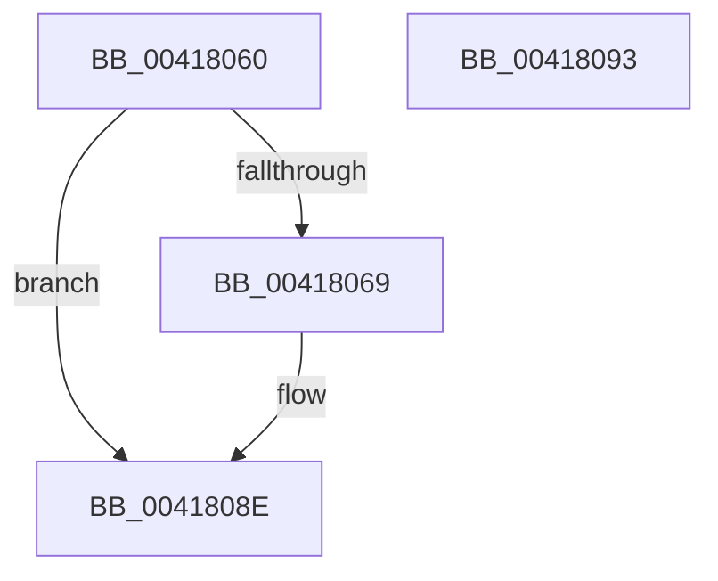

# EtwpCloseLogger

- RVA: `0x00418060`–`0x00418094` (길이 `52` bytes)
- VA: `0x0000000140418060`
- 실행 섹션: `.text`
- PDB 이름 있음: `예`; PDB Function 태그: `아니요`
- unwind 정보 RVA: `0x0005C788`
- 디코드: `13`개 명령, `52/52` bytes 표시
- 미해석 바이트: `0` (있으면 어셈블리에 `.byte`로 보존)

> 이 문서는 커널 이미지의 기계어와 PDB 기호를 분석해 생성했습니다. 4번과 5번은 함수 원형과 자료형을 바이너리 사용 방식에서 추정한 C 해석이며 원본 소스 복구 결과는 아닙니다.

## 1. Dependencies

- 직접 호출 지점: **2**; 고유 호출 대상: **2**
- 직접 호출자로 확인된 함수: **6**
- RIP 상대 이미지 참조: **0**

### Outgoing calls
- `0x0041807B` → [ExReleaseRundownProtectionCacheAwareEx](../25/ExReleaseRundownProtectionCacheAwareEx_function_0025F050.md) (function, `0x0025F050`)
- `0x00418089` → [KeLeaveCriticalRegionThread](../25/KeLeaveCriticalRegionThread_function_0025EFF0.md) (function, `0x0025EFF0`)

### Direct callers
- [EtwTraceEvent](../2F/EtwTraceEvent_function_002FD290.md) at `0x002FD3C6`
- [EtwpCCSwapFlush](EtwpCCSwapFlush_function_00417F50.md) at `0x00417FFC`
- [EtwSendTraceBuffer](../65/EtwSendTraceBuffer_function_00651560.md) at `0x006516A4`
- [EtwTraceRaw](../65/EtwTraceRaw_function_006516CC.md) at `0x006518B4`
- [sub_006DF40E](../6D/Unknown_function_006DF40E.md) at `0x006DF4AA`
- [EtwpKernelTraceRundown](../../page/9E/EtwpKernelTraceRundown_function_009E4080.md) at `0x009E4442`

### Static image references
- 디코드된 RIP-relative 메모리 참조가 없습니다.

## 2. Other-region calls and transfers

- 다른 실행 섹션으로 향하는 call: **0**
- 별도 외부 분기/꼬리 이동을 확인하지 못했습니다.

## 3. Assembly (complete function range)

```asm
00418060  48 83 EC 28                     sub rsp, 0x28
00418064  45 84 C0                        test r8b, r8b
00418067  74 25                           je 0x14041808e
00418069  8B C1                           mov eax, ecx
0041806B  48 8B 8A C0 02 00 00            mov rcx, qword ptr [rdx + 0x2c0]
00418072  BA 01 00 00 00                  mov edx, 1
00418077  48 8B 0C C1                     mov rcx, qword ptr [rcx + rax*8]
0041807B  E8 D0 6F E4 FF                  call 0x14025f050
00418080  65 48 8B 0C 25 88 01 00 00      mov rcx, qword ptr gs:[0x188]
00418089  E8 62 6F E4 FF                  call 0x14025eff0
0041808E  48 83 C4 28                     add rsp, 0x28
00418092  C3                              ret
00418093  CC                              int3
```

## 4. C-style interpretation (structured pseudocode)

```c
__int64 __fastcall EtwpCloseLogger(int a1, __int64 a2, unsigned __int8 a3)
{
    __int64 result;
    __int64 v_rsp;

    v_rsp = (v_rsp) - (40);
    if (a3 != 0) {
        result = a1;
        a1 = *(unsigned __int64 *)(a2 + 704);
        a2 = 1;
        a1 = *(unsigned __int64 *)(a1 + result * 8);
        result = ExReleaseRundownProtectionCacheAwareEx(a1, a2, a3, a4);
        a1 = *(unsigned __int64 *)(gs_base + (0 + 392));
        result = KeLeaveCriticalRegionThread(a1, a2, a3, a4);
    }
    v_rsp = (v_rsp) + (40);
    return result;
}
```

## 5. (Beta) C Style

```c
int64_t EtwpCloseLogger(int32_t Arg1, void *Arg2, uint8_t Arg3)
{
    uint8_t *arg2 = (uint8_t *)Arg2;

    int64_t result;
    int64_t local_rsp;

    local_rsp = (local_rsp) - (40);
    if (Arg3 != 0) {
        result = Arg1;
        Arg1 = *(uint64_t *)(arg2 + 0x2C0);
        Arg2 = 1;
        Arg1 = *(uint64_t *)(Arg1 + result * 8);
        result = ExReleaseRundownProtectionCacheAwareEx(Arg1, Arg2, Arg3, a4);
        Arg1 = *(uint64_t *)(gs_base + (0 + 0x188));
        result = KeLeaveCriticalRegionThread(Arg1, Arg2, Arg3, a4);
    }
    local_rsp = (local_rsp) + (40);
    return result;
}
```

### 관측된 메모리 오프셋

구조체 형식이 확인되지 않은 접근은 인자 기준의 오프셋으로만 기록했습니다.

| 기준 인자 | 오프셋 표현 | 폭 (bit) | 접근 |
|---|---:|---:|---|
| `Arg2` | `+ 0x2C0` | `64` | `R` |

## 6. Execution-region graph

[열기: 2D/3D 그래프와 함수 탐색 컨트롤 패널](../../../control-panel.html?section=text&rva=0x00418060&view=graph)

- 2D 그래프는 위에서 아래로 흐르고, 3D 그래프는 빈 공간을 드래그해 회전합니다. Shift+드래그는 이동, 휠은 확대·축소, 함수 노드 선택은 대상 보고서 이동입니다.

### Static fallback


