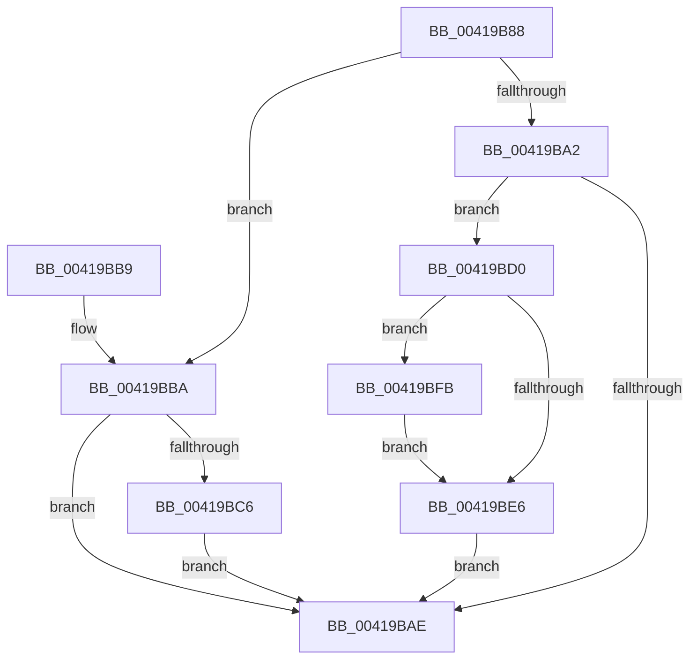

# EtwpLockUnlockBufferList

- RVA: `0x00419B88`–`0x00419C05` (길이 `125` bytes)
- VA: `0x0000000140419B88`
- 실행 섹션: `.text`
- PDB 이름 있음: `예`; PDB Function 태그: `아니요`
- unwind 정보 RVA: `0x0009D274`
- 디코드: `36`개 명령, `125/125` bytes 표시
- 미해석 바이트: `0` (있으면 어셈블리에 `.byte`로 보존)

> 이 문서는 커널 이미지의 기계어와 PDB 기호를 분석해 생성했습니다. 4번과 5번은 함수 원형과 자료형을 바이너리 사용 방식에서 추정한 C 해석이며 원본 소스 복구 결과는 아닙니다.

## 1. Dependencies

- 직접 호출 지점: **5**; 고유 호출 대상: **5**
- 직접 호출자로 확인된 함수: **2**
- RIP 상대 이미지 참조: **1**

### Outgoing calls
- `0x00419BA5` → [KeTestSpinLock](KeTestSpinLock_function_00419C10.md) (function, `0x00419C10`)
- `0x00419BC9` → [ExfAcquireReleasePushLockExclusive](ExfAcquireReleasePushLockExclusive_function_00419C2C.md) (function, `0x00419C2C`)
- `0x00419BE9` → [KeAcquireSpinLockAtDpcLevel](../20/KeAcquireSpinLockAtDpcLevel_function_00208430.md) (function, `0x00208430`)
- `0x00419BF4` → [KeReleaseSpinLock](../39/KeReleaseSpinLock_function_00392BA0.md) (function, `0x00392BA0`)
- `0x00419BFE` → [KiRaiseIrqlProcessIrqlFlags](../4F/KiRaiseIrqlProcessIrqlFlags_function_004F56FC.md) (function, `0x004F56FC`)

### Direct callers
- [EtwpBufferingModeFlush](../../page/9B/EtwpBufferingModeFlush_function_009BD8F4.md) at `0x009BD9F1`
- [EtwpFlushActiveBuffers](../../page/9B/EtwpFlushActiveBuffers_function_009BDEF4.md) at `0x009BE01A`

### Static image references
- `0x00419BDD` → RVA `0x00FC6D20` (`ALMOSTRO`; read)

## 2. Other-region calls and transfers

- 다른 실행 섹션으로 향하는 call: **0**
- 별도 외부 분기/꼬리 이동을 확인하지 못했습니다.

## 3. Assembly (complete function range)

```asm
00419B88  48 89 5C 24 08                  mov qword ptr [rsp + 8], rbx
00419B8D  57                              push rdi
00419B8E  48 83 EC 20                     sub rsp, 0x20
00419B92  83 B9 2C 01 00 00 01            cmp dword ptr [rcx + 0x12c], 1
00419B99  48 8D 99 B8 02 00 00            lea rbx, [rcx + 0x2b8]
00419BA0  74 18                           je 0x140419bba
00419BA2  48 8B CB                        mov rcx, rbx
00419BA5  E8 66 00 00 00                  call 0x140419c10
00419BAA  84 C0                           test al, al
00419BAC  74 22                           je 0x140419bd0
00419BAE  48 8B 5C 24 30                  mov rbx, qword ptr [rsp + 0x30]
00419BB3  48 83 C4 20                     add rsp, 0x20
00419BB7  5F                              pop rdi
00419BB8  C3                              ret
00419BB9  CC                              int3
00419BBA  F0 83 0C 24 00                  lock or dword ptr [rsp], 0
00419BBF  48 8B 03                        mov rax, qword ptr [rbx]
00419BC2  A8 01                           test al, 1
00419BC4  74 E8                           je 0x140419bae
00419BC6  48 8B CB                        mov rcx, rbx
00419BC9  E8 5E 00 00 00                  call 0x140419c2c
00419BCE  EB DE                           jmp 0x140419bae
00419BD0  44 0F 20 C7                     mov rdi, cr8
00419BD4  BA 0F 00 00 00                  mov edx, 0xf
00419BD9  44 0F 22 C2                     mov cr8, rdx
00419BDD  83 3D 3C D1 BA 00 00            cmp dword ptr [rip + 0xbad13c], 0
00419BE4  75 15                           jne 0x140419bfb
00419BE6  48 8B CB                        mov rcx, rbx
00419BE9  E8 42 E8 DE FF                  call 0x140208430
00419BEE  40 8A D7                        mov dl, dil
00419BF1  48 8B CB                        mov rcx, rbx
00419BF4  E8 A7 8F F7 FF                  call 0x140392ba0
00419BF9  EB B3                           jmp 0x140419bae
00419BFB  40 8A CF                        mov cl, dil
00419BFE  E8 F9 BA 0D 00                  call 0x1404f56fc
00419C03  EB E1                           jmp 0x140419be6
```

## 4. C-style interpretation (structured pseudocode)

```c
__int64 __fastcall EtwpLockUnlockBufferList(__int64 a1)
{
    __int64 result;
    __int64 v_rsp;
    unsigned int v_stack_p0;
    unsigned __int64 v_stack_p8;

    v_stack_p8 = v_rbx;
    v_rsp = (v_rsp) - (32);
    if ((*(unsigned int *)(a1 + 300)) == 1) goto loc_00419BBA;
    result = KeTestSpinLock(a1 + 696, a2, a3, a4);
    if ((unsigned __int8)(result) == 0) goto loc_00419BD0;
loc_00419BAE:
    v_rsp = (v_rsp) + (32);
    return result;
loc_00419BBA:
    if ((((unsigned __int8)(*(unsigned __int64 *)(v_stack_p8))) & (1)) == 0) goto loc_00419BAE;
    result = ExfAcquireReleasePushLockExclusive(v_stack_p8, a2, a3, a4);
    goto loc_00419BAE;
loc_00419BD0:
    if ((*(unsigned int *)(v_rip + 12243260)) != 0) goto loc_00419BFB;
loc_00419BE6:
    result = KeAcquireSpinLockAtDpcLevel(v_stack_p8, 15, a3, a4);
    result = KeReleaseSpinLock(v_stack_p8, (unsigned __int8)(v_cr8), a3, a4);
    goto loc_00419BAE;
loc_00419BFB:
    result = KiRaiseIrqlProcessIrqlFlags((unsigned __int8)(v_cr8), (unsigned __int8)(v_cr8), a3, a4);
    goto loc_00419BE6;
}
```

## 5. (Beta) C Style

```c
int64_t EtwpLockUnlockBufferList(void *Arg1)
{
    uint8_t *arg1 = (uint8_t *)Arg1;

    int64_t result;
    int64_t local_rsp;
    uint32_t v_stack_p0;
    uint64_t v_stack_p8;

    v_stack_p8 = local_rbx;
    local_rsp = (local_rsp) - (32);
    if ((*(uint32_t *)(arg1 + 0x12C)) == 1) goto loc_00419BBA;
    result = KeTestSpinLock(Arg1 + 696, a2, a3, a4);
    if ((uint8_t)(result) == 0) goto loc_00419BD0;
loc_00419BAE:
    local_rsp = (local_rsp) + (32);
    return result;
loc_00419BBA:
    if ((((uint8_t)(*(uint64_t *)(v_stack_p8))) & (1)) == 0) goto loc_00419BAE;
    result = ExfAcquireReleasePushLockExclusive(v_stack_p8, a2, a3, a4);
    goto loc_00419BAE;
loc_00419BD0:
    if ((*(uint32_t *)(v_rip + 0xBAD13C)) != 0) goto loc_00419BFB;
loc_00419BE6:
    result = KeAcquireSpinLockAtDpcLevel(v_stack_p8, 15, a3, a4);
    result = KeReleaseSpinLock(v_stack_p8, (uint8_t)(v_cr8), a3, a4);
    goto loc_00419BAE;
loc_00419BFB:
    result = KiRaiseIrqlProcessIrqlFlags((uint8_t)(v_cr8), (uint8_t)(v_cr8), a3, a4);
    goto loc_00419BE6;
}
```

### 관측된 메모리 오프셋

구조체 형식이 확인되지 않은 접근은 인자 기준의 오프셋으로만 기록했습니다.

| 기준 인자 | 오프셋 표현 | 폭 (bit) | 접근 |
|---|---:|---:|---|
| `Arg1` | `+ 0x0` | `64` | `R` |
| `Arg1` | `+ 0x12C` | `32` | `R` |
| `Arg1` | `+ 0x2B8` | `64` | `R` |

## 6. Execution-region graph

[열기: 2D/3D 그래프와 함수 탐색 컨트롤 패널](../../../control-panel.html?section=text&rva=0x00419B88&view=graph)

- 2D 그래프는 위에서 아래로 흐르고, 3D 그래프는 빈 공간을 드래그해 회전합니다. Shift+드래그는 이동, 휠은 확대·축소, 함수 노드 선택은 대상 보고서 이동입니다.

### Static fallback


