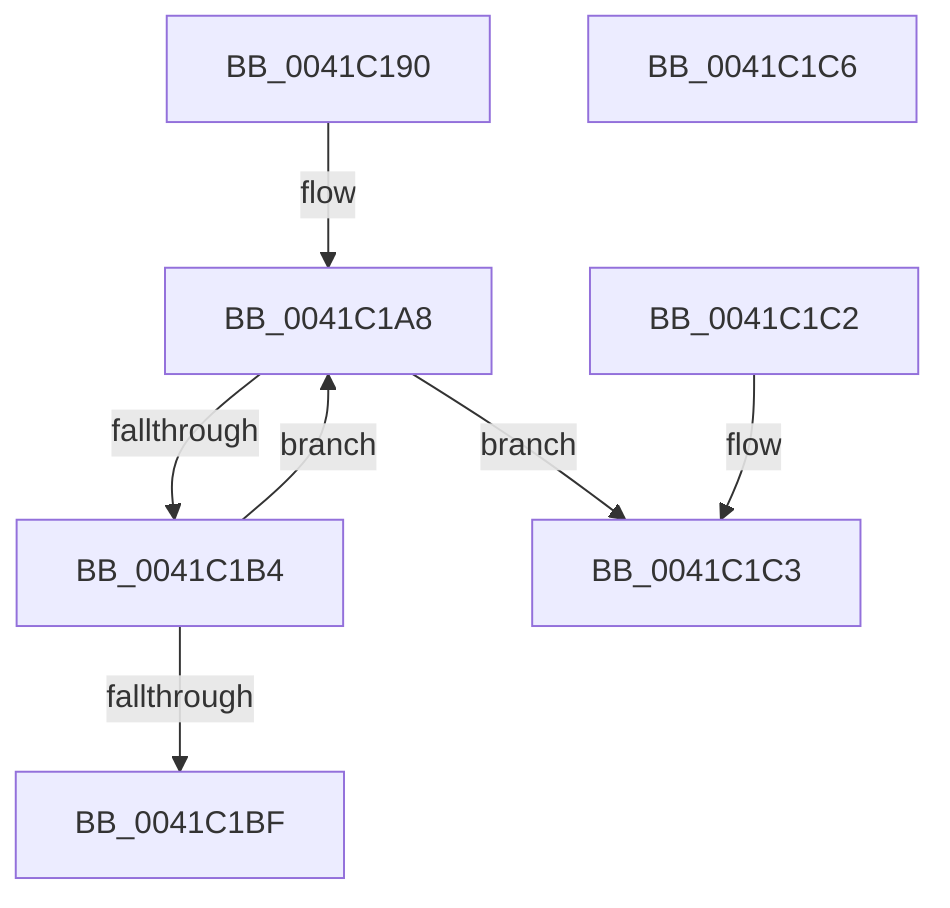

# EtwpPerfectHashFunctionSearch

- RVA: `0x0041C190`–`0x0041C1C7` (길이 `55` bytes)
- VA: `0x000000014041C190`
- 실행 섹션: `.text`
- PDB 이름 있음: `예`; PDB Function 태그: `아니요`
- unwind 정보 RVA: `0x000DB714`
- 디코드: `18`개 명령, `55/55` bytes 표시
- 미해석 바이트: `0` (있으면 어셈블리에 `.byte`로 보존)

> 이 문서는 커널 이미지의 기계어와 PDB 기호를 분석해 생성했습니다. 4번과 5번은 함수 원형과 자료형을 바이너리 사용 방식에서 추정한 C 해석이며 원본 소스 복구 결과는 아닙니다.

## 1. Dependencies

- 직접 호출 지점: **0**; 고유 호출 대상: **0**
- 직접 호출자로 확인된 함수: **1**
- RIP 상대 이미지 참조: **0**

### Outgoing calls
- 직접 디코드된 call 명령이 없습니다.

### Direct callers
- [EtwpApplyStackWalkIdFilter](EtwpApplyStackWalkIdFilter_function_0041C0A8.md) at `0x0041C15E`
- [EtwpApplyStackWalkIdFilter](EtwpApplyStackWalkIdFilter_function_0041C0A8.md) at `0x0041C16E`

### Static image references
- 디코드된 RIP-relative 메모리 참조가 없습니다.

## 2. Other-region calls and transfers

- 다른 실행 섹션으로 향하는 call: **0**
- 별도 외부 분기/꼬리 이동을 확인하지 못했습니다.

## 3. Assembly (complete function range)

```asm
0041C190  44 0F B7 C9                     movzx r9d, cx
0041C194  0F B6 4A 01                     movzx ecx, byte ptr [rdx + 1]
0041C198  41 0F B7 C1                     movzx eax, r9w
0041C19C  66 D3 C8                        ror ax, cl
0041C19F  B9 FF 00 00 00                  mov ecx, 0xff
0041C1A4  66 23 42 02                     and ax, word ptr [rdx + 2]
0041C1A8  44 0F B7 C0                     movzx r8d, ax
0041C1AC  66 46 3B 4C 82 08               cmp r9w, word ptr [rdx + r8*4 + 8]
0041C1B2  74 0F                           je 0x14041c1c3
0041C1B4  42 0F B6 44 82 06               movzx eax, byte ptr [rdx + r8*4 + 6]
0041C1BA  66 3B C1                        cmp ax, cx
0041C1BD  75 E9                           jne 0x14041c1a8
0041C1BF  32 C0                           xor al, al
0041C1C1  C3                              ret
0041C1C2  CC                              int3
0041C1C3  B0 01                           mov al, 1
0041C1C5  C3                              ret
0041C1C6  CC                              int3
```

## 4. C-style interpretation (structured pseudocode)

```c
__int64 __fastcall EtwpPerfectHashFunctionSearch(unsigned __int16 a1, __int64 a2)
{
    __int64 result;

    result = (unsigned __int16)((a1) & (*(unsigned __int16 *)(a2 + 2)));
loc_0041C1A8:
    if (a1 == (*(unsigned __int16 *)(a2 + (unsigned __int16)(result) * 4 + 8))) goto loc_0041C1C3;
    if (((unsigned __int16)(*(unsigned __int8 *)(a2 + (unsigned __int16)(result) * 4 + 6))) != 255) goto loc_0041C1A8;
    result = 0;
    return result;
loc_0041C1C3:
    return 1;
}
```

## 5. (Beta) C Style

```c
int64_t EtwpPerfectHashFunctionSearch(uint16_t Arg1, void *Arg2)
{
    uint8_t *arg2 = (uint8_t *)Arg2;

    int64_t result;

    result = (uint16_t)((Arg1) & (*(uint16_t *)(arg2 + 0x2)));
loc_0041C1A8:
    if (Arg1 == (*(uint16_t *)(arg2 + (uint16_t)(result) * 4 + 0x8))) goto loc_0041C1C3;
    if (((uint16_t)(*(uint8_t *)(arg2 + (uint16_t)(result) * 4 + 0x6))) != 255) goto loc_0041C1A8;
    result = 0;
    return result;
loc_0041C1C3:
    return 1;
}
```

### 관측된 메모리 오프셋

구조체 형식이 확인되지 않은 접근은 인자 기준의 오프셋으로만 기록했습니다.

| 기준 인자 | 오프셋 표현 | 폭 (bit) | 접근 |
|---|---:|---:|---|
| `Arg2` | `+ 0x1` | `8` | `R` |
| `Arg2` | `+ 0x2` | `16` | `R` |
| `Arg2` | `+ 0x6 + r8*4` | `8` | `R` |
| `Arg2` | `+ 0x8 + r8*4` | `16` | `R` |

## 6. Execution-region graph

[열기: 2D/3D 그래프와 함수 탐색 컨트롤 패널](../../../control-panel.html?section=text&rva=0x0041C190&view=graph)

- 2D 그래프는 위에서 아래로 흐르고, 3D 그래프는 빈 공간을 드래그해 회전합니다. Shift+드래그는 이동, 휠은 확대·축소, 함수 노드 선택은 대상 보고서 이동입니다.

### Static fallback


