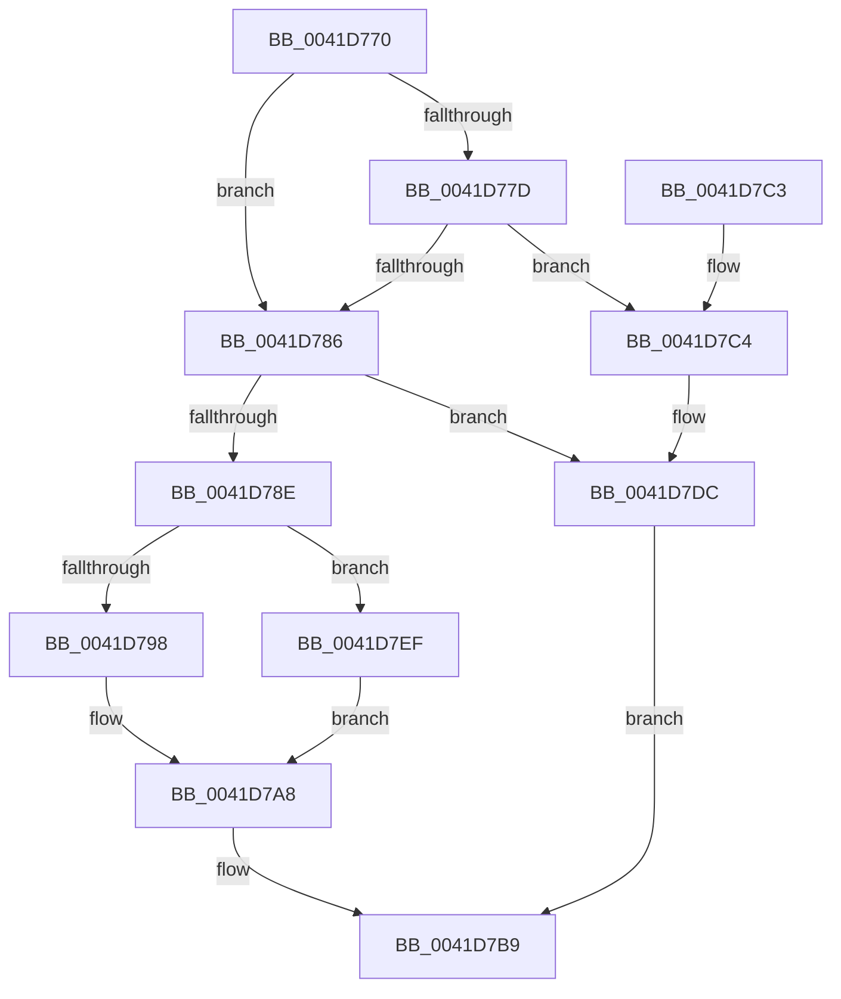

# EtwpReleaseStackLookasideListEntry

- RVA: `0x0041D770`–`0x0041D7F3` (길이 `131` bytes)
- VA: `0x000000014041D770`
- 실행 섹션: `.text`
- PDB 이름 있음: `예`; PDB Function 태그: `아니요`
- unwind 정보 RVA: `0x0009EF34`
- 디코드: `37`개 명령, `131/131` bytes 표시
- 미해석 바이트: `0` (있으면 어셈블리에 `.byte`로 보존)

> 이 문서는 커널 이미지의 기계어와 PDB 기호를 분석해 생성했습니다. 4번과 5번은 함수 원형과 자료형을 바이너리 사용 방식에서 추정한 C 해석이며 원본 소스 복구 결과는 아닙니다.

## 1. Dependencies

- 직접 호출 지점: **2**; 고유 호출 대상: **2**
- 직접 호출자로 확인된 함수: **2**
- RIP 상대 이미지 참조: **4**

### Outgoing calls
- `0x0041D7B9` → [ExpInterlockedPushEntrySList](../6B/ExpInterlockedPushEntrySList_function_006BA5B0.md) (function, `0x006BA5B0`)
- `0x0041D7D6` → [KeBugCheckEx](../4F/KeBugCheckEx_function_004FD660.md) (function, `0x004FD660`)

### Direct callers
- [EtwpEventWriteFull](../22/EtwpEventWriteFull_function_00225C10.md) at `0x0022663B`
- [EtwpEventWriteFull](../22/EtwpEventWriteFull_function_00225C10.md) at `0x002276C2`
- [EtwpWriteUserEvent](../../page/AF/EtwpWriteUserEvent_function_00AF2FEC.md) at `0x00AF3682`
- [EtwpWriteUserEvent](../../page/AF/EtwpWriteUserEvent_function_00AF2FEC.md) at `0x00AF46B2`

### Static image references
- `0x0041D78E` → RVA `0x00FC6A80` (`ALMOSTRO`; read)
- `0x0041D79D` → RVA `0x00FC8C40` (`ALMOSTRO`; read)
- `0x0041D7DC` → RVA `0x00E28F9C` (`.data`; read/write)
- `0x0041D7E6` → RVA `0x00E28F80` (`.data`; read)

## 2. Other-region calls and transfers

- 다른 실행 섹션으로 향하는 call: **0**
- 별도 외부 분기/꼬리 이동을 확인하지 못했습니다.

## 3. Assembly (complete function range)

```asm
0041D770  48 83 EC 38                     sub rsp, 0x38
0041D774  4C 8B 41 18                     mov r8, qword ptr [rcx + 0x18]
0041D778  4D 85 C0                        test r8, r8
0041D77B  74 09                           je 0x14041d786
0041D77D  41 0F B6 40 07                  movzx eax, byte ptr [r8 + 7]
0041D782  A8 02                           test al, 2
0041D784  75 3E                           jne 0x14041d7c4
0041D786  8B 51 10                        mov edx, dword ptr [rcx + 0x10]
0041D789  83 FA FF                        cmp edx, -1
0041D78C  74 4E                           je 0x14041d7dc
0041D78E  8B 05 EC 92 BA 00               mov eax, dword ptr [rip + 0xba92ec]
0041D794  3B D0                           cmp edx, eax
0041D796  73 57                           jae 0x14041d7ef
0041D798  0F AE E8                        lfence
0041D79B  8B C2                           mov eax, edx
0041D79D  48 8D 15 9C B4 BA 00            lea rdx, [rip + 0xbab49c]
0041D7A4  48 8B 04 C2                     mov rax, qword ptr [rdx + rax*8]
0041D7A8  48 8B 80 A8 8B 00 00            mov rax, qword ptr [rax + 0x8ba8]
0041D7AF  48 8B D1                        mov rdx, rcx
0041D7B2  48 8D 88 80 01 00 00            lea rcx, [rax + 0x180]
0041D7B9  E8 F2 CD 29 00                  call 0x1406ba5b0
0041D7BE  48 83 C4 38                     add rsp, 0x38
0041D7C2  C3                              ret
0041D7C3  CC                              int3
0041D7C4  33 C0                           xor eax, eax
0041D7C6  4C 8B C9                        mov r9, rcx
0041D7C9  B9 1D 01 00 00                  mov ecx, 0x11d
0041D7CE  48 89 44 24 20                  mov qword ptr [rsp + 0x20], rax
0041D7D3  8D 50 0A                        lea edx, [rax + 0xa]
0041D7D6  E8 85 FE 0D 00                  call 0x1404fd660
0041D7DB  CC                              int3
0041D7DC  F0 FF 0D B9 B7 A0 00            lock dec dword ptr [rip + 0xa0b7b9]
0041D7E3  48 8B D1                        mov rdx, rcx
0041D7E6  48 8D 0D 93 B7 A0 00            lea rcx, [rip + 0xa0b793]
0041D7ED  EB CA                           jmp 0x14041d7b9
0041D7EF  33 C0                           xor eax, eax
0041D7F1  EB B5                           jmp 0x14041d7a8
```

## 4. C-style interpretation (structured pseudocode)

```c
__int64 __fastcall EtwpReleaseStackLookasideListEntry(__int64 a1)
{
    __int64 result;
    __int64 v_rsp;
    unsigned __int64 v_stack_p20;

    v_rsp = (v_rsp) - (56);
    if (*(unsigned __int64 *)(a1 + 24) == 0) goto loc_0041D786;
    if ((((unsigned __int8)(*(unsigned __int8 *)(*(unsigned __int64 *)(a1 + 24) + 7))) & (2)) != 0) goto loc_0041D7C4;
loc_0041D786:
    if (((unsigned int)((unsigned int)(*(unsigned int *)(a1 + 16)))) == -1) goto loc_0041D7DC;
    if (((unsigned int)((unsigned int)(*(unsigned int *)(a1 + 16)))) >= ((unsigned int)((unsigned int)(*(unsigned int *)(v_rip + 12227308))))) goto loc_0041D7EF;
loc_0041D7A8:
loc_0041D7B9:
    result = ExpInterlockedPushEntrySList(*(unsigned __int64 *)(*(unsigned __int64 *)(v_rip + 12235932 + (unsigned int)((unsigned int)((unsigned int)(*(unsigned int *)(a1 + 16)))) * 8) + 35752) + 384, a1, *(unsigned __int64 *)(a1 + 24), a4);
    v_rsp = (v_rsp) + (56);
    return result;
loc_0041D7C4:
    result = 0;
    v_stack_p20 = 0;
    result = KeBugCheckEx(285, result + 10, *(unsigned __int64 *)(a1 + 24), *(unsigned __int64 *)(*(unsigned __int64 *)(v_rip + 12235932 + (unsigned int)((unsigned int)((unsigned int)(*(unsigned int *)(a1 + 16)))) * 8) + 35752) + 384);
loc_0041D7DC:
    goto loc_0041D7B9;
loc_0041D7EF:
    result = 0;
    goto loc_0041D7A8;
}
```

## 5. (Beta) C Style

```c
int64_t EtwpReleaseStackLookasideListEntry(void *Arg1)
{
    uint8_t *arg1 = (uint8_t *)Arg1;

    int64_t result;
    int64_t local_rsp;
    uint64_t v_stack_p20;

    local_rsp = (local_rsp) - (56);
    if (*(uint64_t *)(arg1 + 0x18) == 0) goto loc_0041D786;
    if ((((uint8_t)(*(uint8_t *)(*(uint64_t *)(arg1 + 0x18) + 0x7))) & (2)) != 0) goto loc_0041D7C4;
loc_0041D786:
    if (((uint32_t)((uint32_t)(*(uint32_t *)(arg1 + 0x10)))) == -1) goto loc_0041D7DC;
    if (((uint32_t)((uint32_t)(*(uint32_t *)(arg1 + 0x10)))) >= ((uint32_t)((uint32_t)(*(uint32_t *)(v_rip + 0xBA92EC))))) goto loc_0041D7EF;
loc_0041D7A8:
loc_0041D7B9:
    result = ExpInterlockedPushEntrySList(*(uint64_t *)(*(uint64_t *)(v_rip + 0xBAB49C + (uint32_t)((uint32_t)((uint32_t)(*(uint32_t *)(arg1 + 0x10)))) * 8) + 0x8BA8) + 384, Arg1, *(uint64_t *)(arg1 + 0x18), a4);
    local_rsp = (local_rsp) + (56);
    return result;
loc_0041D7C4:
    result = 0;
    v_stack_p20 = 0;
    result = KeBugCheckEx(285, result + 10, *(uint64_t *)(arg1 + 0x18), *(uint64_t *)(*(uint64_t *)(v_rip + 0xBAB49C + (uint32_t)((uint32_t)((uint32_t)(*(uint32_t *)(arg1 + 0x10)))) * 8) + 0x8BA8) + 384);
loc_0041D7DC:
    goto loc_0041D7B9;
loc_0041D7EF:
    result = 0;
    goto loc_0041D7A8;
}
```

### 관측된 메모리 오프셋

구조체 형식이 확인되지 않은 접근은 인자 기준의 오프셋으로만 기록했습니다.

| 기준 인자 | 오프셋 표현 | 폭 (bit) | 접근 |
|---|---:|---:|---|
| `Arg1` | `+ 0x10` | `32` | `R` |
| `Arg1` | `+ 0x18` | `64` | `R` |

## 6. Execution-region graph

[열기: 2D/3D 그래프와 함수 탐색 컨트롤 패널](../../../control-panel.html?section=text&rva=0x0041D770&view=graph)

- 2D 그래프는 위에서 아래로 흐르고, 3D 그래프는 빈 공간을 드래그해 회전합니다. Shift+드래그는 이동, 휠은 확대·축소, 함수 노드 선택은 대상 보고서 이동입니다.

### Static fallback


