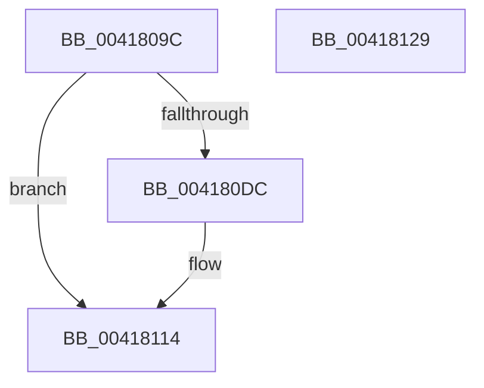

# EtwpReserveWithPebsIndex

- RVA: `0x0041809C`–`0x0041812A` (길이 `142` bytes)
- VA: `0x000000014041809C`
- 실행 섹션: `.text`
- PDB 이름 있음: `예`; PDB Function 태그: `아니요`
- unwind 정보 RVA: `0x00066400`
- 디코드: `37`개 명령, `142/142` bytes 표시
- 미해석 바이트: `0` (있으면 어셈블리에 `.byte`로 보존)

> 이 문서는 커널 이미지의 기계어와 PDB 기호를 분석해 생성했습니다. 4번과 5번은 함수 원형과 자료형을 바이너리 사용 방식에서 추정한 C 해석이며 원본 소스 복구 결과는 아닙니다.

## 1. Dependencies

- 직접 호출 지점: **1**; 고유 호출 대상: **1**
- 직접 호출자로 확인된 함수: **2**
- RIP 상대 이미지 참조: **0**

### Outgoing calls
- `0x004180CF` → [EtwpReserveTraceBuffer](../2F/EtwpReserveTraceBuffer_function_002FC8C0.md) (function, `0x002FC8C0`)

### Direct callers
- [EtwpLogKernelEvent](../25/EtwpLogKernelEvent_function_0025CC00.md) at `0x0025D5D3`
- [EtwpLogContextSwapEvent](EtwpLogContextSwapEvent_function_004175F0.md) at `0x00417AE8`

### Static image references
- 디코드된 RIP-relative 메모리 참조가 없습니다.

## 2. Other-region calls and transfers

- 다른 실행 섹션으로 향하는 call: **0**
- 별도 외부 분기/꼬리 이동을 확인하지 못했습니다.

## 3. Assembly (complete function range)

```asm
0041809C  48 89 5C 24 08                  mov qword ptr [rsp + 8], rbx
004180A1  48 89 6C 24 10                  mov qword ptr [rsp + 0x10], rbp
004180A6  48 89 74 24 18                  mov qword ptr [rsp + 0x18], rsi
004180AB  57                              push rdi
004180AC  48 83 EC 30                     sub rsp, 0x30
004180B0  48 8B 74 24 60                  mov rsi, qword ptr [rsp + 0x60]
004180B5  41 8D 58 18                     lea ebx, [r8 + 0x18]
004180B9  8B 7C 24 68                     mov edi, dword ptr [rsp + 0x68]
004180BD  49 8B C1                        mov rax, r9
004180C0  0F B7 EA                        movzx ebp, dx
004180C3  89 7C 24 20                     mov dword ptr [rsp + 0x20], edi
004180C7  4C 8B CE                        mov r9, rsi
004180CA  4C 8B C0                        mov r8, rax
004180CD  8B D3                           mov edx, ebx
004180CF  E8 EC 47 EE FF                  call 0x1402fc8c0
004180D4  4C 8B C8                        mov r9, rax
004180D7  48 85 C0                        test rax, rax
004180DA  74 38                           je 0x140418114
004180DC  48 8B 06                        mov rax, qword ptr [rsi]
004180DF  49 89 41 08                     mov qword ptr [r9 + 8], rax
004180E3  66 41 89 59 04                  mov word ptr [r9 + 4], bx
004180E8  66 41 89 69 06                  mov word ptr [r9 + 6], bp
004180ED  40 0F B6 C7                     movzx eax, dil
004180F1  0D 00 80 11 C0                  or eax, 0xc0118000
004180F6  41 89 01                        mov dword ptr [r9], eax
004180F9  65 48 8B 04 25 20 00 00 00      mov rax, qword ptr gs:[0x20]
00418102  48 8B 88 A0 8E 00 00            mov rcx, qword ptr [rax + 0x8ea0]
00418109  48 8B 01                        mov rax, qword ptr [rcx]
0041810C  49 89 41 10                     mov qword ptr [r9 + 0x10], rax
00418110  49 8D 41 18                     lea rax, [r9 + 0x18]
00418114  48 8B 5C 24 40                  mov rbx, qword ptr [rsp + 0x40]
00418119  48 8B 6C 24 48                  mov rbp, qword ptr [rsp + 0x48]
0041811E  48 8B 74 24 50                  mov rsi, qword ptr [rsp + 0x50]
00418123  48 83 C4 30                     add rsp, 0x30
00418127  5F                              pop rdi
00418128  C3                              ret
00418129  CC                              int3
```

## 4. C-style interpretation (structured pseudocode)

```c
__int64 __fastcall EtwpReserveWithPebsIndex(__int64 a1, unsigned __int16 a2, __int64 a3, __int64 a4, __int64 a5, unsigned int a6)
{
    __int64 result;
    __int64 v_rsp;
    unsigned int v_stack_m18;
    unsigned __int64 v_stack_p10;
    unsigned __int64 v_stack_p18;
    unsigned __int64 v_stack_p8;

    v_stack_p8 = v_rbx;
    v_stack_p10 = v_rbp;
    v_stack_p18 = v_rsi;
    v_rsp = (v_rsp) - (48);
    v_stack_m18 = (unsigned int)((unsigned int)(a6));
    result = EtwpReserveTraceBuffer(a1, (unsigned int)((unsigned int)(a3 + 24)), a4, a5);
    if (result != 0) {
        result = *(unsigned __int64 *)(a5);
        *(unsigned __int64 *)(result + 8) = result;
        *(unsigned __int16 *)(result + 4) = (unsigned __int16)(a3 + 24);
        *(unsigned __int16 *)(result + 6) = a2;
        result = (unsigned __int8)((unsigned int)(a6));
        result = (unsigned int)((result) | (0xC0118000ULL));
        *(unsigned int *)(result) = (unsigned int)(result);
        result = *(unsigned __int64 *)(gs_base + (0 + 32));
        a1 = *(unsigned __int64 *)(result + 36512);
        result = *(unsigned __int64 *)(a1);
        *(unsigned __int64 *)(result + 16) = result;
        result = result + 24;
    }
    v_rsp = (v_rsp) + (48);
    return result;
}
```

## 5. (Beta) C Style

```c
int64_t EtwpReserveWithPebsIndex(int64_t Arg1, uint16_t Arg2, void *Arg3, int64_t Arg4, void *Arg5, uint32_t Arg6)
{
    uint8_t *arg3 = (uint8_t *)Arg3;
    uint8_t *arg5 = (uint8_t *)Arg5;

    int64_t result;
    int64_t local_rsp;
    uint32_t v_stack_m18;
    uint64_t v_stack_p10;
    uint64_t v_stack_p18;
    uint64_t v_stack_p8;

    v_stack_p8 = local_rbx;
    v_stack_p10 = local_rbp;
    v_stack_p18 = local_rsi;
    local_rsp = (local_rsp) - (48);
    v_stack_m18 = (uint32_t)((uint32_t)(Arg6));
    result = EtwpReserveTraceBuffer(Arg1, (uint32_t)((uint32_t)(Arg3 + 24)), Arg4, Arg5);
    if (result != 0) {
        result = *(uint64_t *)(arg5);
        *(uint64_t *)(result + 0x8) = result;
        *(uint16_t *)(result + 0x4) = (uint16_t)(Arg3 + 24);
        *(uint16_t *)(result + 0x6) = Arg2;
        result = (uint8_t)((uint32_t)(Arg6));
        result = (uint32_t)((result) | (0xC0118000ULL));
        *(uint32_t *)(result) = (uint32_t)(result);
        result = *(uint64_t *)(gs_base + (0 + 0x20));
        Arg1 = *(uint64_t *)(result + 0x8EA0);
        result = *(uint64_t *)(Arg1);
        *(uint64_t *)(result + 0x10) = result;
        result = result + 24;
    }
    local_rsp = (local_rsp) + (48);
    return result;
}
```

### 관측된 메모리 오프셋

구조체 형식이 확인되지 않은 접근은 인자 기준의 오프셋으로만 기록했습니다.

| 기준 인자 | 오프셋 표현 | 폭 (bit) | 접근 |
|---|---:|---:|---|
| `Arg3` | `+ 0x18` | `32` | `R` |
| `Arg5` | `+ 0x0` | `64` | `R` |

## 6. Execution-region graph

[열기: 2D/3D 그래프와 함수 탐색 컨트롤 패널](../../../control-panel.html?section=text&rva=0x0041809C&view=graph)

- 2D 그래프는 위에서 아래로 흐르고, 3D 그래프는 빈 공간을 드래그해 회전합니다. Shift+드래그는 이동, 휠은 확대·축소, 함수 노드 선택은 대상 보고서 이동입니다.

### Static fallback


