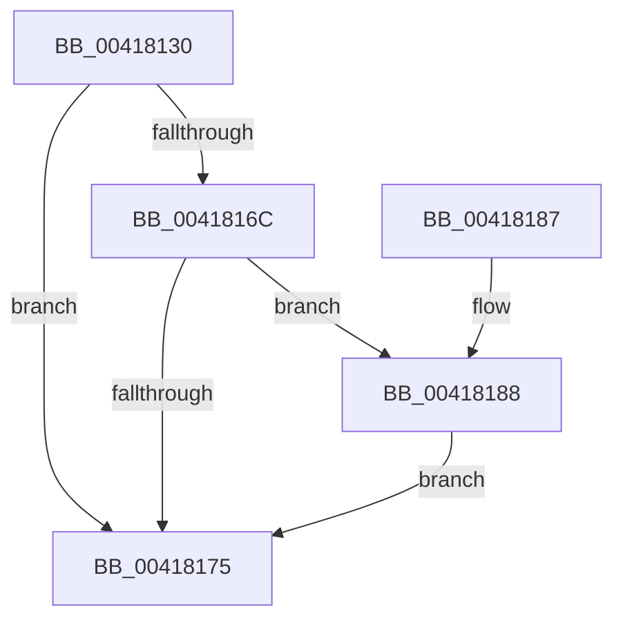

# EtwpTraceProcessorTrace

- RVA: `0x00418130`–`0x004181DE` (길이 `174` bytes)
- VA: `0x0000000140418130`
- 실행 섹션: `.text`
- PDB 이름 있음: `예`; PDB Function 태그: `아니요`
- unwind 정보 RVA: `0x0009CDC8`
- 디코드: `39`개 명령, `174/174` bytes 표시
- 미해석 바이트: `0` (있으면 어셈블리에 `.byte`로 보존)

> 이 문서는 커널 이미지의 기계어와 PDB 기호를 분석해 생성했습니다. 4번과 5번은 함수 원형과 자료형을 바이너리 사용 방식에서 추정한 C 해석이며 원본 소스 복구 결과는 아닙니다.

## 1. Dependencies

- 직접 호출 지점: **2**; 고유 호출 대상: **2**
- 직접 호출자로 확인된 함수: **1**
- RIP 상대 이미지 참조: **1**

### Outgoing calls
- `0x0041817D` → [_security_check_cookie](../6A/_security_check_cookie_function_006AC640.md) (function, `0x006AC640`)
- `0x004181D7` → [guard_dispatch_icall](../6B/guard_dispatch_icall_function_006BAAD0.md) (function, `0x006BAAD0`)

### Direct callers
- [EtwpLogContextSwapEvent](EtwpLogContextSwapEvent_function_004175F0.md) at `0x00417B4D`

### Static image references
- `0x00418134` → RVA `0x00E0A740` (`.data`; read)

## 2. Other-region calls and transfers

- 다른 실행 섹션으로 향하는 call: **0**
- 별도 외부 분기/꼬리 이동을 확인하지 못했습니다.

## 3. Assembly (complete function range)

```asm
00418130  48 83 EC 68                     sub rsp, 0x68
00418134  48 8B 05 05 26 9F 00            mov rax, qword ptr [rip + 0x9f2605]
0041813B  48 33 C4                        xor rax, rsp
0041813E  48 89 44 24 58                  mov qword ptr [rsp + 0x58], rax
00418143  83 64 24 54 00                  and dword ptr [rsp + 0x54], 0
00418148  0F 57 C0                        xorps xmm0, xmm0
0041814B  F3 0F 7F 44 24 40               movdqu xmmword ptr [rsp + 0x40], xmm0
00418151  4C 8B D2                        mov r10, rdx
00418154  65 48 8B 14 25 88 01 00 00      mov rdx, qword ptr gs:[0x188]
0041815D  65 48 8B 04 25 20 00 00 00      mov rax, qword ptr gs:[0x20]
00418166  48 39 50 18                     cmp qword ptr [rax + 0x18], rdx
0041816A  74 09                           je 0x140418175
0041816C  41 F7 C1 00 18 00 00            test r9d, 0x1800
00418173  75 13                           jne 0x140418188
00418175  48 8B 4C 24 58                  mov rcx, qword ptr [rsp + 0x58]
0041817A  48 33 CC                        xor rcx, rsp
0041817D  E8 BE 44 29 00                  call 0x1406ac640
00418182  48 83 C4 68                     add rsp, 0x68
00418186  C3                              ret
00418187  CC                              int3
00418188  48 89 4C 24 20                  mov qword ptr [rsp + 0x20], rcx
0041818D  4D 85 C0                        test r8, r8
00418190  48 8B 89 38 04 00 00            mov rcx, qword ptr [rcx + 0x438]
00418197  44 89 4C 24 50                  mov dword ptr [rsp + 0x50], r9d
0041819C  4C 0F 44 C2                     cmove r8, rdx
004181A0  48 8D 54 24 20                  lea rdx, [rsp + 0x20]
004181A5  41 8B 80 08 05 00 00            mov eax, dword ptr [r8 + 0x508]
004181AC  89 44 24 30                     mov dword ptr [rsp + 0x30], eax
004181B0  41 8B 80 10 05 00 00            mov eax, dword ptr [r8 + 0x510]
004181B7  89 44 24 34                     mov dword ptr [rsp + 0x34], eax
004181BB  49 8B 02                        mov rax, qword ptr [r10]
004181BE  48 89 44 24 28                  mov qword ptr [rsp + 0x28], rax
004181C3  48 8B 41 08                     mov rax, qword ptr [rcx + 8]
004181C7  48 89 44 24 38                  mov qword ptr [rsp + 0x38], rax
004181CC  48 8B 41 10                     mov rax, qword ptr [rcx + 0x10]
004181D0  48 8B 09                        mov rcx, qword ptr [rcx]
004181D3  48 8B 40 10                     mov rax, qword ptr [rax + 0x10]
004181D7  E8 F4 28 2A 00                  call 0x1406baad0
004181DC  EB 97                           jmp 0x140418175
```

## 4. C-style interpretation (structured pseudocode)

```c
__int64 __fastcall EtwpTraceProcessorTrace(__int64 a1, __int64 a2, __int64 a3, int a4)
{
    __int64 result;
    __int64 v_rsp;
    unsigned __int64 v_stack_m10;
    unsigned int v_stack_m14;
    unsigned __int64 v_stack_m28;
    unsigned __int64 v_stack_p20;
    unsigned __int64 v_stack_p28;
    unsigned int v_stack_p30;
    unsigned int v_stack_p34;
    unsigned __int64 v_stack_p38;
    unsigned int v_stack_p50;

    v_rsp = (v_rsp) - (104);
    result = (*(unsigned __int64 *)(v_rip + 10429957)) ^ (v_rsp);
    v_stack_m10 = result;
    v_stack_m28 = v_xmm0;
    if ((*(unsigned __int64 *)(*(unsigned __int64 *)(gs_base + (0 + 32)) + 24)) == (*(unsigned __int64 *)(gs_base + (0 + 392)))) goto loc_00418175;
    if (((a4) & (0x1800ULL)) != 0) goto loc_00418188;
loc_00418175:
    a1 = (v_stack_m10) ^ (v_rsp);
    result = _security_check_cookie(a1, *(unsigned __int64 *)(gs_base + (0 + 392)), a3, a4);
    v_rsp = (v_rsp) + (104);
    return result;
loc_00418188:
    v_stack_p20 = a1;
    v_stack_p50 = a4;
    if (a3 == 0) { a3 = *(unsigned __int64 *)(gs_base + (0 + 392)); }
    v_stack_p30 = (unsigned int)((unsigned int)(*(unsigned int *)(a3 + 1288)));
    v_stack_p34 = (unsigned int)((unsigned int)(*(unsigned int *)(a3 + 1296)));
    v_stack_p28 = *(unsigned __int64 *)(a2);
    v_stack_p38 = *(unsigned __int64 *)(*(unsigned __int64 *)(a1 + 1080) + 8);
    result = guard_dispatch_icall(*(unsigned __int64 *)(*(unsigned __int64 *)(a1 + 1080)), v_stack_p20, a3, a4);
    goto loc_00418175;
}
```

## 5. (Beta) C Style

```c
int64_t EtwpTraceProcessorTrace(void *Arg1, void *Arg2, int64_t Arg3, int32_t Arg4)
{
    uint8_t *arg1 = (uint8_t *)Arg1;
    uint8_t *arg2 = (uint8_t *)Arg2;

    int64_t result;
    int64_t local_rsp;
    uint64_t v_stack_m10;
    uint32_t v_stack_m14;
    uint64_t v_stack_m28;
    uint64_t v_stack_p20;
    uint64_t v_stack_p28;
    uint32_t v_stack_p30;
    uint32_t v_stack_p34;
    uint64_t v_stack_p38;
    uint32_t v_stack_p50;

    local_rsp = (local_rsp) - (104);
    result = (*(uint64_t *)(v_rip + 0x9F2605)) ^ (local_rsp);
    v_stack_m10 = result;
    v_stack_m28 = v_xmm0;
    if ((*(uint64_t *)(*(uint64_t *)(gs_base + (0 + 0x20)) + 0x18)) == (*(uint64_t *)(gs_base + (0 + 0x188)))) goto loc_00418175;
    if (((Arg4) & (0x1800ULL)) != 0) goto loc_00418188;
loc_00418175:
    Arg1 = (v_stack_m10) ^ (local_rsp);
    result = _security_check_cookie(Arg1, *(uint64_t *)(gs_base + (0 + 0x188)), Arg3, Arg4);
    local_rsp = (local_rsp) + (104);
    return result;
loc_00418188:
    v_stack_p20 = Arg1;
    v_stack_p50 = Arg4;
    if (Arg3 == 0) { Arg3 = *(uint64_t *)(gs_base + (0 + 0x188)); }
    v_stack_p30 = (uint32_t)((uint32_t)(*(uint32_t *)(Arg3 + 0x508)));
    v_stack_p34 = (uint32_t)((uint32_t)(*(uint32_t *)(Arg3 + 0x510)));
    v_stack_p28 = *(uint64_t *)(arg2);
    v_stack_p38 = *(uint64_t *)(*(uint64_t *)(arg1 + 0x438) + 0x8);
    result = guard_dispatch_icall(*(uint64_t *)(*(uint64_t *)(arg1 + 0x438)), v_stack_p20, Arg3, Arg4);
    goto loc_00418175;
}
```

### 관측된 메모리 오프셋

구조체 형식이 확인되지 않은 접근은 인자 기준의 오프셋으로만 기록했습니다.

| 기준 인자 | 오프셋 표현 | 폭 (bit) | 접근 |
|---|---:|---:|---|
| `Arg1` | `+ 0x438` | `64` | `R` |
| `Arg2` | `+ 0x0` | `64` | `R` |

## 6. Execution-region graph

[열기: 2D/3D 그래프와 함수 탐색 컨트롤 패널](../../../control-panel.html?section=text&rva=0x00418130&view=graph)

- 2D 그래프는 위에서 아래로 흐르고, 3D 그래프는 빈 공간을 드래그해 회전합니다. Shift+드래그는 이동, 휠은 확대·축소, 함수 노드 선택은 대상 보고서 이동입니다.

### Static fallback


