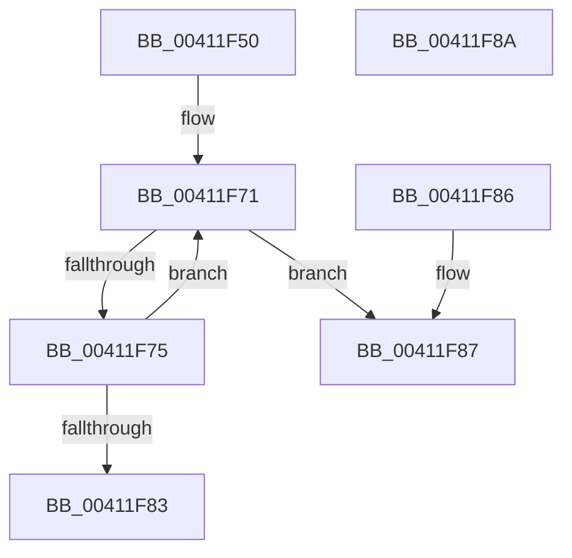

# ExAcquireRundownProtectionCacheAwareEx

- RVA: `0x00411F50`–`0x00411F8B` (길이 `59` bytes)
- VA: `0x0000000140411F50`
- 실행 섹션: `.text`
- PDB 이름 있음: `예`; PDB Function 태그: `아니요`
- unwind 정보 RVA: `0x000DB714`
- 디코드: `21`개 명령, `59/59` bytes 표시
- 미해석 바이트: `0` (있으면 어셈블리에 `.byte`로 보존)

> 이 문서는 커널 이미지의 기계어와 PDB 기호를 분석해 생성했습니다. 4번과 5번은 함수 원형과 자료형을 바이너리 사용 방식에서 추정한 C 해석이며 원본 소스 복구 결과는 아닙니다.

## 1. Dependencies

- 직접 호출 지점: **0**; 고유 호출 대상: **0**
- 직접 호출자로 확인된 함수: **13**
- RIP 상대 이미지 참조: **0**

### Outgoing calls
- 직접 디코드된 call 명령이 없습니다.

### Direct callers
- [EtwpEventWriteFull](../22/EtwpEventWriteFull_function_00225C10.md) at `0x00226177`
- [EtwpFailLogging](../3F/EtwpFailLogging_function_003F0A50.md) at `0x003F0CE8`
- [RawBeginOperation](RawBeginOperation_function_00411F10.md) at `0x00411F2E`
- [EtwpQueueApcPoolDpc](../4D/EtwpQueueApcPoolDpc_function_004DA1A4.md) at `0x004DA1F7`
- [EtwpCompressionDpc](../65/EtwpCompressionDpc_function_00653290.md) at `0x006532C0`
- [EtwpCompressionDpc](../65/EtwpCompressionDpc_function_00653290.md) at `0x006532D1`
- [EtwInitialize](../../page/7B/EtwInitialize_function_007B4D40.md) at `0x007B4DE8`
- [PeriodicCaptureStateTimerCallback](../../page/7B/PeriodicCaptureStateTimerCallback_function_007BCEC0.md) at `0x007BCEE2`
- [EtwpUpdateEnableMask](../../page/8C/EtwpUpdateEnableMask_function_008C0948.md) at `0x008C09F0`
- [sub_008C28B0](../../page/8C/Unknown_function_008C28B0.md) at `0x008C2BCC`
- [sub_0093296D](../../page/93/Unknown_function_0093296D.md) at `0x0093297E`
- [EtwpStopTrace](../../page/9B/EtwpStopTrace_function_009BCE84.md) at `0x009BCF51`
- [EtwpStartLogger](../../page/A9/EtwpStartLogger_function_00A99D80.md) at `0x00A9A2F6`
- [EtwpStartLogger](../../page/A9/EtwpStartLogger_function_00A99D80.md) at `0x00A9ACA2`
- [EtwpWriteUserEvent](../../page/AF/EtwpWriteUserEvent_function_00AF2FEC.md) at `0x00AF33D2`

### Static image references
- 디코드된 RIP-relative 메모리 참조가 없습니다.

## 2. Other-region calls and transfers

- 다른 실행 섹션으로 향하는 call: **0**
- 별도 외부 분기/꼬리 이동을 확인하지 못했습니다.

## 3. Assembly (complete function range)

```asm
00411F50  65 8B 04 25 A4 01 00 00         mov eax, dword ptr gs:[0x1a4]
00411F58  44 8B CA                        mov r9d, edx
00411F5B  33 D2                           xor edx, edx
00411F5D  F7 71 14                        div dword ptr [rcx + 0x14]
00411F60  0F AF 51 10                     imul edx, dword ptr [rcx + 0x10]
00411F64  44 8B C2                        mov r8d, edx
00411F67  4C 03 01                        add r8, qword ptr [rcx]
00411F6A  41 0F 0D 08                     prefetchw byte ptr [r8]
00411F6E  49 8B 00                        mov rax, qword ptr [r8]
00411F71  A8 01                           test al, 1
00411F73  75 12                           jne 0x140411f87
00411F75  43 8D 14 09                     lea edx, [r9 + r9]
00411F79  48 03 D0                        add rdx, rax
00411F7C  F0 49 0F B1 10                  lock cmpxchg qword ptr [r8], rdx
00411F81  75 EE                           jne 0x140411f71
00411F83  B0 01                           mov al, 1
00411F85  C3                              ret
00411F86  CC                              int3
00411F87  32 C0                           xor al, al
00411F89  C3                              ret
00411F8A  CC                              int3
```

## 4. C-style interpretation (structured pseudocode)

```c
__int64 __fastcall ExAcquireRundownProtectionCacheAwareEx(__int64 a1, int a2)
{
    __int64 result;

    a2 = 0;
    a2 = (unsigned int)((a2) * (*(unsigned int *)(a1 + 16)));
    a3 = ((unsigned int)(a2)) + (*(unsigned __int64 *)(a1));
loc_00411F71:
    if ((((unsigned __int8)(*(unsigned __int64 *)(a3))) & (1)) != 0) goto loc_00411F87;
    a2 = ((unsigned int)(a2) + (unsigned int)(a2) * 1) + (*(unsigned __int64 *)(a3));
    if (condition_is_not_equal) goto loc_00411F71;
    return 1;
loc_00411F87:
    result = 0;
    return result;
}
```

## 5. (Beta) C Style

```c
int64_t ExAcquireRundownProtectionCacheAwareEx(void *Arg1, void *Arg2)
{
    uint8_t *arg1 = (uint8_t *)Arg1;
    uint8_t *arg2 = (uint8_t *)Arg2;

    int64_t result;

    Arg2 = 0;
    Arg2 = (uint32_t)((Arg2) * (*(uint32_t *)(arg1 + 0x10)));
    a3 = ((uint32_t)(Arg2)) + (*(uint64_t *)(arg1));
loc_00411F71:
    if ((((uint8_t)(*(uint64_t *)(a3))) & (1)) != 0) goto loc_00411F87;
    Arg2 = ((uint32_t)(Arg2) + (uint32_t)(Arg2) * 1) + (*(uint64_t *)(a3));
    if (condition_is_not_equal) goto loc_00411F71;
    return 1;
loc_00411F87:
    result = 0;
    return result;
}
```

### 관측된 메모리 오프셋

구조체 형식이 확인되지 않은 접근은 인자 기준의 오프셋으로만 기록했습니다.

| 기준 인자 | 오프셋 표현 | 폭 (bit) | 접근 |
|---|---:|---:|---|
| `Arg1` | `+ 0x0` | `64` | `R` |
| `Arg1` | `+ 0x10` | `32` | `R` |
| `Arg1` | `+ 0x14` | `32` | `R` |
| `Arg2` | `+ 0x0 + r9*1` | `32` | `R` |

## 6. Execution-region graph

[열기: 2D/3D 그래프와 함수 탐색 컨트롤 패널](../../../control-panel.html?section=text&rva=0x00411F50&view=graph)

- 2D 그래프는 위에서 아래로 흐르고, 3D 그래프는 빈 공간을 드래그해 회전합니다. Shift+드래그는 이동, 휠은 확대·축소, 함수 노드 선택은 대상 보고서 이동입니다.

### Static fallback


