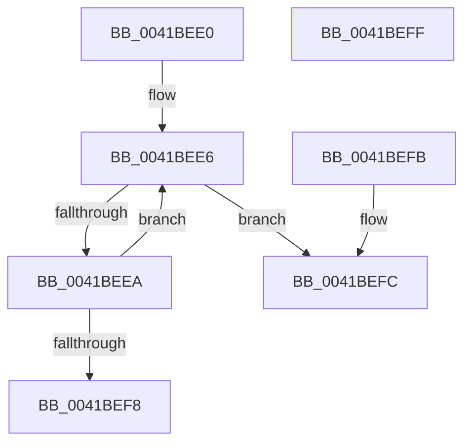

# ExAcquireRundownProtectionEx

- RVA: `0x0041BEE0`–`0x0041BF00` (길이 `32` bytes)
- VA: `0x000000014041BEE0`
- 실행 섹션: `.text`
- PDB 이름 있음: `예`; PDB Function 태그: `아니요`
- unwind 정보 RVA: `0x000DB714`
- 디코드: `14`개 명령, `32/32` bytes 표시
- 미해석 바이트: `0` (있으면 어셈블리에 `.byte`로 보존)

> 이 문서는 커널 이미지의 기계어와 PDB 기호를 분석해 생성했습니다. 4번과 5번은 함수 원형과 자료형을 바이너리 사용 방식에서 추정한 C 해석이며 원본 소스 복구 결과는 아닙니다.

## 1. Dependencies

- 직접 호출 지점: **0**; 고유 호출 대상: **0**
- 직접 호출자로 확인된 함수: **5**
- RIP 상대 이미지 참조: **0**

### Outgoing calls
- 직접 디코드된 call 명령이 없습니다.

### Direct callers
- [sub_002F01AB](../2F/Unknown_function_002F01AB.md) at `0x002F01B3`
- [ExCompareExchangeCallBack](ExCompareExchangeCallBack_function_0041BCD0.md) at `0x0041BCFA`
- [PfSnAddProcessTrace](PfSnAddProcessTrace_function_0041BE64.md) at `0x0041BE8D`
- [SmHwAcceleratorParitionCtxCreate](../../page/7A/SmHwAcceleratorParitionCtxCreate_function_007AB0A8.md) at `0x007AB268`
- [PspRundownProcess](../../page/9F/PspRundownProcess_function_009F65CC.md) at `0x009F65DE`

### Static image references
- 디코드된 RIP-relative 메모리 참조가 없습니다.

## 2. Other-region calls and transfers

- 다른 실행 섹션으로 향하는 call: **0**
- 별도 외부 분기/꼬리 이동을 확인하지 못했습니다.

## 3. Assembly (complete function range)

```asm
0041BEE0  0F 0D 09                        prefetchw byte ptr [rcx]
0041BEE3  48 8B 01                        mov rax, qword ptr [rcx]
0041BEE6  A8 01                           test al, 1
0041BEE8  75 12                           jne 0x14041befc
0041BEEA  44 8D 0C 12                     lea r9d, [rdx + rdx]
0041BEEE  4C 03 C8                        add r9, rax
0041BEF1  F0 4C 0F B1 09                  lock cmpxchg qword ptr [rcx], r9
0041BEF6  75 EE                           jne 0x14041bee6
0041BEF8  B0 01                           mov al, 1
0041BEFA  C3                              ret
0041BEFB  CC                              int3
0041BEFC  32 C0                           xor al, al
0041BEFE  C3                              ret
0041BEFF  CC                              int3
```

## 4. C-style interpretation (structured pseudocode)

```c
__int64 __fastcall ExAcquireRundownProtectionEx(__int64 a1, __int64 a2)
{
    __int64 result;

loc_0041BEE6:
    if ((((unsigned __int8)(*(unsigned __int64 *)(a1))) & (1)) != 0) goto loc_0041BEFC;
    a4 = (a2 + a2 * 1) + (*(unsigned __int64 *)(a1));
    if (condition_is_not_equal) goto loc_0041BEE6;
    return 1;
loc_0041BEFC:
    result = 0;
    return result;
}
```

## 5. (Beta) C Style

```c
int64_t ExAcquireRundownProtectionEx(void *Arg1, void *Arg2)
{
    uint8_t *arg1 = (uint8_t *)Arg1;
    uint8_t *arg2 = (uint8_t *)Arg2;

    int64_t result;

loc_0041BEE6:
    if ((((uint8_t)(*(uint64_t *)(arg1))) & (1)) != 0) goto loc_0041BEFC;
    a4 = (Arg2 + Arg2 * 1) + (*(uint64_t *)(arg1));
    if (condition_is_not_equal) goto loc_0041BEE6;
    return 1;
loc_0041BEFC:
    result = 0;
    return result;
}
```

### 관측된 메모리 오프셋

구조체 형식이 확인되지 않은 접근은 인자 기준의 오프셋으로만 기록했습니다.

| 기준 인자 | 오프셋 표현 | 폭 (bit) | 접근 |
|---|---:|---:|---|
| `Arg1` | `+ 0x0` | `8` | `R` |
| `Arg1` | `+ 0x0` | `64` | `R` |
| `Arg2` | `+ 0x0 + rdx*1` | `32` | `R` |

## 6. Execution-region graph

[열기: 2D/3D 그래프와 함수 탐색 컨트롤 패널](../../../control-panel.html?section=text&rva=0x0041BEE0&view=graph)

- 2D 그래프는 위에서 아래로 흐르고, 3D 그래프는 빈 공간을 드래그해 회전합니다. Shift+드래그는 이동, 휠은 확대·축소, 함수 노드 선택은 대상 보고서 이동입니다.

### Static fallback


