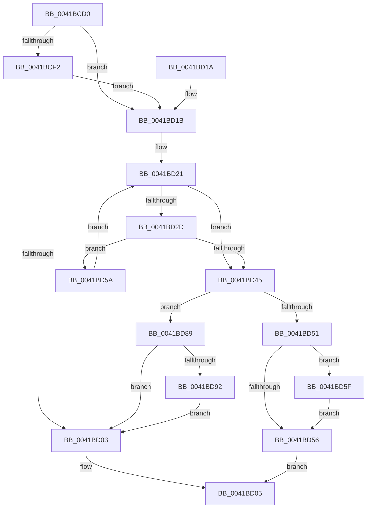

# ExCompareExchangeCallBack

- RVA: `0x0041BCD0`–`0x0041BDA4` (길이 `212` bytes)
- VA: `0x000000014041BCD0`
- 실행 섹션: `.text`
- PDB 이름 있음: `예`; PDB Function 태그: `아니요`
- unwind 정보 RVA: `0x0009D5C0`
- 디코드: `62`개 명령, `212/212` bytes 표시
- 미해석 바이트: `0` (있으면 어셈블리에 `.byte`로 보존)

> 이 문서는 커널 이미지의 기계어와 PDB 기호를 분석해 생성했습니다. 4번과 5번은 함수 원형과 자료형을 바이너리 사용 방식에서 추정한 C 해석이며 원본 소스 복구 결과는 아닙니다.

## 1. Dependencies

- 직접 호출 지점: **5**; 고유 호출 대상: **4**
- 직접 호출자로 확인된 함수: **14**
- RIP 상대 이미지 참조: **1**

### Outgoing calls
- `0x0041BCFA` → [ExAcquireRundownProtectionEx](ExAcquireRundownProtectionEx_function_0041BEE0.md) (function, `0x0041BEE0`)
- `0x0041BD66` → [ExAcquireSpinLockExclusive](../24/ExAcquireSpinLockExclusive_function_00248690.md) (function, `0x00248690`)
- `0x0041BD74` → [ExReleaseSpinLockExclusive](../2C/ExReleaseSpinLockExclusive_function_002C0EF0.md) (function, `0x002C0EF0`)
- `0x0041BD82` → [ExReleaseRundownProtectionEx](../2A/ExReleaseRundownProtectionEx_function_002A55B0.md) (function, `0x002A55B0`)
- `0x0041BD9A` → [ExReleaseRundownProtectionEx](../2A/ExReleaseRundownProtectionEx_function_002A55B0.md) (function, `0x002A55B0`)

### Direct callers
- [IoRegisterPriorityCallback](../59/IoRegisterPriorityCallback_function_00597BB0.md) at `0x00597C2A`
- [IoUnregisterPriorityCallback](../59/IoUnregisterPriorityCallback_function_00597D40.md) at `0x00597DAE`
- [KeDeregisterBoundCallback](../5B/KeDeregisterBoundCallback_function_005B1770.md) at `0x005B17C6`
- [KeRegisterBoundCallback](../5B/KeRegisterBoundCallback_function_005B1B70.md) at `0x005B1BAC`
- [DbgkLkmdRegisterCallback](../../page/71/DbgkLkmdRegisterCallback_function_00711570.md) at `0x0071161A`
- [DbgkLkmdUnregisterCallback](../../page/71/DbgkLkmdUnregisterCallback_function_00711660.md) at `0x007116AC`
- [PoRegisterCoalescingCallback](../../page/75/PoRegisterCoalescingCallback_function_0075BF00.md) at `0x0075BF78`
- [PoUnregisterCoalescingCallback](../../page/75/PoUnregisterCoalescingCallback_function_0075C000.md) at `0x0075C03F`
- [PsEstablishWin32Callouts](../../page/78/PsEstablishWin32Callouts_function_00781B20.md) at `0x00781B42`
- [PspSetCreateThreadNotifyRoutine](../../page/78/PspSetCreateThreadNotifyRoutine_function_00787868.md) at `0x007878A0`
- [PsSetLoadImageNotifyRoutineEx](../../page/AA/PsSetLoadImageNotifyRoutineEx_function_00AA19A0.md) at `0x00AA19E9`
- [PsRemoveCreateThreadNotifyRoutine](../../page/AA/PsRemoveCreateThreadNotifyRoutine_function_00AA3870.md) at `0x00AA38D5`
- [PsRemoveLoadImageNotifyRoutine](../../page/AC/PsRemoveLoadImageNotifyRoutine_function_00AC30F0.md) at `0x00AC3151`
- [sub_00B49F04](../../page/B4/Unknown_function_00B49F04.md) at `0x00B49F15`
- [sub_00B49F04](../../page/B4/Unknown_function_00B49F04.md) at `0x00B49F8F`

### Static image references
- `0x0041BD5F` → RVA `0x00EFACC8` (`.data`; read)

## 2. Other-region calls and transfers

- 다른 실행 섹션으로 향하는 call: **0**
- 별도 외부 분기/꼬리 이동을 확인하지 못했습니다.

## 3. Assembly (complete function range)

```asm
0041BCD0  48 89 5C 24 08                  mov qword ptr [rsp + 8], rbx
0041BCD5  48 89 6C 24 10                  mov qword ptr [rsp + 0x10], rbp
0041BCDA  48 89 74 24 18                  mov qword ptr [rsp + 0x18], rsi
0041BCDF  57                              push rdi
0041BCE0  48 83 EC 20                     sub rsp, 0x20
0041BCE4  49 8B E8                        mov rbp, r8
0041BCE7  48 8B FA                        mov rdi, rdx
0041BCEA  48 8B F1                        mov rsi, rcx
0041BCED  48 85 D2                        test rdx, rdx
0041BCF0  74 29                           je 0x14041bd1b
0041BCF2  BA 10 00 00 00                  mov edx, 0x10
0041BCF7  48 8B CF                        mov rcx, rdi
0041BCFA  E8 E1 01 00 00                  call 0x14041bee0
0041BCFF  84 C0                           test al, al
0041BD01  75 18                           jne 0x14041bd1b
0041BD03  32 C0                           xor al, al
0041BD05  48 8B 5C 24 30                  mov rbx, qword ptr [rsp + 0x30]
0041BD0A  48 8B 6C 24 38                  mov rbp, qword ptr [rsp + 0x38]
0041BD0F  48 8B 74 24 40                  mov rsi, qword ptr [rsp + 0x40]
0041BD14  48 83 C4 20                     add rsp, 0x20
0041BD18  5F                              pop rdi
0041BD19  C3                              ret
0041BD1A  CC                              int3
0041BD1B  0F 0D 0E                        prefetchw byte ptr [rsi]
0041BD1E  48 8B 1E                        mov rbx, qword ptr [rsi]
0041BD21  48 8B C3                        mov rax, rbx
0041BD24  48 33 C5                        xor rax, rbp
0041BD27  48 83 F8 0F                     cmp rax, 0xf
0041BD2B  77 18                           ja 0x14041bd45
0041BD2D  48 8B CF                        mov rcx, rdi
0041BD30  48 8B C3                        mov rax, rbx
0041BD33  48 83 C9 0F                     or rcx, 0xf
0041BD37  48 85 FF                        test rdi, rdi
0041BD3A  48 0F 44 CF                     cmove rcx, rdi
0041BD3E  F0 48 0F B1 0E                  lock cmpxchg qword ptr [rsi], rcx
0041BD43  75 15                           jne 0x14041bd5a
0041BD45  48 8B F3                        mov rsi, rbx
0041BD48  48 83 E6 F0                     and rsi, 0xfffffffffffffff0
0041BD4C  48 3B F5                        cmp rsi, rbp
0041BD4F  75 38                           jne 0x14041bd89
0041BD51  48 85 F6                        test rsi, rsi
0041BD54  75 09                           jne 0x14041bd5f
0041BD56  B0 01                           mov al, 1
0041BD58  EB AB                           jmp 0x14041bd05
0041BD5A  48 8B D8                        mov rbx, rax
0041BD5D  EB C2                           jmp 0x14041bd21
0041BD5F  48 8D 0D 62 EF AD 00            lea rcx, [rip + 0xadef62]
0041BD66  E8 25 C9 E2 FF                  call 0x140248690
0041BD6B  8A D0                           mov dl, al
0041BD6D  48 8D 0D 54 EF AD 00            lea rcx, [rip + 0xadef54]
0041BD74  E8 77 51 EA FF                  call 0x1402c0ef0
0041BD79  83 E3 0F                        and ebx, 0xf
0041BD7C  48 8B CE                        mov rcx, rsi
0041BD7F  8D 53 01                        lea edx, [rbx + 1]
0041BD82  E8 29 98 E8 FF                  call 0x1402a55b0
0041BD87  EB CD                           jmp 0x14041bd56
0041BD89  48 85 FF                        test rdi, rdi
0041BD8C  0F 84 71 FF FF FF               je 0x14041bd03
0041BD92  BA 10 00 00 00                  mov edx, 0x10
0041BD97  48 8B CF                        mov rcx, rdi
0041BD9A  E8 11 98 E8 FF                  call 0x1402a55b0
0041BD9F  E9 5F FF FF FF                  jmp 0x14041bd03
```

## 4. C-style interpretation (structured pseudocode)

```c
__int64 __fastcall ExCompareExchangeCallBack(__int64 a1, __int64 a2, __int64 a3)
{
    __int64 result;
    __int64 v_rbx;
    __int64 v_rsi;
    __int64 v_rsp;
    unsigned __int64 v_stack_p10;
    unsigned __int64 v_stack_p18;
    unsigned __int64 v_stack_p8;

    v_stack_p8 = v_rbx;
    v_stack_p10 = v_rbp;
    v_stack_p18 = v_rsi;
    v_rsp = (v_rsp) - (32);
    if (a2 == 0) goto loc_0041BD1B;
    result = ExAcquireRundownProtectionEx(a2, 16, a3, a4);
    if ((unsigned __int8)(result) != 0) goto loc_0041BD1B;
loc_0041BD03:
    result = 0;
loc_0041BD05:
    v_rsp = (v_rsp) + (32);
    return result;
loc_0041BD1B:
loc_0041BD21:
    result = (*(unsigned __int64 *)(v_stack_p18)) ^ (v_stack_p10);
    if (result > 15) goto loc_0041BD45;
    a1 = (a2) | (15);
    if (a2 == 0) { a1 = a2; }
    if (a2 != 0) goto loc_0041BD5A;
loc_0041BD45:
    v_rsi = (*(unsigned __int64 *)(v_stack_p18)) & (-16);
    if (v_rsi != v_stack_p10) goto loc_0041BD89;
    if (v_rsi != 0) goto loc_0041BD5F;
loc_0041BD56:
    goto loc_0041BD05;
loc_0041BD5A:
    goto loc_0041BD21;
loc_0041BD5F:
    result = ExAcquireSpinLockExclusive(v_rip + 11399010, 16, a3, a4);
    result = ExReleaseSpinLockExclusive(v_rip + 11398996, (unsigned __int8)(result), a3, a4);
    v_rbx = (unsigned int)((1) & (15));
    result = ExReleaseRundownProtectionEx(v_rsi, v_rbx + 1, a3, a4);
    goto loc_0041BD56;
loc_0041BD89:
    if (a2 == 0) goto loc_0041BD03;
    result = ExReleaseRundownProtectionEx(a2, 16, a3, a4);
    goto loc_0041BD03;
}
```

## 5. (Beta) C Style

```c
int64_t ExCompareExchangeCallBack(void *Arg1, int64_t Arg2, int64_t Arg3)
{
    uint8_t *arg1 = (uint8_t *)Arg1;

    int64_t result;
    int64_t local_rbx;
    int64_t local_rsi;
    int64_t local_rsp;
    uint64_t v_stack_p10;
    uint64_t v_stack_p18;
    uint64_t v_stack_p8;

    v_stack_p8 = local_rbx;
    v_stack_p10 = local_rbp;
    v_stack_p18 = local_rsi;
    local_rsp = (local_rsp) - (32);
    if (Arg2 == 0) goto loc_0041BD1B;
    result = ExAcquireRundownProtectionEx(Arg2, 16, Arg3, a4);
    if ((uint8_t)(result) != 0) goto loc_0041BD1B;
loc_0041BD03:
    result = 0;
loc_0041BD05:
    local_rsp = (local_rsp) + (32);
    return result;
loc_0041BD1B:
loc_0041BD21:
    result = (*(uint64_t *)(v_stack_p18)) ^ (v_stack_p10);
    if (result > 15) goto loc_0041BD45;
    Arg1 = (Arg2) | (15);
    if (Arg2 == 0) { Arg1 = Arg2; }
    if (Arg2 != 0) goto loc_0041BD5A;
loc_0041BD45:
    local_rsi = (*(uint64_t *)(v_stack_p18)) & (-16);
    if (local_rsi != v_stack_p10) goto loc_0041BD89;
    if (local_rsi != 0) goto loc_0041BD5F;
loc_0041BD56:
    goto loc_0041BD05;
loc_0041BD5A:
    goto loc_0041BD21;
loc_0041BD5F:
    result = ExAcquireSpinLockExclusive(v_rip + 11399010, 16, Arg3, a4);
    result = ExReleaseSpinLockExclusive(v_rip + 11398996, (uint8_t)(result), Arg3, a4);
    local_rbx = (uint32_t)((1) & (15));
    result = ExReleaseRundownProtectionEx(local_rsi, local_rbx + 1, Arg3, a4);
    goto loc_0041BD56;
loc_0041BD89:
    if (Arg2 == 0) goto loc_0041BD03;
    result = ExReleaseRundownProtectionEx(Arg2, 16, Arg3, a4);
    goto loc_0041BD03;
}
```

### 관측된 메모리 오프셋

구조체 형식이 확인되지 않은 접근은 인자 기준의 오프셋으로만 기록했습니다.

| 기준 인자 | 오프셋 표현 | 폭 (bit) | 접근 |
|---|---:|---:|---|
| `Arg1` | `+ 0x0` | `8` | `R` |
| `Arg1` | `+ 0x0` | `64` | `R` |

## 6. Execution-region graph

[열기: 2D/3D 그래프와 함수 탐색 컨트롤 패널](../../../control-panel.html?section=text&rva=0x0041BCD0&view=graph)

- 2D 그래프는 위에서 아래로 흐르고, 3D 그래프는 빈 공간을 드래그해 회전합니다. Shift+드래그는 이동, 휠은 확대·축소, 함수 노드 선택은 대상 보고서 이동입니다.

### Static fallback


