# ExConvertFastResourceExclusiveToShared

- RVA: `0x00415AB0`–`0x00415C0B` (길이 `347` bytes)
- VA: `0x0000000140415AB0`
- 실행 섹션: `.text`
- PDB 이름 있음: `예`; PDB Function 태그: `아니요`
- unwind 정보 RVA: `0x00064C80`
- 디코드: `96`개 명령, `347/347` bytes 표시
- 미해석 바이트: `0` (있으면 어셈블리에 `.byte`로 보존)

> 이 문서는 커널 이미지의 기계어와 PDB 기호를 분석해 생성했습니다. 4번과 5번은 함수 원형과 자료형을 바이너리 사용 방식에서 추정한 C 해석이며 원본 소스 복구 결과는 아닙니다.

## 1. Dependencies

- 직접 호출 지점: **9**; 고유 호출 대상: **2**
- 직접 호출자로 확인된 함수: **1**
- RIP 상대 이미지 참조: **0**

### Outgoing calls
- `0x00415AD9` → [KeBugCheckEx](../4F/KeBugCheckEx_function_004FD660.md) (function, `0x004FD660`)
- `0x00415B04` → [KeBugCheckEx](../4F/KeBugCheckEx_function_004FD660.md) (function, `0x004FD660`)
- `0x00415B33` → [KeBugCheckEx](../4F/KeBugCheckEx_function_004FD660.md) (function, `0x004FD660`)
- `0x00415B58` → [KeBugCheckEx](../4F/KeBugCheckEx_function_004FD660.md) (function, `0x004FD660`)
- `0x00415B8F` → [KeBugCheckEx](../4F/KeBugCheckEx_function_004FD660.md) (function, `0x004FD660`)
- `0x00415BAC` → [KeBugCheckEx](../4F/KeBugCheckEx_function_004FD660.md) (function, `0x004FD660`)
- `0x00415BD5` → [KeBugCheckEx](../4F/KeBugCheckEx_function_004FD660.md) (function, `0x004FD660`)
- `0x00415BF6` → [KeBugCheckEx](../4F/KeBugCheckEx_function_004FD660.md) (function, `0x004FD660`)
- `0x00415BFF` → [ExpConvertFastResourceExclusiveToShared](ExpConvertFastResourceExclusiveToShared_function_00416110.md) (function, `0x00416110`)

### Direct callers
- [DifExConvertFastResourceExclusiveToSharedWrapper](../61/DifExConvertFastResourceExclusiveToSharedWrapper_function_0061F120.md) at `0x0061F1F7`

### Static image references
- 디코드된 RIP-relative 메모리 참조가 없습니다.

## 2. Other-region calls and transfers

- 다른 실행 섹션으로 향하는 call: **0**
- 별도 외부 분기/꼬리 이동을 확인하지 못했습니다.

## 3. Assembly (complete function range)

```asm
00415AB0  40 53                           push rbx
00415AB2  48 83 EC 30                     sub rsp, 0x30
00415AB6  48 8B DA                        mov rbx, rdx
00415AB9  4C 8D 41 40                     lea r8, [rcx + 0x40]
00415ABD  33 D2                           xor edx, edx
00415ABF  F6 41 1A 01                     test byte ptr [rcx + 0x1a], 1
00415AC3  75 1A                           jne 0x140415adf
00415AC5  45 33 C9                        xor r9d, r9d
00415AC8  48 89 54 24 20                  mov qword ptr [rsp + 0x20], rdx
00415ACD  4C 8B C1                        mov r8, rcx
00415AD0  B9 C6 01 00 00                  mov ecx, 0x1c6
00415AD5  41 8D 51 03                     lea edx, [r9 + 3]
00415AD9  E8 82 7B 0E 00                  call 0x1404fd660
00415ADE  CC                              int3
00415ADF  44 0F 20 C0                     mov rax, cr8
00415AE3  65 4C 8B 14 25 88 01 00 00      mov r10, qword ptr gs:[0x188]
00415AEC  3C 01                           cmp al, 1
00415AEE  76 1A                           jbe 0x140415b0a
00415AF0  44 0F B6 C0                     movzx r8d, al
00415AF4  B9 C6 01 00 00                  mov ecx, 0x1c6
00415AF9  41 B9 01 00 00 00               mov r9d, 1
00415AFF  48 89 54 24 20                  mov qword ptr [rsp + 0x20], rdx
00415B04  E8 57 7B 0E 00                  call 0x1404fd660
00415B09  CC                              int3
00415B0A  73 2D                           jae 0x140415b39
00415B0C  41 F7 42 74 00 04 00 00         test dword ptr [r10 + 0x74], 0x400
00415B14  75 23                           jne 0x140415b39
00415B16  41 39 92 E4 01 00 00            cmp dword ptr [r10 + 0x1e4], edx
00415B1D  75 1A                           jne 0x140415b39
00415B1F  45 33 C9                        xor r9d, r9d
00415B22  48 89 54 24 20                  mov qword ptr [rsp + 0x20], rdx
00415B27  45 33 C0                        xor r8d, r8d
00415B2A  B9 C6 01 00 00                  mov ecx, 0x1c6
00415B2F  41 8D 51 07                     lea edx, [r9 + 7]
00415B33  E8 28 7B 0E 00                  call 0x1404fd660
00415B38  CC                              int3
00415B39  4D 8B 58 10                     mov r11, qword ptr [r8 + 0x10]
00415B3D  4D 8B CB                        mov r9, r11
00415B40  49 83 E1 FE                     and r9, 0xfffffffffffffffe
00415B44  4D 3B CA                        cmp r9, r10
00415B47  74 15                           je 0x140415b5e
00415B49  48 89 54 24 20                  mov qword ptr [rsp + 0x20], rdx
00415B4E  B9 C6 01 00 00                  mov ecx, 0x1c6
00415B53  BA 09 00 00 00                  mov edx, 9
00415B58  E8 03 7B 0E 00                  call 0x1404fd660
00415B5D  CC                              int3
00415B5E  45 0F B6 50 25                  movzx r10d, byte ptr [r8 + 0x25]
00415B63  45 8A CA                        mov r9b, r10b
00415B66  41 80 E1 02                     and r9b, 2
00415B6A  75 29                           jne 0x140415b95
00415B6C  49 8B 40 18                     mov rax, qword ptr [r8 + 0x18]
00415B70  48 3B C1                        cmp rax, rcx
00415B73  74 20                           je 0x140415b95
00415B75  48 85 C0                        test rax, rax
00415B78  74 1B                           je 0x140415b95
00415B7A  4D 8B C8                        mov r9, r8
00415B7D  48 89 44 24 20                  mov qword ptr [rsp + 0x20], rax
00415B82  4C 8B C1                        mov r8, rcx
00415B85  BA 08 00 00 00                  mov edx, 8
00415B8A  B9 C6 01 00 00                  mov ecx, 0x1c6
00415B8F  E8 CC 7A 0E 00                  call 0x1404fd660
00415B94  CC                              int3
00415B95  41 F6 C3 01                     test r11b, 1
00415B99  74 17                           je 0x140415bb2
00415B9B  45 33 C9                        xor r9d, r9d
00415B9E  48 89 54 24 20                  mov qword ptr [rsp + 0x20], rdx
00415BA3  B9 C6 01 00 00                  mov ecx, 0x1c6
00415BA8  41 8D 51 0A                     lea edx, [r9 + 0xa]
00415BAC  E8 AF 7A 0E 00                  call 0x1404fd660
00415BB1  CC                              int3
00415BB2  45 84 C9                        test r9b, r9b
00415BB5  75 24                           jne 0x140415bdb
00415BB7  4D 8B CA                        mov r9, r10
00415BBA  48 89 54 24 20                  mov qword ptr [rsp + 0x20], rdx
00415BBF  41 83 E1 02                     and r9d, 2
00415BC3  BA 0B 00 00 00                  mov edx, 0xb
00415BC8  49 C1 E1 0F                     shl r9, 0xf
00415BCC  B9 C6 01 00 00                  mov ecx, 0x1c6
00415BD1  49 83 C9 01                     or r9, 1
00415BD5  E8 86 7A 0E 00                  call 0x1404fd660
00415BDA  CC                              int3
00415BDB  41 83 78 20 01                  cmp dword ptr [r8 + 0x20], 1
00415BE0  7E 1A                           jle 0x140415bfc
00415BE2  45 33 C9                        xor r9d, r9d
00415BE5  48 89 54 24 20                  mov qword ptr [rsp + 0x20], rdx
00415BEA  4C 8B C1                        mov r8, rcx
00415BED  B9 C6 01 00 00                  mov ecx, 0x1c6
00415BF2  41 8D 51 13                     lea edx, [r9 + 0x13]
00415BF6  E8 65 7A 0E 00                  call 0x1404fd660
00415BFB  CC                              int3
00415BFC  48 8B D3                        mov rdx, rbx
00415BFF  E8 0C 05 00 00                  call 0x140416110
00415C04  48 83 C4 30                     add rsp, 0x30
00415C08  5B                              pop rbx
00415C09  C3                              ret
00415C0A  CC                              int3
```

## 4. C-style interpretation (structured pseudocode)

```c
__int64 __fastcall ExConvertFastResourceExclusiveToShared(__int64 a1, __int64 a2, __int64 a3, int a4)
{
    __int64 result;
    __int64 v_rsp;
    unsigned __int64 v_stack_m18;

    v_rsp = (v_rsp) - (48);
    a2 = 0;
    if (((*(unsigned __int8 *)(a1 + 26)) & (1)) == 0) {
        a4 = 0;
        v_stack_m18 = 0;
        a3 = a1;
        a1 = 454;
        a2 = a4 + 3;
        result = KeBugCheckEx(a1, a2, a3, a4);
    }
    result = v_cr8;
    if (((unsigned __int8)(v_cr8)) >= = 1) {
        a3 = (unsigned __int8)(v_cr8);
        a1 = 454;
        a4 = 1;
        v_stack_m18 = a2;
        result = KeBugCheckEx(a1, a2, a3, a4);
    }
    if (((unsigned __int8)(v_cr8)) >= 1) goto loc_00415B39;
    if (((*(unsigned int *)(*(unsigned __int64 *)(gs_base + (0 + 392)) + 116)) & (0x400ULL)) != 0) goto loc_00415B39;
    if ((*(unsigned int *)(*(unsigned __int64 *)(gs_base + (0 + 392)) + 484)) == ((unsigned int)(a2))) {
        a4 = 0;
        v_stack_m18 = a2;
        a3 = 0;
        a1 = 454;
        a2 = a4 + 7;
        result = KeBugCheckEx(a1, a2, a3, a4);
    }
    a4 = (*(unsigned __int64 *)(a3 + 16)) & (-2);
    if (a4 != (*(unsigned __int64 *)(gs_base + (0 + 392)))) {
        v_stack_m18 = a2;
        a1 = 454;
        a2 = 9;
        result = KeBugCheckEx(a1, a2, a3, a4);
    }
    a4 = (unsigned __int8)(((unsigned __int8)(*(unsigned __int8 *)(a3 + 37))) & (2));
    if (condition_is_not_equal) goto loc_00415B95;
    if ((*(unsigned __int64 *)(a3 + 24)) == a1) goto loc_00415B95;
    result = *(unsigned __int64 *)(a3 + 24);
    if (*(unsigned __int64 *)(a3 + 24) != 0) {
        a4 = 0;
        v_stack_m18 = *(unsigned __int64 *)(a3 + 24);
        a3 = a1;
        a2 = 8;
        a1 = 454;
        result = KeBugCheckEx(a1, a2, a3, a4);
    }
    if ((((unsigned __int8)(*(unsigned __int64 *)(a3 + 16))) & (1)) != 0) {
        a4 = 0;
        v_stack_m18 = a2;
        a1 = 454;
        a2 = a4 + 10;
        result = KeBugCheckEx(a1, a2, a3, a4);
    }
    if (0 == 0) {
        a4 = *(unsigned __int8 *)(a3 + 37);
        v_stack_m18 = a2;
        a4 = (unsigned int)((a4) & (2));
        a2 = 11;
        a4 = (a4) << (15);
        a1 = 454;
        a4 = (a4) | (1);
        result = KeBugCheckEx(a1, a2, a3, a4);
    }
    if ((*(unsigned int *)(a3 + 32)) >= = 1) {
        a4 = 0;
        v_stack_m18 = a2;
        a3 = a1;
        a1 = 454;
        a2 = a4 + 19;
        result = KeBugCheckEx(a1, a2, a3, a4);
    }
    result = ExpConvertFastResourceExclusiveToShared(a1, a2, a3, a4);
    v_rsp = (v_rsp) + (48);
    return result;
}
```

## 5. (Beta) C Style

```c
int64_t ExConvertFastResourceExclusiveToShared(void *Arg1, int64_t Arg2, int64_t Arg3, int32_t Arg4)
{
    uint8_t *arg1 = (uint8_t *)Arg1;

    int64_t result;
    int64_t local_rsp;
    uint64_t v_stack_m18;

    local_rsp = (local_rsp) - (48);
    Arg2 = 0;
    if (((*(uint8_t *)(arg1 + 0x1A)) & (1)) == 0) {
        Arg4 = 0;
        v_stack_m18 = 0;
        Arg3 = Arg1;
        Arg1 = 454;
        Arg2 = Arg4 + 3;
        result = KeBugCheckEx(Arg1, Arg2, Arg3, Arg4);
    }
    result = v_cr8;
    if (((uint8_t)(v_cr8)) >= = 1) {
        Arg3 = (uint8_t)(v_cr8);
        Arg1 = 454;
        Arg4 = 1;
        v_stack_m18 = Arg2;
        result = KeBugCheckEx(Arg1, Arg2, Arg3, Arg4);
    }
    if (((uint8_t)(v_cr8)) >= 1) goto loc_00415B39;
    if (((*(uint32_t *)(*(uint64_t *)(gs_base + (0 + 0x188)) + 0x74)) & (0x400ULL)) != 0) goto loc_00415B39;
    if ((*(uint32_t *)(*(uint64_t *)(gs_base + (0 + 0x188)) + 0x1E4)) == ((uint32_t)(Arg2))) {
        Arg4 = 0;
        v_stack_m18 = Arg2;
        Arg3 = 0;
        Arg1 = 454;
        Arg2 = Arg4 + 7;
        result = KeBugCheckEx(Arg1, Arg2, Arg3, Arg4);
    }
    Arg4 = (*(uint64_t *)(Arg3 + 0x10)) & (-2);
    if (Arg4 != (*(uint64_t *)(gs_base + (0 + 0x188)))) {
        v_stack_m18 = Arg2;
        Arg1 = 454;
        Arg2 = 9;
        result = KeBugCheckEx(Arg1, Arg2, Arg3, Arg4);
    }
    Arg4 = (uint8_t)(((uint8_t)(*(uint8_t *)(Arg3 + 0x25))) & (2));
    if (condition_is_not_equal) goto loc_00415B95;
    if ((*(uint64_t *)(Arg3 + 0x18)) == Arg1) goto loc_00415B95;
    result = *(uint64_t *)(Arg3 + 0x18);
    if (*(uint64_t *)(Arg3 + 0x18) != 0) {
        Arg4 = 0;
        v_stack_m18 = *(uint64_t *)(Arg3 + 0x18);
        Arg3 = Arg1;
        Arg2 = 8;
        Arg1 = 454;
        result = KeBugCheckEx(Arg1, Arg2, Arg3, Arg4);
    }
    if ((((uint8_t)(*(uint64_t *)(Arg3 + 0x10))) & (1)) != 0) {
        Arg4 = 0;
        v_stack_m18 = Arg2;
        Arg1 = 454;
        Arg2 = Arg4 + 10;
        result = KeBugCheckEx(Arg1, Arg2, Arg3, Arg4);
    }
    if (0 == 0) {
        Arg4 = *(uint8_t *)(Arg3 + 0x25);
        v_stack_m18 = Arg2;
        Arg4 = (uint32_t)((Arg4) & (2));
        Arg2 = 11;
        Arg4 = (Arg4) << (15);
        Arg1 = 454;
        Arg4 = (Arg4) | (1);
        result = KeBugCheckEx(Arg1, Arg2, Arg3, Arg4);
    }
    if ((*(uint32_t *)(Arg3 + 0x20)) >= = 1) {
        Arg4 = 0;
        v_stack_m18 = Arg2;
        Arg3 = Arg1;
        Arg1 = 454;
        Arg2 = Arg4 + 19;
        result = KeBugCheckEx(Arg1, Arg2, Arg3, Arg4);
    }
    result = ExpConvertFastResourceExclusiveToShared(Arg1, Arg2, Arg3, Arg4);
    local_rsp = (local_rsp) + (48);
    return result;
}
```

### 관측된 메모리 오프셋

구조체 형식이 확인되지 않은 접근은 인자 기준의 오프셋으로만 기록했습니다.

| 기준 인자 | 오프셋 표현 | 폭 (bit) | 접근 |
|---|---:|---:|---|
| `Arg1` | `+ 0x1A` | `8` | `R` |
| `Arg1` | `+ 0x40` | `64` | `R` |

## 6. Execution-region graph

[열기: 2D/3D 그래프와 함수 탐색 컨트롤 패널](../../../control-panel.html?section=text&rva=0x00415AB0&view=graph)

- 2D 그래프는 위에서 아래로 흐르고, 3D 그래프는 빈 공간을 드래그해 회전합니다. Shift+드래그는 이동, 휠은 확대·축소, 함수 노드 선택은 대상 보고서 이동입니다.

### Static fallback

```mermaid
flowchart TD
  bb_00415AB0[BB_00415AB0]
  bb_00415AC5[BB_00415AC5]
  bb_00415ADF[BB_00415ADF]
  bb_00415AF0[BB_00415AF0]
  bb_00415B0A[BB_00415B0A]
  bb_00415B0C[BB_00415B0C]
  bb_00415B16[BB_00415B16]
  bb_00415B1F[BB_00415B1F]
  bb_00415B39[BB_00415B39]
  bb_00415B49[BB_00415B49]
  bb_00415B5E[BB_00415B5E]
  bb_00415B6C[BB_00415B6C]
  bb_00415B75[BB_00415B75]
  bb_00415B7A[BB_00415B7A]
  bb_00415B95[BB_00415B95]
  bb_00415B9B[BB_00415B9B]
  bb_00415BB2[BB_00415BB2]
  bb_00415BB7[BB_00415BB7]
  bb_00415BDB[BB_00415BDB]
  bb_00415BE2[BB_00415BE2]
  bb_00415BFC[BB_00415BFC]
  bb_00415C0A[BB_00415C0A]
  bb_00415AB0 -->|branch| bb_00415ADF
  bb_00415AB0 -->|fallthrough| bb_00415AC5
  bb_00415AC5 -->|flow| bb_00415ADF
  bb_00415ADF -->|branch| bb_00415B0A
  bb_00415ADF -->|fallthrough| bb_00415AF0
  bb_00415AF0 -->|flow| bb_00415B0A
  bb_00415B0A -->|branch| bb_00415B39
  bb_00415B0A -->|fallthrough| bb_00415B0C
  bb_00415B0C -->|branch| bb_00415B39
  bb_00415B0C -->|fallthrough| bb_00415B16
  bb_00415B16 -->|branch| bb_00415B39
  bb_00415B16 -->|fallthrough| bb_00415B1F
  bb_00415B1F -->|flow| bb_00415B39
  bb_00415B39 -->|branch| bb_00415B5E
  bb_00415B39 -->|fallthrough| bb_00415B49
  bb_00415B49 -->|flow| bb_00415B5E
  bb_00415B5E -->|branch| bb_00415B95
  bb_00415B5E -->|fallthrough| bb_00415B6C
  bb_00415B6C -->|branch| bb_00415B95
  bb_00415B6C -->|fallthrough| bb_00415B75
  bb_00415B75 -->|branch| bb_00415B95
  bb_00415B75 -->|fallthrough| bb_00415B7A
  bb_00415B7A -->|flow| bb_00415B95
  bb_00415B95 -->|branch| bb_00415BB2
  bb_00415B95 -->|fallthrough| bb_00415B9B
  bb_00415B9B -->|flow| bb_00415BB2
  bb_00415BB2 -->|branch| bb_00415BDB
  bb_00415BB2 -->|fallthrough| bb_00415BB7
  bb_00415BB7 -->|flow| bb_00415BDB
  bb_00415BDB -->|branch| bb_00415BFC
  bb_00415BDB -->|fallthrough| bb_00415BE2
  bb_00415BE2 -->|flow| bb_00415BFC
```


