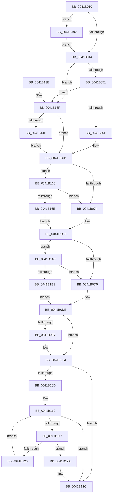

# ExGenRandom

- RVA: `0x0041B010`–`0x0041B1C7` (길이 `439` bytes)
- VA: `0x000000014041B010`
- 실행 섹션: `.text`
- PDB 이름 있음: `예`; PDB Function 태그: `아니요`
- unwind 정보 RVA: `0x0009D428`
- 디코드: `100`개 명령, `439/439` bytes 표시
- 미해석 바이트: `0` (있으면 어셈블리에 `.byte`로 보존)

> 이 문서는 커널 이미지의 기계어와 PDB 기호를 분석해 생성했습니다. 4번과 5번은 함수 원형과 자료형을 바이너리 사용 방식에서 추정한 C 해석이며 원본 소스 복구 결과는 아닙니다.

## 1. Dependencies

- 직접 호출 지점: **5**; 고유 호출 대상: **5**
- 직접 호출자로 확인된 함수: **55**
- RIP 상대 이미지 참조: **11**

### Outgoing calls
- `0x0041B066` → [KiAcquireSpinLockInstrumented](../20/KiAcquireSpinLockInstrumented_function_002084F0.md) (function, `0x002084F0`)
- `0x0041B0EF` → [KiLowerIrqlProcessIrqlFlags](../4F/KiLowerIrqlProcessIrqlFlags_function_004F5698.md) (function, `0x004F5698`)
- `0x0041B156` → [KxWaitForSpinLockAndAcquire](../20/KxWaitForSpinLockAndAcquire_function_002085C0.md) (function, `0x002085C0`)
- `0x0041B199` → [KiRaiseIrqlProcessIrqlFlags](../4F/KiRaiseIrqlProcessIrqlFlags_function_004F56FC.md) (function, `0x004F56FC`)
- `0x0041B1BD` → [KiReleaseSpinLockInstrumented](../39/KiReleaseSpinLockInstrumented_function_00392EF0.md) (function, `0x00392EF0`)

### Direct callers
- [KiSetProcessConcurrencyCount](../24/KiSetProcessConcurrencyCount_function_00249F2C.md) at `0x0024A003`
- [MiGetBackgroundHugePageToZero](../31/MiGetBackgroundHugePageToZero_function_0031DD8C.md) at `0x0031DE53`
- [KeStartThread](../3C/KeStartThread_function_003C21B8.md) at `0x003C248E`
- [RtlRandomEx](RtlRandomEx_function_0041AFE0.md) at `0x0041AFEE`
- [KiAdaptThreadIdealProcessorForProcessIdealSetChange](../4A/KiAdaptThreadIdealProcessorForProcessIdealSetChange_function_004AF434.md) at `0x004AF611`
- [CcBcbProfiler](../50/CcBcbProfiler_function_005099B0.md) at `0x00509B43`
- [CcBcbProfiler](../50/CcBcbProfiler_function_005099B0.md) at `0x00509B71`
- [IopInitializeInMemoryDumpData](../59/IopInitializeInMemoryDumpData_function_005957E0.md) at `0x00595994`
- [RtlpCreateHeapEncoding](../5E/RtlpCreateHeapEncoding_function_005E9888.md) at `0x005E98BD`
- [RtlpCreateHeapEncoding](../5E/RtlpCreateHeapEncoding_function_005E9888.md) at `0x005E98CD`
- [RtlHpGlobalsInitialize](../5F/RtlHpGlobalsInitialize_function_005F09DC.md) at `0x005F0A0F`
- [RtlHpGlobalsInitialize](../5F/RtlHpGlobalsInitialize_function_005F09DC.md) at `0x005F0A1F`
- [MiBuildDynamicRegion](../67/MiBuildDynamicRegion_function_0067F470.md) at `0x0067F4AF`
- [MiBuildDynamicRegion](../67/MiBuildDynamicRegion_function_0067F470.md) at `0x0067F57B`
- [sub_0069B640](../69/Unknown_function_0069B640.md) at `0x0069B66B`
- [sub_0069B640](../69/Unknown_function_0069B640.md) at `0x0069B6B1`
- [sub_0069B640](../69/Unknown_function_0069B640.md) at `0x0069B700`
- [sub_0069B640](../69/Unknown_function_0069B640.md) at `0x0069B754`
- [sub_00705ED0](../../page/70/Unknown_function_00705ED0.md) at `0x00706029`
- [sub_00705ED0](../../page/70/Unknown_function_00705ED0.md) at `0x0070605A`
- [EtwpCovSampCaptureContextStart](../../page/7C/EtwpCovSampCaptureContextStart_function_007C14AC.md) at `0x007C1677`
- [EtwpCovSampStrideSamplerInitialize](../../page/7C/EtwpCovSampStrideSamplerInitialize_function_007C1DD8.md) at `0x007C1E01`
- [CmpCmdInit](../../page/7E/CmpCmdInit_function_007E5768.md) at `0x007E585C`
- [MiInitializePartitionFreeZeroLists](../../page/7F/MiInitializePartitionFreeZeroLists_function_007FDA7C.md) at `0x007FDCA9`
- [MiGenerateSecureCookie](../../page/7F/MiGenerateSecureCookie_function_007FE754.md) at `0x007FE7B0`
- [MiGenerateSecureCookie](../../page/7F/MiGenerateSecureCookie_function_007FE754.md) at `0x007FE7BD`
- [MiCreateZeroThreadContext](../../page/81/MiCreateZeroThreadContext_function_008105B4.md) at `0x0081062D`
- [PspSetupUserStack](../../page/8C/PspSetupUserStack_function_008CD794.md) at `0x008CD840`
- [PspWow64InitThreadGuestx86](../../page/8C/PspWow64InitThreadGuestx86_function_008CE004.md) at `0x008CE02D`
- [PspPrepareSystemDllInitBlock](../../page/8C/PspPrepareSystemDllInitBlock_function_008CE128.md) at `0x008CE223`
- [MiInitializeProcessTopDownEntropy](../../page/8D/MiInitializeProcessTopDownEntropy_function_008D00F0.md) at `0x008D0157`
- [MiInitializeProcessTopDownEntropy](../../page/8D/MiInitializeProcessTopDownEntropy_function_008D00F0.md) at `0x008D016A`
- [MiInitializeProcessBottomUpEntropy](../../page/8D/MiInitializeProcessBottomUpEntropy_function_008D01B4.md) at `0x008D020F`
- [MiInitializeProcessBottomUpEntropy](../../page/8D/MiInitializeProcessBottomUpEntropy_function_008D01B4.md) at `0x008D0294`
- [MiInitializeProcessBottomUpEntropy](../../page/8D/MiInitializeProcessBottomUpEntropy_function_008D01B4.md) at `0x008D033B`
- [PspNotifyThreadCreation](../../page/8D/PspNotifyThreadCreation_function_008D5D48.md) at `0x008D5DBE`
- [MiMapViewOfImageSection](../../page/97/MiMapViewOfImageSection_function_0097E92C.md) at `0x0097F324`
- [MiAllocateNewSubAllocatedRegion](../../page/98/MiAllocateNewSubAllocatedRegion_function_00981EC0.md) at `0x00982046`
- [MiSelectImageBase](../../page/98/MiSelectImageBase_function_009887B0.md) at `0x00988AC7`
- [sub_009A174C](../../page/9A/Unknown_function_009A174C.md) at `0x009A1789`
- [NtQueryInformationProcess](../../page/9A/NtQueryInformationProcess_function_009AA250.md) at `0x009ACD46`
- [RtlRandom](../../page/A6/RtlRandom_function_00A65C60.md) at `0x00A65C6E`
- [MiReserveDriverPtes](../../page/A7/MiReserveDriverPtes_function_00A75150.md) at `0x00A751AC`
- [MiProcessLoadConfigForDriver](../../page/A7/MiProcessLoadConfigForDriver_function_00A7FCE4.md) at `0x00A7FD0C`
- [MiProcessLoadConfigForDriver](../../page/A7/MiProcessLoadConfigForDriver_function_00A7FCE4.md) at `0x00A7FD19`
- [MiSelectOverflowDllBase](../../page/A9/MiSelectOverflowDllBase_function_00A9E8E0.md) at `0x00A9EA45`
- [sub_00B2B51A](../../page/B2/Unknown_function_00B2B51A.md) at `0x00B2B689`
- [MmInitializeProcessor](../../pagelk/B7/MmInitializeProcessor_function_00B737F8.md) at `0x00B73874`
- [CcInitializeCacheManager](../../init/BE/CcInitializeCacheManager_function_00BEE2E8.md) at `0x00BEE467`
- [sub_00BF16D0](../../init/BF/Unknown_function_00BF16D0.md) at `0x00C16422`
- [sub_00BF16D0](../../init/BF/Unknown_function_00BF16D0.md) at `0x00C16460`
- [PspTlsInitialize](../../init/C4/PspTlsInitialize_function_00C46754.md) at `0x00C46761`
- [ExpInitSystemPhase0](../../init/C5/ExpInitSystemPhase0_function_00C5136C.md) at `0x00C51495`
- [ExpInitSystemPhase0](../../init/C5/ExpInitSystemPhase0_function_00C5136C.md) at `0x00C514A5`
- [ExInitializePoolTracker](../../init/C5/ExInitializePoolTracker_function_00C52F10.md) at `0x00C52F62`
- [ExInitializePoolTracker](../../init/C5/ExInitializePoolTracker_function_00C52F10.md) at `0x00C52F6F`
- [ExpTimerInitialization](../../init/C5/ExpTimerInitialization_function_00C5372C.md) at `0x00C5382C`
- [ExpInitializePrivatePools](../../init/C5/ExpInitializePrivatePools_function_00C54B80.md) at `0x00C54BBA`
- [ExpInitializePrivatePools](../../init/C5/ExpInitializePrivatePools_function_00C54B80.md) at `0x00C54BC7`
- [MiInitSystem](../../init/C5/MiInitSystem_function_00C5E6C0.md) at `0x00C5E883`
- [MiInitializeBootDefaults](../../init/C5/MiInitializeBootDefaults_function_00C5ED70.md) at `0x00C5EECE`
- [MiInitializeSharedUserData](../../init/C5/MiInitializeSharedUserData_function_00C5F098.md) at `0x00C5F13B`
- [MiInitializeNonPagedPool](../../init/C6/MiInitializeNonPagedPool_function_00C64A24.md) at `0x00C64AB2`
- [MiInitializeNonPagedPool](../../init/C6/MiInitializeNonPagedPool_function_00C64A24.md) at `0x00C64ABF`
- [MiAddSubRegionEntropy](../../init/C6/MiAddSubRegionEntropy_function_00C652AC.md) at `0x00C652C2`
- [MiAddSubRegionEntropy](../../init/C6/MiAddSubRegionEntropy_function_00C652AC.md) at `0x00C652D2`
- [MiAddSubRegionEntropy](../../init/C6/MiAddSubRegionEntropy_function_00C652AC.md) at `0x00C6531A`
- [MiAssignHalEntropy](../../init/C6/MiAssignHalEntropy_function_00C65344.md) at `0x00C653F3`
- [MiAssignSystemVa](../../init/C6/MiAssignSystemVa_function_00C65470.md) at `0x00C654C2`
- [MiAssignSystemVa](../../init/C6/MiAssignSystemVa_function_00C65470.md) at `0x00C65503`
- [MiAssignSystemVa](../../init/C6/MiAssignSystemVa_function_00C65470.md) at `0x00C65518`
- [MiAssignTopLevelRanges](../../init/C6/MiAssignTopLevelRanges_function_00C65560.md) at `0x00C65622`
- [MiAssignTopLevelRanges](../../init/C6/MiAssignTopLevelRanges_function_00C65560.md) at `0x00C6575C`
- [MiInitializeRelocations](../../init/C6/MiInitializeRelocations_function_00C69790.md) at `0x00C697E8`
- [MiInitializeRelocations](../../init/C6/MiInitializeRelocations_function_00C69790.md) at `0x00C6982F`
- [MiInitializeRelocations](../../init/C6/MiInitializeRelocations_function_00C69790.md) at `0x00C6985B`
- [MiInitializeRelocations](../../init/C6/MiInitializeRelocations_function_00C69790.md) at `0x00C698C9`
- [MiInitializeRelocations](../../init/C6/MiInitializeRelocations_function_00C69790.md) at `0x00C698F6`
- [MiInitializeSystemPtes](../../init/C6/MiInitializeSystemPtes_function_00C6A998.md) at `0x00C6AA87`
- [MiInitializeUltraSpace](../../init/C6/MiInitializeUltraSpace_function_00C6CDFC.md) at `0x00C6CE7D`
- [ObInitSystem](../../init/C7/ObInitSystem_function_00C71C7C.md) at `0x00C71D1D`
- [MiInitializeTopLevelBitmap](../../init/C7/MiInitializeTopLevelBitmap_function_00C770D0.md) at `0x00C770F1`

### Static image references
- `0x0041B037` → RVA `0x00FC6D20` (`ALMOSTRO`; read)
- `0x0041B044` → RVA `0x00FC6B06` (`ALMOSTRO`; read)
- `0x0041B051` → RVA `0x00F0DE58` (`.data`; read)
- `0x0041B05F` → RVA `0x00EFA7B0` (`.data`; read)
- `0x0041B076` → RVA `0x00EFA5E0` (`.data`; read)
- `0x0041B0D5` → RVA `0x00EFA7B0` (`.data`; read/write)
- `0x0041B0FC` → RVA `0x00EFA7A8` (`.data`; read)
- `0x0041B102` → RVA `0x00FC6B30` (`ALMOSTRO`; read)
- `0x0041B160` → RVA `0x00EFA7B8` (`.data`; read)
- `0x0041B170` → RVA `0x00EFA2A0` (`.data`; read)
- `0x0041B17E` → RVA `0x00EFA7B8` (`.data`; write)

## 2. Other-region calls and transfers

- 다른 실행 섹션으로 향하는 call: **0**
- 별도 외부 분기/꼬리 이동을 확인하지 못했습니다.

## 3. Assembly (complete function range)

```asm
0041B010  48 89 5C 24 10                  mov qword ptr [rsp + 0x10], rbx
0041B015  48 89 74 24 18                  mov qword ptr [rsp + 0x18], rsi
0041B01A  57                              push rdi
0041B01B  48 83 EC 20                     sub rsp, 0x20
0041B01F  48 63 F9                        movsxd rdi, ecx
0041B022  C7 44 24 30 00 00 00 00         mov dword ptr [rsp + 0x30], 0
0041B02A  44 0F 20 C6                     mov rsi, cr8
0041B02E  B8 02 00 00 00                  mov eax, 2
0041B033  44 0F 22 C0                     mov cr8, rax
0041B037  83 3D E2 BC BA 00 00            cmp dword ptr [rip + 0xbabce2], 0
0041B03E  0F 85 4E 01 00 00               jne 0x14041b192
0041B044  F6 05 BB BA BA 00 21            test byte ptr [rip + 0xbababb], 0x21
0041B04B  0F 84 EE 00 00 00               je 0x14041b13f
0041B051  8B 05 01 2E AF 00               mov eax, dword ptr [rip + 0xaf2e01]
0041B057  85 C0                           test eax, eax
0041B059  0F 85 E0 00 00 00               jne 0x14041b13f
0041B05F  48 8D 0D 4A F7 AD 00            lea rcx, [rip + 0xadf74a]
0041B066  E8 85 D4 DE FF                  call 0x1402084f0
0041B06B  83 FF 01                        cmp edi, 1
0041B06E  0F 84 EC 00 00 00               je 0x14041b160
0041B074  33 C9                           xor ecx, ecx
0041B076  48 8D 05 63 F5 AD 00            lea rax, [rip + 0xadf563]
0041B07D  4C 69 CF E4 00 00 00            imul r9, rdi, 0xe4
0041B084  4C 03 C8                        add r9, rax
0041B087  41 8B 91 DC 00 00 00            mov edx, dword ptr [r9 + 0xdc]
0041B08E  83 FA 36                        cmp edx, 0x36
0041B091  41 8B B9 E0 00 00 00            mov edi, dword ptr [r9 + 0xe0]
0041B098  8D 42 01                        lea eax, [rdx + 1]
0041B09B  0F 45 C8                        cmovne ecx, eax
0041B09E  8D 47 01                        lea eax, [rdi + 1]
0041B0A1  44 8B C1                        mov r8d, ecx
0041B0A4  33 C9                           xor ecx, ecx
0041B0A6  83 FF 36                        cmp edi, 0x36
0041B0A9  0F 45 C8                        cmovne ecx, eax
0041B0AC  43 8B 1C 81                     mov ebx, dword ptr [r9 + r8*4]
0041B0B0  8B D1                           mov edx, ecx
0041B0B2  41 2B 1C 89                     sub ebx, dword ptr [r9 + rcx*4]
0041B0B6  43 89 1C 81                     mov dword ptr [r9 + r8*4], ebx
0041B0BA  45 89 81 DC 00 00 00            mov dword ptr [r9 + 0xdc], r8d
0041B0C1  41 89 91 E0 00 00 00            mov dword ptr [r9 + 0xe0], edx
0041B0C8  F6 05 37 BA BA 00 01            test byte ptr [rip + 0xbaba37], 1
0041B0CF  0F 85 CE 00 00 00               jne 0x14041b1a3
0041B0D5  F0 48 83 25 D2 F6 AD 00 00      lock and qword ptr [rip + 0xadf6d2], 0
0041B0DE  83 3D 3B BC BA 00 00            cmp dword ptr [rip + 0xbabc3b], 0
0041B0E5  74 0D                           je 0x14041b0f4
0041B0E7  44 0F 20 C1                     mov rcx, cr8
0041B0EB  40 0F B6 D6                     movzx edx, sil
0041B0EF  E8 A4 A5 0D 00                  call 0x1404f5698
0041B0F4  40 0F B6 C6                     movzx eax, sil
0041B0F8  44 0F 22 C0                     mov cr8, rax
0041B0FC  33 1D A6 F6 AD 00               xor ebx, dword ptr [rip + 0xadf6a6]
0041B102  48 0F BA 25 25 BA BA 00 20      bt qword ptr [rip + 0xbaba25], 0x20
0041B10B  73 1F                           jae 0x14041b12c
0041B10D  33 C0                           xor eax, eax
0041B10F  8D 78 01                        lea edi, [rax + 1]
0041B112  83 F8 0A                        cmp eax, 0xa
0041B115  73 15                           jae 0x14041b12c
0041B117  0F C7 F2                        rdrand edx
0041B11A  B9 00 00 00 00                  mov ecx, 0
0041B11F  0F 42 CF                        cmovb ecx, edi
0041B122  85 C9                           test ecx, ecx
0041B124  75 04                           jne 0x14041b12a
0041B126  FF C0                           inc eax
0041B128  EB E8                           jmp 0x14041b112
0041B12A  33 DA                           xor ebx, edx
0041B12C  48 8B 74 24 40                  mov rsi, qword ptr [rsp + 0x40]
0041B131  8B C3                           mov eax, ebx
0041B133  48 8B 5C 24 38                  mov rbx, qword ptr [rsp + 0x38]
0041B138  48 83 C4 20                     add rsp, 0x20
0041B13C  5F                              pop rdi
0041B13D  C3                              ret
0041B13E  CC                              int3
0041B13F  F0 48 0F BA 2D 67 F6 AD 00 00   lock bts qword ptr [rip + 0xadf667], 0
0041B149  0F 83 1C FF FF FF               jae 0x14041b06b
0041B14F  48 8D 0D 5A F6 AD 00            lea rcx, [rip + 0xadf65a]
0041B156  E8 65 D4 DE FF                  call 0x1402085c0
0041B15B  E9 0B FF FF FF                  jmp 0x14041b06b
0041B160  8B 05 52 F6 AD 00               mov eax, dword ptr [rip + 0xadf652]
0041B166  85 C0                           test eax, eax
0041B168  0F 84 06 FF FF FF               je 0x14041b074
0041B16E  FF C8                           dec eax
0041B170  48 8D 0D 29 F1 AD 00            lea rcx, [rip + 0xadf129]
0041B177  8B 1C 81                        mov ebx, dword ptr [rcx + rax*4]
0041B17A  48 8D 3C 81                     lea rdi, [rcx + rax*4]
0041B17E  89 05 34 F6 AD 00               mov dword ptr [rip + 0xadf634], eax
0041B184  B9 04 00 00 00                  mov ecx, 4
0041B189  33 C0                           xor eax, eax
0041B18B  F3 AA                           rep stosb byte ptr [rdi], al
0041B18D  E9 36 FF FF FF                  jmp 0x14041b0c8
0041B192  0F B6 D0                        movzx edx, al
0041B195  40 0F B6 CE                     movzx ecx, sil
0041B199  E8 5E A5 0D 00                  call 0x1404f56fc
0041B19E  E9 A1 FE FF FF                  jmp 0x14041b044
0041B1A3  8B 05 AF 2C AF 00               mov eax, dword ptr [rip + 0xaf2caf]
0041B1A9  85 C0                           test eax, eax
0041B1AB  0F 85 24 FF FF FF               jne 0x14041b0d5
0041B1B1  48 8B 54 24 28                  mov rdx, qword ptr [rsp + 0x28]
0041B1B6  48 8D 0D F3 F5 AD 00            lea rcx, [rip + 0xadf5f3]
0041B1BD  E8 2E 7D F7 FF                  call 0x140392ef0
0041B1C2  E9 17 FF FF FF                  jmp 0x14041b0de
```

## 4. C-style interpretation (structured pseudocode)

```c
__int64 __fastcall ExGenRandom(int a1)
{
    __int64 result;
    __int64 v_rbx;
    __int64 v_rsp;
    unsigned __int64 v_stack_p10;
    unsigned __int64 v_stack_p18;
    unsigned __int64 v_stack_p28;
    unsigned int v_stack_p8;

    v_stack_p10 = v_rbx;
    v_stack_p18 = v_rsi;
    v_rsp = (v_rsp) - (32);
    v_stack_p8 = 0;
    if ((*(unsigned int *)(v_rip + 12238050)) != 0) goto loc_0041B192;
loc_0041B044:
    if (((*(unsigned __int8 *)(v_rip + 12237499)) & (33)) == 0) goto loc_0041B13F;
    if ((unsigned int)((unsigned int)(*(unsigned int *)(v_rip + 11480577))) != 0) goto loc_0041B13F;
    result = KiAcquireSpinLockInstrumented(v_rip + 11401034, a2, a3, a4);
loc_0041B06B:
    if (((unsigned int)((int)(a1))) == 1) goto loc_0041B160;
loc_0041B074:
    a1 = 0;
    a4 = (a4) * ((int)(a1));
    a4 = (a4) + (v_rip + 11400547);
    if (((unsigned int)((unsigned int)(*(unsigned int *)(a4 + 220)))) != 54) { a1 = (unsigned int)((unsigned int)(*(unsigned int *)(a4 + 220)) + 1); }
    a1 = 0;
    if (((unsigned int)((unsigned int)(*(unsigned int *)(a4 + 224)))) != 54) { a1 = (unsigned int)((unsigned int)(*(unsigned int *)(a4 + 224)) + 1); }
    v_rbx = (unsigned int)(((unsigned int)(*(unsigned int *)(a4 + (unsigned int)(a1) * 4))) - (*(unsigned int *)(a4 + a1 * 4)));
    *(unsigned int *)(a4 + (unsigned int)(a1) * 4) = (unsigned int)(v_rbx);
    *(unsigned int *)(a4 + 220) = (unsigned int)((unsigned int)(a1));
    *(unsigned int *)(a4 + 224) = (unsigned int)((unsigned int)(a1));
loc_0041B0C8:
    if (((*(unsigned __int8 *)(v_rip + 12237367)) & (1)) != 0) goto loc_0041B1A3;
loc_0041B0D5:
loc_0041B0DE:
    result = (unsigned int)(*(unsigned int *)(a4 + 224)) + 1;
    if ((*(unsigned int *)(v_rip + 12237883)) != 0) {
        a1 = 2;
        a2 = (unsigned __int8)(v_cr8);
        result = KiLowerIrqlProcessIrqlFlags(a1, a2, (unsigned int)(a1), a4);
    }
    v_rbx = (unsigned int)((v_rbx) ^ (*(unsigned int *)(v_rip + 11400870)));
    if (condition_is_above_or_equal) goto loc_0041B12C;
    result = 0;
loc_0041B112:
    if (0 >= 10) goto loc_0041B12C;
    a1 = 0;
    if (0 < 10) { a1 = (unsigned int)(result + 1); }
    if (a1 != 0) goto loc_0041B12A;
    result = (unsigned int)((result) + 1);
    goto loc_0041B112;
loc_0041B12A:
    v_rbx = (unsigned int)((v_rbx) ^ ((unsigned int)(a2)));
loc_0041B12C:
    v_rsp = (v_rsp) + (32);
    return (unsigned int)((unsigned int)(v_rbx));
loc_0041B13F:
    if (condition_is_above_or_equal) goto loc_0041B06B;
    result = KxWaitForSpinLockAndAcquire(v_rip + 11400794, a2, (unsigned int)(a1), a4);
    goto loc_0041B06B;
loc_0041B160:
    if ((unsigned int)((unsigned int)(*(unsigned int *)(v_rip + 11400786))) == 0) goto loc_0041B074;
    result = (unsigned int)(((unsigned int)(*(unsigned int *)(v_rip + 11400786))) - 1);
    *(unsigned int *)(v_rip + 11400756) = (unsigned int)(result);
    result = 0;
    goto loc_0041B0C8;
loc_0041B192:
    result = KiRaiseIrqlProcessIrqlFlags((unsigned __int8)(v_stack_p18), 0, (unsigned int)(a1), a4);
    goto loc_0041B044;
loc_0041B1A3:
    if ((unsigned int)((unsigned int)(*(unsigned int *)(v_rip + 11480239))) != 0) goto loc_0041B0D5;
    result = KiReleaseSpinLockInstrumented(v_rip + 11400691, v_stack_p28, (unsigned int)(a1), a4);
    goto loc_0041B0DE;
}
```

## 5. (Beta) C Style

```c
int64_t ExGenRandom(int32_t Arg1)
{
    int64_t result;
    int64_t local_rbx;
    int64_t local_rsp;
    uint64_t v_stack_p10;
    uint64_t v_stack_p18;
    uint64_t v_stack_p28;
    uint32_t v_stack_p8;

    v_stack_p10 = local_rbx;
    v_stack_p18 = local_rsi;
    local_rsp = (local_rsp) - (32);
    v_stack_p8 = 0;
    if ((*(uint32_t *)(v_rip + 0xBABCE2)) != 0) goto loc_0041B192;
loc_0041B044:
    if (((*(uint8_t *)(v_rip + 0xBABABB)) & (33)) == 0) goto loc_0041B13F;
    if ((uint32_t)((uint32_t)(*(uint32_t *)(v_rip + 0xAF2E01))) != 0) goto loc_0041B13F;
    result = KiAcquireSpinLockInstrumented(v_rip + 11401034, a2, a3, a4);
loc_0041B06B:
    if (((uint32_t)((int32_t)(Arg1))) == 1) goto loc_0041B160;
loc_0041B074:
    Arg1 = 0;
    a4 = (a4) * ((int32_t)(Arg1));
    a4 = (a4) + (v_rip + 11400547);
    if (((uint32_t)((uint32_t)(*(uint32_t *)(a4 + 0xDC)))) != 54) { Arg1 = (uint32_t)((uint32_t)(*(uint32_t *)(a4 + 0xDC)) + 1); }
    Arg1 = 0;
    if (((uint32_t)((uint32_t)(*(uint32_t *)(a4 + 0xE0)))) != 54) { Arg1 = (uint32_t)((uint32_t)(*(uint32_t *)(a4 + 0xE0)) + 1); }
    local_rbx = (uint32_t)(((uint32_t)(*(uint32_t *)(a4 + (uint32_t)(Arg1) * 4))) - (*(uint32_t *)(a4 + Arg1 * 4)));
    *(uint32_t *)(a4 + (uint32_t)(Arg1) * 4) = (uint32_t)(local_rbx);
    *(uint32_t *)(a4 + 0xDC) = (uint32_t)((uint32_t)(Arg1));
    *(uint32_t *)(a4 + 0xE0) = (uint32_t)((uint32_t)(Arg1));
loc_0041B0C8:
    if (((*(uint8_t *)(v_rip + 0xBABA37)) & (1)) != 0) goto loc_0041B1A3;
loc_0041B0D5:
loc_0041B0DE:
    result = (uint32_t)(*(uint32_t *)(a4 + 0xE0)) + 1;
    if ((*(uint32_t *)(v_rip + 0xBABC3B)) != 0) {
        Arg1 = 2;
        a2 = (uint8_t)(v_cr8);
        result = KiLowerIrqlProcessIrqlFlags(Arg1, a2, (uint32_t)(Arg1), a4);
    }
    local_rbx = (uint32_t)((local_rbx) ^ (*(uint32_t *)(v_rip + 0xADF6A6)));
    if (condition_is_above_or_equal) goto loc_0041B12C;
    result = 0;
loc_0041B112:
    if (0 >= 10) goto loc_0041B12C;
    Arg1 = 0;
    if (0 < 10) { Arg1 = (uint32_t)(result + 1); }
    if (Arg1 != 0) goto loc_0041B12A;
    result = (uint32_t)((result) + 1);
    goto loc_0041B112;
loc_0041B12A:
    local_rbx = (uint32_t)((local_rbx) ^ ((uint32_t)(a2)));
loc_0041B12C:
    local_rsp = (local_rsp) + (32);
    return (uint32_t)((uint32_t)(local_rbx));
loc_0041B13F:
    if (condition_is_above_or_equal) goto loc_0041B06B;
    result = KxWaitForSpinLockAndAcquire(v_rip + 11400794, a2, (uint32_t)(Arg1), a4);
    goto loc_0041B06B;
loc_0041B160:
    if ((uint32_t)((uint32_t)(*(uint32_t *)(v_rip + 0xADF652))) == 0) goto loc_0041B074;
    result = (uint32_t)(((uint32_t)(*(uint32_t *)(v_rip + 0xADF652))) - 1);
    *(uint32_t *)(v_rip + 0xADF634) = (uint32_t)(result);
    result = 0;
    goto loc_0041B0C8;
loc_0041B192:
    result = KiRaiseIrqlProcessIrqlFlags((uint8_t)(v_stack_p18), 0, (uint32_t)(Arg1), a4);
    goto loc_0041B044;
loc_0041B1A3:
    if ((uint32_t)((uint32_t)(*(uint32_t *)(v_rip + 0xAF2CAF))) != 0) goto loc_0041B0D5;
    result = KiReleaseSpinLockInstrumented(v_rip + 11400691, v_stack_p28, (uint32_t)(Arg1), a4);
    goto loc_0041B0DE;
}
```

## 6. Execution-region graph

[열기: 2D/3D 그래프와 함수 탐색 컨트롤 패널](../../../control-panel.html?section=text&rva=0x0041B010&view=graph)

- 2D 그래프는 위에서 아래로 흐르고, 3D 그래프는 빈 공간을 드래그해 회전합니다. Shift+드래그는 이동, 휠은 확대·축소, 함수 노드 선택은 대상 보고서 이동입니다.

### Static fallback


