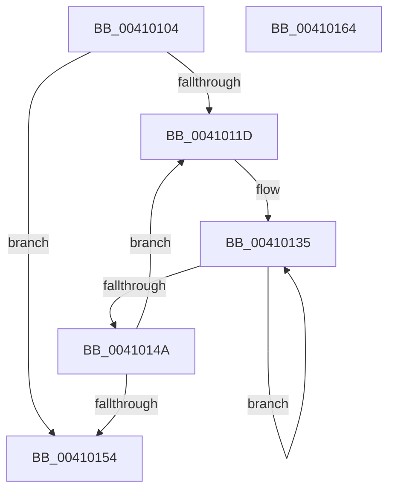

# ExHeapLookasideRebalance

- RVA: `0x00410104`–`0x00410165` (길이 `97` bytes)
- VA: `0x0000000140410104`
- 실행 섹션: `.text`
- PDB 이름 있음: `예`; PDB Function 태그: `아니요`
- unwind 정보 RVA: `0x00060BC4`
- 디코드: `26`개 명령, `97/97` bytes 표시
- 미해석 바이트: `0` (있으면 어셈블리에 `.byte`로 보존)

> 이 문서는 커널 이미지의 기계어와 PDB 기호를 분석해 생성했습니다. 4번과 5번은 함수 원형과 자료형을 바이너리 사용 방식에서 추정한 C 해석이며 원본 소스 복구 결과는 아닙니다.

## 1. Dependencies

- 직접 호출 지점: **1**; 고유 호출 대상: **1**
- 직접 호출자로 확인된 함수: **1**
- RIP 상대 이미지 참조: **2**

### Outgoing calls
- `0x00410138` → [RtlpDynamicLookasideRebalance](RtlpDynamicLookasideRebalance_function_0041016C.md) (function, `0x0041016C`)

### Direct callers
- [ExpScanSystemLookasideList](../40/ExpScanSystemLookasideList_function_0040FEE4.md) at `0x0040FFF1`

### Static image references
- `0x00410115` → RVA `0x00E6BF10` (`.data`; read)
- `0x0041012B` → RVA `0x00E6BF80` (`.data`; read)

## 2. Other-region calls and transfers

- 다른 실행 섹션으로 향하는 call: **0**
- 별도 외부 분기/꼬리 이동을 확인하지 못했습니다.

## 3. Assembly (complete function range)

```asm
00410104  48 89 5C 24 08                  mov qword ptr [rsp + 8], rbx
00410109  48 89 74 24 10                  mov qword ptr [rsp + 0x10], rsi
0041010E  57                              push rdi
0041010F  48 83 EC 20                     sub rsp, 0x20
00410113  33 DB                           xor ebx, ebx
00410115  39 1D F5 BD A5 00               cmp dword ptr [rip + 0xa5bdf5], ebx
0041011B  76 37                           jbe 0x140410154
0041011D  8B C3                           mov eax, ebx
0041011F  BE 02 00 00 00                  mov esi, 2
00410124  48 69 F8 C0 20 00 00            imul rdi, rax, 0x20c0
0041012B  48 8D 05 4E BE A5 00            lea rax, [rip + 0xa5be4e]
00410132  48 03 F8                        add rdi, rax
00410135  48 8B CF                        mov rcx, rdi
00410138  E8 2F 00 00 00                  call 0x14041016c
0041013D  48 81 C7 40 10 00 00            add rdi, 0x1040
00410144  48 83 EE 01                     sub rsi, 1
00410148  75 EB                           jne 0x140410135
0041014A  FF C3                           inc ebx
0041014C  3B 1D BE BD A5 00               cmp ebx, dword ptr [rip + 0xa5bdbe]
00410152  72 C9                           jb 0x14041011d
00410154  48 8B 5C 24 30                  mov rbx, qword ptr [rsp + 0x30]
00410159  48 8B 74 24 38                  mov rsi, qword ptr [rsp + 0x38]
0041015E  48 83 C4 20                     add rsp, 0x20
00410162  5F                              pop rdi
00410163  C3                              ret
00410164  CC                              int3
```

## 4. C-style interpretation (structured pseudocode)

```c
__int64 __fastcall ExHeapLookasideRebalance(void)
{
    __int64 result;
    __int64 v_rbx;
    __int64 v_rdi;
    __int64 v_rsi;
    __int64 v_rsp;
    unsigned __int64 v_stack_p10;
    unsigned __int64 v_stack_p8;

    v_stack_p8 = v_rbx;
    v_stack_p10 = v_rsi;
    v_rsp = (v_rsp) - (32);
    v_rbx = 0;
    if ((*(unsigned int *)(v_rip + 10862069)) <= 0) goto loc_00410154;
loc_0041011D:
    v_rdi = (v_rdi) * (0);
    v_rdi = (v_rdi) + (v_rip + 10862158);
loc_00410135:
    result = RtlpDynamicLookasideRebalance(v_rdi, a2, a3, a4);
    v_rdi = (v_rdi) + (0x1040ULL);
    v_rsi = (2) - (1);
    if (condition_is_not_equal) goto loc_00410135;
    v_rbx = (unsigned int)((v_rbx) + 1);
    if (((unsigned int)(v_rbx)) < (*(unsigned int *)(v_rip + 10862014))) goto loc_0041011D;
loc_00410154:
    v_rsp = (v_rsp) + (32);
    return result;
}
```

## 5. (Beta) C Style

```c
void ExHeapLookasideRebalance(void)
{
    int64_t result;
    int64_t local_rbx;
    int64_t local_rdi;
    int64_t local_rsi;
    int64_t local_rsp;
    uint64_t v_stack_p10;
    uint64_t v_stack_p8;

    v_stack_p8 = local_rbx;
    v_stack_p10 = local_rsi;
    local_rsp = (local_rsp) - (32);
    local_rbx = 0;
    if ((*(uint32_t *)(v_rip + 0xA5BDF5)) <= 0) goto loc_00410154;
loc_0041011D:
    local_rdi = (local_rdi) * (0);
    local_rdi = (local_rdi) + (v_rip + 10862158);
loc_00410135:
    result = RtlpDynamicLookasideRebalance(local_rdi, a2, a3, a4);
    local_rdi = (local_rdi) + (0x1040ULL);
    local_rsi = (2) - (1);
    if (condition_is_not_equal) goto loc_00410135;
    local_rbx = (uint32_t)((local_rbx) + 1);
    if (((uint32_t)(local_rbx)) < (*(uint32_t *)(v_rip + 0xA5BDBE))) goto loc_0041011D;
loc_00410154:
    local_rsp = (local_rsp) + (32);
    return result;
}
```

## 6. Execution-region graph

[열기: 2D/3D 그래프와 함수 탐색 컨트롤 패널](../../../control-panel.html?section=text&rva=0x00410104&view=graph)

- 2D 그래프는 위에서 아래로 흐르고, 3D 그래프는 빈 공간을 드래그해 회전합니다. Shift+드래그는 이동, 휠은 확대·축소, 함수 노드 선택은 대상 보고서 이동입니다.

### Static fallback


