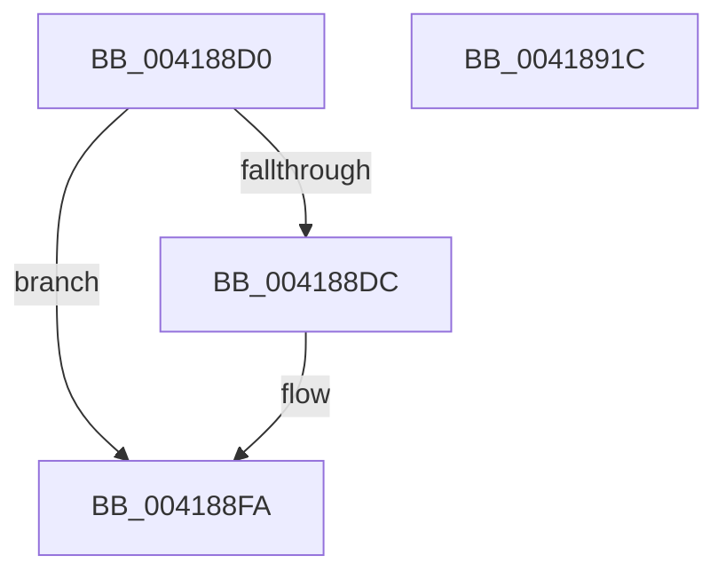

# ExInitializeFastOwnerEntry

- RVA: `0x004188D0`–`0x0041891D` (길이 `77` bytes)
- VA: `0x00000001404188D0`
- 실행 섹션: `.text`
- PDB 이름 있음: `예`; PDB Function 태그: `아니요`
- unwind 정보 RVA: `0x0005D2F4`
- 디코드: `21`개 명령, `77/77` bytes 표시
- 미해석 바이트: `0` (있으면 어셈블리에 `.byte`로 보존)

> 이 문서는 커널 이미지의 기계어와 PDB 기호를 분석해 생성했습니다. 4번과 5번은 함수 원형과 자료형을 바이너리 사용 방식에서 추정한 C 해석이며 원본 소스 복구 결과는 아닙니다.

## 1. Dependencies

- 직접 호출 지점: **1**; 고유 호출 대상: **1**
- 직접 호출자로 확인된 함수: **1**
- RIP 상대 이미지 참조: **0**

### Outgoing calls
- `0x004188F4` → [KeBugCheckEx](../4F/KeBugCheckEx_function_004FD660.md) (function, `0x004FD660`)

### Direct callers
- [DifExInitializeFastOwnerEntryWrapper](../62/DifExInitializeFastOwnerEntryWrapper_function_006206F0.md) at `0x006207B6`

### Static image references
- 디코드된 RIP-relative 메모리 참조가 없습니다.

## 2. Other-region calls and transfers

- 다른 실행 섹션으로 향하는 call: **0**
- 별도 외부 분기/꼬리 이동을 확인하지 못했습니다.

## 3. Assembly (complete function range)

```asm
004188D0  48 83 EC 38                     sub rsp, 0x38
004188D4  44 0F 20 C0                     mov rax, cr8
004188D8  3C 02                           cmp al, 2
004188DA  76 1E                           jbe 0x1404188fa
004188DC  33 D2                           xor edx, edx
004188DE  44 0F B6 C0                     movzx r8d, al
004188E2  B9 C6 01 00 00                  mov ecx, 0x1c6
004188E7  48 C7 44 24 20 00 00 00 00      mov qword ptr [rsp + 0x20], 0
004188F0  44 8D 4A 02                     lea r9d, [rdx + 2]
004188F4  E8 67 4D 0E 00                  call 0x1404fd660
004188F9  CC                              int3
004188FA  0F 57 C0                        xorps xmm0, xmm0
004188FD  33 C0                           xor eax, eax
004188FF  0F 11 01                        movups xmmword ptr [rcx], xmm0
00418902  0F 11 41 10                     movups xmmword ptr [rcx + 0x10], xmm0
00418906  48 89 41 20                     mov qword ptr [rcx + 0x20], rax
0041890A  65 48 8B 04 25 88 01 00 00      mov rax, qword ptr gs:[0x188]
00418913  48 89 41 10                     mov qword ptr [rcx + 0x10], rax
00418917  48 83 C4 38                     add rsp, 0x38
0041891B  C3                              ret
0041891C  CC                              int3
```

## 4. C-style interpretation (structured pseudocode)

```c
__int64 __fastcall ExInitializeFastOwnerEntry(__int64 a1, int a2)
{
    __int64 result;
    __int64 v_rsp;
    unsigned __int64 v_stack_m18;

    v_rsp = (v_rsp) - (56);
    result = v_cr8;
    if (((unsigned __int8)(v_cr8)) >= = 2) {
        a2 = 0;
        a3 = (unsigned __int8)(v_cr8);
        a1 = 454;
        v_stack_m18 = 0;
        a4 = a2 + 2;
        result = KeBugCheckEx(a1, a2, a3, a4);
    }
    result = 0;
    *(unsigned __int64 *)(a1) = v_xmm0;
    *(unsigned __int64 *)(a1 + 16) = v_xmm0;
    *(unsigned __int64 *)(a1 + 32) = 0;
    *(unsigned __int64 *)(a1 + 16) = *(unsigned __int64 *)(gs_base + (0 + 392));
    v_rsp = (v_rsp) + (56);
    return *(unsigned __int64 *)(gs_base + (0 + 392));
}
```

## 5. (Beta) C Style

```c
int64_t ExInitializeFastOwnerEntry(int64_t Arg1, int32_t Arg2)
{
    int64_t result;
    int64_t local_rsp;
    uint64_t v_stack_m18;

    local_rsp = (local_rsp) - (56);
    result = v_cr8;
    if (((uint8_t)(v_cr8)) >= = 2) {
        Arg2 = 0;
        a3 = (uint8_t)(v_cr8);
        Arg1 = 454;
        v_stack_m18 = 0;
        a4 = Arg2 + 2;
        result = KeBugCheckEx(Arg1, Arg2, a3, a4);
    }
    result = 0;
    *(uint64_t *)(Arg1) = v_xmm0;
    *(uint64_t *)(Arg1 + 0x10) = v_xmm0;
    *(uint64_t *)(Arg1 + 0x20) = 0;
    *(uint64_t *)(Arg1 + 0x10) = *(uint64_t *)(gs_base + (0 + 0x188));
    local_rsp = (local_rsp) + (56);
    return *(uint64_t *)(gs_base + (0 + 0x188));
}
```

## 6. Execution-region graph

[열기: 2D/3D 그래프와 함수 탐색 컨트롤 패널](../../../control-panel.html?section=text&rva=0x004188D0&view=graph)

- 2D 그래프는 위에서 아래로 흐르고, 3D 그래프는 빈 공간을 드래그해 회전합니다. Shift+드래그는 이동, 휠은 확대·축소, 함수 노드 선택은 대상 보고서 이동입니다.

### Static fallback


