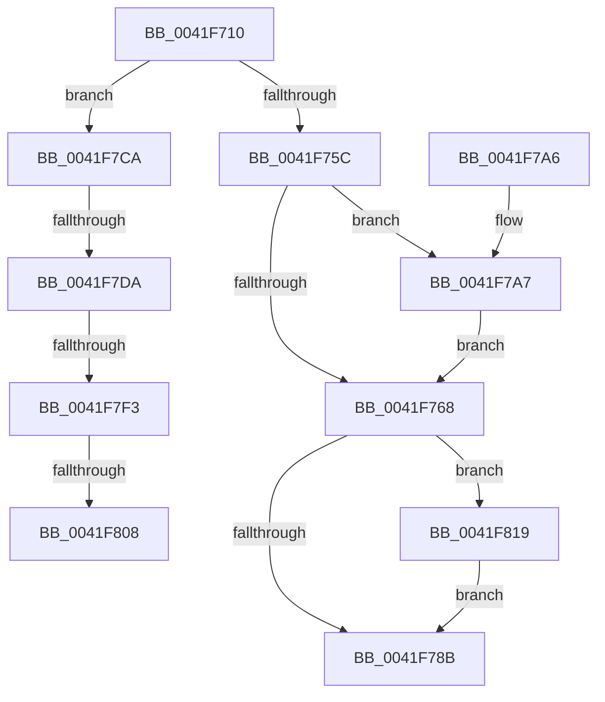

# ExInitializeResourceLite2

- RVA: `0x0041F710`–`0x0041F831` (길이 `289` bytes)
- VA: `0x000000014041F710`
- 실행 섹션: `.text`
- PDB 이름 있음: `예`; PDB Function 태그: `예`
- unwind 정보 RVA: `0x00066F24`
- 디코드: `75`개 명령, `289/289` bytes 표시
- 미해석 바이트: `0` (있으면 어셈블리에 `.byte`로 보존)

> 이 문서는 커널 이미지의 기계어와 PDB 기호를 분석해 생성했습니다. 4번과 5번은 함수 원형과 자료형을 바이너리 사용 방식에서 추정한 C 해석이며 원본 소스 복구 결과는 아닙니다.

## 1. Dependencies

- 직접 호출 지점: **6**; 고유 호출 대상: **6**
- 직접 호출자로 확인된 함수: **21**
- RIP 상대 이미지 참조: **3**

### Outgoing calls
- `0x0041F734` → [memset](../6C/memset_function_006C6C40.md) (function, `0x006C6C40`)
- `0x0041F76E` → [ExpAddResourceToSystemResourceList](ExpAddResourceToSystemResourceList_function_0041FA30.md) (function, `0x0041FA30`)
- `0x0041F7E2` → [RtlStdLogStackTrace](../49/RtlStdLogStackTrace_function_00495BF8.md) (function, `0x00495BF8`)
- `0x0041F7F9` → [RtlpStdGetRecordedStackTraceIndex](../49/RtlpStdGetRecordedStackTraceIndex_function_00495C84.md) (function, `0x00495C84`)
- `0x0041F80E` → [RtlStdReleaseStackTrace](../49/RtlStdReleaseStackTrace_function_00495D58.md) (function, `0x00495D58`)
- `0x0041F827` → [PerfLogExecutiveResourceInitialize](../65/PerfLogExecutiveResourceInitialize_function_006525E8.md) (function, `0x006525E8`)

### Direct callers
- [CcPinFileData](../33/CcPinFileData_function_0033FB40.md) at `0x00340182`
- [CcAllocateInitializeBcb](CcAllocateInitializeBcb_function_0041F5A4.md) at `0x0041F618`
- [RtlpCreateHeap](../4E/RtlpCreateHeap_function_004E1904.md) at `0x004E2224`
- [SepCreateTokenEx](../4E/SepCreateTokenEx_function_004E9CD0.md) at `0x004EA2F7`
- [DifExInitializeResourceLiteWrapper](../62/DifExInitializeResourceLiteWrapper_function_006210C0.md) at `0x00621190`
- [FsRtlInitSystem](../../init/C2/FsRtlInitSystem_function_00C28EEC.md) at `0x00C28F30`
- [IoInitSystemPreDrivers](../../init/C2/IoInitSystemPreDrivers_function_00C2AC3C.md) at `0x00C2ACD4`
- [IoInitSystemPreDrivers](../../init/C2/IoInitSystemPreDrivers_function_00C2AC3C.md) at `0x00C2ACE2`
- [IoInitSystemPreDrivers](../../init/C2/IoInitSystemPreDrivers_function_00C2AC3C.md) at `0x00C2ACF0`
- [IoInitSystemPreDrivers](../../init/C2/IoInitSystemPreDrivers_function_00C2AC3C.md) at `0x00C2ACFE`
- [IoInitSystemPreDrivers](../../init/C2/IoInitSystemPreDrivers_function_00C2AC3C.md) at `0x00C2AD0C`
- [IopInitializePlugPlayServices](../../init/C2/IopInitializePlugPlayServices_function_00C2F298.md) at `0x00C2FA43`
- [IopInitializePlugPlayServices](../../init/C2/IopInitializePlugPlayServices_function_00C2F298.md) at `0x00C2FA51`
- [IopInitializePlugPlayServices](../../init/C2/IopInitializePlugPlayServices_function_00C2F298.md) at `0x00C2FA5F`
- [IopInitializePlugPlayServices](../../init/C2/IopInitializePlugPlayServices_function_00C2F298.md) at `0x00C2FAF0`
- [PnpInitPhase0](../../init/C3/PnpInitPhase0_function_00C32820.md) at `0x00C32830`
- [PpInitializeBootDDB](../../init/C3/PpInitializeBootDDB_function_00C34018.md) at `0x00C34057`
- [PiSwInit](../../init/C3/PiSwInit_function_00C3567C.md) at `0x00C3573D`
- [PipDmgInitPhaseZero](../../init/C3/PipDmgInitPhaseZero_function_00C358C0.md) at `0x00C35919`
- [PopInitializeAdpm](../../init/C4/PopInitializeAdpm_function_00C43B1C.md) at `0x00C43B2A`
- [PopDripsWatchdogInitialize](../../init/C4/PopDripsWatchdogInitialize_function_00C43BCC.md) at `0x00C43BDF`
- [SepInitializeWorkList](../../init/C4/SepInitializeWorkList_function_00C482F0.md) at `0x00C48300`
- [SepInitializeWorkList](../../init/C4/SepInitializeWorkList_function_00C482F0.md) at `0x00C48369`
- [SepRmDbInitialization](../../init/C4/SepRmDbInitialization_function_00C4BAF4.md) at `0x00C4BB10`
- [SepRmDbInitialization](../../init/C4/SepRmDbInitialization_function_00C4BAF4.md) at `0x00C4BB29`
- [WMIInitialize](../../init/C4/WMIInitialize_function_00C4D264.md) at `0x00C4D2BF`
- [ExpInitSystemPhase0](../../init/C5/ExpInitSystemPhase0_function_00C5136C.md) at `0x00C51440`
- [CmInitSystem1](../../init/C5/CmInitSystem1_function_00C559CC.md) at `0x00C55B6C`
- [MiInitializeLoadedModuleList](../../init/C6/MiInitializeLoadedModuleList_function_00C6BCDC.md) at `0x00C6BD23`
- [PoInitSystem](../../init/C7/PoInitSystem_function_00C72358.md) at `0x00C7283F`

### Static image references
- `0x0041F750` → RVA `0x00FC42C0` (`.data`; read)
- `0x0041F77B` → RVA `0x00FC6B04` (`ALMOSTRO`; read)
- `0x0041F7CA` → RVA `0x00F05C48` (`.data`; read)

## 2. Other-region calls and transfers

- 다른 실행 섹션으로 향하는 call: **0**
- call이 아닌 외부 분기/꼬리 이동: **4**
  - `0x0041F7D4` → [sub_006ED980 + 0x4](../6E/Unknown_function_006ED980.md) (`tail-transfer`)
  - `0x0041F7ED` → [sub_006ED980](../6E/Unknown_function_006ED980.md) (`tail-transfer`)
  - `0x0041F802` → [sub_006ED980 + 0x2](../6E/Unknown_function_006ED980.md) (`tail-transfer`)
  - `0x0041F814` → [sub_006ED980 + 0x2](../6E/Unknown_function_006ED980.md) (`tail-transfer`)

## 3. Assembly (complete function range)

```asm
0041F710  48 89 5C 24 08                  mov qword ptr [rsp + 8], rbx
0041F715  48 89 6C 24 10                  mov qword ptr [rsp + 0x10], rbp
0041F71A  48 89 74 24 18                  mov qword ptr [rsp + 0x18], rsi
0041F71F  57                              push rdi
0041F720  41 56                           push r14
0041F722  41 57                           push r15
0041F724  48 83 EC 20                     sub rsp, 0x20
0041F728  44 8B FA                        mov r15d, edx
0041F72B  48 8B F9                        mov rdi, rcx
0041F72E  33 D2                           xor edx, edx
0041F730  44 8D 42 68                     lea r8d, [rdx + 0x68]
0041F734  E8 07 75 2A 00                  call 0x1406c6c40
0041F739  48 89 7F 08                     mov qword ptr [rdi + 8], rdi
0041F73D  33 C0                           xor eax, eax
0041F73F  48 89 3F                        mov qword ptr [rdi], rdi
0041F742  33 DB                           xor ebx, ebx
0041F744  48 89 47 20                     mov qword ptr [rdi + 0x20], rax
0041F748  48 89 47 28                     mov qword ptr [rdi + 0x28], rax
0041F74C  48 89 5F 60                     mov qword ptr [rdi + 0x60], rbx
0041F750  F7 05 66 4B BA 00 00 20 00 00   test dword ptr [rip + 0xba4b66], 0x2000
0041F75A  75 6E                           jne 0x14041f7ca
0041F75C  83 C9 FF                        or ecx, 0xffffffff
0041F75F  48 89 5F 58                     mov qword ptr [rdi + 0x58], rbx
0041F763  44 3B F9                        cmp r15d, ecx
0041F766  75 3F                           jne 0x14041f7a7
0041F768  89 4F 54                        mov dword ptr [rdi + 0x54], ecx
0041F76B  48 8B CF                        mov rcx, rdi
0041F76E  E8 BD 02 00 00                  call 0x14041fa30
0041F773  65 FF 04 25 58 90 00 00         inc dword ptr gs:[0x9058]
0041F77B  F7 05 7F 73 BA 00 00 00 02 00   test dword ptr [rip + 0xba737f], 0x20000
0041F785  0F 85 8E 00 00 00               jne 0x14041f819
0041F78B  48 8B 5C 24 40                  mov rbx, qword ptr [rsp + 0x40]
0041F790  33 C0                           xor eax, eax
0041F792  48 8B 6C 24 48                  mov rbp, qword ptr [rsp + 0x48]
0041F797  48 8B 74 24 50                  mov rsi, qword ptr [rsp + 0x50]
0041F79C  48 83 C4 20                     add rsp, 0x20
0041F7A0  41 5F                           pop r15
0041F7A2  41 5E                           pop r14
0041F7A4  5F                              pop rdi
0041F7A5  C3                              ret
0041F7A6  CC                              int3
0041F7A7  41 8D 8F 9F 0F 00 00            lea ecx, [r15 + 0xf9f]
0041F7AE  48 B8 77 BE 9F 1A 2F DD 24 06   movabs rax, 0x624dd2f1a9fbe77
0041F7B8  48 F7 E1                        mul rcx
0041F7BB  48 2B CA                        sub rcx, rdx
0041F7BE  48 D1 E9                        shr rcx, 1
0041F7C1  48 03 CA                        add rcx, rdx
0041F7C4  48 C1 E9 0B                     shr rcx, 0xb
0041F7C8  EB 9E                           jmp 0x14041f768
0041F7CA  48 8B 35 77 64 AE 00            mov rsi, qword ptr [rip + 0xae6477]
0041F7D1  48 85 F6                        test rsi, rsi
0041F7D4  0F 84 AA E1 2C 00               je 0x1406ed984
0041F7DA  BA 01 00 00 00                  mov edx, 1
0041F7DF  48 8B CE                        mov rcx, rsi
0041F7E2  E8 11 64 07 00                  call 0x140495bf8
0041F7E7  4C 8B F0                        mov r14, rax
0041F7EA  48 85 C0                        test rax, rax
0041F7ED  0F 84 8D E1 2C 00               je 0x1406ed980
0041F7F3  48 8B D0                        mov rdx, rax
0041F7F6  48 8B CE                        mov rcx, rsi
0041F7F9  E8 86 64 07 00                  call 0x140495c84
0041F7FE  8B E8                           mov ebp, eax
0041F800  85 C0                           test eax, eax
0041F802  0F 85 7A E1 2C 00               jne 0x1406ed982
0041F808  49 8B D6                        mov rdx, r14
0041F80B  48 8B CE                        mov rcx, rsi
0041F80E  E8 45 65 07 00                  call 0x140495d58
0041F813  90                              nop
0041F814  E9 69 E1 2C 00                  jmp 0x1406ed982
0041F819  45 33 C9                        xor r9d, r9d
0041F81C  45 33 C0                        xor r8d, r8d
0041F81F  48 8B D7                        mov rdx, rdi
0041F822  B9 08 00 01 00                  mov ecx, 0x10008
0041F827  E8 BC 2D 23 00                  call 0x1406525e8
0041F82C  E9 5A FF FF FF                  jmp 0x14041f78b
```

## 4. C-style interpretation (structured pseudocode)

```c
__int64 __fastcall ExInitializeResourceLite2(__int64 a1, int a2, __int64 a3, int a4)
{
    __int64 result;
    __int64 v_rbx;
    __int64 v_rsp;
    unsigned __int64 v_stack_p10;
    unsigned __int64 v_stack_p18;
    unsigned __int64 v_stack_p8;

    v_stack_p8 = v_rbx;
    v_stack_p10 = v_rbp;
    v_stack_p18 = v_rsi;
    v_rsp = (v_rsp) - (32);
    a2 = 0;
    result = memset(a1, a2, a2 + 104, a4);
    *(unsigned __int64 *)(a1 + 8) = a1;
    result = 0;
    *(unsigned __int64 *)(a1) = a1;
    v_rbx = 0;
    *(unsigned __int64 *)(a1 + 32) = 0;
    *(unsigned __int64 *)(a1 + 40) = 0;
    *(unsigned __int64 *)(a1 + 96) = 0;
    if (((*(unsigned int *)(v_rip + 12208998)) & (0x2000ULL)) != 0) goto loc_0041F7CA;
    a1 = (unsigned int)((a1) | (0xFFFFFFFFULL));
    *(unsigned __int64 *)(a1 + 88) = 0;
    if (((unsigned int)((unsigned int)(a2))) != ((unsigned int)(a1))) goto loc_0041F7A7;
loc_0041F768:
    *(unsigned int *)(a1 + 84) = (unsigned int)(a1);
    result = ExpAddResourceToSystemResourceList(a1, a2, a2 + 104, a4);
    if (((*(unsigned int *)(v_rip + 12219263)) & (0x20000ULL)) != 0) goto loc_0041F819;
loc_0041F78B:
    result = 0;
    v_rsp = (v_rsp) + (32);
    return result;
loc_0041F7A7:
    a1 = ((unsigned int)(a2) + 3999) - (0);
    a1 = (a1) >> (1);
    a1 = (a1) + (0);
    a1 = (a1) >> (11);
    goto loc_0041F768;
loc_0041F7CA:
    result = RtlStdLogStackTrace(*(unsigned __int64 *)(v_rip + 11428983), 1, a2 + 104, a4);
    result = RtlpStdGetRecordedStackTraceIndex(*(unsigned __int64 *)(v_rip + 11428983), result, a2 + 104, a4);
    result = RtlStdReleaseStackTrace(*(unsigned __int64 *)(v_rip + 11428983), result, a2 + 104, a4);
loc_0041F819:
    a4 = 0;
    a3 = 0;
    result = PerfLogExecutiveResourceInitialize((unsigned int)(0x10008ULL), a1, a3, a4);
    goto loc_0041F78B;
}
```

## 5. (Beta) C Style

```c
int64_t ExInitializeResourceLite2(void *ResourceLite2, int32_t Arg2, int64_t Arg3, int32_t Arg4)
{
    uint8_t *resourceLite2 = (uint8_t *)ResourceLite2;

    int64_t result;
    int64_t local_rbx;
    int64_t local_rsp;
    uint64_t v_stack_p10;
    uint64_t v_stack_p18;
    uint64_t v_stack_p8;

    v_stack_p8 = local_rbx;
    v_stack_p10 = local_rbp;
    v_stack_p18 = local_rsi;
    local_rsp = (local_rsp) - (32);
    Arg2 = 0;
    result = memset(ResourceLite2, Arg2, Arg2 + 104, Arg4);
    *(void **)(resourceLite2 + 0x8) = ResourceLite2;
    result = 0;
    *(void **)(resourceLite2) = ResourceLite2;
    local_rbx = 0;
    *(uint64_t *)(resourceLite2 + 0x20) = 0;
    *(uint64_t *)(resourceLite2 + 0x28) = 0;
    *(uint64_t *)(resourceLite2 + 0x60) = 0;
    if (((*(uint32_t *)(v_rip + 0xBA4B66)) & (0x2000ULL)) != 0) goto loc_0041F7CA;
    ResourceLite2 = (uint32_t)((ResourceLite2) | (0xFFFFFFFFULL));
    *(uint64_t *)(resourceLite2 + 0x58) = 0;
    if (((uint32_t)((uint32_t)(Arg2))) != ((uint32_t)(ResourceLite2))) goto loc_0041F7A7;
loc_0041F768:
    *(uint32_t *)(resourceLite2 + 0x54) = (uint32_t)(ResourceLite2);
    result = ExpAddResourceToSystemResourceList(ResourceLite2, Arg2, Arg2 + 104, Arg4);
    if (((*(uint32_t *)(v_rip + 0xBA737F)) & (0x20000ULL)) != 0) goto loc_0041F819;
loc_0041F78B:
    result = 0;
    local_rsp = (local_rsp) + (32);
    return result;
loc_0041F7A7:
    ResourceLite2 = ((uint32_t)(Arg2) + 3999) - (0);
    ResourceLite2 = (ResourceLite2) >> (1);
    ResourceLite2 = (ResourceLite2) + (0);
    ResourceLite2 = (ResourceLite2) >> (11);
    goto loc_0041F768;
loc_0041F7CA:
    result = RtlStdLogStackTrace(*(uint64_t *)(v_rip + 0xAE6477), 1, Arg2 + 104, Arg4);
    result = RtlpStdGetRecordedStackTraceIndex(*(uint64_t *)(v_rip + 0xAE6477), result, Arg2 + 104, Arg4);
    result = RtlStdReleaseStackTrace(*(uint64_t *)(v_rip + 0xAE6477), result, Arg2 + 104, Arg4);
loc_0041F819:
    Arg4 = 0;
    Arg3 = 0;
    result = PerfLogExecutiveResourceInitialize((uint32_t)(0x10008ULL), ResourceLite2, Arg3, Arg4);
    goto loc_0041F78B;
}
```

### 관측된 메모리 오프셋

구조체 형식이 확인되지 않은 접근은 인자 기준의 오프셋으로만 기록했습니다.

| 기준 인자 | 오프셋 표현 | 폭 (bit) | 접근 |
|---|---:|---:|---|
| `ResourceLite2` | `+ 0x0` | `64` | `W` |
| `ResourceLite2` | `+ 0x8` | `64` | `W` |
| `ResourceLite2` | `+ 0x20` | `64` | `W` |
| `ResourceLite2` | `+ 0x28` | `64` | `W` |
| `ResourceLite2` | `+ 0x54` | `32` | `W` |
| `ResourceLite2` | `+ 0x58` | `64` | `W` |
| `ResourceLite2` | `+ 0x60` | `64` | `W` |

## 6. Execution-region graph

[열기: 2D/3D 그래프와 함수 탐색 컨트롤 패널](../../../control-panel.html?section=text&rva=0x0041F710&view=graph)

- 2D 그래프는 위에서 아래로 흐르고, 3D 그래프는 빈 공간을 드래그해 회전합니다. Shift+드래그는 이동, 휠은 확대·축소, 함수 노드 선택은 대상 보고서 이동입니다.

### Static fallback


