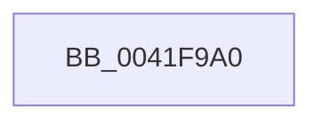

# ExInitializeResourceLite

- RVA: `0x0041F9A0`–`0x0041F9A8` (길이 `8` bytes)
- VA: `0x000000014041F9A0`
- 실행 섹션: `.text`
- PDB 이름 있음: `예`; PDB Function 태그: `예`
- unwind 정보 RVA: `0x0009FE84`
- 디코드: `3`개 명령, `8/8` bytes 표시
- 미해석 바이트: `0` (있으면 어셈블리에 `.byte`로 보존)

> 이 문서는 커널 이미지의 기계어와 PDB 기호를 분석해 생성했습니다. 4번과 5번은 함수 원형과 자료형을 바이너리 사용 방식에서 추정한 C 해석이며 원본 소스 복구 결과는 아닙니다.

## 1. Dependencies

- 직접 호출 지점: **0**; 고유 호출 대상: **0**
- 직접 호출자로 확인된 함수: **21**
- RIP 상대 이미지 참조: **0**

### Outgoing calls
- 직접 디코드된 call 명령이 없습니다.

### Direct callers
- [FsRtlInitializeDedupChange](../../page/71/FsRtlInitializeDedupChange_function_00715E00.md) at `0x00715E20`
- [FsRtlInitializeTieringHeat](../../page/71/FsRtlInitializeTieringHeat_function_00716938.md) at `0x00716958`
- [IopInitializeBootLogging](../../page/71/IopInitializeBootLogging_function_0071B748.md) at `0x0071B7A2`
- [PiPnpRtlInit](../../page/73/PiPnpRtlInit_function_007300A4.md) at `0x007300DA`
- [PiPnpRtlInit](../../page/73/PiPnpRtlInit_function_007300A4.md) at `0x007300F0`
- [PiDmObjectManagerInit](../../page/73/PiDmObjectManagerInit_function_00730548.md) at `0x00730557`
- [PiDqObjectManagerInit](../../page/73/PiDqObjectManagerInit_function_00731A18.md) at `0x00731A3D`
- [PiDrvDbCreateNode](../../page/74/PiDrvDbCreateNode_function_00740AFC.md) at `0x00740CA9`
- [PfSnPrefetchCacheCtxInitialize](../../page/75/PfSnPrefetchCacheCtxInitialize_function_007523E8.md) at `0x00752412`
- [TtmInit](../../page/77/TtmInit_function_00776D80.md) at `0x00776D90`
- [TtmiInitTerminals](../../page/77/TtmiInitTerminals_function_0077CA40.md) at `0x0077CAA0`
- [TtmiCreateEventQueue](../../page/77/TtmiCreateEventQueue_function_0077DA14.md) at `0x0077DAEC`
- [AdtpObjsInitialize](../../page/82/AdtpObjsInitialize_function_00822B30.md) at `0x00822B8D`
- [PnpCtxOpenMachine](../../page/82/PnpCtxOpenMachine_function_00828FB0.md) at `0x008290EE`
- [DrvDbOpenContext](../../page/83/DrvDbOpenContext_function_00834F8C.md) at `0x0083501C`
- [DrvDbCreateDatabaseNode](../../page/83/DrvDbCreateDatabaseNode_function_0083533C.md) at `0x00835551`
- [CmpInitCmRM](../../page/87/CmpInitCmRM_function_0087C700.md) at `0x0087C90D`
- [SepDuplicateToken](../../page/8B/SepDuplicateToken_function_008B87EC.md) at `0x008B89C4`
- [NtCreateJobObject](../../page/91/NtCreateJobObject_function_009177E0.md) at `0x0091799E`
- [SepFilterToken](../../page/9C/SepFilterToken_function_009C6B80.md) at `0x009C6DEA`
- [MUIInitializeResourceLock](../../page/9E/MUIInitializeResourceLock_function_009ECB08.md) at `0x009ECB55`
- [PnpInitializeNotifyEntry](../../page/A4/PnpInitializeNotifyEntry_function_00A456D0.md) at `0x00A45731`

### Static image references
- 디코드된 RIP-relative 메모리 참조가 없습니다.

## 2. Other-region calls and transfers

- 다른 실행 섹션으로 향하는 call: **0**
- 별도 외부 분기/꼬리 이동을 확인하지 못했습니다.

## 3. Assembly (complete function range)

```asm
0041F9A0  40 53                           push rbx
0041F9A2  48 83 EC 20                     sub rsp, 0x20
0041F9A6  33 D2                           xor edx, edx
```

## 4. C-style interpretation (structured pseudocode)

```c
void __fastcall ExInitializeResourceLite(__int64 a1, int a2)
{
    __int64 v_rsp;

    v_rsp = (v_rsp) - (32);
    a2 = 0;
    return;
}
```

## 5. (Beta) C Style

```c
void ExInitializeResourceLite(int64_t Arg1, int32_t Arg2)
{
    int64_t local_rsp;

    local_rsp = (local_rsp) - (32);
    Arg2 = 0;
    return;
}
```

## 6. Execution-region graph

[열기: 2D/3D 그래프와 함수 탐색 컨트롤 패널](../../../control-panel.html?section=text&rva=0x0041F9A0&view=graph)

- 2D 그래프는 위에서 아래로 흐르고, 3D 그래프는 빈 공간을 드래그해 회전합니다. Shift+드래그는 이동, 휠은 확대·축소, 함수 노드 선택은 대상 보고서 이동입니다.

### Static fallback


