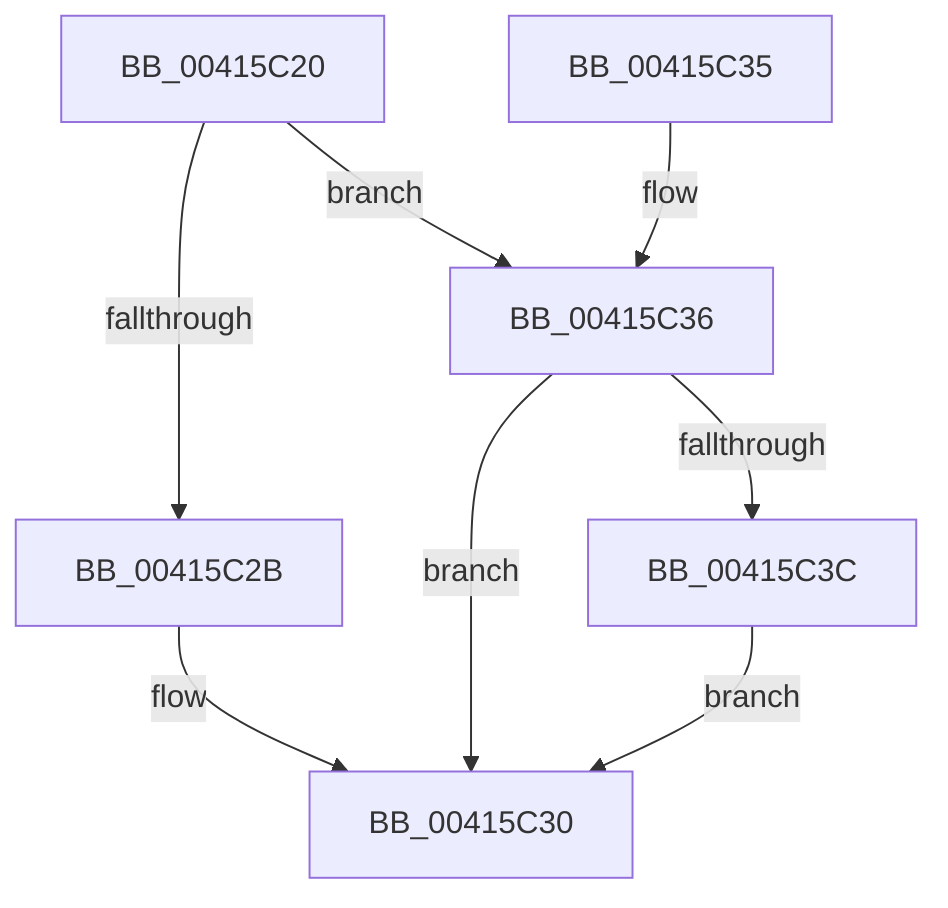

# ExMoveFastResourceOwnershipWithFlags

- RVA: `0x00415C20`–`0x00415C45` (길이 `37` bytes)
- VA: `0x0000000140415C20`
- 실행 섹션: `.text`
- PDB 이름 있음: `예`; PDB Function 태그: `아니요`
- unwind 정보 RVA: `0x0005D35C`
- 디코드: `13`개 명령, `37/37` bytes 표시
- 미해석 바이트: `0` (있으면 어셈블리에 `.byte`로 보존)

> 이 문서는 커널 이미지의 기계어와 PDB 기호를 분석해 생성했습니다. 4번과 5번은 함수 원형과 자료형을 바이너리 사용 방식에서 추정한 C 해석이며 원본 소스 복구 결과는 아닙니다.

## 1. Dependencies

- 직접 호출 지점: **2**; 고유 호출 대상: **2**
- 직접 호출자로 확인된 함수: **0**
- RIP 상대 이미지 참조: **0**

### Outgoing calls
- `0x00415C2B` → [ExpMoveSharedFastResourceOwnershipWithFlags](ExpMoveSharedFastResourceOwnershipWithFlags_function_00415C4C.md) (function, `0x00415C4C`)
- `0x00415C3E` → [ExDisownFastResource](../4A/ExDisownFastResource_function_004A2C10.md) (function, `0x004A2C10`)

### Direct callers
- 이 함수 시작 RVA로 연결되는 직접 call은 확인되지 않았습니다. 간접 호출은 완전히 역산할 수 없습니다.

### Static image references
- 디코드된 RIP-relative 메모리 참조가 없습니다.

## 2. Other-region calls and transfers

- 다른 실행 섹션으로 향하는 call: **0**
- 별도 외부 분기/꼬리 이동을 확인하지 못했습니다.

## 3. Assembly (complete function range)

```asm
00415C20  48 83 EC 28                     sub rsp, 0x28
00415C24  48 8B 01                        mov rax, qword ptr [rcx]
00415C27  A8 01                           test al, 1
00415C29  75 0B                           jne 0x140415c36
00415C2B  E8 1C 00 00 00                  call 0x140415c4c
00415C30  48 83 C4 28                     add rsp, 0x28
00415C34  C3                              ret
00415C35  CC                              int3
00415C36  41 F6 C1 01                     test r9b, 1
00415C3A  74 F4                           je 0x140415c30
00415C3C  33 D2                           xor edx, edx
00415C3E  E8 CD CF 08 00                  call 0x1404a2c10
00415C43  EB EB                           jmp 0x140415c30
```

## 4. C-style interpretation (structured pseudocode)

```c
__int64 __fastcall ExMoveFastResourceOwnershipWithFlags(__int64 a1, int a2, __int64 a3, unsigned __int8 a4)
{
    __int64 result;
    __int64 v_rsp;

    v_rsp = (v_rsp) - (40);
    if ((((unsigned __int8)(*(unsigned __int64 *)(a1))) & (1)) != 0) goto loc_00415C36;
    result = ExpMoveSharedFastResourceOwnershipWithFlags(a1, a2, a3, a4);
loc_00415C30:
    v_rsp = (v_rsp) + (40);
    return result;
loc_00415C36:
    if (((a4) & (1)) == 0) goto loc_00415C30;
    a2 = 0;
    result = ExDisownFastResource(a1, a2, a3, a4);
    goto loc_00415C30;
}
```

## 5. (Beta) C Style

```c
int64_t ExMoveFastResourceOwnershipWithFlags(void *Arg1, int32_t Arg2, int64_t Arg3, uint8_t Arg4)
{
    uint8_t *arg1 = (uint8_t *)Arg1;

    int64_t result;
    int64_t local_rsp;

    local_rsp = (local_rsp) - (40);
    if ((((uint8_t)(*(uint64_t *)(arg1))) & (1)) != 0) goto loc_00415C36;
    result = ExpMoveSharedFastResourceOwnershipWithFlags(Arg1, Arg2, Arg3, Arg4);
loc_00415C30:
    local_rsp = (local_rsp) + (40);
    return result;
loc_00415C36:
    if (((Arg4) & (1)) == 0) goto loc_00415C30;
    Arg2 = 0;
    result = ExDisownFastResource(Arg1, Arg2, Arg3, Arg4);
    goto loc_00415C30;
}
```

### 관측된 메모리 오프셋

구조체 형식이 확인되지 않은 접근은 인자 기준의 오프셋으로만 기록했습니다.

| 기준 인자 | 오프셋 표현 | 폭 (bit) | 접근 |
|---|---:|---:|---|
| `Arg1` | `+ 0x0` | `64` | `R` |

## 6. Execution-region graph

[열기: 2D/3D 그래프와 함수 탐색 컨트롤 패널](../../../control-panel.html?section=text&rva=0x00415C20&view=graph)

- 2D 그래프는 위에서 아래로 흐르고, 3D 그래프는 빈 공간을 드래그해 회전합니다. Shift+드래그는 이동, 휠은 확대·축소, 함수 노드 선택은 대상 보고서 이동입니다.

### Static fallback


