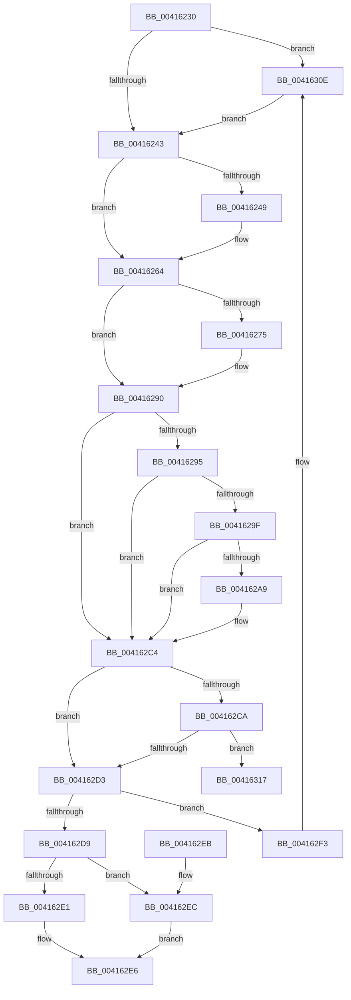

# ExReleaseDisownedFastResource

- RVA: `0x00416230`–`0x00416332` (길이 `258` bytes)
- VA: `0x0000000140416230`
- 실행 섹션: `.text`
- PDB 이름 있음: `예`; PDB Function 태그: `아니요`
- unwind 정보 RVA: `0x000892C8`
- 디코드: `70`개 명령, `258/258` bytes 표시
- 미해석 바이트: `0` (있으면 어셈블리에 `.byte`로 보존)

> 이 문서는 커널 이미지의 기계어와 PDB 기호를 분석해 생성했습니다. 4번과 5번은 함수 원형과 자료형을 바이너리 사용 방식에서 추정한 C 해석이며 원본 소스 복구 결과는 아닙니다.

## 1. Dependencies

- 직접 호출 지점: **7**; 고유 호출 대상: **3**
- 직접 호출자로 확인된 함수: **1**
- RIP 상대 이미지 참조: **0**

### Outgoing calls
- `0x0041625E` → [KeBugCheckEx](../4F/KeBugCheckEx_function_004FD660.md) (function, `0x004FD660`)
- `0x0041628A` → [KeBugCheckEx](../4F/KeBugCheckEx_function_004FD660.md) (function, `0x004FD660`)
- `0x004162BE` → [KeBugCheckEx](../4F/KeBugCheckEx_function_004FD660.md) (function, `0x004FD660`)
- `0x004162E1` → [ExpReleaseDisownedFastResourceShared](ExpReleaseDisownedFastResourceShared_function_00416338.md) (function, `0x00416338`)
- `0x004162EC` → [ExpReleaseDisownedFastResourceExclusive](ExpReleaseDisownedFastResourceExclusive_function_00416470.md) (function, `0x00416470`)
- `0x00416308` → [KeBugCheckEx](../4F/KeBugCheckEx_function_004FD660.md) (function, `0x004FD660`)
- `0x0041632C` → [KeBugCheckEx](../4F/KeBugCheckEx_function_004FD660.md) (function, `0x004FD660`)

### Direct callers
- [DifExReleaseDisownedFastResourceWrapper](../62/DifExReleaseDisownedFastResourceWrapper_function_006222D0.md) at `0x006223A7`

### Static image references
- 디코드된 RIP-relative 메모리 참조가 없습니다.

## 2. Other-region calls and transfers

- 다른 실행 섹션으로 향하는 call: **0**
- 별도 외부 분기/꼬리 이동을 확인하지 못했습니다.

## 3. Assembly (complete function range)

```asm
00416230  48 83 EC 38                     sub rsp, 0x38
00416234  48 8B 01                        mov rax, qword ptr [rcx]
00416237  41 B1 01                        mov r9b, 1
0041623A  41 84 C1                        test r9b, al
0041623D  0F 85 CB 00 00 00               jne 0x14041630e
00416243  44 84 49 1A                     test byte ptr [rcx + 0x1a], r9b
00416247  75 1B                           jne 0x140416264
00416249  48 83 64 24 20 00               and qword ptr [rsp + 0x20], 0
0041624F  45 33 C9                        xor r9d, r9d
00416252  4C 8B C1                        mov r8, rcx
00416255  B9 C6 01 00 00                  mov ecx, 0x1c6
0041625A  41 8D 51 03                     lea edx, [r9 + 3]
0041625E  E8 FD 73 0E 00                  call 0x1404fd660
00416263  CC                              int3
00416264  44 0F 20 C0                     mov rax, cr8
00416268  65 4C 8B 04 25 88 01 00 00      mov r8, qword ptr gs:[0x188]
00416271  3C 02                           cmp al, 2
00416273  76 1B                           jbe 0x140416290
00416275  48 83 64 24 20 00               and qword ptr [rsp + 0x20], 0
0041627B  33 D2                           xor edx, edx
0041627D  44 0F B6 C0                     movzx r8d, al
00416281  B9 C6 01 00 00                  mov ecx, 0x1c6
00416286  44 8D 4A 02                     lea r9d, [rdx + 2]
0041628A  E8 D1 73 0E 00                  call 0x1404fd660
0041628F  CC                              int3
00416290  41 3A C1                        cmp al, r9b
00416293  73 2F                           jae 0x1404162c4
00416295  41 F7 40 74 00 04 00 00         test dword ptr [r8 + 0x74], 0x400
0041629D  75 25                           jne 0x1404162c4
0041629F  41 83 B8 E4 01 00 00 00         cmp dword ptr [r8 + 0x1e4], 0
004162A7  75 1B                           jne 0x1404162c4
004162A9  48 83 64 24 20 00               and qword ptr [rsp + 0x20], 0
004162AF  45 33 C9                        xor r9d, r9d
004162B2  45 33 C0                        xor r8d, r8d
004162B5  B9 C6 01 00 00                  mov ecx, 0x1c6
004162BA  41 8D 51 07                     lea edx, [r9 + 7]
004162BE  E8 9D 73 0E 00                  call 0x1404fd660
004162C3  CC                              int3
004162C4  F6 42 25 02                     test byte ptr [rdx + 0x25], 2
004162C8  75 09                           jne 0x1404162d3
004162CA  48 8B 42 18                     mov rax, qword ptr [rdx + 0x18]
004162CE  48 3B C1                        cmp rax, rcx
004162D1  75 44                           jne 0x140416317
004162D3  44 84 4A 10                     test byte ptr [rdx + 0x10], r9b
004162D7  74 1A                           je 0x1404162f3
004162D9  48 8B 01                        mov rax, qword ptr [rcx]
004162DC  41 84 C1                        test r9b, al
004162DF  75 0B                           jne 0x1404162ec
004162E1  E8 52 00 00 00                  call 0x140416338
004162E6  48 83 C4 38                     add rsp, 0x38
004162EA  C3                              ret
004162EB  CC                              int3
004162EC  E8 7F 01 00 00                  call 0x140416470
004162F1  EB F3                           jmp 0x1404162e6
004162F3  48 83 64 24 20 00               and qword ptr [rsp + 0x20], 0
004162F9  45 33 C9                        xor r9d, r9d
004162FC  4C 8B C2                        mov r8, rdx
004162FF  B9 C6 01 00 00                  mov ecx, 0x1c6
00416304  41 8D 51 0D                     lea edx, [r9 + 0xd]
00416308  E8 53 73 0E 00                  call 0x1404fd660
0041630D  CC                              int3
0041630E  48 8D 51 40                     lea rdx, [rcx + 0x40]
00416312  E9 2C FF FF FF                  jmp 0x140416243
00416317  4C 8B CA                        mov r9, rdx
0041631A  48 89 44 24 20                  mov qword ptr [rsp + 0x20], rax
0041631F  4C 8B C1                        mov r8, rcx
00416322  BA 0C 00 00 00                  mov edx, 0xc
00416327  B9 C6 01 00 00                  mov ecx, 0x1c6
0041632C  E8 2F 73 0E 00                  call 0x1404fd660
00416331  CC                              int3
```

## 4. C-style interpretation (structured pseudocode)

```c
__int64 __fastcall ExReleaseDisownedFastResource(__int64 a1)
{
    __int64 result;
    __int64 v_rsp;
    unsigned __int64 v_stack_m18;
    unsigned __int64 v_stack_p20;

    v_rsp = (v_rsp) - (56);
    if (((1) & ((unsigned __int8)(*(unsigned __int64 *)(a1)))) != 0) goto loc_0041630E;
loc_00416243:
    result = *(unsigned __int64 *)(a1);
    if (((*(unsigned __int8 *)(a1 + 26)) & (1)) == 0) {
        a4 = 0;
        a3 = a1;
        a1 = 454;
        a2 = a4 + 3;
        result = KeBugCheckEx(a1, a2, a3, a4);
    }
    result = v_cr8;
    if (((unsigned __int8)(v_cr8)) >= = 2) {
        a2 = 0;
        a3 = (unsigned __int8)(v_cr8);
        a1 = 454;
        a4 = a2 + 2;
        result = KeBugCheckEx(a1, a2, a3, a4);
    }
    if (((unsigned __int8)(result)) >= ((unsigned __int8)(a4))) goto loc_004162C4;
    if (((*(unsigned int *)(a3 + 116)) & (0x400ULL)) != 0) goto loc_004162C4;
    if ((*(unsigned int *)(a3 + 484)) == 0) {
        a4 = 0;
        a3 = 0;
        a1 = 454;
        a2 = a4 + 7;
        result = KeBugCheckEx(a1, a2, a3, a4);
    }
    if (((*(unsigned __int8 *)(a2 + 37)) & (2)) != 0) goto loc_004162D3;
    if ((*(unsigned __int64 *)(a2 + 24)) != a1) goto loc_00416317;
loc_004162D3:
    if (((*(unsigned __int8 *)(a2 + 16)) & (0)) == 0) goto loc_004162F3;
    if (((0) & ((unsigned __int8)(*(unsigned __int64 *)(a1)))) != 0) goto loc_004162EC;
    result = ExpReleaseDisownedFastResourceShared(a1, a2, a3, a4);
loc_004162E6:
    v_rsp = (v_rsp) + (56);
    return result;
loc_004162EC:
    result = ExpReleaseDisownedFastResourceExclusive(a1, a2, a3, a4);
    goto loc_004162E6;
loc_004162F3:
    a4 = 0;
    result = KeBugCheckEx(454, a4 + 13, a2, a4);
loc_0041630E:
    goto loc_00416243;
loc_00416317:
    v_stack_p20 = result;
    result = KeBugCheckEx(454, 12, 454, 454 + 64);
    return result;
}
```

## 5. (Beta) C Style

```c
int64_t ExReleaseDisownedFastResource(void *Arg1)
{
    uint8_t *arg1 = (uint8_t *)Arg1;

    int64_t result;
    int64_t local_rsp;
    uint64_t v_stack_m18;
    uint64_t v_stack_p20;

    local_rsp = (local_rsp) - (56);
    if (((1) & ((uint8_t)(*(uint64_t *)(arg1)))) != 0) goto loc_0041630E;
loc_00416243:
    result = *(uint64_t *)(arg1);
    if (((*(uint8_t *)(arg1 + 0x1A)) & (1)) == 0) {
        a4 = 0;
        a3 = Arg1;
        Arg1 = 454;
        a2 = a4 + 3;
        result = KeBugCheckEx(Arg1, a2, a3, a4);
    }
    result = v_cr8;
    if (((uint8_t)(v_cr8)) >= = 2) {
        a2 = 0;
        a3 = (uint8_t)(v_cr8);
        Arg1 = 454;
        a4 = a2 + 2;
        result = KeBugCheckEx(Arg1, a2, a3, a4);
    }
    if (((uint8_t)(result)) >= ((uint8_t)(a4))) goto loc_004162C4;
    if (((*(uint32_t *)(a3 + 0x74)) & (0x400ULL)) != 0) goto loc_004162C4;
    if ((*(uint32_t *)(a3 + 0x1E4)) == 0) {
        a4 = 0;
        a3 = 0;
        Arg1 = 454;
        a2 = a4 + 7;
        result = KeBugCheckEx(Arg1, a2, a3, a4);
    }
    if (((*(uint8_t *)(a2 + 0x25)) & (2)) != 0) goto loc_004162D3;
    if ((*(uint64_t *)(a2 + 0x18)) != Arg1) goto loc_00416317;
loc_004162D3:
    if (((*(uint8_t *)(a2 + 0x10)) & (0)) == 0) goto loc_004162F3;
    if (((0) & ((uint8_t)(*(uint64_t *)(arg1)))) != 0) goto loc_004162EC;
    result = ExpReleaseDisownedFastResourceShared(Arg1, a2, a3, a4);
loc_004162E6:
    local_rsp = (local_rsp) + (56);
    return result;
loc_004162EC:
    result = ExpReleaseDisownedFastResourceExclusive(Arg1, a2, a3, a4);
    goto loc_004162E6;
loc_004162F3:
    a4 = 0;
    result = KeBugCheckEx(454, a4 + 13, a2, a4);
loc_0041630E:
    goto loc_00416243;
loc_00416317:
    v_stack_p20 = result;
    result = KeBugCheckEx(454, 12, 454, 454 + 64);
    return result;
}
```

### 관측된 메모리 오프셋

구조체 형식이 확인되지 않은 접근은 인자 기준의 오프셋으로만 기록했습니다.

| 기준 인자 | 오프셋 표현 | 폭 (bit) | 접근 |
|---|---:|---:|---|
| `Arg1` | `+ 0x0` | `64` | `R` |

## 6. Execution-region graph

[열기: 2D/3D 그래프와 함수 탐색 컨트롤 패널](../../../control-panel.html?section=text&rva=0x00416230&view=graph)

- 2D 그래프는 위에서 아래로 흐르고, 3D 그래프는 빈 공간을 드래그해 회전합니다. Shift+드래그는 이동, 휠은 확대·축소, 함수 노드 선택은 대상 보고서 이동입니다.

### Static fallback


