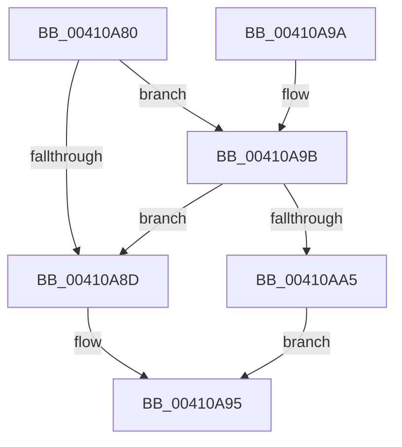

# ExTryAcquireSpinLockSharedAtDpcLevel

- RVA: `0x00410A80`–`0x00410AAC` (길이 `44` bytes)
- VA: `0x0000000140410A80`
- 실행 섹션: `.text`
- PDB 이름 있음: `예`; PDB Function 태그: `아니요`
- unwind 정보 RVA: `0x00063CEC`
- 디코드: `13`개 명령, `44/44` bytes 표시
- 미해석 바이트: `0` (있으면 어셈블리에 `.byte`로 보존)

> 이 문서는 커널 이미지의 기계어와 PDB 기호를 분석해 생성했습니다. 4번과 5번은 함수 원형과 자료형을 바이너리 사용 방식에서 추정한 C 해석이며 원본 소스 복구 결과는 아닙니다.

## 1. Dependencies

- 직접 호출 지점: **2**; 고유 호출 대상: **2**
- 직접 호출자로 확인된 함수: **2**
- RIP 상대 이미지 참조: **2**

### Outgoing calls
- `0x00410A8D` → [ExpTryAcquireSpinLockShared](ExpTryAcquireSpinLockShared_function_00410AC0.md) (function, `0x00410AC0`)
- `0x00410AA5` → [ExpTryAcquireSpinLockSharedAtDpcLevelInstrumented](ExpTryAcquireSpinLockSharedAtDpcLevelInstrumented_function_004109EC.md) (function, `0x004109EC`)

### Direct callers
- [MiFreezeIoPfnNode](../67/MiFreezeIoPfnNode_function_0067BDAC.md) at `0x0067BDF8`
- [MmReadProcessPageTables](../68/MmReadProcessPageTables_function_006866C8.md) at `0x00686705`

### Static image references
- `0x00410A84` → RVA `0x00FC6B06` (`ALMOSTRO`; read)
- `0x00410A9B` → RVA `0x00F0DE58` (`.data`; read)

## 2. Other-region calls and transfers

- 다른 실행 섹션으로 향하는 call: **0**
- 별도 외부 분기/꼬리 이동을 확인하지 못했습니다.

## 3. Assembly (complete function range)

```asm
00410A80  48 83 EC 28                     sub rsp, 0x28
00410A84  F6 05 7B 60 BB 00 21            test byte ptr [rip + 0xbb607b], 0x21
00410A8B  75 0E                           jne 0x140410a9b
00410A8D  E8 2E 00 00 00                  call 0x140410ac0
00410A92  0F B6 C0                        movzx eax, al
00410A95  48 83 C4 28                     add rsp, 0x28
00410A99  C3                              ret
00410A9A  CC                              int3
00410A9B  8B 05 B7 D3 AF 00               mov eax, dword ptr [rip + 0xafd3b7]
00410AA1  85 C0                           test eax, eax
00410AA3  75 E8                           jne 0x140410a8d
00410AA5  E8 42 FF FF FF                  call 0x1404109ec
00410AAA  EB E9                           jmp 0x140410a95
```

## 4. C-style interpretation (structured pseudocode)

```c
__int64 __fastcall ExTryAcquireSpinLockSharedAtDpcLevel(void)
{
    __int64 result;
    __int64 v_rsp;

    v_rsp = (v_rsp) - (40);
    if (((*(unsigned __int8 *)(v_rip + 12279931)) & (33)) != 0) goto loc_00410A9B;
loc_00410A8D:
    result = ExpTryAcquireSpinLockShared(a1, a2, a3, a4);
loc_00410A95:
    v_rsp = (v_rsp) + (40);
    return (unsigned __int8)(result);
loc_00410A9B:
    if ((unsigned int)((unsigned int)(*(unsigned int *)(v_rip + 11522999))) != 0) goto loc_00410A8D;
    result = ExpTryAcquireSpinLockSharedAtDpcLevelInstrumented(a1, a2, a3, a4);
    goto loc_00410A95;
}
```

## 5. (Beta) C Style

```c
void ExTryAcquireSpinLockSharedAtDpcLevel(void)
{
    int64_t result;
    int64_t local_rsp;

    local_rsp = (local_rsp) - (40);
    if (((*(uint8_t *)(v_rip + 0xBB607B)) & (33)) != 0) goto loc_00410A9B;
loc_00410A8D:
    result = ExpTryAcquireSpinLockShared(a1, a2, a3, a4);
loc_00410A95:
    local_rsp = (local_rsp) + (40);
    return (uint8_t)(result);
loc_00410A9B:
    if ((uint32_t)((uint32_t)(*(uint32_t *)(v_rip + 0xAFD3B7))) != 0) goto loc_00410A8D;
    result = ExpTryAcquireSpinLockSharedAtDpcLevelInstrumented(a1, a2, a3, a4);
    goto loc_00410A95;
}
```

## 6. Execution-region graph

[열기: 2D/3D 그래프와 함수 탐색 컨트롤 패널](../../../control-panel.html?section=text&rva=0x00410A80&view=graph)

- 2D 그래프는 위에서 아래로 흐르고, 3D 그래프는 빈 공간을 드래그해 회전합니다. Shift+드래그는 이동, 휠은 확대·축소, 함수 노드 선택은 대상 보고서 이동입니다.

### Static fallback


