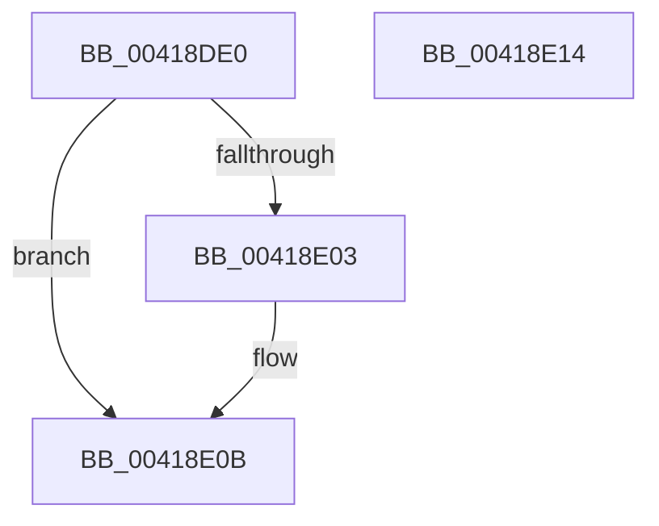

# ExfAcquireCacheAwarePushLockSharedEx

- RVA: `0x00418DE0`–`0x00418E15` (길이 `53` bytes)
- VA: `0x0000000140418DE0`
- 실행 섹션: `.text`
- PDB 이름 있음: `예`; PDB Function 태그: `아니요`
- unwind 정보 RVA: `0x0005CF00`
- 디코드: `16`개 명령, `53/53` bytes 표시
- 미해석 바이트: `0` (있으면 어셈블리에 `.byte`로 보존)

> 이 문서는 커널 이미지의 기계어와 PDB 기호를 분석해 생성했습니다. 4번과 5번은 함수 원형과 자료형을 바이너리 사용 방식에서 추정한 C 해석이며 원본 소스 복구 결과는 아닙니다.

## 1. Dependencies

- 직접 호출 지점: **1**; 고유 호출 대상: **1**
- 직접 호출자로 확인된 함수: **1**
- RIP 상대 이미지 참조: **0**

### Outgoing calls
- `0x00418E06` → [ExfAcquirePushLockSharedEx](../21/ExfAcquirePushLockSharedEx_function_0021044C.md) (function, `0x0021044C`)

### Direct callers
- [CmpLockRegistry](../../pagecmrc/BC/CmpLockRegistry_function_00BC9B34.md) at `0x00BC9BE7`

### Static image references
- 디코드된 RIP-relative 메모리 참조가 없습니다.

## 2. Other-region calls and transfers

- 다른 실행 섹션으로 향하는 call: **0**
- 별도 외부 분기/꼬리 이동을 확인하지 못했습니다.

## 3. Assembly (complete function range)

```asm
00418DE0  40 53                           push rbx
00418DE2  48 83 EC 20                     sub rsp, 0x20
00418DE6  65 8B 1C 25 A4 01 00 00         mov ebx, dword ptr gs:[0x1a4]
00418DEE  83 E3 1F                        and ebx, 0x1f
00418DF1  33 C0                           xor eax, eax
00418DF3  48 8B 1C D9                     mov rbx, qword ptr [rcx + rbx*8]
00418DF7  B9 11 00 00 00                  mov ecx, 0x11
00418DFC  F0 48 0F B1 0B                  lock cmpxchg qword ptr [rbx], rcx
00418E01  74 08                           je 0x140418e0b
00418E03  48 8B CB                        mov rcx, rbx
00418E06  E8 41 76 DF FF                  call 0x14021044c
00418E0B  48 8B C3                        mov rax, rbx
00418E0E  48 83 C4 20                     add rsp, 0x20
00418E12  5B                              pop rbx
00418E13  C3                              ret
00418E14  CC                              int3
```

## 4. C-style interpretation (structured pseudocode)

```c
__int64 __fastcall ExfAcquireCacheAwarePushLockSharedEx(__int64 a1)
{
    __int64 result;
    __int64 v_rbx;
    __int64 v_rsp;

    v_rsp = (v_rsp) - (32);
    v_rbx = (unsigned int)(((unsigned int)(*(unsigned int *)(gs_base + (0 + 420)))) & (31));
    result = 0;
    if (!(condition_is_equal)) {
        a1 = *(unsigned __int64 *)(a1 + v_rbx * 8);
        result = ExfAcquirePushLockSharedEx(a1, a2, a3, a4);
    }
    v_rsp = (v_rsp) + (32);
    return *(unsigned __int64 *)(a1 + v_rbx * 8);
}
```

## 5. (Beta) C Style

```c
int64_t ExfAcquireCacheAwarePushLockSharedEx(void *Arg1)
{
    uint8_t *arg1 = (uint8_t *)Arg1;

    int64_t result;
    int64_t local_rbx;
    int64_t local_rsp;

    local_rsp = (local_rsp) - (32);
    local_rbx = (uint32_t)(((uint32_t)(*(uint32_t *)(gs_base + (0 + 0x1A4)))) & (31));
    result = 0;
    if (!(condition_is_equal)) {
        Arg1 = *(uint64_t *)(arg1 + local_rbx * 8);
        result = ExfAcquirePushLockSharedEx(Arg1, a2, a3, a4);
    }
    local_rsp = (local_rsp) + (32);
    return *(uint64_t *)(arg1 + local_rbx * 8);
}
```

### 관측된 메모리 오프셋

구조체 형식이 확인되지 않은 접근은 인자 기준의 오프셋으로만 기록했습니다.

| 기준 인자 | 오프셋 표현 | 폭 (bit) | 접근 |
|---|---:|---:|---|
| `Arg1` | `+ 0x0 + rbx*8` | `64` | `R` |

## 6. Execution-region graph

[열기: 2D/3D 그래프와 함수 탐색 컨트롤 패널](../../../control-panel.html?section=text&rva=0x00418DE0&view=graph)

- 2D 그래프는 위에서 아래로 흐르고, 3D 그래프는 빈 공간을 드래그해 회전합니다. Shift+드래그는 이동, 휠은 확대·축소, 함수 노드 선택은 대상 보고서 이동입니다.

### Static fallback


