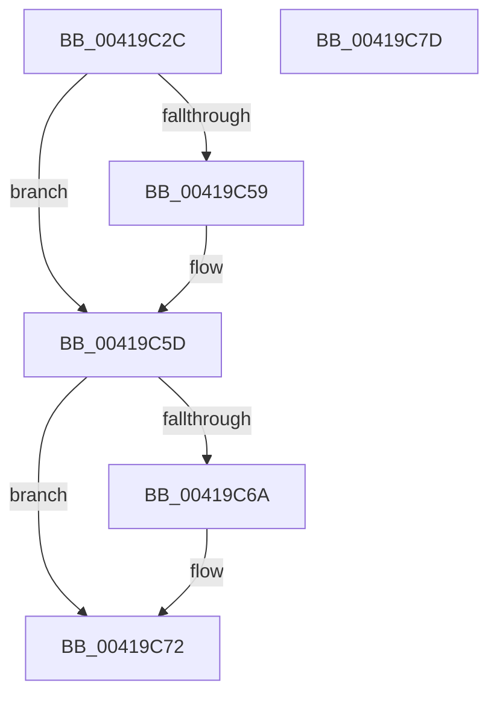

# ExfAcquireReleasePushLockExclusive

- RVA: `0x00419C2C`–`0x00419C7E` (길이 `82` bytes)
- VA: `0x0000000140419C2C`
- 실행 섹션: `.text`
- PDB 이름 있음: `예`; PDB Function 태그: `아니요`
- unwind 정보 RVA: `0x0005CAAC`
- 디코드: `26`개 명령, `82/82` bytes 표시
- 미해석 바이트: `0` (있으면 어셈블리에 `.byte`로 보존)

> 이 문서는 커널 이미지의 기계어와 PDB 기호를 분석해 생성했습니다. 4번과 5번은 함수 원형과 자료형을 바이너리 사용 방식에서 추정한 C 해석이며 원본 소스 복구 결과는 아닙니다.

## 1. Dependencies

- 직접 호출 지점: **4**; 고유 호출 대상: **4**
- 직접 호출자로 확인된 함수: **12**
- RIP 상대 이미지 참조: **0**

### Outgoing calls
- `0x00419C3E` → [KeAbPreAcquire](../21/KeAbPreAcquire_function_00210230.md) (function, `0x00210230`)
- `0x00419C4F` → [ExfAcquirePushLockExclusiveEx](../20/ExfAcquirePushLockExclusiveEx_function_0020FC90.md) (function, `0x0020FC90`)
- `0x00419C60` → [ExfReleasePushLockExclusive](../26/ExfReleasePushLockExclusive_function_00263900.md) (function, `0x00263900`)
- `0x00419C6D` → [KeAbPostRelease](../2E/KeAbPostRelease_function_002E1600.md) (function, `0x002E1600`)

### Direct callers
- [PspLockUnlockProcessExclusive](PspLockUnlockProcessExclusive_function_00419B48.md) at `0x00419B6C`
- [EtwpLockUnlockBufferList](EtwpLockUnlockBufferList_function_00419B88.md) at `0x00419BC9`
- [PspLockUnlockThreadSecurityExclusiveUnsafe](../4E/PspLockUnlockThreadSecurityExclusiveUnsafe_function_004E96AC.md) at `0x004E96CD`
- [PsShutdownSystem](../../page/78/PsShutdownSystem_function_00785E94.md) at `0x007860DB`
- [sub_00889F78](../../page/88/Unknown_function_00889F78.md) at `0x0088A00A`
- [AlpcpCaptureSecurityAttribute](../../page/89/AlpcpCaptureSecurityAttribute_function_00890540.md) at `0x00890827`
- [sub_008909EC](../../page/89/Unknown_function_008909EC.md) at `0x00890A77`
- [sub_008A2CF7](../../page/8A/Unknown_function_008A2CF7.md) at `0x008A2D45`
- [NtSetInformationJobObject](../../page/9F/NtSetInformationJobObject_function_009F84C0.md) at `0x009F9233`
- [PfpRpCHashDeleteEntries](../../page/A3/PfpRpCHashDeleteEntries_function_00A322A8.md) at `0x00A32436`
- [ObpDeleteDirectoryObject](../../page/A7/ObpDeleteDirectoryObject_function_00A757A0.md) at `0x00A757F1`
- [EtwpUpdateLoggerSecurityDescriptor](../../page/AA/EtwpUpdateLoggerSecurityDescriptor_function_00AA9F64.md) at `0x00AA9FFE`

### Static image references
- 디코드된 RIP-relative 메모리 참조가 없습니다.

## 2. Other-region calls and transfers

- 다른 실행 섹션으로 향하는 call: **0**
- 별도 외부 분기/꼬리 이동을 확인하지 못했습니다.

## 3. Assembly (complete function range)

```asm
00419C2C  48 89 5C 24 08                  mov qword ptr [rsp + 8], rbx
00419C31  57                              push rdi
00419C32  48 83 EC 20                     sub rsp, 0x20
00419C36  45 33 C0                        xor r8d, r8d
00419C39  33 D2                           xor edx, edx
00419C3B  48 8B D9                        mov rbx, rcx
00419C3E  E8 ED 65 DF FF                  call 0x140210230
00419C43  4C 8B C3                        mov r8, rbx
00419C46  48 8B D0                        mov rdx, rax
00419C49  48 8B CB                        mov rcx, rbx
00419C4C  48 8B F8                        mov rdi, rax
00419C4F  E8 3C 60 DF FF                  call 0x14020fc90
00419C54  48 85 FF                        test rdi, rdi
00419C57  74 04                           je 0x140419c5d
00419C59  C6 47 0A 01                     mov byte ptr [rdi + 0xa], 1
00419C5D  48 8B CB                        mov rcx, rbx
00419C60  E8 9B 9C E4 FF                  call 0x140263900
00419C65  48 85 FF                        test rdi, rdi
00419C68  74 08                           je 0x140419c72
00419C6A  48 8B CB                        mov rcx, rbx
00419C6D  E8 8E 79 EC FF                  call 0x1402e1600
00419C72  48 8B 5C 24 30                  mov rbx, qword ptr [rsp + 0x30]
00419C77  48 83 C4 20                     add rsp, 0x20
00419C7B  5F                              pop rdi
00419C7C  C3                              ret
00419C7D  CC                              int3
```

## 4. C-style interpretation (structured pseudocode)

```c
__int64 __fastcall ExfAcquireReleasePushLockExclusive(__int64 a1, int a2, int a3)
{
    __int64 result;
    __int64 v_rsp;
    unsigned __int64 v_stack_p8;

    v_stack_p8 = v_rbx;
    v_rsp = (v_rsp) - (32);
    a3 = 0;
    a2 = 0;
    result = KeAbPreAcquire(a1, a2, a3, a4);
    result = ExfAcquirePushLockExclusiveEx(a1, result, a1, a4);
    if (result != 0) {
        *(unsigned __int8 *)(result + 10) = 1;
    }
    result = ExfReleasePushLockExclusive(a1, result, a1, a4);
    if (result != 0) {
        a1 = a1;
        result = KeAbPostRelease(a1, result, a1, a4);
    }
    v_rsp = (v_rsp) + (32);
    return result;
}
```

## 5. (Beta) C Style

```c
int64_t ExfAcquireReleasePushLockExclusive(int64_t Arg1, int32_t Arg2, int32_t Arg3)
{
    int64_t result;
    int64_t local_rsp;
    uint64_t v_stack_p8;

    v_stack_p8 = local_rbx;
    local_rsp = (local_rsp) - (32);
    Arg3 = 0;
    Arg2 = 0;
    result = KeAbPreAcquire(Arg1, Arg2, Arg3, a4);
    result = ExfAcquirePushLockExclusiveEx(Arg1, result, Arg1, a4);
    if (result != 0) {
        *(uint8_t *)(result + 0xA) = 1;
    }
    result = ExfReleasePushLockExclusive(Arg1, result, Arg1, a4);
    if (result != 0) {
        Arg1 = Arg1;
        result = KeAbPostRelease(Arg1, result, Arg1, a4);
    }
    local_rsp = (local_rsp) + (32);
    return result;
}
```

## 6. Execution-region graph

[열기: 2D/3D 그래프와 함수 탐색 컨트롤 패널](../../../control-panel.html?section=text&rva=0x00419C2C&view=graph)

- 2D 그래프는 위에서 아래로 흐르고, 3D 그래프는 빈 공간을 드래그해 회전합니다. Shift+드래그는 이동, 휠은 확대·축소, 함수 노드 선택은 대상 보고서 이동입니다.

### Static fallback


