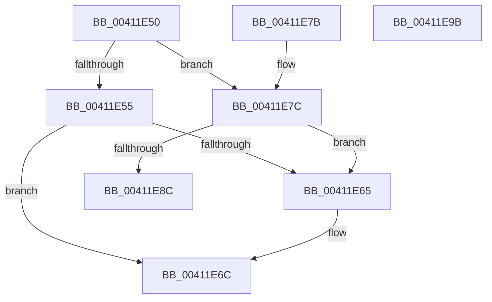

# ExpAddFastOwnerEntryToThreadList

- RVA: `0x00411E50`–`0x00411E9C` (길이 `76` bytes)
- VA: `0x0000000140411E50`
- 실행 섹션: `.text`
- PDB 이름 있음: `예`; PDB Function 태그: `아니요`
- unwind 정보 RVA: `0x000DB714`
- 디코드: `24`개 명령, `76/76` bytes 표시
- 미해석 바이트: `0` (있으면 어셈블리에 `.byte`로 보존)

> 이 문서는 커널 이미지의 기계어와 PDB 기호를 분석해 생성했습니다. 4번과 5번은 함수 원형과 자료형을 바이너리 사용 방식에서 추정한 C 해석이며 원본 소스 복구 결과는 아닙니다.

## 1. Dependencies

- 직접 호출 지점: **0**; 고유 호출 대상: **0**
- 직접 호출자로 확인된 함수: **4**
- RIP 상대 이미지 참조: **0**

### Outgoing calls
- 직접 디코드된 call 명령이 없습니다.

### Direct callers
- [sub_00211104](../21/Unknown_function_00211104.md) at `0x002111B7`
- [sub_00211104](../21/Unknown_function_00211104.md) at `0x00211230`
- [sub_00211E87](../21/Unknown_function_00211E87.md) at `0x00211F08`
- [sub_00211E87](../21/Unknown_function_00211E87.md) at `0x00211F81`
- [ExAcquireFastResourceWithFlags](../65/ExAcquireFastResourceWithFlags_function_00658120.md) at `0x00658279`
- [ExAcquireFastResourceWithFlags](../65/ExAcquireFastResourceWithFlags_function_00658120.md) at `0x00658298`
- [ExAcquireFastResourceWithFlags](../65/ExAcquireFastResourceWithFlags_function_00658120.md) at `0x00658592`
- [ExAcquireFastResourceWithFlags](../65/ExAcquireFastResourceWithFlags_function_00658120.md) at `0x006585B1`
- [ExTryToConvertFastResourceSharedToExclusive](../65/ExTryToConvertFastResourceSharedToExclusive_function_00658A30.md) at `0x00658BFC`

### Static image references
- 디코드된 RIP-relative 메모리 참조가 없습니다.

## 2. Other-region calls and transfers

- 다른 실행 섹션으로 향하는 call: **0**
- 별도 외부 분기/꼬리 이동을 확인하지 못했습니다.

## 3. Assembly (complete function range)

```asm
00411E50  45 84 C0                        test r8b, r8b
00411E53  75 27                           jne 0x140411e7c
00411E55  48 8D 81 B8 06 00 00            lea rax, [rcx + 0x6b8]
00411E5C  48 8B 08                        mov rcx, qword ptr [rax]
00411E5F  48 39 41 08                     cmp qword ptr [rcx + 8], rax
00411E63  74 07                           je 0x140411e6c
00411E65  B9 03 00 00 00                  mov ecx, 3
00411E6A  CD 29                           int 0x29
00411E6C  49 89 09                        mov qword ptr [r9], rcx
00411E6F  49 89 41 08                     mov qword ptr [r9 + 8], rax
00411E73  4C 89 49 08                     mov qword ptr [rcx + 8], r9
00411E77  4C 89 08                        mov qword ptr [rax], r9
00411E7A  C3                              ret
00411E7B  CC                              int3
00411E7C  48 81 C1 D0 06 00 00            add rcx, 0x6d0
00411E83  48 8B 01                        mov rax, qword ptr [rcx]
00411E86  48 39 48 08                     cmp qword ptr [rax + 8], rcx
00411E8A  75 D9                           jne 0x140411e65
00411E8C  49 89 01                        mov qword ptr [r9], rax
00411E8F  49 89 49 08                     mov qword ptr [r9 + 8], rcx
00411E93  4C 89 48 08                     mov qword ptr [rax + 8], r9
00411E97  4C 89 09                        mov qword ptr [rcx], r9
00411E9A  C3                              ret
00411E9B  CC                              int3
```

## 4. C-style interpretation (structured pseudocode)

```c
__int64 __fastcall ExpAddFastOwnerEntryToThreadList(__int64 a1, __int64 a2, unsigned __int8 a3, __int64 a4)
{
    if (a3 != 0) goto loc_00411E7C;
    if ((*(unsigned __int64 *)(*(unsigned __int64 *)(a1 + 1720) + 8)) != (a1 + 1720)) {
        a1 = 3;
    }
    *(unsigned __int64 *)(a4) = a1;
    *(unsigned __int64 *)(a4 + 8) = a1 + 1720;
    *(unsigned __int64 *)(a1 + 8) = a4;
    *(unsigned __int64 *)(a1 + 1720) = a4;
    return a1 + 1720;
loc_00411E7C:
    a1 = (a1) + (0x6D0ULL);
    if ((*(unsigned __int64 *)(*(unsigned __int64 *)(a1) + 8)) != a1) goto loc_00411E65;
    *(unsigned __int64 *)(a4) = *(unsigned __int64 *)(a1);
    *(unsigned __int64 *)(a4 + 8) = a1;
    *(unsigned __int64 *)(*(unsigned __int64 *)(a1) + 8) = a4;
    *(unsigned __int64 *)(a1) = a4;
    return *(unsigned __int64 *)(a1);
}
```

## 5. (Beta) C Style

```c
void *ExpAddFastOwnerEntryToThreadList(void *Arg1, int64_t Arg2, uint8_t Arg3, void *Arg4)
{
    uint8_t *arg1 = (uint8_t *)Arg1;
    uint8_t *arg4 = (uint8_t *)Arg4;

    if (Arg3 != 0) goto loc_00411E7C;
    if ((*(uint64_t *)(*(uint64_t *)(arg1 + 0x6B8) + 0x8)) != (Arg1 + 1720)) {
        Arg1 = 3;
    }
    *(void **)(arg4) = Arg1;
    *(void **)(arg4 + 0x8) = Arg1 + 1720;
    *(void **)(arg1 + 0x8) = Arg4;
    *(void **)(arg1 + 0x6B8) = Arg4;
    return Arg1 + 1720;
loc_00411E7C:
    Arg1 = (Arg1) + (0x6D0ULL);
    if ((*(uint64_t *)(*(uint64_t *)(arg1) + 0x8)) != Arg1) goto loc_00411E65;
    *(uint64_t *)(arg4) = *(uint64_t *)(arg1);
    *(void **)(arg4 + 0x8) = Arg1;
    *(void **)(*(uint64_t *)(arg1) + 0x8) = Arg4;
    *(void **)(arg1) = Arg4;
    return *(uint64_t *)(arg1);
}
```

### 관측된 메모리 오프셋

구조체 형식이 확인되지 않은 접근은 인자 기준의 오프셋으로만 기록했습니다.

| 기준 인자 | 오프셋 표현 | 폭 (bit) | 접근 |
|---|---:|---:|---|
| `Arg1` | `+ 0x0` | `64` | `R` |
| `Arg1` | `+ 0x0` | `64` | `W` |
| `Arg1` | `+ 0x6B8` | `64` | `R` |
| `Arg4` | `+ 0x0` | `64` | `W` |
| `Arg4` | `+ 0x8` | `64` | `W` |

## 6. Execution-region graph

[열기: 2D/3D 그래프와 함수 탐색 컨트롤 패널](../../../control-panel.html?section=text&rva=0x00411E50&view=graph)

- 2D 그래프는 위에서 아래로 흐르고, 3D 그래프는 빈 공간을 드래그해 회전합니다. Shift+드래그는 이동, 휠은 확대·축소, 함수 노드 선택은 대상 보고서 이동입니다.

### Static fallback


