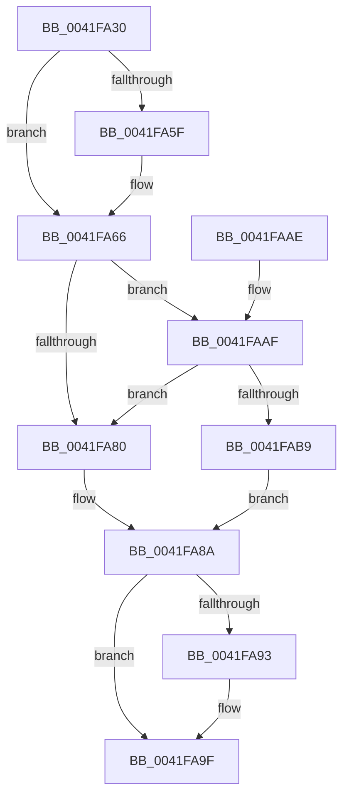

# ExpAddResourceToSystemResourceList

- RVA: `0x0041FA30`–`0x0041FACC` (길이 `156` bytes)
- VA: `0x000000014041FA30`
- 실행 섹션: `.text`
- PDB 이름 있음: `예`; PDB Function 태그: `아니요`
- unwind 정보 RVA: `0x00068A5C`
- 디코드: `38`개 명령, `156/156` bytes 표시
- 미해석 바이트: `0` (있으면 어셈블리에 `.byte`로 보존)

> 이 문서는 커널 이미지의 기계어와 PDB 기호를 분석해 생성했습니다. 4번과 5번은 함수 원형과 자료형을 바이너리 사용 방식에서 추정한 C 해석이며 원본 소스 복구 결과는 아닙니다.

## 1. Dependencies

- 직접 호출 지점: **3**; 고유 호출 대상: **3**
- 직접 호출자로 확인된 함수: **2**
- RIP 상대 이미지 참조: **8**

### Outgoing calls
- `0x0041FA44` → [ExAcquireSpinLockExclusive](../24/ExAcquireSpinLockExclusive_function_00248690.md) (function, `0x00248690`)
- `0x0041FA9A` → [KiLowerIrqlProcessIrqlFlags](../4F/KiLowerIrqlProcessIrqlFlags_function_004F5698.md) (function, `0x004F5698`)
- `0x0041FAC5` → [ExpReleaseSpinLockExclusiveFromDpcLevelInstrumented](../2C/ExpReleaseSpinLockExclusiveFromDpcLevelInstrumented_function_002C0F44.md) (function, `0x002C0F44`)

### Direct callers
- [ExInitializeResourceLite2](ExInitializeResourceLite2_function_0041F710.md) at `0x0041F76E`
- [sub_0041F9A8](Unknown_function_0041F9A8.md) at `0x0041F9EE`

### Static image references
- `0x0041FA3D` → RVA `0x00FCF0C0` (`CACHEALI`; read)
- `0x0041FA4C` → RVA `0x00EFAC20` (`.data`; read)
- `0x0041FA53` → RVA `0x00EFAC28` (`.data`; read)
- `0x0041FA70` → RVA `0x00FC6B06` (`ALMOSTRO`; read)
- `0x0041FA77` → RVA `0x00EFAC28` (`.data`; write)
- `0x0041FA80` → RVA `0x00FCF0C0` (`CACHEALI`; write)
- `0x0041FA8A` → RVA `0x00FC6D20` (`ALMOSTRO`; read)
- `0x0041FAAF` → RVA `0x00F0DE58` (`.data`; read)

## 2. Other-region calls and transfers

- 다른 실행 섹션으로 향하는 call: **0**
- 별도 외부 분기/꼬리 이동을 확인하지 못했습니다.

## 3. Assembly (complete function range)

```asm
0041FA30  48 89 5C 24 08                  mov qword ptr [rsp + 8], rbx
0041FA35  57                              push rdi
0041FA36  48 83 EC 20                     sub rsp, 0x20
0041FA3A  48 8B D9                        mov rbx, rcx
0041FA3D  48 8D 0D 7C F6 BA 00            lea rcx, [rip + 0xbaf67c]
0041FA44  E8 47 8C E2 FF                  call 0x140248690
0041FA49  0F B6 F8                        movzx edi, al
0041FA4C  48 8D 0D CD B1 AD 00            lea rcx, [rip + 0xadb1cd]
0041FA53  48 8B 05 CE B1 AD 00            mov rax, qword ptr [rip + 0xadb1ce]
0041FA5A  48 39 08                        cmp qword ptr [rax], rcx
0041FA5D  74 07                           je 0x14041fa66
0041FA5F  B9 03 00 00 00                  mov ecx, 3
0041FA64  CD 29                           int 0x29
0041FA66  48 89 0B                        mov qword ptr [rbx], rcx
0041FA69  48 89 43 08                     mov qword ptr [rbx + 8], rax
0041FA6D  48 89 18                        mov qword ptr [rax], rbx
0041FA70  F6 05 8F 70 BA 00 01            test byte ptr [rip + 0xba708f], 1
0041FA77  48 89 1D AA B1 AD 00            mov qword ptr [rip + 0xadb1aa], rbx
0041FA7E  75 2F                           jne 0x14041faaf
0041FA80  C7 05 36 F6 BA 00 00 00 00 00   mov dword ptr [rip + 0xbaf636], 0
0041FA8A  83 3D 8F 72 BA 00 00            cmp dword ptr [rip + 0xba728f], 0
0041FA91  74 0C                           je 0x14041fa9f
0041FA93  44 0F 20 C1                     mov rcx, cr8
0041FA97  40 8A D7                        mov dl, dil
0041FA9A  E8 F9 5B 0D 00                  call 0x1404f5698
0041FA9F  44 0F 22 C7                     mov cr8, rdi
0041FAA3  48 8B 5C 24 30                  mov rbx, qword ptr [rsp + 0x30]
0041FAA8  48 83 C4 20                     add rsp, 0x20
0041FAAC  5F                              pop rdi
0041FAAD  C3                              ret
0041FAAE  CC                              int3
0041FAAF  8B 05 A3 E3 AE 00               mov eax, dword ptr [rip + 0xaee3a3]
0041FAB5  85 C0                           test eax, eax
0041FAB7  75 C7                           jne 0x14041fa80
0041FAB9  48 8B 54 24 28                  mov rdx, qword ptr [rsp + 0x28]
0041FABE  48 8D 0D FB F5 BA 00            lea rcx, [rip + 0xbaf5fb]
0041FAC5  E8 7A 14 EA FF                  call 0x1402c0f44
0041FACA  EB BE                           jmp 0x14041fa8a
```

## 4. C-style interpretation (structured pseudocode)

```c
__int64 __fastcall ExpAddResourceToSystemResourceList(__int64 a1)
{
    __int64 result;
    __int64 v_rsp;
    unsigned __int64 v_stack_p28;
    unsigned __int64 v_stack_p8;

    v_stack_p8 = v_rbx;
    v_rsp = (v_rsp) - (32);
    result = ExAcquireSpinLockExclusive(v_rip + 12252796, a2, a3, a4);
    if ((*(unsigned __int64 *)(*(unsigned __int64 *)(v_rip + 11383246))) != (v_rip + 11383245)) {
        a1 = 3;
    }
    *(unsigned __int64 *)(a1) = a1;
    *(unsigned __int64 *)(a1 + 8) = *(unsigned __int64 *)(v_rip + 11383246);
    *(unsigned __int64 *)(*(unsigned __int64 *)(v_rip + 11383246)) = a1;
    *(unsigned __int64 *)(v_rip + 11383210) = a1;
    if (((*(unsigned __int8 *)(v_rip + 12218511)) & (1)) != 0) goto loc_0041FAAF;
loc_0041FA80:
    *(unsigned int *)(v_rip + 12252726) = 0;
loc_0041FA8A:
    result = *(unsigned __int64 *)(v_rip + 11383246);
    if ((*(unsigned int *)(v_rip + 12219023)) != 0) {
        a1 = v_cr8;
        a2 = (unsigned __int8)((unsigned __int8)(result));
        result = KiLowerIrqlProcessIrqlFlags(a1, a2, a3, a4);
    }
    v_rsp = (v_rsp) + (32);
    return result;
loc_0041FAAF:
    if ((unsigned int)((unsigned int)(*(unsigned int *)(v_rip + 11461539))) != 0) goto loc_0041FA80;
    result = ExpReleaseSpinLockExclusiveFromDpcLevelInstrumented(v_rip + 12252667, v_stack_p28, a3, a4);
    goto loc_0041FA8A;
}
```

## 5. (Beta) C Style

```c
int64_t ExpAddResourceToSystemResourceList(void *Arg1)
{
    uint8_t *arg1 = (uint8_t *)Arg1;

    int64_t result;
    int64_t local_rsp;
    uint64_t v_stack_p28;
    uint64_t v_stack_p8;

    v_stack_p8 = local_rbx;
    local_rsp = (local_rsp) - (32);
    result = ExAcquireSpinLockExclusive(v_rip + 12252796, a2, a3, a4);
    if ((*(uint64_t *)(*(uint64_t *)(v_rip + 0xADB1CE))) != (v_rip + 11383245)) {
        Arg1 = 3;
    }
    *(void **)(arg1) = Arg1;
    *(uint64_t *)(arg1 + 0x8) = *(uint64_t *)(v_rip + 0xADB1CE);
    *(void **)(*(uint64_t *)(v_rip + 0xADB1CE)) = Arg1;
    *(void **)(v_rip + 0xADB1AA) = Arg1;
    if (((*(uint8_t *)(v_rip + 0xBA708F)) & (1)) != 0) goto loc_0041FAAF;
loc_0041FA80:
    *(uint32_t *)(v_rip + 0xBAF636) = 0;
loc_0041FA8A:
    result = *(uint64_t *)(v_rip + 0xADB1CE);
    if ((*(uint32_t *)(v_rip + 0xBA728F)) != 0) {
        Arg1 = v_cr8;
        a2 = (uint8_t)((uint8_t)(result));
        result = KiLowerIrqlProcessIrqlFlags(Arg1, a2, a3, a4);
    }
    local_rsp = (local_rsp) + (32);
    return result;
loc_0041FAAF:
    if ((uint32_t)((uint32_t)(*(uint32_t *)(v_rip + 0xAEE3A3))) != 0) goto loc_0041FA80;
    result = ExpReleaseSpinLockExclusiveFromDpcLevelInstrumented(v_rip + 12252667, v_stack_p28, a3, a4);
    goto loc_0041FA8A;
}
```

### 관측된 메모리 오프셋

구조체 형식이 확인되지 않은 접근은 인자 기준의 오프셋으로만 기록했습니다.

| 기준 인자 | 오프셋 표현 | 폭 (bit) | 접근 |
|---|---:|---:|---|
| `Arg1` | `+ 0x0` | `64` | `W` |
| `Arg1` | `+ 0x8` | `64` | `W` |

## 6. Execution-region graph

[열기: 2D/3D 그래프와 함수 탐색 컨트롤 패널](../../../control-panel.html?section=text&rva=0x0041FA30&view=graph)

- 2D 그래프는 위에서 아래로 흐르고, 3D 그래프는 빈 공간을 드래그해 회전합니다. Shift+드래그는 이동, 휠은 확대·축소, 함수 노드 선택은 대상 보고서 이동입니다.

### Static fallback


