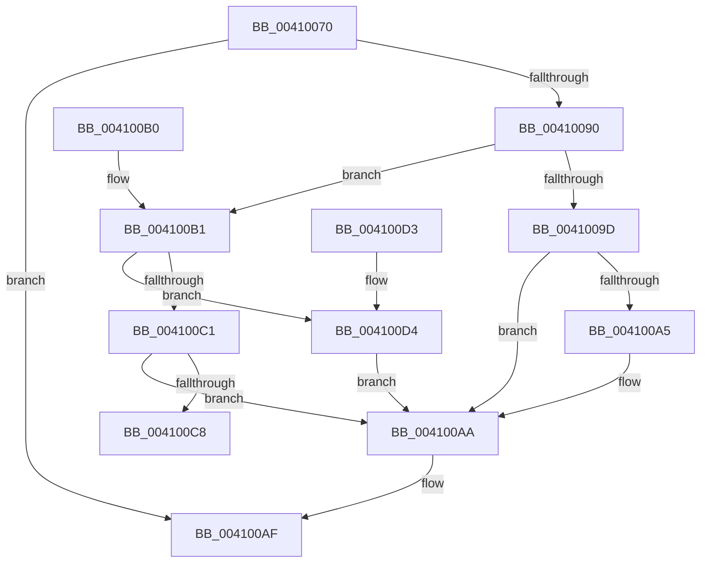

# ExpComputeLookasideDepth

- RVA: `0x00410070`–`0x004100FE` (길이 `142` bytes)
- VA: `0x0000000140410070`
- 실행 섹션: `.text`
- PDB 이름 있음: `예`; PDB Function 태그: `아니요`
- unwind 정보 RVA: `0x000DB714`
- 디코드: `46`개 명령, `142/142` bytes 표시
- 미해석 바이트: `0` (있으면 어셈블리에 `.byte`로 보존)

> 이 문서는 커널 이미지의 기계어와 PDB 기호를 분석해 생성했습니다. 4번과 5번은 함수 원형과 자료형을 바이너리 사용 방식에서 추정한 C 해석이며 원본 소스 복구 결과는 아닙니다.

## 1. Dependencies

- 직접 호출 지점: **0**; 고유 호출 대상: **0**
- 직접 호출자로 확인된 함수: **1**
- RIP 상대 이미지 참조: **0**

### Outgoing calls
- 직접 디코드된 call 명령이 없습니다.

### Direct callers
- [ExpScanSystemLookasideList](../40/ExpScanSystemLookasideList_function_0040FEE4.md) at `0x0040FF43`
- [ExpScanSystemLookasideList](../40/ExpScanSystemLookasideList_function_0040FEE4.md) at `0x0040FF76`
- [ExpScanSystemLookasideList](../40/ExpScanSystemLookasideList_function_0040FEE4.md) at `0x0040FFAA`
- [ExpScanSystemLookasideList](../40/ExpScanSystemLookasideList_function_0040FEE4.md) at `0x0040FFDE`
- [ExpScanSystemLookasideList](../40/ExpScanSystemLookasideList_function_0040FEE4.md) at `0x0041004D`

### Static image references
- 디코드된 RIP-relative 메모리 참조가 없습니다.

## 2. Other-region calls and transfers

- 다른 실행 섹션으로 향하는 call: **0**
- 별도 외부 분기/꼬리 이동을 확인하지 못했습니다.

## 3. Assembly (complete function range)

```asm
00410070  8B 41 14                        mov eax, dword ptr [rcx + 0x14]
00410073  4C 8B C9                        mov r9, rcx
00410076  44 0F B7 59 12                  movzx r11d, word ptr [rcx + 0x12]
0041007B  44 8B D0                        mov r10d, eax
0041007E  44 2B 51 50                     sub r10d, dword ptr [rcx + 0x50]
00410082  89 41 50                        mov dword ptr [rcx + 0x50], eax
00410085  B8 FF FF 00 00                  mov eax, 0xffff
0041008A  66 44 3B D8                     cmp r11w, ax
0041008E  74 1F                           je 0x1404100af
00410090  0F B7 49 10                     movzx ecx, word ptr [rcx + 0x10]
00410094  41 6B C0 19                     imul eax, r8d, 0x19
00410098  44 3B D0                        cmp r10d, eax
0041009B  73 14                           jae 0x1404100b1
0041009D  83 E9 0A                        sub ecx, 0xa
004100A0  83 F9 04                        cmp ecx, 4
004100A3  7D 05                           jge 0x1404100aa
004100A5  B9 04 00 00 00                  mov ecx, 4
004100AA  66 41 89 49 10                  mov word ptr [r9 + 0x10], cx
004100AF  C3                              ret
004100B0  CC                              int3
004100B1  69 C2 E8 03 00 00               imul eax, edx, 0x3e8
004100B7  33 D2                           xor edx, edx
004100B9  41 F7 F2                        div r10d
004100BC  83 F8 05                        cmp eax, 5
004100BF  73 13                           jae 0x1404100d4
004100C1  FF C9                           dec ecx
004100C3  83 F9 04                        cmp ecx, 4
004100C6  7D E2                           jge 0x1404100aa
004100C8  B9 04 00 00 00                  mov ecx, 4
004100CD  66 41 89 49 10                  mov word ptr [r9 + 0x10], cx
004100D2  C3                              ret
004100D3  CC                              int3
004100D4  41 8B D3                        mov edx, r11d
004100D7  2B D1                           sub edx, ecx
004100D9  0F AF D0                        imul edx, eax
004100DC  B8 D3 4D 62 10                  mov eax, 0x10624dd3
004100E1  F7 E2                           mul edx
004100E3  B8 1E 00 00 00                  mov eax, 0x1e
004100E8  C1 EA 07                        shr edx, 7
004100EB  83 C2 05                        add edx, 5
004100EE  3B D0                           cmp edx, eax
004100F0  0F 47 D0                        cmova edx, eax
004100F3  03 CA                           add ecx, edx
004100F5  41 3B CB                        cmp ecx, r11d
004100F8  41 0F 4F CB                     cmovg ecx, r11d
004100FC  EB AC                           jmp 0x1404100aa
```

## 4. C-style interpretation (structured pseudocode)

```c
__int64 __fastcall ExpComputeLookasideDepth(__int64 a1, int a2, int a3)
{
    __int64 result;
    __int64 v_r10;

    v_r10 = (unsigned int)(((unsigned int)((unsigned int)((unsigned int)(*(unsigned int *)(a1 + 20))))) - (*(unsigned int *)(a1 + 80)));
    *(unsigned int *)(a1 + 80) = (unsigned int)((unsigned int)(*(unsigned int *)(a1 + 20)));
    if (((unsigned __int16)(*(unsigned __int16 *)(a1 + 18))) == ((unsigned __int16)((unsigned int)(0xFFFFULL)))) goto loc_004100AF;
    result = (unsigned int)(((unsigned int)(0xFFFFULL)) * (a3));
    if (((unsigned int)(v_r10)) >= ((unsigned int)(result))) goto loc_004100B1;
    a1 = (unsigned int)((*(unsigned __int16 *)(a1 + 16)) - (10));
    if (((unsigned int)(a1)) < 4) {
        a1 = 4;
    }
    *(unsigned __int16 *)(a1 + 16) = (unsigned __int16)(a1);
loc_004100AF:
    return result;
loc_004100B1:
    result = (unsigned int)((result) * (a2));
    a2 = 0;
    if (((unsigned int)(result)) >= 5) goto loc_004100D4;
    a1 = (unsigned int)((a1) - 1);
    if (((unsigned int)(a1)) >= 4) goto loc_004100AA;
    *(unsigned __int16 *)(a1 + 16) = 4;
    return result;
loc_004100D4:
    a2 = (unsigned int)(((unsigned int)((unsigned int)(*(unsigned __int16 *)(a1 + 18)))) - (4));
    a2 = (unsigned int)((a2) * ((unsigned int)(result)));
    a2 = (unsigned int)((a2) >> (7));
    a2 = (unsigned int)((a2) + (5));
    if (a2 > 30) { a2 = 30; }
    a1 = (unsigned int)((4) + (a2));
    if (((unsigned int)(a1)) > ((unsigned int)(*(unsigned __int16 *)(a1 + 18)))) { a1 = (unsigned int)(*(unsigned __int16 *)(a1 + 18)); }
    goto loc_004100AA;
}
```

## 5. (Beta) C Style

```c
int64_t ExpComputeLookasideDepth(void *Arg1, int32_t Arg2, int32_t Arg3)
{
    uint8_t *arg1 = (uint8_t *)Arg1;

    int64_t result;
    int64_t local_r10;

    local_r10 = (uint32_t)(((uint32_t)((uint32_t)((uint32_t)(*(uint32_t *)(arg1 + 0x14))))) - (*(uint32_t *)(arg1 + 0x50)));
    *(uint32_t *)(arg1 + 0x50) = (uint32_t)((uint32_t)(*(uint32_t *)(arg1 + 0x14)));
    if (((uint16_t)(*(uint16_t *)(arg1 + 0x12))) == ((uint16_t)((uint32_t)(0xFFFFULL)))) goto loc_004100AF;
    result = (uint32_t)(((uint32_t)(0xFFFFULL)) * (Arg3));
    if (((uint32_t)(local_r10)) >= ((uint32_t)(result))) goto loc_004100B1;
    Arg1 = (uint32_t)((*(uint16_t *)(arg1 + 0x10)) - (10));
    if (((uint32_t)(Arg1)) < 4) {
        Arg1 = 4;
    }
    *(uint16_t *)(arg1 + 0x10) = (uint16_t)(Arg1);
loc_004100AF:
    return result;
loc_004100B1:
    result = (uint32_t)((result) * (Arg2));
    Arg2 = 0;
    if (((uint32_t)(result)) >= 5) goto loc_004100D4;
    Arg1 = (uint32_t)((Arg1) - 1);
    if (((uint32_t)(Arg1)) >= 4) goto loc_004100AA;
    *(uint16_t *)(arg1 + 0x10) = 4;
    return result;
loc_004100D4:
    Arg2 = (uint32_t)(((uint32_t)((uint32_t)(*(uint16_t *)(arg1 + 0x12)))) - (4));
    Arg2 = (uint32_t)((Arg2) * ((uint32_t)(result)));
    Arg2 = (uint32_t)((Arg2) >> (7));
    Arg2 = (uint32_t)((Arg2) + (5));
    if (Arg2 > 30) { Arg2 = 30; }
    Arg1 = (uint32_t)((4) + (Arg2));
    if (((uint32_t)(Arg1)) > ((uint32_t)(*(uint16_t *)(arg1 + 0x12)))) { Arg1 = (uint32_t)(*(uint16_t *)(arg1 + 0x12)); }
    goto loc_004100AA;
}
```

### 관측된 메모리 오프셋

구조체 형식이 확인되지 않은 접근은 인자 기준의 오프셋으로만 기록했습니다.

| 기준 인자 | 오프셋 표현 | 폭 (bit) | 접근 |
|---|---:|---:|---|
| `Arg1` | `+ 0x10` | `16` | `R` |
| `Arg1` | `+ 0x10` | `16` | `W` |
| `Arg1` | `+ 0x12` | `16` | `R` |
| `Arg1` | `+ 0x14` | `32` | `R` |
| `Arg1` | `+ 0x50` | `32` | `R` |
| `Arg1` | `+ 0x50` | `32` | `W` |

## 6. Execution-region graph

[열기: 2D/3D 그래프와 함수 탐색 컨트롤 패널](../../../control-panel.html?section=text&rva=0x00410070&view=graph)

- 2D 그래프는 위에서 아래로 흐르고, 3D 그래프는 빈 공간을 드래그해 회전합니다. Shift+드래그는 이동, 휠은 확대·축소, 함수 노드 선택은 대상 보고서 이동입니다.

### Static fallback


