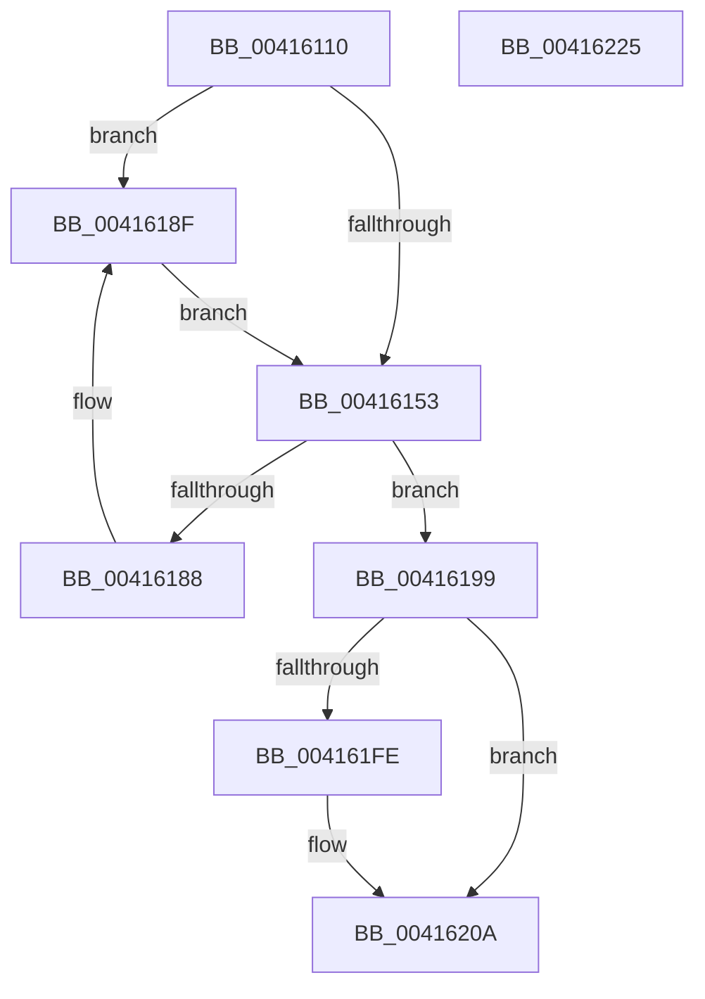

# ExpConvertFastResourceExclusiveToShared

- RVA: `0x00416110`–`0x00416226` (길이 `278` bytes)
- VA: `0x0000000140416110`
- 실행 섹션: `.text`
- PDB 이름 있음: `예`; PDB Function 태그: `아니요`
- unwind 정보 RVA: `0x0009CA28`
- 디코드: `74`개 명령, `278/278` bytes 표시
- 미해석 바이트: `0` (있으면 어셈블리에 `.byte`로 보존)

> 이 문서는 커널 이미지의 기계어와 PDB 기호를 분석해 생성했습니다. 4번과 5번은 함수 원형과 자료형을 바이너리 사용 방식에서 추정한 C 해석이며 원본 소스 복구 결과는 아닙니다.

## 1. Dependencies

- 직접 호출 지점: **7**; 고유 호출 대상: **7**
- 직접 호출자로 확인된 함수: **2**
- RIP 상대 이미지 참조: **1**

### Outgoing calls
- `0x0041615A` → [ExpRemoveFastOwnerEntryFromThreadList](ExpRemoveFastOwnerEntryFromThreadList_function_00416760.md) (function, `0x00416760`)
- `0x00416192` → [KiRaiseIrqlProcessIrqlFlags](../4F/KiRaiseIrqlProcessIrqlFlags_function_004F56FC.md) (function, `0x004F56FC`)
- `0x004161B0` → [KeAcquireInStackQueuedSpinLockAtDpcLevel](../27/KeAcquireInStackQueuedSpinLockAtDpcLevel_function_00275740.md) (function, `0x00275740`)
- `0x004161D7` → [ExpUpdateLockWordForRelease](ExpUpdateLockWordForRelease_function_00416850.md) (function, `0x00416850`)
- `0x004161E1` → [KeReleaseInStackQueuedSpinLockFromDpcLevel](../21/KeReleaseInStackQueuedSpinLockFromDpcLevel_function_002171B0.md) (function, `0x002171B0`)
- `0x004161F0` → [KeWakeWaitChain](../34/KeWakeWaitChain_function_0034F8C0.md) (function, `0x0034F8C0`)
- `0x00416205` → [KiLowerIrqlProcessIrqlFlags](../4F/KiLowerIrqlProcessIrqlFlags_function_004F5698.md) (function, `0x004F5698`)

### Direct callers
- [ExConvertFastResourceExclusiveToShared](ExConvertFastResourceExclusiveToShared_function_00415AB0.md) at `0x00415BFF`
- [ExpFastResourceLegacyConvertExclusiveToShared](ExpFastResourceLegacyConvertExclusiveToShared_function_00416000.md) at `0x004160C2`

### Static image references
- `0x0041614B` → RVA `0x00FC6D20` (`ALMOSTRO`; read)

## 2. Other-region calls and transfers

- 다른 실행 섹션으로 향하는 call: **0**
- 별도 외부 분기/꼬리 이동을 확인하지 못했습니다.

## 3. Assembly (complete function range)

```asm
00416110  48 89 5C 24 10                  mov qword ptr [rsp + 0x10], rbx
00416115  48 89 6C 24 18                  mov qword ptr [rsp + 0x18], rbp
0041611A  56                              push rsi
0041611B  57                              push rdi
0041611C  41 56                           push r14
0041611E  48 83 EC 40                     sub rsp, 0x40
00416122  0F 57 C0                        xorps xmm0, xmm0
00416125  33 C0                           xor eax, eax
00416127  0F 11 44 24 20                  movups xmmword ptr [rsp + 0x20], xmm0
0041612C  48 89 44 24 30                  mov qword ptr [rsp + 0x30], rax
00416131  48 8B DA                        mov rbx, rdx
00416134  65 4C 8B 34 25 88 01 00 00      mov r14, qword ptr gs:[0x188]
0041613D  48 8B F1                        mov rsi, rcx
00416140  44 0F 20 C7                     mov rdi, cr8
00416144  8D 50 02                        lea edx, [rax + 2]
00416147  44 0F 22 C2                     mov cr8, rdx
0041614B  39 05 CF 0B BB 00               cmp dword ptr [rip + 0xbb0bcf], eax
00416151  75 3C                           jne 0x14041618f
00416153  FF 4E 60                        dec dword ptr [rsi + 0x60]
00416156  48 8D 4E 40                     lea rcx, [rsi + 0x40]
0041615A  E8 01 06 00 00                  call 0x140416760
0041615F  80 63 25 FD                     and byte ptr [rbx + 0x25], 0xfd
00416163  C7 43 20 01 00 00 00            mov dword ptr [rbx + 0x20], 1
0041616A  48 89 73 18                     mov qword ptr [rbx + 0x18], rsi
0041616E  8A 46 64                        mov al, byte ptr [rsi + 0x64]
00416171  88 43 24                        mov byte ptr [rbx + 0x24], al
00416174  49 8D 86 B8 06 00 00            lea rax, [r14 + 0x6b8]
0041617B  C6 46 64 00                     mov byte ptr [rsi + 0x64], 0
0041617F  48 8B 08                        mov rcx, qword ptr [rax]
00416182  48 39 41 08                     cmp qword ptr [rcx + 8], rax
00416186  74 11                           je 0x140416199
00416188  B9 03 00 00 00                  mov ecx, 3
0041618D  CD 29                           int 0x29
0041618F  40 8A CF                        mov cl, dil
00416192  E8 65 F5 0D 00                  call 0x1404f56fc
00416197  EB BA                           jmp 0x140416153
00416199  48 89 0B                        mov qword ptr [rbx], rcx
0041619C  48 8D 54 24 20                  lea rdx, [rsp + 0x20]
004161A1  48 89 43 08                     mov qword ptr [rbx + 8], rax
004161A5  48 89 59 08                     mov qword ptr [rcx + 8], rbx
004161A9  48 8D 4E 30                     lea rcx, [rsi + 0x30]
004161AD  48 89 18                        mov qword ptr [rax], rbx
004161B0  E8 8B F5 E5 FF                  call 0x140275740
004161B5  48 83 66 50 00                  and qword ptr [rsi + 0x50], 0
004161BA  41 B0 01                        mov r8b, 1
004161BD  48 8B 46 08                     mov rax, qword ptr [rsi + 8]
004161C1  48 8B CE                        mov rcx, rsi
004161C4  48 83 66 08 00                  and qword ptr [rsi + 8], 0
004161C9  8B 56 38                        mov edx, dword ptr [rsi + 0x38]
004161CC  83 66 38 00                     and dword ptr [rsi + 0x38], 0
004161D0  FF C2                           inc edx
004161D2  48 89 44 24 60                  mov qword ptr [rsp + 0x60], rax
004161D7  E8 74 06 00 00                  call 0x140416850
004161DC  48 8D 4C 24 20                  lea rcx, [rsp + 0x20]
004161E1  E8 CA 0F E0 FF                  call 0x1402171b0
004161E6  45 33 C0                        xor r8d, r8d
004161E9  48 8D 4C 24 60                  lea rcx, [rsp + 0x60]
004161EE  33 D2                           xor edx, edx
004161F0  E8 CB 96 F3 FF                  call 0x14034f8c0
004161F5  83 3D 24 0B BB 00 00            cmp dword ptr [rip + 0xbb0b24], 0
004161FC  74 0C                           je 0x14041620a
004161FE  44 0F 20 C1                     mov rcx, cr8
00416202  40 8A D7                        mov dl, dil
00416205  E8 8E F4 0D 00                  call 0x1404f5698
0041620A  40 0F B6 C7                     movzx eax, dil
0041620E  44 0F 22 C0                     mov cr8, rax
00416212  48 8B 5C 24 68                  mov rbx, qword ptr [rsp + 0x68]
00416217  48 8B 6C 24 70                  mov rbp, qword ptr [rsp + 0x70]
0041621C  48 83 C4 40                     add rsp, 0x40
00416220  41 5E                           pop r14
00416222  5F                              pop rdi
00416223  5E                              pop rsi
00416224  C3                              ret
00416225  CC                              int3
```

## 4. C-style interpretation (structured pseudocode)

```c
__int64 __fastcall ExpConvertFastResourceExclusiveToShared(__int64 a1, __int64 a2)
{
    __int64 result;
    __int64 v_rsp;
    unsigned __int64 v_stack_m28;
    unsigned __int64 v_stack_m38;
    unsigned __int64 v_stack_p10;
    unsigned __int64 v_stack_p18;
    unsigned __int64 v_stack_p8;

    v_stack_p10 = v_rbx;
    v_stack_p18 = v_rbp;
    v_rsp = (v_rsp) - (64);
    result = 0;
    v_stack_m38 = v_xmm0;
    v_stack_m28 = 0;
    if ((*(unsigned int *)(v_rip + 12258255)) != 0) goto loc_0041618F;
loc_00416153:
    result = ExpRemoveFastOwnerEntryFromThreadList(a1 + 64, result + 2, a3, a4);
    *(unsigned int *)(a2 + 32) = 1;
    *(unsigned __int64 *)(a2 + 24) = a1;
    *(unsigned __int8 *)(a2 + 36) = (unsigned __int8)(*(unsigned __int8 *)(a1 + 100));
    *(unsigned __int8 *)(a1 + 100) = 0;
    if ((*(unsigned __int64 *)(*(unsigned __int64 *)(*(unsigned __int64 *)(gs_base + (0 + 392)) + 1720) + 8)) == (*(unsigned __int64 *)(gs_base + (0 + 392)) + 1720)) goto loc_00416199;
loc_0041618F:
    result = KiRaiseIrqlProcessIrqlFlags((unsigned __int8)(v_cr8), result + 2, a3, a4);
    goto loc_00416153;
loc_00416199:
    *(unsigned __int64 *)(a2) = (unsigned __int8)(v_cr8);
    *(unsigned __int64 *)(a2 + 8) = result;
    *(unsigned __int64 *)((unsigned __int8)(v_cr8) + 8) = a2;
    *(unsigned __int64 *)(result) = a2;
    result = KeAcquireInStackQueuedSpinLockAtDpcLevel(a1 + 48, v_stack_m38, a3, a4);
    a2 = (unsigned int)(((unsigned int)(*(unsigned int *)(a1 + 56))) + 1);
    v_stack_p8 = *(unsigned __int64 *)(a1 + 8);
    result = ExpUpdateLockWordForRelease(a1, a2, 1, a4);
    result = KeReleaseInStackQueuedSpinLockFromDpcLevel(v_stack_m38, a2, 1, a4);
    a3 = 0;
    a2 = 0;
    result = KeWakeWaitChain(v_stack_p8, a2, a3, a4);
    if ((*(unsigned int *)(v_rip + 12258084)) != 0) {
        a1 = result + 2;
        a2 = (unsigned __int8)(v_cr8);
        result = KiLowerIrqlProcessIrqlFlags(a1, a2, a3, a4);
    }
    v_rsp = (v_rsp) + (64);
    return (unsigned __int8)(v_cr8);
}
```

## 5. (Beta) C Style

```c
int64_t ExpConvertFastResourceExclusiveToShared(void *Arg1, void *Arg2)
{
    uint8_t *arg1 = (uint8_t *)Arg1;
    uint8_t *arg2 = (uint8_t *)Arg2;

    int64_t result;
    int64_t local_rsp;
    uint64_t v_stack_m28;
    uint64_t v_stack_m38;
    uint64_t v_stack_p10;
    uint64_t v_stack_p18;
    uint64_t v_stack_p8;

    v_stack_p10 = local_rbx;
    v_stack_p18 = local_rbp;
    local_rsp = (local_rsp) - (64);
    result = 0;
    v_stack_m38 = v_xmm0;
    v_stack_m28 = 0;
    if ((*(uint32_t *)(v_rip + 0xBB0BCF)) != 0) goto loc_0041618F;
loc_00416153:
    result = ExpRemoveFastOwnerEntryFromThreadList(Arg1 + 64, result + 2, a3, a4);
    *(uint32_t *)(arg2 + 0x20) = 1;
    *(void **)(arg2 + 0x18) = Arg1;
    *(uint8_t *)(arg2 + 0x24) = (uint8_t)(*(uint8_t *)(arg1 + 0x64));
    *(uint8_t *)(arg1 + 0x64) = 0;
    if ((*(uint64_t *)(*(uint64_t *)(*(uint64_t *)(gs_base + (0 + 0x188)) + 0x6B8) + 0x8)) == (*(uint64_t *)(gs_base + (0 + 0x188)) + 1720)) goto loc_00416199;
loc_0041618F:
    result = KiRaiseIrqlProcessIrqlFlags((uint8_t)(v_cr8), result + 2, a3, a4);
    goto loc_00416153;
loc_00416199:
    *(uint64_t *)(arg2) = (uint8_t)(v_cr8);
    *(uint64_t *)(arg2 + 0x8) = result;
    *(void **)((uint8_t)(v_cr8) + 0x8) = Arg2;
    *(void **)(result) = Arg2;
    result = KeAcquireInStackQueuedSpinLockAtDpcLevel(Arg1 + 48, v_stack_m38, a3, a4);
    Arg2 = (uint32_t)(((uint32_t)(*(uint32_t *)(arg1 + 0x38))) + 1);
    v_stack_p8 = *(uint64_t *)(arg1 + 0x8);
    result = ExpUpdateLockWordForRelease(Arg1, Arg2, 1, a4);
    result = KeReleaseInStackQueuedSpinLockFromDpcLevel(v_stack_m38, Arg2, 1, a4);
    a3 = 0;
    Arg2 = 0;
    result = KeWakeWaitChain(v_stack_p8, Arg2, a3, a4);
    if ((*(uint32_t *)(v_rip + 0xBB0B24)) != 0) {
        Arg1 = result + 2;
        Arg2 = (uint8_t)(v_cr8);
        result = KiLowerIrqlProcessIrqlFlags(Arg1, Arg2, a3, a4);
    }
    local_rsp = (local_rsp) + (64);
    return (uint8_t)(v_cr8);
}
```

### 관측된 메모리 오프셋

구조체 형식이 확인되지 않은 접근은 인자 기준의 오프셋으로만 기록했습니다.

| 기준 인자 | 오프셋 표현 | 폭 (bit) | 접근 |
|---|---:|---:|---|
| `Arg1` | `+ 0x8` | `64` | `R` |
| `Arg1` | `+ 0x8` | `64` | `R/W` |
| `Arg1` | `+ 0x30` | `64` | `R` |
| `Arg1` | `+ 0x38` | `32` | `R` |
| `Arg1` | `+ 0x38` | `32` | `R/W` |
| `Arg1` | `+ 0x40` | `64` | `R` |
| `Arg1` | `+ 0x50` | `64` | `R/W` |
| `Arg1` | `+ 0x60` | `32` | `R/W` |
| `Arg1` | `+ 0x64` | `8` | `R` |
| `Arg1` | `+ 0x64` | `8` | `W` |
| `Arg2` | `+ 0x0` | `64` | `W` |
| `Arg2` | `+ 0x8` | `64` | `W` |
| `Arg2` | `+ 0x18` | `64` | `W` |
| `Arg2` | `+ 0x20` | `32` | `W` |
| `Arg2` | `+ 0x24` | `8` | `W` |
| `Arg2` | `+ 0x25` | `8` | `R/W` |

## 6. Execution-region graph

[열기: 2D/3D 그래프와 함수 탐색 컨트롤 패널](../../../control-panel.html?section=text&rva=0x00416110&view=graph)

- 2D 그래프는 위에서 아래로 흐르고, 3D 그래프는 빈 공간을 드래그해 회전합니다. Shift+드래그는 이동, 휠은 확대·축소, 함수 노드 선택은 대상 보고서 이동입니다.

### Static fallback


