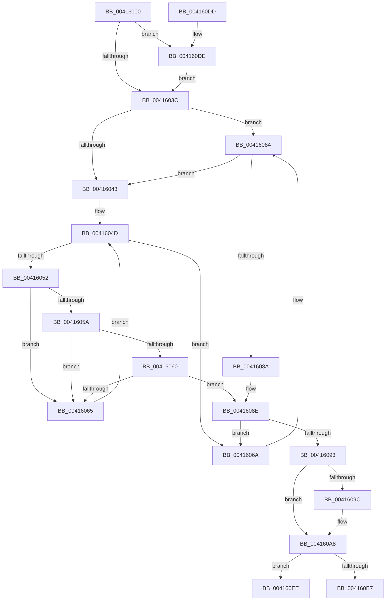

# ExpFastResourceLegacyConvertExclusiveToShared

- RVA: `0x00416000`–`0x0041610A` (길이 `266` bytes)
- VA: `0x0000000140416000`
- 실행 섹션: `.text`
- PDB 이름 있음: `예`; PDB Function 태그: `아니요`
- unwind 정보 RVA: `0x0009CA10`
- 디코드: `72`개 명령, `266/266` bytes 표시
- 미해석 바이트: `0` (있으면 어셈블리에 `.byte`로 보존)

> 이 문서는 커널 이미지의 기계어와 PDB 기호를 분석해 생성했습니다. 4번과 5번은 함수 원형과 자료형을 바이너리 사용 방식에서 추정한 C 해석이며 원본 소스 복구 결과는 아닙니다.

## 1. Dependencies

- 직접 호출 지점: **6**; 고유 호출 대상: **5**
- 직접 호출자로 확인된 함수: **1**
- RIP 상대 이미지 참조: **1**

### Outgoing calls
- `0x0041607E` → [KeBugCheckEx](../4F/KeBugCheckEx_function_004FD660.md) (function, `0x004FD660`)
- `0x004160A3` → [KiLowerIrqlProcessIrqlFlags](../4F/KiLowerIrqlProcessIrqlFlags_function_004F5698.md) (function, `0x004F5698`)
- `0x004160B7` → [ExpAllocateOwnerEntryForLegacyShim](../21/ExpAllocateOwnerEntryForLegacyShim_function_00213B50.md) (function, `0x00213B50`)
- `0x004160C2` → [ExpConvertFastResourceExclusiveToShared](ExpConvertFastResourceExclusiveToShared_function_00416110.md) (function, `0x00416110`)
- `0x004160E4` → [KiRaiseIrqlProcessIrqlFlags](../4F/KiRaiseIrqlProcessIrqlFlags_function_004F56FC.md) (function, `0x004F56FC`)
- `0x00416104` → [KeBugCheckEx](../4F/KeBugCheckEx_function_004FD660.md) (function, `0x004FD660`)

### Direct callers
- [ExConvertExclusiveToSharedLite](../34/ExConvertExclusiveToSharedLite_function_0034F700.md) at `0x0034F79A`

### Static image references
- `0x0041602F` → RVA `0x00FC6D20` (`ALMOSTRO`; read)

## 2. Other-region calls and transfers

- 다른 실행 섹션으로 향하는 call: **0**
- 별도 외부 분기/꼬리 이동을 확인하지 못했습니다.

## 3. Assembly (complete function range)

```asm
00416000  48 89 5C 24 08                  mov qword ptr [rsp + 8], rbx
00416005  48 89 74 24 10                  mov qword ptr [rsp + 0x10], rsi
0041600A  48 89 7C 24 18                  mov qword ptr [rsp + 0x18], rdi
0041600F  41 56                           push r14
00416011  48 83 EC 30                     sub rsp, 0x30
00416015  65 48 8B 3C 25 88 01 00 00      mov rdi, qword ptr gs:[0x188]
0041601E  48 8B D9                        mov rbx, rcx
00416021  44 0F 20 C6                     mov rsi, cr8
00416025  41 BE 02 00 00 00               mov r14d, 2
0041602B  45 0F 22 C6                     mov cr8, r14
0041602F  83 3D EA 0C BB 00 00            cmp dword ptr [rip + 0xbb0cea], 0
00416036  0F 85 A2 00 00 00               jne 0x1404160de
0041603C  48 8B 03                        mov rax, qword ptr [rbx]
0041603F  A8 01                           test al, 1
00416041  75 41                           jne 0x140416084
00416043  48 8D 8F B8 06 00 00            lea rcx, [rdi + 0x6b8]
0041604A  48 8B 01                        mov rax, qword ptr [rcx]
0041604D  48 3B C1                        cmp rax, rcx
00416050  74 18                           je 0x14041606a
00416052  8A 50 25                        mov dl, byte ptr [rax + 0x25]
00416055  41 84 D6                        test r14b, dl
00416058  75 0B                           jne 0x140416065
0041605A  48 39 58 18                     cmp qword ptr [rax + 0x18], rbx
0041605E  75 05                           jne 0x140416065
00416060  F6 C2 01                        test dl, 1
00416063  75 29                           jne 0x14041608e
00416065  48 8B 00                        mov rax, qword ptr [rax]
00416068  EB E3                           jmp 0x14041604d
0041606A  48 83 64 24 20 00               and qword ptr [rsp + 0x20], 0
00416070  45 33 C9                        xor r9d, r9d
00416073  4C 8B C7                        mov r8, rdi
00416076  48 8B D3                        mov rdx, rbx
00416079  B9 E3 00 00 00                  mov ecx, 0xe3
0041607E  E8 DD 75 0E 00                  call 0x1404fd660
00416083  CC                              int3
00416084  48 39 7B 50                     cmp qword ptr [rbx + 0x50], rdi
00416088  75 B9                           jne 0x140416043
0041608A  48 8D 43 40                     lea rax, [rbx + 0x40]
0041608E  48 85 C0                        test rax, rax
00416091  74 D7                           je 0x14041606a
00416093  83 3D 86 0C BB 00 00            cmp dword ptr [rip + 0xbb0c86], 0
0041609A  74 0C                           je 0x1404160a8
0041609C  44 0F 20 C1                     mov rcx, cr8
004160A0  40 8A D6                        mov dl, sil
004160A3  E8 F0 F5 0D 00                  call 0x1404f5698
004160A8  40 0F B6 C6                     movzx eax, sil
004160AC  44 0F 22 C0                     mov cr8, rax
004160B0  48 8B 03                        mov rax, qword ptr [rbx]
004160B3  A8 01                           test al, 1
004160B5  74 37                           je 0x1404160ee
004160B7  E8 94 DA DF FF                  call 0x140213b50
004160BC  48 8B D0                        mov rdx, rax
004160BF  48 8B CB                        mov rcx, rbx
004160C2  E8 49 00 00 00                  call 0x140416110
004160C7  48 8B 5C 24 40                  mov rbx, qword ptr [rsp + 0x40]
004160CC  48 8B 74 24 48                  mov rsi, qword ptr [rsp + 0x48]
004160D1  48 8B 7C 24 50                  mov rdi, qword ptr [rsp + 0x50]
004160D6  48 83 C4 30                     add rsp, 0x30
004160DA  41 5E                           pop r14
004160DC  C3                              ret
004160DD  CC                              int3
004160DE  41 8A D6                        mov dl, r14b
004160E1  40 8A CE                        mov cl, sil
004160E4  E8 13 F6 0D 00                  call 0x1404f56fc
004160E9  E9 4E FF FF FF                  jmp 0x14041603c
004160EE  48 83 64 24 20 00               and qword ptr [rsp + 0x20], 0
004160F4  4C 8B CF                        mov r9, rdi
004160F7  4C 8B C3                        mov r8, rbx
004160FA  BA 16 00 00 00                  mov edx, 0x16
004160FF  B9 C6 01 00 00                  mov ecx, 0x1c6
00416104  E8 57 75 0E 00                  call 0x1404fd660
00416109  CC                              int3
```

## 4. C-style interpretation (structured pseudocode)

```c
__int64 __fastcall ExpFastResourceLegacyConvertExclusiveToShared(__int64 a1, __int64 a2, __int64 a3, int a4)
{
    __int64 result;
    __int64 v_rsp;
    unsigned __int64 v_stack_m18;
    unsigned __int64 v_stack_p10;
    unsigned __int64 v_stack_p18;
    unsigned __int64 v_stack_p20;
    unsigned __int64 v_stack_p8;

    v_stack_p8 = v_rbx;
    v_stack_p10 = v_rsi;
    v_stack_p18 = v_rdi;
    v_rsp = (v_rsp) - (48);
    if ((*(unsigned int *)(v_rip + 12258538)) != 0) goto loc_004160DE;
loc_0041603C:
    if ((((unsigned __int8)(*(unsigned __int64 *)(a1))) & (1)) != 0) goto loc_00416084;
loc_00416043:
loc_0041604D:
    if ((*(unsigned __int64 *)(*(unsigned __int64 *)(gs_base + (0 + 392)) + 1720)) == (*(unsigned __int64 *)(gs_base + (0 + 392)) + 1720)) goto loc_0041606A;
    if (((2) & ((unsigned __int8)(*(unsigned __int8 *)(*(unsigned __int64 *)(*(unsigned __int64 *)(gs_base + (0 + 392)) + 1720) + 37)))) != 0) goto loc_00416065;
    if ((*(unsigned __int64 *)(*(unsigned __int64 *)(*(unsigned __int64 *)(gs_base + (0 + 392)) + 1720) + 24)) != a1) goto loc_00416065;
    if ((((unsigned __int8)(*(unsigned __int8 *)(*(unsigned __int64 *)(*(unsigned __int64 *)(gs_base + (0 + 392)) + 1720) + 37))) & (1)) != 0) goto loc_0041608E;
loc_00416065:
    goto loc_0041604D;
loc_0041606A:
    a4 = 0;
    result = KeBugCheckEx(227, a1, *(unsigned __int64 *)(gs_base + (0 + 392)), a4);
loc_00416084:
    if ((*(unsigned __int64 *)(a1 + 80)) != (*(unsigned __int64 *)(gs_base + (0 + 392)))) goto loc_00416043;
loc_0041608E:
    if (a1 + 64 == 0) goto loc_0041606A;
    result = a1 + 64;
    if ((*(unsigned int *)(v_rip + 12258438)) != 0) {
        a1 = 2;
        a2 = (unsigned __int8)(v_cr8);
        result = KiLowerIrqlProcessIrqlFlags(a1, a2, *(unsigned __int64 *)(gs_base + (0 + 392)), a4);
    }
    if ((((unsigned __int8)(*(unsigned __int64 *)(a1))) & (1)) == 0) goto loc_004160EE;
    result = ExpAllocateOwnerEntryForLegacyShim(a1, a2, *(unsigned __int64 *)(gs_base + (0 + 392)), a4);
    result = ExpConvertFastResourceExclusiveToShared(a1, result, *(unsigned __int64 *)(gs_base + (0 + 392)), a4);
    v_rsp = (v_rsp) + (48);
    return result;
loc_004160DE:
    result = KiRaiseIrqlProcessIrqlFlags((unsigned __int8)(v_stack_p10), 2, *(unsigned __int64 *)(gs_base + (0 + 392)), a4);
    goto loc_0041603C;
loc_004160EE:
    result = KeBugCheckEx(454, 22, v_stack_p8, v_stack_p18);
    return result;
}
```

## 5. (Beta) C Style

```c
int64_t ExpFastResourceLegacyConvertExclusiveToShared(void *Arg1, int64_t Arg2, int64_t Arg3, int32_t Arg4)
{
    uint8_t *arg1 = (uint8_t *)Arg1;

    int64_t result;
    int64_t local_rsp;
    uint64_t v_stack_m18;
    uint64_t v_stack_p10;
    uint64_t v_stack_p18;
    uint64_t v_stack_p20;
    uint64_t v_stack_p8;

    v_stack_p8 = local_rbx;
    v_stack_p10 = local_rsi;
    v_stack_p18 = local_rdi;
    local_rsp = (local_rsp) - (48);
    if ((*(uint32_t *)(v_rip + 0xBB0CEA)) != 0) goto loc_004160DE;
loc_0041603C:
    if ((((uint8_t)(*(uint64_t *)(arg1))) & (1)) != 0) goto loc_00416084;
loc_00416043:
loc_0041604D:
    if ((*(uint64_t *)(*(uint64_t *)(gs_base + (0 + 0x188)) + 0x6B8)) == (*(uint64_t *)(gs_base + (0 + 0x188)) + 1720)) goto loc_0041606A;
    if (((2) & ((uint8_t)(*(uint8_t *)(*(uint64_t *)(*(uint64_t *)(gs_base + (0 + 0x188)) + 0x6B8) + 0x25)))) != 0) goto loc_00416065;
    if ((*(uint64_t *)(*(uint64_t *)(*(uint64_t *)(gs_base + (0 + 0x188)) + 0x6B8) + 0x18)) != Arg1) goto loc_00416065;
    if ((((uint8_t)(*(uint8_t *)(*(uint64_t *)(*(uint64_t *)(gs_base + (0 + 0x188)) + 0x6B8) + 0x25))) & (1)) != 0) goto loc_0041608E;
loc_00416065:
    goto loc_0041604D;
loc_0041606A:
    Arg4 = 0;
    result = KeBugCheckEx(227, Arg1, *(uint64_t *)(gs_base + (0 + 0x188)), Arg4);
loc_00416084:
    if ((*(uint64_t *)(arg1 + 0x50)) != (*(uint64_t *)(gs_base + (0 + 0x188)))) goto loc_00416043;
loc_0041608E:
    if (Arg1 + 64 == 0) goto loc_0041606A;
    result = Arg1 + 64;
    if ((*(uint32_t *)(v_rip + 0xBB0C86)) != 0) {
        Arg1 = 2;
        Arg2 = (uint8_t)(v_cr8);
        result = KiLowerIrqlProcessIrqlFlags(Arg1, Arg2, *(uint64_t *)(gs_base + (0 + 0x188)), Arg4);
    }
    if ((((uint8_t)(*(uint64_t *)(arg1))) & (1)) == 0) goto loc_004160EE;
    result = ExpAllocateOwnerEntryForLegacyShim(Arg1, Arg2, *(uint64_t *)(gs_base + (0 + 0x188)), Arg4);
    result = ExpConvertFastResourceExclusiveToShared(Arg1, result, *(uint64_t *)(gs_base + (0 + 0x188)), Arg4);
    local_rsp = (local_rsp) + (48);
    return result;
loc_004160DE:
    result = KiRaiseIrqlProcessIrqlFlags((uint8_t)(v_stack_p10), 2, *(uint64_t *)(gs_base + (0 + 0x188)), Arg4);
    goto loc_0041603C;
loc_004160EE:
    result = KeBugCheckEx(454, 22, v_stack_p8, v_stack_p18);
    return result;
}
```

### 관측된 메모리 오프셋

구조체 형식이 확인되지 않은 접근은 인자 기준의 오프셋으로만 기록했습니다.

| 기준 인자 | 오프셋 표현 | 폭 (bit) | 접근 |
|---|---:|---:|---|
| `Arg1` | `+ 0x0` | `64` | `R` |
| `Arg1` | `+ 0x40` | `64` | `R` |
| `Arg1` | `+ 0x50` | `64` | `R` |

## 6. Execution-region graph

[열기: 2D/3D 그래프와 함수 탐색 컨트롤 패널](../../../control-panel.html?section=text&rva=0x00416000&view=graph)

- 2D 그래프는 위에서 아래로 흐르고, 3D 그래프는 빈 공간을 드래그해 회전합니다. Shift+드래그는 이동, 휠은 확대·축소, 함수 노드 선택은 대상 보고서 이동입니다.

### Static fallback


