# ExpMoveSharedFastResourceOwnershipWithFlags

- RVA: `0x00415C4C`–`0x00415FFA` (길이 `942` bytes)
- VA: `0x0000000140415C4C`
- 실행 섹션: `.text`
- PDB 이름 있음: `예`; PDB Function 태그: `아니요`
- unwind 정보 RVA: `0x0009C9F0`
- 디코드: `249`개 명령, `942/942` bytes 표시
- 미해석 바이트: `0` (있으면 어셈블리에 `.byte`로 보존)

> 이 문서는 커널 이미지의 기계어와 PDB 기호를 분석해 생성했습니다. 4번과 5번은 함수 원형과 자료형을 바이너리 사용 방식에서 추정한 C 해석이며 원본 소스 복구 결과는 아닙니다.

## 1. Dependencies

- 직접 호출 지점: **19**; 고유 호출 대상: **7**
- 직접 호출자로 확인된 함수: **1**
- RIP 상대 이미지 참조: **0**

### Outgoing calls
- `0x00415C9F` → [KeBugCheckEx](../4F/KeBugCheckEx_function_004FD660.md) (function, `0x004FD660`)
- `0x00415CCF` → [KeBugCheckEx](../4F/KeBugCheckEx_function_004FD660.md) (function, `0x004FD660`)
- `0x00415CFD` → [KeBugCheckEx](../4F/KeBugCheckEx_function_004FD660.md) (function, `0x004FD660`)
- `0x00415D25` → [KeBugCheckEx](../4F/KeBugCheckEx_function_004FD660.md) (function, `0x004FD660`)
- `0x00415D5A` → [KeBugCheckEx](../4F/KeBugCheckEx_function_004FD660.md) (function, `0x004FD660`)
- `0x00415D7A` → [KeBugCheckEx](../4F/KeBugCheckEx_function_004FD660.md) (function, `0x004FD660`)
- `0x00415DA5` → [KeBugCheckEx](../4F/KeBugCheckEx_function_004FD660.md) (function, `0x004FD660`)
- `0x00415DD4` → [KeBugCheckEx](../4F/KeBugCheckEx_function_004FD660.md) (function, `0x004FD660`)
- `0x00415E13` → [KeBugCheckEx](../4F/KeBugCheckEx_function_004FD660.md) (function, `0x004FD660`)
- `0x00415E3C` → [KeBugCheckEx](../4F/KeBugCheckEx_function_004FD660.md) (function, `0x004FD660`)
- `0x00415E81` → [ExpRemoveFastOwnerEntryFromThreadList](ExpRemoveFastOwnerEntryFromThreadList_function_00416760.md) (function, `0x00416760`)
- `0x00415F20` → [KiRemoveSystemWorkPriorityKick](../26/KiRemoveSystemWorkPriorityKick_function_002631D0.md) (function, `0x002631D0`)
- `0x00415F40` → [KeBugCheckEx](../4F/KeBugCheckEx_function_004FD660.md) (function, `0x004FD660`)
- `0x00415F6B` → [KeBugCheckEx](../4F/KeBugCheckEx_function_004FD660.md) (function, `0x004FD660`)
- `0x00415F92` → [KeBugCheckEx](../4F/KeBugCheckEx_function_004FD660.md) (function, `0x004FD660`)
- `0x00415FA7` → [KeAcquireSpinLockAtDpcLevel](../20/KeAcquireSpinLockAtDpcLevel_function_00208430.md) (function, `0x00208430`)
- `0x00415FD1` → [KxReleaseSpinLock](../20/KxReleaseSpinLock_function_00206670.md) (function, `0x00206670`)
- `0x00415FDE` → [KeAbMarkCrossThreadReleasable](../3B/KeAbMarkCrossThreadReleasable_function_003BE8AC.md) (function, `0x003BE8AC`)
- `0x00415FF0` → [ObfReferenceObjectWithTag](../21/ObfReferenceObjectWithTag_function_00210710.md) (function, `0x00210710`)

### Direct callers
- [ExMoveFastResourceOwnershipWithFlags](ExMoveFastResourceOwnershipWithFlags_function_00415C20.md) at `0x00415C2B`

### Static image references
- 디코드된 RIP-relative 메모리 참조가 없습니다.

## 2. Other-region calls and transfers

- 다른 실행 섹션으로 향하는 call: **0**
- 별도 외부 분기/꼬리 이동을 확인하지 못했습니다.

## 3. Assembly (complete function range)

```asm
00415C4C  48 8B C4                        mov rax, rsp
00415C4F  48 89 58 08                     mov qword ptr [rax + 8], rbx
00415C53  48 89 68 10                     mov qword ptr [rax + 0x10], rbp
00415C57  48 89 70 18                     mov qword ptr [rax + 0x18], rsi
00415C5B  48 89 78 20                     mov qword ptr [rax + 0x20], rdi
00415C5F  41 55                           push r13
00415C61  41 56                           push r14
00415C63  41 57                           push r15
00415C65  48 83 EC 30                     sub rsp, 0x30
00415C69  65 4C 8B 2C 25 88 01 00 00      mov r13, qword ptr gs:[0x188]
00415C72  41 BE 01 00 00 00               mov r14d, 1
00415C78  44 0F B7 51 1A                  movzx r10d, word ptr [rcx + 0x1a]
00415C7D  33 DB                           xor ebx, ebx
00415C7F  45 8B D9                        mov r11d, r9d
00415C82  49 8B F8                        mov rdi, r8
00415C85  48 8B F2                        mov rsi, rdx
00415C88  45 84 D6                        test r14b, r10b
00415C8B  75 18                           jne 0x140415ca5
00415C8D  4C 8B C1                        mov r8, rcx
00415C90  48 89 58 D8                     mov qword ptr [rax - 0x28], rbx
00415C94  B9 C6 01 00 00                  mov ecx, 0x1c6
00415C99  8D 53 03                        lea edx, [rbx + 3]
00415C9C  45 33 C9                        xor r9d, r9d
00415C9F  E8 BC 79 0E 00                  call 0x1404fd660
00415CA4  CC                              int3
00415CA5  44 0F 20 C0                     mov rax, cr8
00415CA9  65 48 8B 14 25 88 01 00 00      mov rdx, qword ptr gs:[0x188]
00415CB2  BD 02 00 00 00                  mov ebp, 2
00415CB7  40 3A C5                        cmp al, bpl
00415CBA  76 19                           jbe 0x140415cd5
00415CBC  44 0F B6 C0                     movzx r8d, al
00415CC0  44 8B CD                        mov r9d, ebp
00415CC3  33 D2                           xor edx, edx
00415CC5  48 89 5C 24 20                  mov qword ptr [rsp + 0x20], rbx
00415CCA  B9 C6 01 00 00                  mov ecx, 0x1c6
00415CCF  E8 8C 79 0E 00                  call 0x1404fd660
00415CD4  CC                              int3
00415CD5  41 3A C6                        cmp al, r14b
00415CD8  73 29                           jae 0x140415d03
00415CDA  0F BA 62 74 0A                  bt dword ptr [rdx + 0x74], 0xa
00415CDF  72 22                           jb 0x140415d03
00415CE1  39 9A E4 01 00 00               cmp dword ptr [rdx + 0x1e4], ebx
00415CE7  75 1A                           jne 0x140415d03
00415CE9  45 33 C9                        xor r9d, r9d
00415CEC  48 89 5C 24 20                  mov qword ptr [rsp + 0x20], rbx
00415CF1  45 33 C0                        xor r8d, r8d
00415CF4  B9 C6 01 00 00                  mov ecx, 0x1c6
00415CF9  41 8D 51 07                     lea edx, [r9 + 7]
00415CFD  E8 5E 79 0E 00                  call 0x1404fd660
00415D02  CC                              int3
00415D03  4C 8B 46 10                     mov r8, qword ptr [rsi + 0x10]
00415D07  4D 8B C8                        mov r9, r8
00415D0A  49 83 E1 FE                     and r9, 0xfffffffffffffffe
00415D0E  4C 3B CA                        cmp r9, rdx
00415D11  74 18                           je 0x140415d2b
00415D13  4C 8B C6                        mov r8, rsi
00415D16  48 89 5C 24 20                  mov qword ptr [rsp + 0x20], rbx
00415D1B  BA 09 00 00 00                  mov edx, 9
00415D20  B9 C6 01 00 00                  mov ecx, 0x1c6
00415D25  E8 36 79 0E 00                  call 0x1404fd660
00415D2A  CC                              int3
00415D2B  0F B6 56 25                     movzx edx, byte ptr [rsi + 0x25]
00415D2F  40 84 D5                        test bpl, dl
00415D32  75 09                           jne 0x140415d3d
00415D34  48 8B 46 18                     mov rax, qword ptr [rsi + 0x18]
00415D38  48 3B C1                        cmp rax, rcx
00415D3B  75 23                           jne 0x140415d60
00415D3D  45 84 C6                        test r14b, r8b
00415D40  0F 84 00 02 00 00               je 0x140415f46
00415D46  45 33 C9                        xor r9d, r9d
00415D49  48 89 5C 24 20                  mov qword ptr [rsp + 0x20], rbx
00415D4E  4C 8B C6                        mov r8, rsi
00415D51  B9 C6 01 00 00                  mov ecx, 0x1c6
00415D56  41 8D 51 0A                     lea edx, [r9 + 0xa]
00415D5A  E8 01 79 0E 00                  call 0x1404fd660
00415D5F  CC                              int3
00415D60  48 85 C0                        test rax, rax
00415D63  74 D8                           je 0x140415d3d
00415D65  4C 8B C1                        mov r8, rcx
00415D68  48 89 44 24 20                  mov qword ptr [rsp + 0x20], rax
00415D6D  B9 C6 01 00 00                  mov ecx, 0x1c6
00415D72  4C 8B CE                        mov r9, rsi
00415D75  BA 08 00 00 00                  mov edx, 8
00415D7A  E8 E1 78 0E 00                  call 0x1404fd660
00415D7F  CC                              int3
00415D80  44 0F 20 C2                     mov rdx, cr8
00415D84  65 4C 8B 04 25 88 01 00 00      mov r8, qword ptr gs:[0x188]
00415D8D  40 3A D5                        cmp dl, bpl
00415D90  76 19                           jbe 0x140415dab
00415D92  44 0F B6 C2                     movzx r8d, dl
00415D96  4C 8B CD                        mov r9, rbp
00415D99  33 D2                           xor edx, edx
00415D9B  48 89 5C 24 20                  mov qword ptr [rsp + 0x20], rbx
00415DA0  B9 C6 01 00 00                  mov ecx, 0x1c6
00415DA5  E8 B6 78 0E 00                  call 0x1404fd660
00415DAA  CC                              int3
00415DAB  73 6C                           jae 0x140415e19
00415DAD  41 F6 C2 08                     test r10b, 8
00415DB1  75 27                           jne 0x140415dda
00415DB3  41 0F B6 80 C0 00 00 00         movzx eax, byte ptr [r8 + 0xc0]
00415DBB  40 84 C5                        test bpl, al
00415DBE  74 1A                           je 0x140415dda
00415DC0  45 33 C9                        xor r9d, r9d
00415DC3  48 89 5C 24 20                  mov qword ptr [rsp + 0x20], rbx
00415DC8  45 33 C0                        xor r8d, r8d
00415DCB  B9 C6 01 00 00                  mov ecx, 0x1c6
00415DD0  41 8D 51 06                     lea edx, [r9 + 6]
00415DD4  E8 87 78 0E 00                  call 0x1404fd660
00415DD9  CC                              int3
00415DDA  41 3A D6                        cmp dl, r14b
00415DDD  73 15                           jae 0x140415df4
00415DDF  41 0F BA 60 74 0A               bt dword ptr [r8 + 0x74], 0xa
00415DE5  72 0D                           jb 0x140415df4
00415DE7  41 39 98 E4 01 00 00            cmp dword ptr [r8 + 0x1e4], ebx
00415DEE  0F 84 F5 FE FF FF               je 0x140415ce9
00415DF4  4C 8B 4F 10                     mov r9, qword ptr [rdi + 0x10]
00415DF8  49 83 E1 FE                     and r9, 0xfffffffffffffffe
00415DFC  4D 3B C8                        cmp r9, r8
00415DFF  74 41                           je 0x140415e42
00415E01  4C 8B C7                        mov r8, rdi
00415E04  48 89 5C 24 20                  mov qword ptr [rsp + 0x20], rbx
00415E09  BA 09 00 00 00                  mov edx, 9
00415E0E  B9 C6 01 00 00                  mov ecx, 0x1c6
00415E13  E8 48 78 0E 00                  call 0x1404fd660
00415E18  CC                              int3
00415E19  65 8B 04 25 3C 3A 00 00         mov eax, dword ptr gs:[0x3a3c]
00415E21  A9 01 00 01 00                  test eax, 0x10001
00415E26  74 85                           je 0x140415dad
00415E28  45 33 C9                        xor r9d, r9d
00415E2B  48 89 5C 24 20                  mov qword ptr [rsp + 0x20], rbx
00415E30  45 33 C0                        xor r8d, r8d
00415E33  B9 C6 01 00 00                  mov ecx, 0x1c6
00415E38  41 8D 51 05                     lea edx, [r9 + 5]
00415E3C  E8 1F 78 0E 00                  call 0x1404fd660
00415E41  CC                              int3
00415E42  40 84 6F 25                     test byte ptr [rdi + 0x25], bpl
00415E46  75 0D                           jne 0x140415e55
00415E48  4C 8B 4F 18                     mov r9, qword ptr [rdi + 0x18]
00415E4C  4D 85 C9                        test r9, r9
00415E4F  0F 85 D2 00 00 00               jne 0x140415f27
00415E55  45 84 DE                        test r14b, r11b
00415E58  0F 85 13 01 00 00               jne 0x140415f71
00415E5E  40 8A EB                        mov bpl, bl
00415E61  44 89 77 20                     mov dword ptr [rdi + 0x20], r14d
00415E65  44 8B F3                        mov r14d, ebx
00415E68  40 0F B6 C5                     movzx eax, bpl
00415E6C  49 0B C5                        or rax, r13
00415E6F  48 89 4F 18                     mov qword ptr [rdi + 0x18], rcx
00415E73  48 89 47 10                     mov qword ptr [rdi + 0x10], rax
00415E77  8A 46 24                        mov al, byte ptr [rsi + 0x24]
00415E7A  88 47 24                        mov byte ptr [rdi + 0x24], al
00415E7D  FA                              cli
00415E7E  48 8B CE                        mov rcx, rsi
00415E81  E8 DA 08 00 00                  call 0x140416760
00415E86  40 84 ED                        test bpl, bpl
00415E89  0F 85 09 01 00 00               jne 0x140415f98
00415E8F  49 8D 85 B8 06 00 00            lea rax, [r13 + 0x6b8]
00415E96  48 8B 08                        mov rcx, qword ptr [rax]
00415E99  48 39 41 08                     cmp qword ptr [rcx + 8], rax
00415E9D  74 07                           je 0x140415ea6
00415E9F  B9 03 00 00 00                  mov ecx, 3
00415EA4  CD 29                           int 0x29
00415EA6  48 89 0F                        mov qword ptr [rdi], rcx
00415EA9  48 89 47 08                     mov qword ptr [rdi + 8], rax
00415EAD  48 89 79 08                     mov qword ptr [rcx + 8], rdi
00415EB1  48 89 38                        mov qword ptr [rax], rdi
00415EB4  65 48 8B 0C 25 20 00 00 00      mov rcx, qword ptr gs:[0x20]
00415EBD  4C 8B 81 B8 8E 00 00            mov r8, qword ptr [rcx + 0x8eb8]
00415EC4  4D 85 C0                        test r8, r8
00415EC7  75 3D                           jne 0x140415f06
00415EC9  FB                              sti
00415ECA  89 5E 20                        mov dword ptr [rsi + 0x20], ebx
00415ECD  88 5E 24                        mov byte ptr [rsi + 0x24], bl
00415ED0  48 89 5E 18                     mov qword ptr [rsi + 0x18], rbx
00415ED4  45 85 F6                        test r14d, r14d
00415ED7  0F 85 FE 00 00 00               jne 0x140415fdb
00415EDD  40 84 ED                        test bpl, bpl
00415EE0  0F 85 02 01 00 00               jne 0x140415fe8
00415EE6  48 8B 5C 24 50                  mov rbx, qword ptr [rsp + 0x50]
00415EEB  48 8B 6C 24 58                  mov rbp, qword ptr [rsp + 0x58]
00415EF0  48 8B 74 24 60                  mov rsi, qword ptr [rsp + 0x60]
00415EF5  48 8B 7C 24 68                  mov rdi, qword ptr [rsp + 0x68]
00415EFA  48 83 C4 30                     add rsp, 0x30
00415EFE  41 5F                           pop r15
00415F00  41 5E                           pop r14
00415F02  41 5D                           pop r13
00415F04  C3                              ret
00415F05  CC                              int3
00415F06  41 0F 0D 08                     prefetchw byte ptr [r8]
00415F0A  41 8B 00                        mov eax, dword ptr [r8]
00415F0D  8B D0                           mov edx, eax
00415F0F  0F BA F2 15                     btr edx, 0x15
00415F13  F0 41 0F B1 10                  lock cmpxchg dword ptr [r8], edx
00415F18  75 F3                           jne 0x140415f0d
00415F1A  0F BA E0 15                     bt eax, 0x15
00415F1E  73 A9                           jae 0x140415ec9
00415F20  E8 AB D2 E4 FF                  call 0x1402631d0
00415F25  EB A2                           jmp 0x140415ec9
00415F27  4C 3B C9                        cmp r9, rcx
00415F2A  0F 84 25 FF FF FF               je 0x140415e55
00415F30  4C 8B C7                        mov r8, rdi
00415F33  48 89 5C 24 20                  mov qword ptr [rsp + 0x20], rbx
00415F38  48 8B D5                        mov rdx, rbp
00415F3B  B9 C6 01 00 00                  mov ecx, 0x1c6
00415F40  E8 1B 77 0E 00                  call 0x1404fd660
00415F45  CC                              int3
00415F46  40 84 D5                        test bpl, dl
00415F49  0F 84 31 FE FF FF               je 0x140415d80
00415F4F  4C 8B CA                        mov r9, rdx
00415F52  48 89 5C 24 20                  mov qword ptr [rsp + 0x20], rbx
00415F57  4C 23 CD                        and r9, rbp
00415F5A  4C 8B C6                        mov r8, rsi
00415F5D  49 C1 E1 0F                     shl r9, 0xf
00415F61  BA 0B 00 00 00                  mov edx, 0xb
00415F66  B9 C6 01 00 00                  mov ecx, 0x1c6
00415F6B  E8 F0 76 0E 00                  call 0x1404fd660
00415F70  CC                              int3
00415F71  41 8A EE                        mov bpl, r14b
00415F74  44 39 76 20                     cmp dword ptr [rsi + 0x20], r14d
00415F78  0F 8E E3 FE FF FF               jle 0x140415e61
00415F7E  45 33 C9                        xor r9d, r9d
00415F81  48 89 5C 24 20                  mov qword ptr [rsp + 0x20], rbx
00415F86  4C 8B C1                        mov r8, rcx
00415F89  B9 C6 01 00 00                  mov ecx, 0x1c6
00415F8E  41 8D 51 17                     lea edx, [r9 + 0x17]
00415F92  E8 C9 76 0E 00                  call 0x1404fd660
00415F97  CC                              int3
00415F98  44 0F B6 77 24                  movzx r14d, byte ptr [rdi + 0x24]
00415F9D  4D 8D BD C8 06 00 00            lea r15, [r13 + 0x6c8]
00415FA4  49 8B CF                        mov rcx, r15
00415FA7  E8 84 24 DF FF                  call 0x140208430
00415FAC  49 8D 85 D0 06 00 00            lea rax, [r13 + 0x6d0]
00415FB3  48 8B 08                        mov rcx, qword ptr [rax]
00415FB6  48 39 41 08                     cmp qword ptr [rcx + 8], rax
00415FBA  0F 85 DF FE FF FF               jne 0x140415e9f
00415FC0  48 89 0F                        mov qword ptr [rdi], rcx
00415FC3  48 89 47 08                     mov qword ptr [rdi + 8], rax
00415FC7  48 89 79 08                     mov qword ptr [rcx + 8], rdi
00415FCB  49 8B CF                        mov rcx, r15
00415FCE  48 89 38                        mov qword ptr [rax], rdi
00415FD1  E8 9A 06 DF FF                  call 0x140206670
00415FD6  E9 D9 FE FF FF                  jmp 0x140415eb4
00415FDB  41 8B D6                        mov edx, r14d
00415FDE  E8 C9 88 FA FF                  call 0x1403be8ac
00415FE3  E9 F5 FE FF FF                  jmp 0x140415edd
00415FE8  BA 44 66 6C 74                  mov edx, 0x746c6644
00415FED  49 8B CD                        mov rcx, r13
00415FF0  E8 1B A7 DF FF                  call 0x140210710
00415FF5  E9 EC FE FF FF                  jmp 0x140415ee6
```

## 4. C-style interpretation (structured pseudocode)

```c
__int64 __fastcall ExpMoveSharedFastResourceOwnershipWithFlags(__int64 a1, __int64 a2, __int64 a3, int a4)
{
    __int64 result;
    __int64 v_rbx;
    __int64 v_rsp;
    unsigned __int64 v_stack_m28;
    unsigned __int64 v_stack_p10;
    unsigned __int64 v_stack_p18;
    unsigned __int64 v_stack_p20;
    unsigned __int64 v_stack_p8;

    *(unsigned __int64 *)(v_rsp + 8) = v_rbx;
    *(unsigned __int64 *)(v_rsp + 16) = v_rbp;
    *(unsigned __int64 *)(v_rsp + 24) = v_rsi;
    *(unsigned __int64 *)(v_rsp + 32) = v_rdi;
    v_rsp = (v_rsp) - (48);
    v_rbx = 0;
    result = v_rsp;
    if (((1) & ((unsigned __int8)(*(unsigned __int16 *)(a1 + 26)))) == 0) {
        a3 = a1;
        *(unsigned __int64 *)(v_rsp - 40) = 0;
        a1 = 454;
        a2 = v_rbx + 3;
        a4 = 0;
        result = KeBugCheckEx(a1, a2, a3, a4);
    }
    result = v_cr8;
    if (((unsigned __int8)(v_cr8)) >= = 2) {
        a3 = (unsigned __int8)(v_cr8);
        a4 = 2;
        a2 = 0;
        v_stack_m28 = 0;
        a1 = 454;
        result = KeBugCheckEx(a1, a2, a3, a4);
    }
    if (((unsigned __int8)(result)) >= 1) goto loc_00415D03;
    if (((unsigned __int8)(result)) < 1) goto loc_00415D03;
    if ((*(unsigned int *)(a2 + 484)) == 0) {
        a4 = 0;
        v_stack_m28 = 0;
        a3 = 0;
        a1 = 454;
        a2 = a4 + 7;
        result = KeBugCheckEx(a1, a2, a3, a4);
    }
    a4 = (*(unsigned __int64 *)(a2 + 16)) & (-2);
    if (a4 != a2) {
        a3 = a2;
        v_stack_m28 = 0;
        a2 = 9;
        a1 = 454;
        result = KeBugCheckEx(a1, a2, a3, a4);
    }
    if (((2) & ((unsigned __int8)(*(unsigned __int8 *)(a2 + 37)))) != 0) goto loc_00415D3D;
    if ((*(unsigned __int64 *)(a2 + 24)) != a1) goto loc_00415D60;
loc_00415D3D:
    if (((1) & ((unsigned __int8)(a3))) == 0) goto loc_00415F46;
    a4 = 0;
    v_stack_m28 = 0;
    result = KeBugCheckEx(454, a4 + 10, a2, a4);
loc_00415D60:
    if (result == 0) goto loc_00415D3D;
    v_stack_m28 = result;
    result = KeBugCheckEx(454, 8, 454, a2);
loc_00415D80:
    if (((unsigned __int8)(v_cr8)) >= = 2) {
        a3 = (unsigned __int8)(v_cr8);
        a4 = 2;
        a2 = 0;
        v_stack_m28 = 0;
        a1 = 454;
        result = KeBugCheckEx(a1, a2, a3, a4);
    }
    if (condition_is_above_or_equal) goto loc_00415E19;
loc_00415DAD:
    if ((((unsigned __int8)(*(unsigned __int16 *)(a1 + 26))) & (8)) != 0) goto loc_00415DDA;
    result = *(unsigned __int8 *)(a3 + 192);
    if (((2) & ((unsigned __int8)(*(unsigned __int8 *)(a3 + 192)))) != 0) {
        a4 = 0;
        v_stack_m28 = 0;
        a3 = 0;
        a1 = 454;
        a2 = a4 + 6;
        result = KeBugCheckEx(a1, a2, a3, a4);
    }
    if (((unsigned __int8)(a2)) >= 1) goto loc_00415DF4;
    if (((unsigned __int8)(a2)) < 1) goto loc_00415DF4;
    if ((*(unsigned int *)(a3 + 484)) == 0) goto loc_00415CE9;
loc_00415DF4:
    a4 = (*(unsigned __int64 *)(a3 + 16)) & (-2);
    if (a4 == 0) goto loc_00415E42;
    v_stack_m28 = 0;
    result = KeBugCheckEx(454, 9, 0, a4);
loc_00415E19:
    if ((((unsigned int)((unsigned int)(*(unsigned int *)(gs_base + (0 + 14908))))) & (0x10001ULL)) == 0) goto loc_00415DAD;
    a4 = 0;
    v_stack_m28 = 0;
    a3 = 0;
    result = KeBugCheckEx(454, a4 + 5, a3, a4);
loc_00415E42:
    if (((*(unsigned __int8 *)(a3 + 37)) & (2)) != 0) goto loc_00415E55;
    if (*(unsigned __int64 *)(a3 + 24) != 0) goto loc_00415F27;
loc_00415E55:
    if (((1) & ((unsigned __int8)((unsigned int)(a4)))) != 0) goto loc_00415F71;
loc_00415E61:
    *(unsigned int *)(a3 + 32) = 1;
    result = (0) | (*(unsigned __int64 *)(gs_base + (0 + 392)));
    *(unsigned __int64 *)(a3 + 24) = 454;
    *(unsigned __int64 *)(a3 + 16) = result;
    *(unsigned __int8 *)(a3 + 36) = (unsigned __int8)(*(unsigned __int8 *)(a2 + 36));
    result = ExpRemoveFastOwnerEntryFromThreadList(a2, a4 + 5, a3, *(unsigned __int64 *)(a3 + 24));
    if (0 != 0) goto loc_00415F98;
    if ((*(unsigned __int64 *)(*(unsigned __int64 *)(*(unsigned __int64 *)(gs_base + (0 + 392)) + 1720) + 8)) != (*(unsigned __int64 *)(gs_base + (0 + 392)) + 1720)) {
        a1 = 3;
    }
    *(unsigned __int64 *)(a3) = a1;
    *(unsigned __int64 *)(a3 + 8) = *(unsigned __int64 *)(gs_base + (0 + 392)) + 1720;
    *(unsigned __int64 *)(a1 + 8) = 0;
    *(unsigned __int64 *)(*(unsigned __int64 *)(gs_base + (0 + 392)) + 1720) = 0;
loc_00415EB4:
    if (*(unsigned __int64 *)(*(unsigned __int64 *)(gs_base + (0 + 32)) + 36536) != 0) goto loc_00415F06;
loc_00415EC9:
    *(unsigned int *)(a2 + 32) = 0;
    *(unsigned __int8 *)(a2 + 36) = 0;
    *(unsigned __int64 *)(a2 + 24) = 0;
    if (0 != 0) goto loc_00415FDB;
loc_00415EDD:
    if (0 != 0) goto loc_00415FE8;
loc_00415EE6:
    v_rsp = (v_rsp) + (48);
    return *(unsigned __int64 *)(gs_base + (0 + 392)) + 1720;
loc_00415F06:
loc_00415F0D:
    if (condition_is_not_equal) goto loc_00415F0D;
    if (condition_is_above_or_equal) goto loc_00415EC9;
    result = KiRemoveSystemWorkPriorityKick(*(unsigned __int64 *)(gs_base + (0 + 32)), (unsigned int)((unsigned int)((unsigned int)(*(unsigned int *)(*(unsigned __int64 *)(*(unsigned __int64 *)(gs_base + (0 + 32)) + 36536))))), *(unsigned __int64 *)(*(unsigned __int64 *)(gs_base + (0 + 32)) + 36536), *(unsigned __int64 *)(a3 + 24));
    goto loc_00415EC9;
loc_00415F27:
    if ((*(unsigned __int64 *)(a3 + 24)) == (*(unsigned __int64 *)(gs_base + (0 + 32)))) goto loc_00415E55;
    v_stack_p20 = v_stack_p8;
    result = KeBugCheckEx(454, v_stack_p10, v_stack_p20, *(unsigned __int64 *)(a3 + 24));
loc_00415F46:
    if ((unsigned __int8)(v_stack_p10) == 0) goto loc_00415D80;
    v_stack_p20 = v_stack_p8;
    a4 = (v_stack_p10) & (v_stack_p10);
    a4 = (a4) << (15);
    result = KeBugCheckEx(454, 11, v_stack_p18, a4);
loc_00415F71:
    if ((*(unsigned int *)(v_stack_p18 + 32)) <= 0) goto loc_00415E61;
    a4 = 0;
    v_stack_p20 = v_stack_p8;
    result = KeBugCheckEx(454, a4 + 23, 454, a4);
loc_00415F98:
    result = KeAcquireSpinLockAtDpcLevel(*(unsigned __int64 *)(gs_base + (0 + 392)) + 1736, a4 + 23, 454, a4);
    if ((*(unsigned __int64 *)(*(unsigned __int64 *)(*(unsigned __int64 *)(gs_base + (0 + 392)) + 1744) + 8)) != (*(unsigned __int64 *)(gs_base + (0 + 392)) + 1744)) goto loc_00415E9F;
    *(unsigned __int64 *)(v_stack_p20) = *(unsigned __int64 *)(*(unsigned __int64 *)(gs_base + (0 + 392)) + 1744);
    *(unsigned __int64 *)(v_stack_p20 + 8) = *(unsigned __int64 *)(gs_base + (0 + 392)) + 1744;
    *(unsigned __int64 *)(*(unsigned __int64 *)(*(unsigned __int64 *)(gs_base + (0 + 392)) + 1744) + 8) = v_stack_p20;
    *(unsigned __int64 *)(*(unsigned __int64 *)(gs_base + (0 + 392)) + 1744) = v_stack_p20;
    result = KxReleaseSpinLock(*(unsigned __int64 *)(gs_base + (0 + 392)) + 1736, a4 + 23, 454, a4);
    goto loc_00415EB4;
loc_00415FDB:
    result = KeAbMarkCrossThreadReleasable(*(unsigned __int64 *)(gs_base + (0 + 392)) + 1736, (unsigned int)((unsigned int)(*(unsigned __int8 *)(v_stack_p20 + 36))), 454, a4);
    goto loc_00415EDD;
loc_00415FE8:
    result = ObfReferenceObjectWithTag(*(unsigned __int64 *)(gs_base + (0 + 392)), (unsigned int)(0x746C6644ULL), 454, a4);
    goto loc_00415EE6;
}
```

## 5. (Beta) C Style

```c
int64_t ExpMoveSharedFastResourceOwnershipWithFlags(void *Arg1, void *Arg2, void *Arg3, int32_t Arg4)
{
    uint8_t *arg1 = (uint8_t *)Arg1;
    uint8_t *arg2 = (uint8_t *)Arg2;
    uint8_t *arg3 = (uint8_t *)Arg3;

    int64_t result;
    int64_t local_rbx;
    int64_t local_rsp;
    uint64_t v_stack_m28;
    uint64_t v_stack_p10;
    uint64_t v_stack_p18;
    uint64_t v_stack_p20;
    uint64_t v_stack_p8;

    *(uint64_t *)(local_rsp + 0x8) = local_rbx;
    *(uint64_t *)(local_rsp + 0x10) = local_rbp;
    *(uint64_t *)(local_rsp + 0x18) = local_rsi;
    *(uint64_t *)(local_rsp + 0x20) = local_rdi;
    local_rsp = (local_rsp) - (48);
    local_rbx = 0;
    result = local_rsp;
    if (((1) & ((uint8_t)(*(uint16_t *)(arg1 + 0x1A)))) == 0) {
        Arg3 = Arg1;
        *(uint64_t *)(local_rsp - 0x28) = 0;
        Arg1 = 454;
        Arg2 = local_rbx + 3;
        Arg4 = 0;
        result = KeBugCheckEx(Arg1, Arg2, Arg3, Arg4);
    }
    result = v_cr8;
    if (((uint8_t)(v_cr8)) >= = 2) {
        Arg3 = (uint8_t)(v_cr8);
        Arg4 = 2;
        Arg2 = 0;
        v_stack_m28 = 0;
        Arg1 = 454;
        result = KeBugCheckEx(Arg1, Arg2, Arg3, Arg4);
    }
    if (((uint8_t)(result)) >= 1) goto loc_00415D03;
    if (((uint8_t)(result)) < 1) goto loc_00415D03;
    if ((*(uint32_t *)(arg2 + 0x1E4)) == 0) {
        Arg4 = 0;
        v_stack_m28 = 0;
        Arg3 = 0;
        Arg1 = 454;
        Arg2 = Arg4 + 7;
        result = KeBugCheckEx(Arg1, Arg2, Arg3, Arg4);
    }
    Arg4 = (*(uint64_t *)(arg2 + 0x10)) & (-2);
    if (Arg4 != Arg2) {
        Arg3 = Arg2;
        v_stack_m28 = 0;
        Arg2 = 9;
        Arg1 = 454;
        result = KeBugCheckEx(Arg1, Arg2, Arg3, Arg4);
    }
    if (((2) & ((uint8_t)(*(uint8_t *)(arg2 + 0x25)))) != 0) goto loc_00415D3D;
    if ((*(uint64_t *)(arg2 + 0x18)) != Arg1) goto loc_00415D60;
loc_00415D3D:
    if (((1) & ((uint8_t)(Arg3))) == 0) goto loc_00415F46;
    Arg4 = 0;
    v_stack_m28 = 0;
    result = KeBugCheckEx(454, Arg4 + 10, Arg2, Arg4);
loc_00415D60:
    if (result == 0) goto loc_00415D3D;
    v_stack_m28 = result;
    result = KeBugCheckEx(454, 8, 454, Arg2);
loc_00415D80:
    if (((uint8_t)(v_cr8)) >= = 2) {
        Arg3 = (uint8_t)(v_cr8);
        Arg4 = 2;
        Arg2 = 0;
        v_stack_m28 = 0;
        Arg1 = 454;
        result = KeBugCheckEx(Arg1, Arg2, Arg3, Arg4);
    }
    if (condition_is_above_or_equal) goto loc_00415E19;
loc_00415DAD:
    if ((((uint8_t)(*(uint16_t *)(arg1 + 0x1A))) & (8)) != 0) goto loc_00415DDA;
    result = *(uint8_t *)(arg3 + 0xC0);
    if (((2) & ((uint8_t)(*(uint8_t *)(arg3 + 0xC0)))) != 0) {
        Arg4 = 0;
        v_stack_m28 = 0;
        Arg3 = 0;
        Arg1 = 454;
        Arg2 = Arg4 + 6;
        result = KeBugCheckEx(Arg1, Arg2, Arg3, Arg4);
    }
    if (((uint8_t)(Arg2)) >= 1) goto loc_00415DF4;
    if (((uint8_t)(Arg2)) < 1) goto loc_00415DF4;
    if ((*(uint32_t *)(arg3 + 0x1E4)) == 0) goto loc_00415CE9;
loc_00415DF4:
    Arg4 = (*(uint64_t *)(arg3 + 0x10)) & (-2);
    if (Arg4 == 0) goto loc_00415E42;
    v_stack_m28 = 0;
    result = KeBugCheckEx(454, 9, 0, Arg4);
loc_00415E19:
    if ((((uint32_t)((uint32_t)(*(uint32_t *)(gs_base + (0 + 0x3A3C))))) & (0x10001ULL)) == 0) goto loc_00415DAD;
    Arg4 = 0;
    v_stack_m28 = 0;
    Arg3 = 0;
    result = KeBugCheckEx(454, Arg4 + 5, Arg3, Arg4);
loc_00415E42:
    if (((*(uint8_t *)(arg3 + 0x25)) & (2)) != 0) goto loc_00415E55;
    if (*(uint64_t *)(arg3 + 0x18) != 0) goto loc_00415F27;
loc_00415E55:
    if (((1) & ((uint8_t)((uint32_t)(Arg4)))) != 0) goto loc_00415F71;
loc_00415E61:
    *(uint32_t *)(arg3 + 0x20) = 1;
    result = (0) | (*(uint64_t *)(gs_base + (0 + 0x188)));
    *(uint64_t *)(arg3 + 0x18) = 454;
    *(uint64_t *)(arg3 + 0x10) = result;
    *(uint8_t *)(arg3 + 0x24) = (uint8_t)(*(uint8_t *)(arg2 + 0x24));
    result = ExpRemoveFastOwnerEntryFromThreadList(Arg2, Arg4 + 5, Arg3, *(uint64_t *)(arg3 + 0x18));
    if (0 != 0) goto loc_00415F98;
    if ((*(uint64_t *)(*(uint64_t *)(*(uint64_t *)(gs_base + (0 + 0x188)) + 0x6B8) + 0x8)) != (*(uint64_t *)(gs_base + (0 + 0x188)) + 1720)) {
        Arg1 = 3;
    }
    *(void **)(arg3) = Arg1;
    *(uint64_t *)(arg3 + 0x8) = *(uint64_t *)(gs_base + (0 + 0x188)) + 1720;
    *(uint64_t *)(arg1 + 0x8) = 0;
    *(uint64_t *)(*(uint64_t *)(gs_base + (0 + 0x188)) + 0x6B8) = 0;
loc_00415EB4:
    if (*(uint64_t *)(*(uint64_t *)(gs_base + (0 + 0x20)) + 0x8EB8) != 0) goto loc_00415F06;
loc_00415EC9:
    *(uint32_t *)(arg2 + 0x20) = 0;
    *(uint8_t *)(arg2 + 0x24) = 0;
    *(uint64_t *)(arg2 + 0x18) = 0;
    if (0 != 0) goto loc_00415FDB;
loc_00415EDD:
    if (0 != 0) goto loc_00415FE8;
loc_00415EE6:
    local_rsp = (local_rsp) + (48);
    return *(uint64_t *)(gs_base + (0 + 0x188)) + 1720;
loc_00415F06:
loc_00415F0D:
    if (condition_is_not_equal) goto loc_00415F0D;
    if (condition_is_above_or_equal) goto loc_00415EC9;
    result = KiRemoveSystemWorkPriorityKick(*(uint64_t *)(gs_base + (0 + 0x20)), (uint32_t)((uint32_t)((uint32_t)(*(uint32_t *)(*(uint64_t *)(*(uint64_t *)(gs_base + (0 + 0x20)) + 0x8EB8))))), *(uint64_t *)(*(uint64_t *)(gs_base + (0 + 0x20)) + 0x8EB8), *(uint64_t *)(arg3 + 0x18));
    goto loc_00415EC9;
loc_00415F27:
    if ((*(uint64_t *)(arg3 + 0x18)) == (*(uint64_t *)(gs_base + (0 + 0x20)))) goto loc_00415E55;
    v_stack_p20 = v_stack_p8;
    result = KeBugCheckEx(454, v_stack_p10, v_stack_p20, *(uint64_t *)(arg3 + 0x18));
loc_00415F46:
    if ((uint8_t)(v_stack_p10) == 0) goto loc_00415D80;
    v_stack_p20 = v_stack_p8;
    Arg4 = (v_stack_p10) & (v_stack_p10);
    Arg4 = (Arg4) << (15);
    result = KeBugCheckEx(454, 11, v_stack_p18, Arg4);
loc_00415F71:
    if ((*(uint32_t *)(v_stack_p18 + 0x20)) <= 0) goto loc_00415E61;
    Arg4 = 0;
    v_stack_p20 = v_stack_p8;
    result = KeBugCheckEx(454, Arg4 + 23, 454, Arg4);
loc_00415F98:
    result = KeAcquireSpinLockAtDpcLevel(*(uint64_t *)(gs_base + (0 + 0x188)) + 1736, Arg4 + 23, 454, Arg4);
    if ((*(uint64_t *)(*(uint64_t *)(*(uint64_t *)(gs_base + (0 + 0x188)) + 0x6D0) + 0x8)) != (*(uint64_t *)(gs_base + (0 + 0x188)) + 1744)) goto loc_00415E9F;
    *(uint64_t *)(v_stack_p20) = *(uint64_t *)(*(uint64_t *)(gs_base + (0 + 0x188)) + 0x6D0);
    *(uint64_t *)(v_stack_p20 + 0x8) = *(uint64_t *)(gs_base + (0 + 0x188)) + 1744;
    *(uint64_t *)(*(uint64_t *)(*(uint64_t *)(gs_base + (0 + 0x188)) + 0x6D0) + 0x8) = v_stack_p20;
    *(uint64_t *)(*(uint64_t *)(gs_base + (0 + 0x188)) + 0x6D0) = v_stack_p20;
    result = KxReleaseSpinLock(*(uint64_t *)(gs_base + (0 + 0x188)) + 1736, Arg4 + 23, 454, Arg4);
    goto loc_00415EB4;
loc_00415FDB:
    result = KeAbMarkCrossThreadReleasable(*(uint64_t *)(gs_base + (0 + 0x188)) + 1736, (uint32_t)((uint32_t)(*(uint8_t *)(v_stack_p20 + 0x24))), 454, Arg4);
    goto loc_00415EDD;
loc_00415FE8:
    result = ObfReferenceObjectWithTag(*(uint64_t *)(gs_base + (0 + 0x188)), (uint32_t)(0x746C6644ULL), 454, Arg4);
    goto loc_00415EE6;
}
```

### 관측된 메모리 오프셋

구조체 형식이 확인되지 않은 접근은 인자 기준의 오프셋으로만 기록했습니다.

| 기준 인자 | 오프셋 표현 | 폭 (bit) | 접근 |
|---|---:|---:|---|
| `Arg1` | `+ 0x1A` | `16` | `R` |
| `Arg2` | `+ 0x10` | `64` | `R` |
| `Arg2` | `+ 0x18` | `64` | `R` |
| `Arg2` | `+ 0x18` | `64` | `W` |
| `Arg2` | `+ 0x20` | `32` | `R` |
| `Arg2` | `+ 0x20` | `32` | `W` |
| `Arg2` | `+ 0x24` | `8` | `R` |
| `Arg2` | `+ 0x24` | `8` | `W` |
| `Arg2` | `+ 0x25` | `8` | `R` |
| `Arg3` | `+ 0x0` | `64` | `W` |
| `Arg3` | `+ 0x8` | `64` | `W` |
| `Arg3` | `+ 0x10` | `64` | `R` |
| `Arg3` | `+ 0x10` | `64` | `W` |
| `Arg3` | `+ 0x18` | `64` | `R` |
| `Arg3` | `+ 0x18` | `64` | `W` |
| `Arg3` | `+ 0x20` | `32` | `W` |
| `Arg3` | `+ 0x24` | `8` | `R` |
| `Arg3` | `+ 0x24` | `8` | `W` |
| `Arg3` | `+ 0x25` | `8` | `R` |

## 6. Execution-region graph

[열기: 2D/3D 그래프와 함수 탐색 컨트롤 패널](../../../control-panel.html?section=text&rva=0x00415C4C&view=graph)

- 2D 그래프는 위에서 아래로 흐르고, 3D 그래프는 빈 공간을 드래그해 회전합니다. Shift+드래그는 이동, 휠은 확대·축소, 함수 노드 선택은 대상 보고서 이동입니다.

### Static fallback

```mermaid
flowchart TD
  bb_00415C4C[BB_00415C4C]
  bb_00415C8D[BB_00415C8D]
  bb_00415CA5[BB_00415CA5]
  bb_00415CBC[BB_00415CBC]
  bb_00415CD5[BB_00415CD5]
  bb_00415CDA[BB_00415CDA]
  bb_00415CE1[BB_00415CE1]
  bb_00415CE9[BB_00415CE9]
  bb_00415D03[BB_00415D03]
  bb_00415D13[BB_00415D13]
  bb_00415D2B[BB_00415D2B]
  bb_00415D34[BB_00415D34]
  bb_00415D3D[BB_00415D3D]
  bb_00415D46[BB_00415D46]
  bb_00415D60[BB_00415D60]
  bb_00415D65[BB_00415D65]
  bb_00415D80[BB_00415D80]
  bb_00415D92[BB_00415D92]
  bb_00415DAB[BB_00415DAB]
  bb_00415DAD[BB_00415DAD]
  bb_00415DB3[BB_00415DB3]
  bb_00415DC0[BB_00415DC0]
  bb_00415DDA[BB_00415DDA]
  bb_00415DDF[BB_00415DDF]
  bb_00415DE7[BB_00415DE7]
  bb_00415DF4[BB_00415DF4]
  bb_00415E01[BB_00415E01]
  bb_00415E19[BB_00415E19]
  bb_00415E28[BB_00415E28]
  bb_00415E42[BB_00415E42]
  bb_00415E48[BB_00415E48]
  bb_00415E55[BB_00415E55]
  bb_00415E5E[BB_00415E5E]
  bb_00415E61[BB_00415E61]
  bb_00415E8F[BB_00415E8F]
  bb_00415E9F[BB_00415E9F]
  bb_00415EA6[BB_00415EA6]
  bb_00415EB4[BB_00415EB4]
  bb_00415EC9[BB_00415EC9]
  bb_00415EDD[BB_00415EDD]
  bb_00415EE6[BB_00415EE6]
  bb_00415F05[BB_00415F05]
  bb_00415F06[BB_00415F06]
  bb_00415F0D[BB_00415F0D]
  bb_00415F1A[BB_00415F1A]
  bb_00415F20[BB_00415F20]
  bb_00415F27[BB_00415F27]
  bb_00415F30[BB_00415F30]
  bb_00415F46[BB_00415F46]
  bb_00415F4F[BB_00415F4F]
  bb_00415F71[BB_00415F71]
  bb_00415F7E[BB_00415F7E]
  bb_00415F98[BB_00415F98]
  bb_00415FC0[BB_00415FC0]
  bb_00415FDB[BB_00415FDB]
  bb_00415FE8[BB_00415FE8]
  bb_00415C4C -->|branch| bb_00415CA5
  bb_00415C4C -->|fallthrough| bb_00415C8D
  bb_00415C8D -->|flow| bb_00415CA5
  bb_00415CA5 -->|branch| bb_00415CD5
  bb_00415CA5 -->|fallthrough| bb_00415CBC
  bb_00415CBC -->|flow| bb_00415CD5
  bb_00415CD5 -->|branch| bb_00415D03
  bb_00415CD5 -->|fallthrough| bb_00415CDA
  bb_00415CDA -->|branch| bb_00415D03
  bb_00415CDA -->|fallthrough| bb_00415CE1
  bb_00415CE1 -->|branch| bb_00415D03
  bb_00415CE1 -->|fallthrough| bb_00415CE9
  bb_00415CE9 -->|flow| bb_00415D03
  bb_00415D03 -->|branch| bb_00415D2B
  bb_00415D03 -->|fallthrough| bb_00415D13
  bb_00415D13 -->|flow| bb_00415D2B
  bb_00415D2B -->|branch| bb_00415D3D
  bb_00415D2B -->|fallthrough| bb_00415D34
  bb_00415D34 -->|branch| bb_00415D60
  bb_00415D34 -->|fallthrough| bb_00415D3D
  bb_00415D3D -->|branch| bb_00415F46
  bb_00415D3D -->|fallthrough| bb_00415D46
  bb_00415D46 -->|flow| bb_00415D60
  bb_00415D60 -->|branch| bb_00415D3D
  bb_00415D60 -->|fallthrough| bb_00415D65
  bb_00415D65 -->|flow| bb_00415D80
  bb_00415D80 -->|branch| bb_00415DAB
  bb_00415D80 -->|fallthrough| bb_00415D92
  bb_00415D92 -->|flow| bb_00415DAB
  bb_00415DAB -->|branch| bb_00415E19
  bb_00415DAB -->|fallthrough| bb_00415DAD
  bb_00415DAD -->|branch| bb_00415DDA
  bb_00415DAD -->|fallthrough| bb_00415DB3
  bb_00415DB3 -->|branch| bb_00415DDA
  bb_00415DB3 -->|fallthrough| bb_00415DC0
  bb_00415DC0 -->|flow| bb_00415DDA
  bb_00415DDA -->|branch| bb_00415DF4
  bb_00415DDA -->|fallthrough| bb_00415DDF
  bb_00415DDF -->|branch| bb_00415DF4
  bb_00415DDF -->|fallthrough| bb_00415DE7
  bb_00415DE7 -->|branch| bb_00415CE9
  bb_00415DE7 -->|fallthrough| bb_00415DF4
  bb_00415DF4 -->|branch| bb_00415E42
  bb_00415DF4 -->|fallthrough| bb_00415E01
  bb_00415E01 -->|flow| bb_00415E19
  bb_00415E19 -->|branch| bb_00415DAD
  bb_00415E19 -->|fallthrough| bb_00415E28
  bb_00415E28 -->|flow| bb_00415E42
  bb_00415E42 -->|branch| bb_00415E55
  bb_00415E42 -->|fallthrough| bb_00415E48
  bb_00415E48 -->|branch| bb_00415F27
  bb_00415E48 -->|fallthrough| bb_00415E55
  bb_00415E55 -->|branch| bb_00415F71
  bb_00415E55 -->|fallthrough| bb_00415E5E
  bb_00415E5E -->|flow| bb_00415E61
  bb_00415E61 -->|branch| bb_00415F98
  bb_00415E61 -->|fallthrough| bb_00415E8F
  bb_00415E8F -->|branch| bb_00415EA6
  bb_00415E8F -->|fallthrough| bb_00415E9F
  bb_00415E9F -->|flow| bb_00415EA6
  bb_00415EA6 -->|flow| bb_00415EB4
  bb_00415EB4 -->|branch| bb_00415F06
  bb_00415EB4 -->|fallthrough| bb_00415EC9
  bb_00415EC9 -->|branch| bb_00415FDB
  bb_00415EC9 -->|fallthrough| bb_00415EDD
  bb_00415EDD -->|branch| bb_00415FE8
  bb_00415EDD -->|fallthrough| bb_00415EE6
  bb_00415F05 -->|flow| bb_00415F06
  bb_00415F06 -->|flow| bb_00415F0D
  bb_00415F0D -->|branch| bb_00415F0D
  bb_00415F0D -->|fallthrough| bb_00415F1A
  bb_00415F1A -->|branch| bb_00415EC9
  bb_00415F1A -->|fallthrough| bb_00415F20
  bb_00415F20 -->|branch| bb_00415EC9
  bb_00415F27 -->|branch| bb_00415E55
  bb_00415F27 -->|fallthrough| bb_00415F30
  bb_00415F30 -->|flow| bb_00415F46
  bb_00415F46 -->|branch| bb_00415D80
  bb_00415F46 -->|fallthrough| bb_00415F4F
  bb_00415F4F -->|flow| bb_00415F71
  bb_00415F71 -->|branch| bb_00415E61
  bb_00415F71 -->|fallthrough| bb_00415F7E
  bb_00415F7E -->|flow| bb_00415F98
  bb_00415F98 -->|branch| bb_00415E9F
  bb_00415F98 -->|fallthrough| bb_00415FC0
  bb_00415FC0 -->|branch| bb_00415EB4
  bb_00415FDB -->|branch| bb_00415EDD
  bb_00415FE8 -->|branch| bb_00415EE6
```


