# ExpPrepareToWakeFastResourceExclusive

- RVA: `0x0041C8D0`–`0x0041CAA2` (길이 `466` bytes)
- VA: `0x000000014041C8D0`
- 실행 섹션: `.text`
- PDB 이름 있음: `예`; PDB Function 태그: `아니요`
- unwind 정보 RVA: `0x0009ED0C`
- 디코드: `133`개 명령, `466/466` bytes 표시
- 미해석 바이트: `0` (있으면 어셈블리에 `.byte`로 보존)

> 이 문서는 커널 이미지의 기계어와 PDB 기호를 분석해 생성했습니다. 4번과 5번은 함수 원형과 자료형을 바이너리 사용 방식에서 추정한 C 해석이며 원본 소스 복구 결과는 아닙니다.

## 1. Dependencies

- 직접 호출 지점: **0**; 고유 호출 대상: **0**
- 직접 호출자로 확인된 함수: **1**
- RIP 상대 이미지 참조: **0**

### Outgoing calls
- 직접 디코드된 call 명령이 없습니다.

### Direct callers
- [ExpReleaseDisownedFastResourceExclusive](ExpReleaseDisownedFastResourceExclusive_function_00416470.md) at `0x0041652F`

### Static image references
- 디코드된 RIP-relative 메모리 참조가 없습니다.

## 2. Other-region calls and transfers

- 다른 실행 섹션으로 향하는 call: **0**
- 별도 외부 분기/꼬리 이동을 확인하지 못했습니다.

## 3. Assembly (complete function range)

```asm
0041C8D0  48 89 5C 24 08                  mov qword ptr [rsp + 8], rbx
0041C8D5  48 89 6C 24 10                  mov qword ptr [rsp + 0x10], rbp
0041C8DA  48 89 74 24 18                  mov qword ptr [rsp + 0x18], rsi
0041C8DF  48 89 7C 24 20                  mov qword ptr [rsp + 0x20], rdi
0041C8E4  48 8B 41 10                     mov rax, qword ptr [rcx + 0x10]
0041C8E8  33 ED                           xor ebp, ebp
0041C8EA  49 8B F9                        mov rdi, r9
0041C8ED  49 8B F0                        mov rsi, r8
0041C8F0  4C 8D 49 38                     lea r9, [rcx + 0x38]
0041C8F4  4C 8B D1                        mov r10, rcx
0041C8F7  44 8B DD                        mov r11d, ebp
0041C8FA  48 85 C0                        test rax, rax
0041C8FD  0F 84 3C 01 00 00               je 0x14041ca3f
0041C903  BB 01 00 00 00                  mov ebx, 1
0041C908  41 39 29                        cmp dword ptr [r9], ebp
0041C90B  75 40                           jne 0x14041c94d
0041C90D  48 85 C0                        test rax, rax
0041C910  0F 84 81 01 00 00               je 0x14041ca97
0041C916  33 C0                           xor eax, eax
0041C918  48 89 02                        mov qword ptr [rdx], rax
0041C91B  48 8B 41 10                     mov rax, qword ptr [rcx + 0x10]
0041C91F  48 85 C0                        test rax, rax
0041C922  74 5A                           je 0x14041c97e
0041C924  48 8B 08                        mov rcx, qword ptr [rax]
0041C927  48 3B C8                        cmp rcx, rax
0041C92A  74 34                           je 0x14041c960
0041C92C  49 89 4A 10                     mov qword ptr [r10 + 0x10], rcx
0041C930  4C 8B 00                        mov r8, qword ptr [rax]
0041C933  49 39 40 08                     cmp qword ptr [r8 + 8], rax
0041C937  75 0D                           jne 0x14041c946
0041C939  48 8B 48 08                     mov rcx, qword ptr [rax + 8]
0041C93D  48 39 01                        cmp qword ptr [rcx], rax
0041C940  0F 84 25 01 00 00               je 0x14041ca6b
0041C946  B9 03 00 00 00                  mov ecx, 3
0041C94B  CD 29                           int 0x29
0041C94D  48 8B 41 08                     mov rax, qword ptr [rcx + 8]
0041C951  48 89 02                        mov qword ptr [rdx], rax
0041C954  48 89 69 08                     mov qword ptr [rcx + 8], rbp
0041C958  45 8B 01                        mov r8d, dword ptr [r9]
0041C95B  41 89 29                        mov dword ptr [r9], ebp
0041C95E  EB 24                           jmp 0x14041c984
0041C960  49 89 6A 10                     mov qword ptr [r10 + 0x10], rbp
0041C964  48 8B 0A                        mov rcx, qword ptr [rdx]
0041C967  4C 8B 58 10                     mov r11, qword ptr [rax + 0x10]
0041C96B  48 85 C9                        test rcx, rcx
0041C96E  0F 85 03 01 00 00               jne 0x14041ca77
0041C974  48 89 40 08                     mov qword ptr [rax + 8], rax
0041C978  48 89 00                        mov qword ptr [rax], rax
0041C97B  48 89 02                        mov qword ptr [rdx], rax
0041C97E  41 B8 01 00 00 00               mov r8d, 1
0041C984  48 8B 4C 24 28                  mov rcx, qword ptr [rsp + 0x28]
0041C989  8B C5                           mov eax, ebp
0041C98B  44 89 07                        mov dword ptr [rdi], r8d
0041C98E  4C 89 1E                        mov qword ptr [rsi], r11
0041C991  89 29                           mov dword ptr [rcx], ebp
0041C993  85 DB                           test ebx, ebx
0041C995  74 07                           je 0x14041c99e
0041C997  B8 02 00 00 00                  mov eax, 2
0041C99C  89 01                           mov dword ptr [rcx], eax
0041C99E  4D 85 DB                        test r11, r11
0041C9A1  74 05                           je 0x14041c9a8
0041C9A3  83 C8 01                        or eax, 1
0041C9A6  89 01                           mov dword ptr [rcx], eax
0041C9A8  41 0F 0D 0A                     prefetchw byte ptr [r10]
0041C9AC  49 8B 02                        mov rax, qword ptr [r10]
0041C9AF  4D 85 DB                        test r11, r11
0041C9B2  74 4C                           je 0x14041ca00
0041C9B4  49 39 6A 10                     cmp qword ptr [r10 + 0x10], rbp
0041C9B8  0F 84 91 00 00 00               je 0x14041ca4f
0041C9BE  41 B8 01 00 00 00               mov r8d, 1
0041C9C4  48 8B D0                        mov rdx, rax
0041C9C7  48 8B C8                        mov rcx, rax
0041C9CA  48 83 E1 FD                     and rcx, 0xfffffffffffffffd
0041C9CE  48 83 CA 02                     or rdx, 2
0041C9D2  45 85 C0                        test r8d, r8d
0041C9D5  48 0F 45 CA                     cmovne rcx, rdx
0041C9D9  F6 C1 01                        test cl, 1
0041C9DC  48 3B C8                        cmp rcx, rax
0041C9DF  74 07                           je 0x14041c9e8
0041C9E1  F0 49 0F B1 0A                  lock cmpxchg qword ptr [r10], rcx
0041C9E6  75 CC                           jne 0x14041c9b4
0041C9E8  48 8B 5C 24 08                  mov rbx, qword ptr [rsp + 8]
0041C9ED  48 8B 6C 24 10                  mov rbp, qword ptr [rsp + 0x10]
0041C9F2  48 8B 74 24 18                  mov rsi, qword ptr [rsp + 0x18]
0041C9F7  48 8B 7C 24 20                  mov rdi, qword ptr [rsp + 0x20]
0041C9FC  C3                              ret
0041C9FD  CC                              int3
0041C9FE  66 90                           nop
0041CA00  49 39 6A 10                     cmp qword ptr [r10 + 0x10], rbp
0041CA04  74 5A                           je 0x14041ca60
0041CA06  41 B9 01 00 00 00               mov r9d, 1
0041CA0C  48 8B D0                        mov rdx, rax
0041CA0F  48 8B C8                        mov rcx, rax
0041CA12  48 83 E1 FD                     and rcx, 0xfffffffffffffffd
0041CA16  48 83 CA 02                     or rdx, 2
0041CA1A  45 85 C9                        test r9d, r9d
0041CA1D  48 0F 45 CA                     cmovne rcx, rdx
0041CA21  48 83 E1 FE                     and rcx, 0xfffffffffffffffe
0041CA25  45 85 C0                        test r8d, r8d
0041CA28  74 07                           je 0x14041ca31
0041CA2A  49 63 D0                        movsxd rdx, r8d
0041CA2D  48 8D 0C 91                     lea rcx, [rcx + rdx*4]
0041CA31  48 3B C8                        cmp rcx, rax
0041CA34  74 B2                           je 0x14041c9e8
0041CA36  F0 49 0F B1 0A                  lock cmpxchg qword ptr [r10], rcx
0041CA3B  74 AB                           je 0x14041c9e8
0041CA3D  EB C1                           jmp 0x14041ca00
0041CA3F  41 39 29                        cmp dword ptr [r9], ebp
0041CA42  0F 87 BB FE FF FF               ja 0x14041c903
0041CA48  8B DD                           mov ebx, ebp
0041CA4A  E9 B9 FE FF FF                  jmp 0x14041c908
0041CA4F  41 39 29                        cmp dword ptr [r9], ebp
0041CA52  0F 87 66 FF FF FF               ja 0x14041c9be
0041CA58  44 8B C5                        mov r8d, ebp
0041CA5B  E9 64 FF FF FF                  jmp 0x14041c9c4
0041CA60  41 39 6A 38                     cmp dword ptr [r10 + 0x38], ebp
0041CA64  77 A0                           ja 0x14041ca06
0041CA66  44 8B CD                        mov r9d, ebp
0041CA69  EB A1                           jmp 0x14041ca0c
0041CA6B  4C 89 01                        mov qword ptr [rcx], r8
0041CA6E  49 89 48 08                     mov qword ptr [r8 + 8], rcx
0041CA72  E9 ED FE FF FF                  jmp 0x14041c964
0041CA77  4C 8B 41 08                     mov r8, qword ptr [rcx + 8]
0041CA7B  49 39 08                        cmp qword ptr [r8], rcx
0041CA7E  0F 85 C2 FE FF FF               jne 0x14041c946
0041CA84  48 89 08                        mov qword ptr [rax], rcx
0041CA87  4C 89 40 08                     mov qword ptr [rax + 8], r8
0041CA8B  49 89 00                        mov qword ptr [r8], rax
0041CA8E  48 89 41 08                     mov qword ptr [rcx + 8], rax
0041CA92  E9 E4 FE FF FF                  jmp 0x14041c97b
0041CA97  48 89 02                        mov qword ptr [rdx], rax
0041CA9A  44 8B C5                        mov r8d, ebp
0041CA9D  E9 E2 FE FF FF                  jmp 0x14041c984
```

## 4. C-style interpretation (structured pseudocode)

```c
__int64 __fastcall ExpPrepareToWakeFastResourceExclusive(__int64 a1, __int64 a2, __int64 a3, __int64 a4, __int64 a5)
{
    __int64 result;
    __int64 v_rbp;
    unsigned __int64 v_stack_p10;
    unsigned __int64 v_stack_p18;
    unsigned __int64 v_stack_p20;
    unsigned __int64 v_stack_p8;

    v_stack_p8 = v_rbx;
    v_stack_p10 = v_rbp;
    v_stack_p18 = v_rsi;
    v_stack_p20 = v_rdi;
    v_rbp = 0;
    if (*(unsigned __int64 *)(a1 + 16) == 0) goto loc_0041CA3F;
loc_0041C903:
loc_0041C908:
    if ((*(unsigned int *)(a1 + 56)) != 0) goto loc_0041C94D;
    if (*(unsigned __int64 *)(a1 + 16) == 0) goto loc_0041CA97;
    result = 0;
    *(unsigned __int64 *)(a2) = 0;
    if (*(unsigned __int64 *)(a1 + 16) == 0) goto loc_0041C97E;
    if ((*(unsigned __int64 *)(*(unsigned __int64 *)(a1 + 16))) == (*(unsigned __int64 *)(a1 + 16))) goto loc_0041C960;
    *(unsigned __int64 *)(a1 + 16) = *(unsigned __int64 *)(*(unsigned __int64 *)(a1 + 16));
    if ((*(unsigned __int64 *)(*(unsigned __int64 *)(*(unsigned __int64 *)(a1 + 16)) + 8)) != (*(unsigned __int64 *)(a1 + 16))) goto loc_0041C946;
    if ((*(unsigned __int64 *)(*(unsigned __int64 *)(*(unsigned __int64 *)(a1 + 16) + 8))) == (*(unsigned __int64 *)(a1 + 16))) goto loc_0041CA6B;
loc_0041C946:
loc_0041C94D:
    *(unsigned __int64 *)(a2) = *(unsigned __int64 *)(3 + 8);
    *(unsigned __int64 *)(3 + 8) = 0;
    *(unsigned int *)(a1 + 56) = 0;
    goto loc_0041C984;
loc_0041C960:
    *(unsigned __int64 *)(a1 + 16) = 0;
loc_0041C964:
    if (*(unsigned __int64 *)(a2) != 0) goto loc_0041CA77;
    *(unsigned __int64 *)(*(unsigned __int64 *)(3 + 8) + 8) = *(unsigned __int64 *)(3 + 8);
    *(unsigned __int64 *)(*(unsigned __int64 *)(3 + 8)) = *(unsigned __int64 *)(3 + 8);
loc_0041C97B:
    *(unsigned __int64 *)(a2) = *(unsigned __int64 *)(3 + 8);
loc_0041C97E:
loc_0041C984:
    *(unsigned int *)(a4) = 1;
    *(unsigned __int64 *)(a3) = *(unsigned __int64 *)(*(unsigned __int64 *)(3 + 8) + 16);
    *(unsigned int *)(a5) = 0;
    result = 0;
    if (1 != 0) {
        result = 2;
        *(unsigned int *)(a5) = (unsigned int)(result);
    }
    if (*(unsigned __int64 *)(*(unsigned __int64 *)(3 + 8) + 16) != 0) {
        result = (unsigned int)((result) | (1));
        *(unsigned int *)(a5) = (unsigned int)(result);
    }
    if (*(unsigned __int64 *)(*(unsigned __int64 *)(3 + 8) + 16) == 0) goto loc_0041CA00;
loc_0041C9B4:
    if ((*(unsigned __int64 *)(a1 + 16)) == 0) goto loc_0041CA4F;
loc_0041C9BE:
loc_0041C9C4:
    a1 = (*(unsigned __int64 *)(a1)) & (-3);
    a2 = (*(unsigned __int64 *)(a1)) | (2);
    if (1 != 0) { a1 = a2; }
    if (a1 == (*(unsigned __int64 *)(a1))) goto loc_0041C9E8;
    if (a1 != (*(unsigned __int64 *)(a1))) goto loc_0041C9B4;
loc_0041C9E8:
    return *(unsigned __int64 *)(a1);
loc_0041CA00:
    if ((*(unsigned __int64 *)(a1 + 16)) == v_stack_p10) goto loc_0041CA60;
loc_0041CA06:
loc_0041CA0C:
    a1 = (*(unsigned __int64 *)(a1)) & (-3);
    a2 = (*(unsigned __int64 *)(a1)) | (2);
    if (1 != 0) { a1 = a2; }
    a1 = (a1) & (-2);
    if (1 != 0) {
        a2 = (int)(1);
        a1 = a1 + a2 * 4;
    }
    if (a1 == (*(unsigned __int64 *)(a1))) goto loc_0041C9E8;
    if (a1 == (*(unsigned __int64 *)(a1))) goto loc_0041C9E8;
    goto loc_0041CA00;
loc_0041CA3F:
    if ((*(unsigned int *)(1)) > ((unsigned int)(v_stack_p10))) goto loc_0041C903;
    goto loc_0041C908;
loc_0041CA4F:
    if ((*(unsigned int *)(1)) > ((unsigned int)(v_stack_p10))) goto loc_0041C9BE;
    goto loc_0041C9C4;
loc_0041CA60:
    if ((*(unsigned int *)(a1 + 56)) > ((unsigned int)(v_stack_p10))) goto loc_0041CA06;
    goto loc_0041CA0C;
loc_0041CA6B:
    *(unsigned __int64 *)(a1) = (unsigned int)((unsigned int)(v_stack_p10));
    *(unsigned __int64 *)((unsigned int)((unsigned int)(v_stack_p10)) + 8) = a1;
    goto loc_0041C964;
loc_0041CA77:
    if ((*(unsigned __int64 *)(*(unsigned __int64 *)(a1 + 8))) != a1) goto loc_0041C946;
    *(unsigned __int64 *)(*(unsigned __int64 *)(a1)) = a1;
    *(unsigned __int64 *)(*(unsigned __int64 *)(a1) + 8) = *(unsigned __int64 *)(a1 + 8);
    *(unsigned __int64 *)(*(unsigned __int64 *)(a1 + 8)) = *(unsigned __int64 *)(a1);
    *(unsigned __int64 *)(a1 + 8) = *(unsigned __int64 *)(a1);
    goto loc_0041C97B;
loc_0041CA97:
    *(unsigned __int64 *)(a2) = *(unsigned __int64 *)(a1);
    goto loc_0041C984;
}
```

## 5. (Beta) C Style

```c
int64_t ExpPrepareToWakeFastResourceExclusive(void *Arg1, void *Arg2, void *Arg3, void *Arg4, void *Arg5)
{
    uint8_t *arg1 = (uint8_t *)Arg1;
    uint8_t *arg2 = (uint8_t *)Arg2;
    uint8_t *arg3 = (uint8_t *)Arg3;
    uint8_t *arg4 = (uint8_t *)Arg4;
    uint8_t *arg5 = (uint8_t *)Arg5;

    int64_t result;
    int64_t local_rbp;
    uint64_t v_stack_p10;
    uint64_t v_stack_p18;
    uint64_t v_stack_p20;
    uint64_t v_stack_p8;

    v_stack_p8 = local_rbx;
    v_stack_p10 = local_rbp;
    v_stack_p18 = local_rsi;
    v_stack_p20 = local_rdi;
    local_rbp = 0;
    if (*(uint64_t *)(arg1 + 0x10) == 0) goto loc_0041CA3F;
loc_0041C903:
loc_0041C908:
    if ((*(uint32_t *)(arg1 + 0x38)) != 0) goto loc_0041C94D;
    if (*(uint64_t *)(arg1 + 0x10) == 0) goto loc_0041CA97;
    result = 0;
    *(uint64_t *)(arg2) = 0;
    if (*(uint64_t *)(arg1 + 0x10) == 0) goto loc_0041C97E;
    if ((*(uint64_t *)(*(uint64_t *)(arg1 + 0x10))) == (*(uint64_t *)(arg1 + 0x10))) goto loc_0041C960;
    *(uint64_t *)(arg1 + 0x10) = *(uint64_t *)(*(uint64_t *)(arg1 + 0x10));
    if ((*(uint64_t *)(*(uint64_t *)(*(uint64_t *)(arg1 + 0x10)) + 0x8)) != (*(uint64_t *)(arg1 + 0x10))) goto loc_0041C946;
    if ((*(uint64_t *)(*(uint64_t *)(*(uint64_t *)(arg1 + 0x10) + 0x8))) == (*(uint64_t *)(arg1 + 0x10))) goto loc_0041CA6B;
loc_0041C946:
loc_0041C94D:
    *(uint64_t *)(arg2) = *(uint64_t *)(3 + 0x8);
    *(uint64_t *)(3 + 0x8) = 0;
    *(uint32_t *)(arg1 + 0x38) = 0;
    goto loc_0041C984;
loc_0041C960:
    *(uint64_t *)(arg1 + 0x10) = 0;
loc_0041C964:
    if (*(uint64_t *)(arg2) != 0) goto loc_0041CA77;
    *(uint64_t *)(*(uint64_t *)(3 + 0x8) + 0x8) = *(uint64_t *)(3 + 0x8);
    *(uint64_t *)(*(uint64_t *)(3 + 0x8)) = *(uint64_t *)(3 + 0x8);
loc_0041C97B:
    *(uint64_t *)(arg2) = *(uint64_t *)(3 + 0x8);
loc_0041C97E:
loc_0041C984:
    *(uint32_t *)(arg4) = 1;
    *(uint64_t *)(arg3) = *(uint64_t *)(*(uint64_t *)(3 + 0x8) + 0x10);
    *(uint32_t *)(arg5) = 0;
    result = 0;
    if (1 != 0) {
        result = 2;
        *(uint32_t *)(arg5) = (uint32_t)(result);
    }
    if (*(uint64_t *)(*(uint64_t *)(3 + 0x8) + 0x10) != 0) {
        result = (uint32_t)((result) | (1));
        *(uint32_t *)(arg5) = (uint32_t)(result);
    }
    if (*(uint64_t *)(*(uint64_t *)(3 + 0x8) + 0x10) == 0) goto loc_0041CA00;
loc_0041C9B4:
    if ((*(uint64_t *)(arg1 + 0x10)) == 0) goto loc_0041CA4F;
loc_0041C9BE:
loc_0041C9C4:
    Arg1 = (*(uint64_t *)(arg1)) & (-3);
    Arg2 = (*(uint64_t *)(arg1)) | (2);
    if (1 != 0) { Arg1 = Arg2; }
    if (Arg1 == (*(uint64_t *)(arg1))) goto loc_0041C9E8;
    if (Arg1 != (*(uint64_t *)(arg1))) goto loc_0041C9B4;
loc_0041C9E8:
    return *(uint64_t *)(arg1);
loc_0041CA00:
    if ((*(uint64_t *)(arg1 + 0x10)) == v_stack_p10) goto loc_0041CA60;
loc_0041CA06:
loc_0041CA0C:
    Arg1 = (*(uint64_t *)(arg1)) & (-3);
    Arg2 = (*(uint64_t *)(arg1)) | (2);
    if (1 != 0) { Arg1 = Arg2; }
    Arg1 = (Arg1) & (-2);
    if (1 != 0) {
        Arg2 = (int32_t)(1);
        Arg1 = Arg1 + Arg2 * 4;
    }
    if (Arg1 == (*(uint64_t *)(arg1))) goto loc_0041C9E8;
    if (Arg1 == (*(uint64_t *)(arg1))) goto loc_0041C9E8;
    goto loc_0041CA00;
loc_0041CA3F:
    if ((*(uint32_t *)(1)) > ((uint32_t)(v_stack_p10))) goto loc_0041C903;
    goto loc_0041C908;
loc_0041CA4F:
    if ((*(uint32_t *)(1)) > ((uint32_t)(v_stack_p10))) goto loc_0041C9BE;
    goto loc_0041C9C4;
loc_0041CA60:
    if ((*(uint32_t *)(arg1 + 0x38)) > ((uint32_t)(v_stack_p10))) goto loc_0041CA06;
    goto loc_0041CA0C;
loc_0041CA6B:
    *(uint64_t *)(arg1) = (uint32_t)((uint32_t)(v_stack_p10));
    *(void **)((uint32_t)((uint32_t)(v_stack_p10)) + 0x8) = Arg1;
    goto loc_0041C964;
loc_0041CA77:
    if ((*(uint64_t *)(*(uint64_t *)(arg1 + 0x8))) != Arg1) goto loc_0041C946;
    *(void **)(*(uint64_t *)(arg1)) = Arg1;
    *(uint64_t *)(*(uint64_t *)(arg1) + 0x8) = *(uint64_t *)(arg1 + 0x8);
    *(uint64_t *)(*(uint64_t *)(arg1 + 0x8)) = *(uint64_t *)(arg1);
    *(uint64_t *)(arg1 + 0x8) = *(uint64_t *)(arg1);
    goto loc_0041C97B;
loc_0041CA97:
    *(uint64_t *)(arg2) = *(uint64_t *)(arg1);
    goto loc_0041C984;
}
```

### 관측된 메모리 오프셋

구조체 형식이 확인되지 않은 접근은 인자 기준의 오프셋으로만 기록했습니다.

| 기준 인자 | 오프셋 표현 | 폭 (bit) | 접근 |
|---|---:|---:|---|
| `Arg1` | `+ 0x0` | `8` | `R` |
| `Arg1` | `+ 0x0` | `32` | `R` |
| `Arg1` | `+ 0x0` | `32` | `W` |
| `Arg1` | `+ 0x0` | `64` | `R` |
| `Arg1` | `+ 0x10` | `64` | `R` |
| `Arg1` | `+ 0x10` | `64` | `W` |
| `Arg1` | `+ 0x38` | `32` | `R` |
| `Arg1` | `+ 0x38` | `64` | `R` |
| `Arg2` | `+ 0x0` | `64` | `R` |
| `Arg2` | `+ 0x0` | `64` | `W` |
| `Arg3` | `+ 0x0` | `64` | `W` |
| `Arg4` | `+ 0x0` | `32` | `W` |
| `Arg5` | `+ 0x0` | `32` | `W` |

## 6. Execution-region graph

[열기: 2D/3D 그래프와 함수 탐색 컨트롤 패널](../../../control-panel.html?section=text&rva=0x0041C8D0&view=graph)

- 2D 그래프는 위에서 아래로 흐르고, 3D 그래프는 빈 공간을 드래그해 회전합니다. Shift+드래그는 이동, 휠은 확대·축소, 함수 노드 선택은 대상 보고서 이동입니다.

### Static fallback

```mermaid
flowchart TD
  bb_0041C8D0[BB_0041C8D0]
  bb_0041C903[BB_0041C903]
  bb_0041C908[BB_0041C908]
  bb_0041C90D[BB_0041C90D]
  bb_0041C916[BB_0041C916]
  bb_0041C924[BB_0041C924]
  bb_0041C92C[BB_0041C92C]
  bb_0041C939[BB_0041C939]
  bb_0041C946[BB_0041C946]
  bb_0041C94D[BB_0041C94D]
  bb_0041C960[BB_0041C960]
  bb_0041C964[BB_0041C964]
  bb_0041C974[BB_0041C974]
  bb_0041C97B[BB_0041C97B]
  bb_0041C97E[BB_0041C97E]
  bb_0041C984[BB_0041C984]
  bb_0041C997[BB_0041C997]
  bb_0041C99E[BB_0041C99E]
  bb_0041C9A3[BB_0041C9A3]
  bb_0041C9A8[BB_0041C9A8]
  bb_0041C9B4[BB_0041C9B4]
  bb_0041C9BE[BB_0041C9BE]
  bb_0041C9C4[BB_0041C9C4]
  bb_0041C9E1[BB_0041C9E1]
  bb_0041C9E8[BB_0041C9E8]
  bb_0041C9FD[BB_0041C9FD]
  bb_0041CA00[BB_0041CA00]
  bb_0041CA06[BB_0041CA06]
  bb_0041CA0C[BB_0041CA0C]
  bb_0041CA2A[BB_0041CA2A]
  bb_0041CA31[BB_0041CA31]
  bb_0041CA36[BB_0041CA36]
  bb_0041CA3D[BB_0041CA3D]
  bb_0041CA3F[BB_0041CA3F]
  bb_0041CA48[BB_0041CA48]
  bb_0041CA4F[BB_0041CA4F]
  bb_0041CA58[BB_0041CA58]
  bb_0041CA60[BB_0041CA60]
  bb_0041CA66[BB_0041CA66]
  bb_0041CA6B[BB_0041CA6B]
  bb_0041CA77[BB_0041CA77]
  bb_0041CA84[BB_0041CA84]
  bb_0041CA97[BB_0041CA97]
  bb_0041C8D0 -->|branch| bb_0041CA3F
  bb_0041C8D0 -->|fallthrough| bb_0041C903
  bb_0041C903 -->|flow| bb_0041C908
  bb_0041C908 -->|branch| bb_0041C94D
  bb_0041C908 -->|fallthrough| bb_0041C90D
  bb_0041C90D -->|branch| bb_0041CA97
  bb_0041C90D -->|fallthrough| bb_0041C916
  bb_0041C916 -->|branch| bb_0041C97E
  bb_0041C916 -->|fallthrough| bb_0041C924
  bb_0041C924 -->|branch| bb_0041C960
  bb_0041C924 -->|fallthrough| bb_0041C92C
  bb_0041C92C -->|branch| bb_0041C946
  bb_0041C92C -->|fallthrough| bb_0041C939
  bb_0041C939 -->|branch| bb_0041CA6B
  bb_0041C939 -->|fallthrough| bb_0041C946
  bb_0041C946 -->|flow| bb_0041C94D
  bb_0041C94D -->|branch| bb_0041C984
  bb_0041C960 -->|flow| bb_0041C964
  bb_0041C964 -->|branch| bb_0041CA77
  bb_0041C964 -->|fallthrough| bb_0041C974
  bb_0041C974 -->|flow| bb_0041C97B
  bb_0041C97B -->|flow| bb_0041C97E
  bb_0041C97E -->|flow| bb_0041C984
  bb_0041C984 -->|branch| bb_0041C99E
  bb_0041C984 -->|fallthrough| bb_0041C997
  bb_0041C997 -->|flow| bb_0041C99E
  bb_0041C99E -->|branch| bb_0041C9A8
  bb_0041C99E -->|fallthrough| bb_0041C9A3
  bb_0041C9A3 -->|flow| bb_0041C9A8
  bb_0041C9A8 -->|branch| bb_0041CA00
  bb_0041C9A8 -->|fallthrough| bb_0041C9B4
  bb_0041C9B4 -->|branch| bb_0041CA4F
  bb_0041C9B4 -->|fallthrough| bb_0041C9BE
  bb_0041C9BE -->|flow| bb_0041C9C4
  bb_0041C9C4 -->|branch| bb_0041C9E8
  bb_0041C9C4 -->|fallthrough| bb_0041C9E1
  bb_0041C9E1 -->|branch| bb_0041C9B4
  bb_0041C9E1 -->|fallthrough| bb_0041C9E8
  bb_0041C9FD -->|flow| bb_0041CA00
  bb_0041CA00 -->|branch| bb_0041CA60
  bb_0041CA00 -->|fallthrough| bb_0041CA06
  bb_0041CA06 -->|flow| bb_0041CA0C
  bb_0041CA0C -->|branch| bb_0041CA31
  bb_0041CA0C -->|fallthrough| bb_0041CA2A
  bb_0041CA2A -->|flow| bb_0041CA31
  bb_0041CA31 -->|branch| bb_0041C9E8
  bb_0041CA31 -->|fallthrough| bb_0041CA36
  bb_0041CA36 -->|branch| bb_0041C9E8
  bb_0041CA36 -->|fallthrough| bb_0041CA3D
  bb_0041CA3D -->|branch| bb_0041CA00
  bb_0041CA3F -->|branch| bb_0041C903
  bb_0041CA3F -->|fallthrough| bb_0041CA48
  bb_0041CA48 -->|branch| bb_0041C908
  bb_0041CA4F -->|branch| bb_0041C9BE
  bb_0041CA4F -->|fallthrough| bb_0041CA58
  bb_0041CA58 -->|branch| bb_0041C9C4
  bb_0041CA60 -->|branch| bb_0041CA06
  bb_0041CA60 -->|fallthrough| bb_0041CA66
  bb_0041CA66 -->|branch| bb_0041CA0C
  bb_0041CA6B -->|branch| bb_0041C964
  bb_0041CA77 -->|branch| bb_0041C946
  bb_0041CA77 -->|fallthrough| bb_0041CA84
  bb_0041CA84 -->|branch| bb_0041C97B
  bb_0041CA97 -->|branch| bb_0041C984
```


