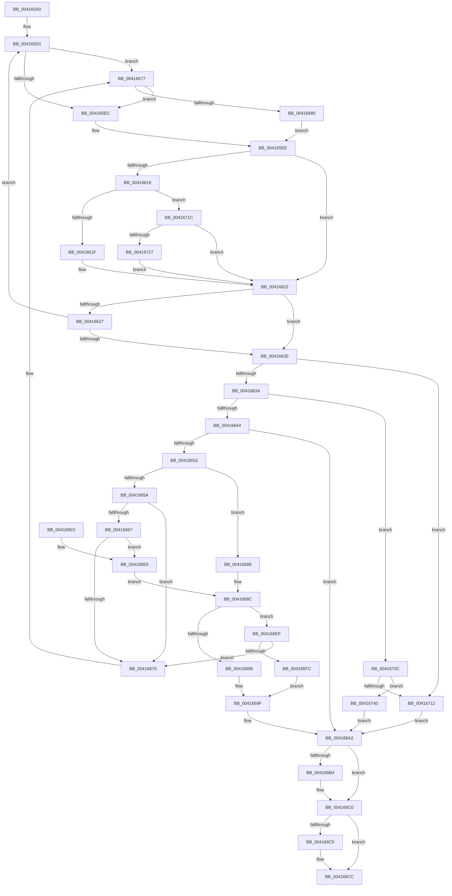

# ExpPrepareToWakeFastResourceShared

- RVA: `0x004165A0`–`0x00416758` (길이 `440` bytes)
- VA: `0x00000001404165A0`
- 실행 섹션: `.text`
- PDB 이름 있음: `예`; PDB Function 태그: `아니요`
- unwind 정보 RVA: `0x0009CA70`
- 디코드: `129`개 명령, `440/440` bytes 표시
- 미해석 바이트: `0` (있으면 어셈블리에 `.byte`로 보존)

> 이 문서는 커널 이미지의 기계어와 PDB 기호를 분석해 생성했습니다. 4번과 5번은 함수 원형과 자료형을 바이너리 사용 방식에서 추정한 C 해석이며 원본 소스 복구 결과는 아닙니다.

## 1. Dependencies

- 직접 호출 지점: **0**; 고유 호출 대상: **0**
- 직접 호출자로 확인된 함수: **1**
- RIP 상대 이미지 참조: **0**

### Outgoing calls
- 직접 디코드된 call 명령이 없습니다.

### Direct callers
- [ExpReleaseDisownedFastResourceShared](ExpReleaseDisownedFastResourceShared_function_00416338.md) at `0x004163B9`

### Static image references
- 디코드된 RIP-relative 메모리 참조가 없습니다.

## 2. Other-region calls and transfers

- 다른 실행 섹션으로 향하는 call: **0**
- 별도 외부 분기/꼬리 이동을 확인하지 못했습니다.

## 3. Assembly (complete function range)

```asm
004165A0  48 89 5C 24 08                  mov qword ptr [rsp + 8], rbx
004165A5  48 89 6C 24 10                  mov qword ptr [rsp + 0x10], rbp
004165AA  48 89 74 24 18                  mov qword ptr [rsp + 0x18], rsi
004165AF  48 89 7C 24 20                  mov qword ptr [rsp + 0x20], rdi
004165B4  41 56                           push r14
004165B6  41 57                           push r15
004165B8  4D 8B F1                        mov r14, r9
004165BB  4D 8B F8                        mov r15, r8
004165BE  48 8B FA                        mov rdi, rdx
004165C1  4C 8B D1                        mov r10, rcx
004165C4  0F 0D 09                        prefetchw byte ptr [rcx]
004165C7  48 8B 01                        mov rax, qword ptr [rcx]
004165CA  45 33 DB                        xor r11d, r11d
004165CD  41 8D 6B 01                     lea ebp, [r11 + 1]
004165D1  4D 8B 42 10                     mov r8, qword ptr [r10 + 0x10]
004165D5  4D 8D 4A 38                     lea r9, [r10 + 0x38]
004165D9  48 8B D8                        mov rbx, rax
004165DC  48 C1 FB 02                     sar rbx, 2
004165E0  48 FF CB                        dec rbx
004165E3  4D 85 C0                        test r8, r8
004165E6  0F 84 8B 00 00 00               je 0x140416677
004165EC  8B F5                           mov esi, ebp
004165EE  8B CE                           mov ecx, esi
004165F0  48 8B D0                        mov rdx, rax
004165F3  48 83 E2 FD                     and rdx, 0xfffffffffffffffd
004165F7  48 03 C9                        add rcx, rcx
004165FA  48 0B CA                        or rcx, rdx
004165FD  48 8B D1                        mov rdx, rcx
00416600  48 83 E2 FC                     and rdx, 0xfffffffffffffffc
00416604  48 FF CA                        dec rdx
00416607  48 33 D1                        xor rdx, rcx
0041660A  48 83 E2 FC                     and rdx, 0xfffffffffffffffc
0041660E  48 33 CA                        xor rcx, rdx
00416611  48 3B DD                        cmp rbx, rbp
00416614  73 0C                           jae 0x140416622
00416616  4D 85 C0                        test r8, r8
00416619  0F 84 FD 00 00 00               je 0x14041671c
0041661F  48 0B CD                        or rcx, rbp
00416622  48 3B C8                        cmp rcx, rax
00416625  74 07                           je 0x14041662e
00416627  F0 49 0F B1 0A                  lock cmpxchg qword ptr [r10], rcx
0041662C  75 A3                           jne 0x1404165d1
0041662E  49 8B CB                        mov rcx, r11
00416631  48 3B DD                        cmp rbx, rbp
00416634  0F 83 D8 00 00 00               jae 0x140416712
0041663A  49 39 4A 10                     cmp qword ptr [r10 + 0x10], rcx
0041663E  0F 84 C8 00 00 00               je 0x14041670c
00416644  33 C0                           xor eax, eax
00416646  48 89 07                        mov qword ptr [rdi], rax
00416649  49 8B 42 10                     mov rax, qword ptr [r10 + 0x10]
0041664D  48 85 C0                        test rax, rax
00416650  74 50                           je 0x1404166a2
00416652  48 8B 08                        mov rcx, qword ptr [rax]
00416655  48 3B C8                        cmp rcx, rax
00416658  74 2E                           je 0x140416688
0041665A  49 89 4A 10                     mov qword ptr [r10 + 0x10], rcx
0041665E  48 8B 10                        mov rdx, qword ptr [rax]
00416661  48 39 42 08                     cmp qword ptr [rdx + 8], rax
00416665  75 09                           jne 0x140416670
00416667  48 8B 48 08                     mov rcx, qword ptr [rax + 8]
0041666B  48 39 01                        cmp qword ptr [rcx], rax
0041666E  74 76                           je 0x1404166e6
00416670  B9 03 00 00 00                  mov ecx, 3
00416675  CD 29                           int 0x29
00416677  45 39 19                        cmp dword ptr [r9], r11d
0041667A  0F 87 6C FF FF FF               ja 0x1404165ec
00416680  41 8B F3                        mov esi, r11d
00416683  E9 66 FF FF FF                  jmp 0x1404165ee
00416688  4D 89 5A 10                     mov qword ptr [r10 + 0x10], r11
0041668C  48 8B 17                        mov rdx, qword ptr [rdi]
0041668F  48 8B 48 10                     mov rcx, qword ptr [rax + 0x10]
00416693  48 85 D2                        test rdx, rdx
00416696  75 57                           jne 0x1404166ef
00416698  48 89 40 08                     mov qword ptr [rax + 8], rax
0041669C  48 89 00                        mov qword ptr [rax], rax
0041669F  48 89 07                        mov qword ptr [rdi], rax
004166A2  48 8B 44 24 38                  mov rax, qword ptr [rsp + 0x38]
004166A7  41 89 2E                        mov dword ptr [r14], ebp
004166AA  49 89 0F                        mov qword ptr [r15], rcx
004166AD  44 89 18                        mov dword ptr [rax], r11d
004166B0  85 F6                           test esi, esi
004166B2  74 0C                           je 0x1404166c0
004166B4  C7 00 02 00 00 00               mov dword ptr [rax], 2
004166BA  41 BB 02 00 00 00               mov r11d, 2
004166C0  48 85 C9                        test rcx, rcx
004166C3  74 07                           je 0x1404166cc
004166C5  41 83 CB 01                     or r11d, 1
004166C9  44 89 18                        mov dword ptr [rax], r11d
004166CC  48 8B 5C 24 18                  mov rbx, qword ptr [rsp + 0x18]
004166D1  48 8B 6C 24 20                  mov rbp, qword ptr [rsp + 0x20]
004166D6  48 8B 74 24 28                  mov rsi, qword ptr [rsp + 0x28]
004166DB  48 8B 7C 24 30                  mov rdi, qword ptr [rsp + 0x30]
004166E0  41 5F                           pop r15
004166E2  41 5E                           pop r14
004166E4  C3                              ret
004166E5  CC                              int3
004166E6  48 89 11                        mov qword ptr [rcx], rdx
004166E9  48 89 4A 08                     mov qword ptr [rdx + 8], rcx
004166ED  EB 9D                           jmp 0x14041668c
004166EF  4C 8B 42 08                     mov r8, qword ptr [rdx + 8]
004166F3  49 39 10                        cmp qword ptr [r8], rdx
004166F6  0F 85 74 FF FF FF               jne 0x140416670
004166FC  48 89 10                        mov qword ptr [rax], rdx
004166FF  4C 89 40 08                     mov qword ptr [rax + 8], r8
00416703  49 89 00                        mov qword ptr [r8], rax
00416706  48 89 42 08                     mov qword ptr [rdx + 8], rax
0041670A  EB 93                           jmp 0x14041669f
0041670C  41 39 4A 38                     cmp dword ptr [r10 + 0x38], ecx
00416710  75 2E                           jne 0x140416740
00416712  33 C0                           xor eax, eax
00416714  41 8B EB                        mov ebp, r11d
00416717  48 89 07                        mov qword ptr [rdi], rax
0041671A  EB 86                           jmp 0x1404166a2
0041671C  41 8B 11                        mov edx, dword ptr [r9]
0041671F  85 D2                           test edx, edx
00416721  0F 84 FB FE FF FF               je 0x140416622
00416727  44 8B C2                        mov r8d, edx
0041672A  48 8B D1                        mov rdx, rcx
0041672D  48 83 E2 FC                     and rdx, 0xfffffffffffffffc
00416731  83 E1 03                        and ecx, 3
00416734  4E 8D 0C 82                     lea r9, [rdx + r8*4]
00416738  49 0B C9                        or rcx, r9
0041673B  E9 E2 FE FF FF                  jmp 0x140416622
00416740  49 8B 42 08                     mov rax, qword ptr [r10 + 8]
00416744  48 89 07                        mov qword ptr [rdi], rax
00416747  4D 89 5A 08                     mov qword ptr [r10 + 8], r11
0041674B  41 8B 6A 38                     mov ebp, dword ptr [r10 + 0x38]
0041674F  45 89 5A 38                     mov dword ptr [r10 + 0x38], r11d
00416753  E9 4A FF FF FF                  jmp 0x1404166a2
```

## 4. C-style interpretation (structured pseudocode)

```c
__int64 __fastcall ExpPrepareToWakeFastResourceShared(__int64 a1, __int64 a2, __int64 a3, __int64 a4, __int64 a5)
{
    __int64 result;
    __int64 v_r11;
    __int64 v_rbx;
    unsigned __int64 v_stack_p10;
    unsigned __int64 v_stack_p18;
    unsigned __int64 v_stack_p20;
    unsigned __int64 v_stack_p8;

    v_stack_p8 = v_rbx;
    v_stack_p10 = v_rbp;
    v_stack_p18 = v_rsi;
    v_stack_p20 = v_rdi;
    v_r11 = 0;
loc_004165D1:
    v_rbx = (*(unsigned __int64 *)(a1)) >> (2);
    v_rbx = (v_rbx) - 1;
    if (*(unsigned __int64 *)(a1 + 16) == 0) goto loc_00416677;
loc_004165EC:
loc_004165EE:
    a2 = (*(unsigned __int64 *)(a1)) & (-3);
    a1 = ((unsigned int)((unsigned int)((unsigned int)((unsigned int)(v_r11 + 1))))) + ((unsigned int)((unsigned int)((unsigned int)((unsigned int)(v_r11 + 1)))));
    a1 = (a1) | (a2);
    a2 = (a1) & (-4);
    a2 = (a2) - 1;
    a2 = (a2) ^ (a1);
    a2 = (a2) & (-4);
    a1 = (a1) ^ (a2);
    if (v_rbx >= (v_r11 + 1)) goto loc_00416622;
    if (*(unsigned __int64 *)(a1 + 16) == 0) goto loc_0041671C;
    a1 = (a1) | (v_r11 + 1);
loc_00416622:
    if (a1 == (*(unsigned __int64 *)(a1))) goto loc_0041662E;
    if (a1 != (*(unsigned __int64 *)(a1))) goto loc_004165D1;
loc_0041662E:
    if (v_rbx >= (v_r11 + 1)) goto loc_00416712;
    if ((*(unsigned __int64 *)(a1 + 16)) == 0) goto loc_0041670C;
    result = 0;
    *(unsigned __int64 *)(a2) = 0;
    if (*(unsigned __int64 *)(a1 + 16) == 0) goto loc_004166A2;
    if ((*(unsigned __int64 *)(*(unsigned __int64 *)(a1 + 16))) == (*(unsigned __int64 *)(a1 + 16))) goto loc_00416688;
    *(unsigned __int64 *)(a1 + 16) = *(unsigned __int64 *)(*(unsigned __int64 *)(a1 + 16));
    if ((*(unsigned __int64 *)(*(unsigned __int64 *)(*(unsigned __int64 *)(a1 + 16)) + 8)) != (*(unsigned __int64 *)(a1 + 16))) goto loc_00416670;
    if ((*(unsigned __int64 *)(*(unsigned __int64 *)(*(unsigned __int64 *)(a1 + 16) + 8))) == (*(unsigned __int64 *)(a1 + 16))) goto loc_004166E6;
loc_00416670:
loc_00416677:
    if ((*(unsigned int *)(a1 + 56)) > 0) goto loc_004165EC;
    goto loc_004165EE;
loc_00416688:
    *(unsigned __int64 *)(a1 + 16) = 0;
loc_0041668C:
    if (*(unsigned __int64 *)(a2) != 0) goto loc_004166EF;
    *(unsigned __int64 *)(*(unsigned __int64 *)(a1 + 16) + 8) = *(unsigned __int64 *)(a1 + 16);
    *(unsigned __int64 *)(*(unsigned __int64 *)(a1 + 16)) = *(unsigned __int64 *)(a1 + 16);
loc_0041669F:
    *(unsigned __int64 *)(a2) = *(unsigned __int64 *)(a1 + 16);
loc_004166A2:
    *(unsigned int *)(a4) = (unsigned int)(v_r11 + 1);
    *(unsigned __int64 *)(a3) = *(unsigned __int64 *)(*(unsigned __int64 *)(a1 + 16) + 16);
    *(unsigned int *)(a5) = 0;
    if (0 != 0) {
        *(unsigned int *)(a5) = 2;
        v_r11 = 2;
    }
    if (*(unsigned __int64 *)(*(unsigned __int64 *)(a1 + 16) + 16) != 0) {
        v_r11 = (unsigned int)((v_r11) | (1));
        *(unsigned int *)(a5) = (unsigned int)(v_r11);
    }
    return a5;
loc_004166E6:
    *(unsigned __int64 *)(*(unsigned __int64 *)(*(unsigned __int64 *)(a1 + 16) + 16)) = *(unsigned __int64 *)(a2);
    *(unsigned __int64 *)(*(unsigned __int64 *)(a2) + 8) = *(unsigned __int64 *)(*(unsigned __int64 *)(a1 + 16) + 16);
    goto loc_0041668C;
loc_004166EF:
    if ((*(unsigned __int64 *)(*(unsigned __int64 *)(*(unsigned __int64 *)(a2) + 8))) != (*(unsigned __int64 *)(a2))) goto loc_00416670;
    *(unsigned __int64 *)(a5) = *(unsigned __int64 *)(a2);
    *(unsigned __int64 *)(a5 + 8) = *(unsigned __int64 *)(*(unsigned __int64 *)(a2) + 8);
    *(unsigned __int64 *)(*(unsigned __int64 *)(*(unsigned __int64 *)(a2) + 8)) = a5;
    *(unsigned __int64 *)(*(unsigned __int64 *)(a2) + 8) = a5;
    goto loc_0041669F;
loc_0041670C:
    if ((*(unsigned int *)(a1 + 56)) != ((unsigned int)(*(unsigned __int64 *)(*(unsigned __int64 *)(a1 + 16) + 16)))) goto loc_00416740;
loc_00416712:
    result = 0;
    *(unsigned __int64 *)(v_stack_p20) = 0;
    goto loc_004166A2;
loc_0041671C:
    if ((unsigned int)((unsigned int)(*(unsigned int *)(a1 + 56))) == 0) goto loc_00416622;
    a2 = (*(unsigned __int64 *)(*(unsigned __int64 *)(a1 + 16) + 16)) & (-4);
    a1 = (unsigned int)((*(unsigned __int64 *)(*(unsigned __int64 *)(a1 + 16) + 16)) & (3));
    a1 = (a1) | (a2 + (unsigned int)((unsigned int)((unsigned int)(*(unsigned int *)(a1 + 56)))) * 4);
    goto loc_00416622;
loc_00416740:
    *(unsigned __int64 *)(v_stack_p20) = *(unsigned __int64 *)(a1 + 8);
    *(unsigned __int64 *)(a1 + 8) = v_r11;
    *(unsigned int *)(a1 + 56) = (unsigned int)(v_r11);
    goto loc_004166A2;
}
```

## 5. (Beta) C Style

```c
void *ExpPrepareToWakeFastResourceShared(void *Arg1, void *Arg2, void *Arg3, void *Arg4, void *Arg5)
{
    uint8_t *arg1 = (uint8_t *)Arg1;
    uint8_t *arg2 = (uint8_t *)Arg2;
    uint8_t *arg3 = (uint8_t *)Arg3;
    uint8_t *arg4 = (uint8_t *)Arg4;
    uint8_t *arg5 = (uint8_t *)Arg5;

    int64_t result;
    int64_t local_r11;
    int64_t local_rbx;
    uint64_t v_stack_p10;
    uint64_t v_stack_p18;
    uint64_t v_stack_p20;
    uint64_t v_stack_p8;

    v_stack_p8 = local_rbx;
    v_stack_p10 = local_rbp;
    v_stack_p18 = local_rsi;
    v_stack_p20 = local_rdi;
    local_r11 = 0;
loc_004165D1:
    local_rbx = (*(uint64_t *)(arg1)) >> (2);
    local_rbx = (local_rbx) - 1;
    if (*(uint64_t *)(arg1 + 0x10) == 0) goto loc_00416677;
loc_004165EC:
loc_004165EE:
    Arg2 = (*(uint64_t *)(arg1)) & (-3);
    Arg1 = ((uint32_t)((uint32_t)((uint32_t)((uint32_t)(local_r11 + 1))))) + ((uint32_t)((uint32_t)((uint32_t)((uint32_t)(local_r11 + 1)))));
    Arg1 = (Arg1) | (Arg2);
    Arg2 = (Arg1) & (-4);
    Arg2 = (Arg2) - 1;
    Arg2 = (Arg2) ^ (Arg1);
    Arg2 = (Arg2) & (-4);
    Arg1 = (Arg1) ^ (Arg2);
    if (local_rbx >= (local_r11 + 1)) goto loc_00416622;
    if (*(uint64_t *)(arg1 + 0x10) == 0) goto loc_0041671C;
    Arg1 = (Arg1) | (local_r11 + 1);
loc_00416622:
    if (Arg1 == (*(uint64_t *)(arg1))) goto loc_0041662E;
    if (Arg1 != (*(uint64_t *)(arg1))) goto loc_004165D1;
loc_0041662E:
    if (local_rbx >= (local_r11 + 1)) goto loc_00416712;
    if ((*(uint64_t *)(arg1 + 0x10)) == 0) goto loc_0041670C;
    result = 0;
    *(uint64_t *)(arg2) = 0;
    if (*(uint64_t *)(arg1 + 0x10) == 0) goto loc_004166A2;
    if ((*(uint64_t *)(*(uint64_t *)(arg1 + 0x10))) == (*(uint64_t *)(arg1 + 0x10))) goto loc_00416688;
    *(uint64_t *)(arg1 + 0x10) = *(uint64_t *)(*(uint64_t *)(arg1 + 0x10));
    if ((*(uint64_t *)(*(uint64_t *)(*(uint64_t *)(arg1 + 0x10)) + 0x8)) != (*(uint64_t *)(arg1 + 0x10))) goto loc_00416670;
    if ((*(uint64_t *)(*(uint64_t *)(*(uint64_t *)(arg1 + 0x10) + 0x8))) == (*(uint64_t *)(arg1 + 0x10))) goto loc_004166E6;
loc_00416670:
loc_00416677:
    if ((*(uint32_t *)(arg1 + 0x38)) > 0) goto loc_004165EC;
    goto loc_004165EE;
loc_00416688:
    *(uint64_t *)(arg1 + 0x10) = 0;
loc_0041668C:
    if (*(uint64_t *)(arg2) != 0) goto loc_004166EF;
    *(uint64_t *)(*(uint64_t *)(arg1 + 0x10) + 0x8) = *(uint64_t *)(arg1 + 0x10);
    *(uint64_t *)(*(uint64_t *)(arg1 + 0x10)) = *(uint64_t *)(arg1 + 0x10);
loc_0041669F:
    *(uint64_t *)(arg2) = *(uint64_t *)(arg1 + 0x10);
loc_004166A2:
    *(uint32_t *)(arg4) = (uint32_t)(local_r11 + 1);
    *(uint64_t *)(arg3) = *(uint64_t *)(*(uint64_t *)(arg1 + 0x10) + 0x10);
    *(uint32_t *)(arg5) = 0;
    if (0 != 0) {
        *(uint32_t *)(arg5) = 2;
        local_r11 = 2;
    }
    if (*(uint64_t *)(*(uint64_t *)(arg1 + 0x10) + 0x10) != 0) {
        local_r11 = (uint32_t)((local_r11) | (1));
        *(uint32_t *)(arg5) = (uint32_t)(local_r11);
    }
    return Arg5;
loc_004166E6:
    *(uint64_t *)(*(uint64_t *)(*(uint64_t *)(arg1 + 0x10) + 0x10)) = *(uint64_t *)(arg2);
    *(uint64_t *)(*(uint64_t *)(arg2) + 0x8) = *(uint64_t *)(*(uint64_t *)(arg1 + 0x10) + 0x10);
    goto loc_0041668C;
loc_004166EF:
    if ((*(uint64_t *)(*(uint64_t *)(*(uint64_t *)(arg2) + 0x8))) != (*(uint64_t *)(arg2))) goto loc_00416670;
    *(uint64_t *)(arg5) = *(uint64_t *)(arg2);
    *(uint64_t *)(arg5 + 0x8) = *(uint64_t *)(*(uint64_t *)(arg2) + 0x8);
    *(void **)(*(uint64_t *)(*(uint64_t *)(arg2) + 0x8)) = Arg5;
    *(void **)(*(uint64_t *)(arg2) + 0x8) = Arg5;
    goto loc_0041669F;
loc_0041670C:
    if ((*(uint32_t *)(arg1 + 0x38)) != ((uint32_t)(*(uint64_t *)(*(uint64_t *)(arg1 + 0x10) + 0x10)))) goto loc_00416740;
loc_00416712:
    result = 0;
    *(uint64_t *)(v_stack_p20) = 0;
    goto loc_004166A2;
loc_0041671C:
    if ((uint32_t)((uint32_t)(*(uint32_t *)(arg1 + 0x38))) == 0) goto loc_00416622;
    Arg2 = (*(uint64_t *)(*(uint64_t *)(arg1 + 0x10) + 0x10)) & (-4);
    Arg1 = (uint32_t)((*(uint64_t *)(*(uint64_t *)(arg1 + 0x10) + 0x10)) & (3));
    Arg1 = (Arg1) | (Arg2 + (uint32_t)((uint32_t)((uint32_t)(*(uint32_t *)(arg1 + 0x38)))) * 4);
    goto loc_00416622;
loc_00416740:
    *(uint64_t *)(v_stack_p20) = *(uint64_t *)(arg1 + 0x8);
    *(uint64_t *)(arg1 + 0x8) = local_r11;
    *(uint32_t *)(arg1 + 0x38) = (uint32_t)(local_r11);
    goto loc_004166A2;
}
```

### 관측된 메모리 오프셋

구조체 형식이 확인되지 않은 접근은 인자 기준의 오프셋으로만 기록했습니다.

| 기준 인자 | 오프셋 표현 | 폭 (bit) | 접근 |
|---|---:|---:|---|
| `Arg1` | `+ 0x0` | `8` | `R` |
| `Arg1` | `+ 0x0` | `64` | `R` |
| `Arg1` | `+ 0x8` | `64` | `R` |
| `Arg1` | `+ 0x8` | `64` | `W` |
| `Arg1` | `+ 0x10` | `64` | `R` |
| `Arg1` | `+ 0x10` | `64` | `W` |
| `Arg1` | `+ 0x38` | `32` | `R` |
| `Arg1` | `+ 0x38` | `32` | `W` |
| `Arg1` | `+ 0x38` | `64` | `R` |
| `Arg2` | `+ 0x0` | `64` | `R` |
| `Arg2` | `+ 0x0` | `64` | `W` |
| `Arg3` | `+ 0x0` | `64` | `W` |
| `Arg4` | `+ 0x0` | `32` | `W` |
| `Arg5` | `+ 0x0` | `32` | `W` |

## 6. Execution-region graph

[열기: 2D/3D 그래프와 함수 탐색 컨트롤 패널](../../../control-panel.html?section=text&rva=0x004165A0&view=graph)

- 2D 그래프는 위에서 아래로 흐르고, 3D 그래프는 빈 공간을 드래그해 회전합니다. Shift+드래그는 이동, 휠은 확대·축소, 함수 노드 선택은 대상 보고서 이동입니다.

### Static fallback


