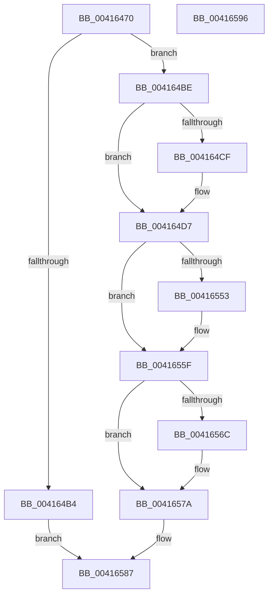

# ExpReleaseDisownedFastResourceExclusive

- RVA: `0x00416470`–`0x00416597` (길이 `295` bytes)
- VA: `0x0000000140416470`
- 실행 섹션: `.text`
- PDB 이름 있음: `예`; PDB Function 태그: `아니요`
- unwind 정보 RVA: `0x0009CA58`
- 디코드: `86`개 명령, `295/295` bytes 표시
- 미해석 바이트: `0` (있으면 어셈블리에 `.byte`로 보존)

> 이 문서는 커널 이미지의 기계어와 PDB 기호를 분석해 생성했습니다. 4번과 5번은 함수 원형과 자료형을 바이너리 사용 방식에서 추정한 C 해석이며 원본 소스 복구 결과는 아닙니다.

## 1. Dependencies

- 직접 호출 지점: **11**; 고유 호출 대상: **11**
- 직접 호출자로 확인된 함수: **3**
- RIP 상대 이미지 참조: **1**

### Outgoing calls
- `0x004164D2` → [KiRaiseIrqlProcessIrqlFlags](../4F/KiRaiseIrqlProcessIrqlFlags_function_004F56FC.md) (function, `0x004F56FC`)
- `0x004164E9` → [KeAcquireSpinLockAtDpcLevel](../20/KeAcquireSpinLockAtDpcLevel_function_00208430.md) (function, `0x00208430`)
- `0x004164F1` → [ExpRemoveFastOwnerEntryFromThreadList](ExpRemoveFastOwnerEntryFromThreadList_function_00416760.md) (function, `0x00416760`)
- `0x004164F9` → [KxReleaseSpinLock](../20/KxReleaseSpinLock_function_00206670.md) (function, `0x00206670`)
- `0x00416506` → [KeAcquireInStackQueuedSpinLockAtDpcLevel](../27/KeAcquireInStackQueuedSpinLockAtDpcLevel_function_00275740.md) (function, `0x00275740`)
- `0x0041652F` → [ExpPrepareToWakeFastResourceExclusive](ExpPrepareToWakeFastResourceExclusive_function_0041C8D0.md) (function, `0x0041C8D0`)
- `0x00416538` → [KeReleaseInStackQueuedSpinLockFromDpcLevel](../21/KeReleaseInStackQueuedSpinLockFromDpcLevel_function_002171B0.md) (function, `0x002171B0`)
- `0x00416545` → [ExpCommitWakeFastResource](../21/ExpCommitWakeFastResource_function_00219E80.md) (function, `0x00219E80`)
- `0x0041655A` → [KiLowerIrqlProcessIrqlFlags](../4F/KiLowerIrqlProcessIrqlFlags_function_004F5698.md) (function, `0x004F5698`)
- `0x00416575` → [KeAbCrossThreadRelease](KeAbCrossThreadRelease_function_00416794.md) (function, `0x00416794`)
- `0x00416582` → [ObfDereferenceObjectWithTag](../2F/ObfDereferenceObjectWithTag_function_002F78E0.md) (function, `0x002F78E0`)

### Direct callers
- [ExReleaseDisownedFastResource](ExReleaseDisownedFastResource_function_00416230.md) at `0x004162EC`
- [ExReleaseDisownedFastResourceExclusive](../65/ExReleaseDisownedFastResourceExclusive_function_006586D0.md) at `0x006587AF`
- [ExReleaseDisownedFastResourceShared](../65/ExReleaseDisownedFastResourceShared_function_006587C0.md) at `0x006588D3`

### Static image references
- `0x004164C6` → RVA `0x00FC6D20` (`ALMOSTRO`; read)

## 2. Other-region calls and transfers

- 다른 실행 섹션으로 향하는 call: **0**
- 별도 외부 분기/꼬리 이동을 확인하지 못했습니다.

## 3. Assembly (complete function range)

```asm
00416470  40 55                           push rbp
00416472  53                              push rbx
00416473  56                              push rsi
00416474  57                              push rdi
00416475  41 55                           push r13
00416477  41 56                           push r14
00416479  41 57                           push r15
0041647B  48 8B EC                        mov rbp, rsp
0041647E  48 83 EC 50                     sub rsp, 0x50
00416482  44 0F B6 7A 24                  movzx r15d, byte ptr [rdx + 0x24]
00416487  33 C0                           xor eax, eax
00416489  48 21 45 58                     and qword ptr [rbp + 0x58], rax
0041648D  48 8B FA                        mov rdi, rdx
00416490  48 21 45 E0                     and qword ptr [rbp - 0x20], rax
00416494  0F 57 C0                        xorps xmm0, xmm0
00416497  21 45 50                        and dword ptr [rbp + 0x50], eax
0041649A  4C 8B E9                        mov r13, rcx
0041649D  21 45 48                        and dword ptr [rbp + 0x48], eax
004164A0  48 89 45 F8                     mov qword ptr [rbp - 8], rax
004164A4  8B 42 20                        mov eax, dword ptr [rdx + 0x20]
004164A7  BA 02 00 00 00                  mov edx, 2
004164AC  0F 11 45 E8                     movups xmmword ptr [rbp - 0x18], xmm0
004164B0  3B C2                           cmp eax, edx
004164B2  7C 0A                           jl 0x1404164be
004164B4  FF C8                           dec eax
004164B6  89 47 20                        mov dword ptr [rdi + 0x20], eax
004164B9  E9 C9 00 00 00                  jmp 0x140416587
004164BE  44 0F 20 C6                     mov rsi, cr8
004164C2  44 0F 22 C2                     mov cr8, rdx
004164C6  83 3D 53 08 BB 00 00            cmp dword ptr [rip + 0xbb0853], 0
004164CD  74 08                           je 0x1404164d7
004164CF  40 8A CE                        mov cl, sil
004164D2  E8 25 F2 0D 00                  call 0x1404f56fc
004164D7  4C 8B 77 10                     mov r14, qword ptr [rdi + 0x10]
004164DB  49 83 E6 FE                     and r14, 0xfffffffffffffffe
004164DF  49 8D 9E C8 06 00 00            lea rbx, [r14 + 0x6c8]
004164E6  48 8B CB                        mov rcx, rbx
004164E9  E8 42 1F DF FF                  call 0x140208430
004164EE  48 8B CF                        mov rcx, rdi
004164F1  E8 6A 02 00 00                  call 0x140416760
004164F6  48 8B CB                        mov rcx, rbx
004164F9  E8 72 01 DF FF                  call 0x140206670
004164FE  49 8D 4D 30                     lea rcx, [r13 + 0x30]
00416502  48 8D 55 E8                     lea rdx, [rbp - 0x18]
00416506  E8 35 F2 E5 FF                  call 0x140275740
0041650B  48 83 67 10 00                  and qword ptr [rdi + 0x10], 0
00416510  48 8D 45 48                     lea rax, [rbp + 0x48]
00416514  FF 4F 20                        dec dword ptr [rdi + 0x20]
00416517  4C 8D 4D 50                     lea r9, [rbp + 0x50]
0041651B  4C 8D 45 E0                     lea r8, [rbp - 0x20]
0041651F  48 89 44 24 20                  mov qword ptr [rsp + 0x20], rax
00416524  48 8D 55 58                     lea rdx, [rbp + 0x58]
00416528  C6 47 24 00                     mov byte ptr [rdi + 0x24], 0
0041652C  49 8B CD                        mov rcx, r13
0041652F  E8 9C 63 00 00                  call 0x14041c8d0
00416534  48 8D 4D E8                     lea rcx, [rbp - 0x18]
00416538  E8 73 0C E0 FF                  call 0x1402171b0
0041653D  44 8B 4D 48                     mov r9d, dword ptr [rbp + 0x48]
00416541  48 8D 4D 58                     lea rcx, [rbp + 0x58]
00416545  E8 36 39 E0 FF                  call 0x140219e80
0041654A  83 3D CF 07 BB 00 00            cmp dword ptr [rip + 0xbb07cf], 0
00416551  74 0C                           je 0x14041655f
00416553  44 0F 20 C1                     mov rcx, cr8
00416557  40 8A D6                        mov dl, sil
0041655A  E8 39 F1 0D 00                  call 0x1404f5698
0041655F  40 0F B6 C6                     movzx eax, sil
00416563  44 0F 22 C0                     mov cr8, rax
00416567  45 84 FF                        test r15b, r15b
0041656A  74 0E                           je 0x14041657a
0041656C  49 8B D7                        mov rdx, r15
0041656F  4D 8B C6                        mov r8, r14
00416572  49 8B CD                        mov rcx, r13
00416575  E8 1A 02 00 00                  call 0x140416794
0041657A  BA 44 66 6C 74                  mov edx, 0x746c6644
0041657F  49 8B CE                        mov rcx, r14
00416582  E8 59 13 EE FF                  call 0x1402f78e0
00416587  48 83 C4 50                     add rsp, 0x50
0041658B  41 5F                           pop r15
0041658D  41 5E                           pop r14
0041658F  41 5D                           pop r13
00416591  5F                              pop rdi
00416592  5E                              pop rsi
00416593  5B                              pop rbx
00416594  5D                              pop rbp
00416595  C3                              ret
00416596  CC                              int3
```

## 4. C-style interpretation (structured pseudocode)

```c
__int64 __fastcall ExpReleaseDisownedFastResourceExclusive(__int64 a1, __int64 a2)
{
    __int64 result;
    __int64 v_r14;
    __int64 v_rsp;
    unsigned __int64 v_stack_m40;
    unsigned __int64 v_stack_m50;
    unsigned __int64 v_stack_m58;
    unsigned __int64 v_stack_m68;
    unsigned int v_stack_p10;
    unsigned int v_stack_p18;
    unsigned __int64 v_stack_p20;

    v_rsp = (v_rsp) - (80);
    result = 0;
    v_stack_m40 = 0;
    v_stack_m50 = v_xmm0;
    if (((unsigned int)((unsigned int)(*(unsigned int *)(a2 + 32)))) < 2) goto loc_004164BE;
    result = (unsigned int)(((unsigned int)(*(unsigned int *)(a2 + 32))) - 1);
    *(unsigned int *)(a2 + 32) = (unsigned int)(result);
    goto loc_00416587;
loc_004164BE:
    if ((*(unsigned int *)(v_rip + 12257363)) != 0) {
        a1 = (unsigned __int8)(v_cr8);
        result = KiRaiseIrqlProcessIrqlFlags(a1, 2, a3, a4);
    }
    v_r14 = (*(unsigned __int64 *)(a2 + 16)) & (-2);
    result = KeAcquireSpinLockAtDpcLevel(v_r14 + 1736, 2, a3, a4);
    result = ExpRemoveFastOwnerEntryFromThreadList(a2, 2, a3, a4);
    result = KxReleaseSpinLock(v_r14 + 1736, 2, a3, a4);
    result = KeAcquireInStackQueuedSpinLockAtDpcLevel(a1 + 48, v_stack_m50, a3, a4);
    v_stack_m68 = v_stack_p10;
    *(unsigned __int8 *)(a2 + 36) = 0;
    result = ExpPrepareToWakeFastResourceExclusive(a1, v_stack_p20, v_stack_m58, v_stack_p18);
    result = KeReleaseInStackQueuedSpinLockFromDpcLevel(v_stack_m50, v_stack_p20, v_stack_m58, v_stack_p18);
    result = ExpCommitWakeFastResource(v_stack_p20, v_stack_p20, v_stack_m58, (unsigned int)(v_stack_p10));
    if ((*(unsigned int *)(v_rip + 12257231)) != 0) {
        a1 = 2;
        a2 = (unsigned __int8)(v_cr8);
        result = KiLowerIrqlProcessIrqlFlags(a1, a2, v_stack_m58, (unsigned int)(v_stack_p10));
    }
    result = (unsigned __int8)(v_cr8);
    if ((unsigned __int8)(*(unsigned __int8 *)(a2 + 36)) != 0) {
        a2 = *(unsigned __int8 *)(a2 + 36);
        a3 = v_r14;
        a1 = a1;
        result = KeAbCrossThreadRelease(a1, a2, a3, (unsigned int)(v_stack_p10));
    }
    result = ObfDereferenceObjectWithTag(v_r14, (unsigned int)(0x746C6644ULL), a3, (unsigned int)(v_stack_p10));
loc_00416587:
    v_rsp = (v_rsp) + (80);
    return result;
}
```

## 5. (Beta) C Style

```c
int64_t ExpReleaseDisownedFastResourceExclusive(void *Arg1, void *Arg2)
{
    uint8_t *arg1 = (uint8_t *)Arg1;
    uint8_t *arg2 = (uint8_t *)Arg2;

    int64_t result;
    int64_t local_r14;
    int64_t local_rsp;
    uint64_t v_stack_m40;
    uint64_t v_stack_m50;
    uint64_t v_stack_m58;
    uint64_t v_stack_m68;
    uint32_t v_stack_p10;
    uint32_t v_stack_p18;
    uint64_t v_stack_p20;

    local_rsp = (local_rsp) - (80);
    result = 0;
    v_stack_m40 = 0;
    v_stack_m50 = v_xmm0;
    if (((uint32_t)((uint32_t)(*(uint32_t *)(arg2 + 0x20)))) < 2) goto loc_004164BE;
    result = (uint32_t)(((uint32_t)(*(uint32_t *)(arg2 + 0x20))) - 1);
    *(uint32_t *)(arg2 + 0x20) = (uint32_t)(result);
    goto loc_00416587;
loc_004164BE:
    if ((*(uint32_t *)(v_rip + 0xBB0853)) != 0) {
        Arg1 = (uint8_t)(v_cr8);
        result = KiRaiseIrqlProcessIrqlFlags(Arg1, 2, a3, a4);
    }
    local_r14 = (*(uint64_t *)(arg2 + 0x10)) & (-2);
    result = KeAcquireSpinLockAtDpcLevel(local_r14 + 1736, 2, a3, a4);
    result = ExpRemoveFastOwnerEntryFromThreadList(Arg2, 2, a3, a4);
    result = KxReleaseSpinLock(local_r14 + 1736, 2, a3, a4);
    result = KeAcquireInStackQueuedSpinLockAtDpcLevel(Arg1 + 48, v_stack_m50, a3, a4);
    v_stack_m68 = v_stack_p10;
    *(uint8_t *)(arg2 + 0x24) = 0;
    result = ExpPrepareToWakeFastResourceExclusive(Arg1, v_stack_p20, v_stack_m58, v_stack_p18);
    result = KeReleaseInStackQueuedSpinLockFromDpcLevel(v_stack_m50, v_stack_p20, v_stack_m58, v_stack_p18);
    result = ExpCommitWakeFastResource(v_stack_p20, v_stack_p20, v_stack_m58, (uint32_t)(v_stack_p10));
    if ((*(uint32_t *)(v_rip + 0xBB07CF)) != 0) {
        Arg1 = 2;
        Arg2 = (uint8_t)(v_cr8);
        result = KiLowerIrqlProcessIrqlFlags(Arg1, Arg2, v_stack_m58, (uint32_t)(v_stack_p10));
    }
    result = (uint8_t)(v_cr8);
    if ((uint8_t)(*(uint8_t *)(arg2 + 0x24)) != 0) {
        Arg2 = *(uint8_t *)(arg2 + 0x24);
        a3 = local_r14;
        Arg1 = Arg1;
        result = KeAbCrossThreadRelease(Arg1, Arg2, a3, (uint32_t)(v_stack_p10));
    }
    result = ObfDereferenceObjectWithTag(local_r14, (uint32_t)(0x746C6644ULL), a3, (uint32_t)(v_stack_p10));
loc_00416587:
    local_rsp = (local_rsp) + (80);
    return result;
}
```

### 관측된 메모리 오프셋

구조체 형식이 확인되지 않은 접근은 인자 기준의 오프셋으로만 기록했습니다.

| 기준 인자 | 오프셋 표현 | 폭 (bit) | 접근 |
|---|---:|---:|---|
| `Arg1` | `+ 0x30` | `64` | `R` |
| `Arg2` | `+ 0x10` | `64` | `R` |
| `Arg2` | `+ 0x10` | `64` | `R/W` |
| `Arg2` | `+ 0x20` | `32` | `R` |
| `Arg2` | `+ 0x20` | `32` | `R/W` |
| `Arg2` | `+ 0x20` | `32` | `W` |
| `Arg2` | `+ 0x24` | `8` | `R` |
| `Arg2` | `+ 0x24` | `8` | `W` |

## 6. Execution-region graph

[열기: 2D/3D 그래프와 함수 탐색 컨트롤 패널](../../../control-panel.html?section=text&rva=0x00416470&view=graph)

- 2D 그래프는 위에서 아래로 흐르고, 3D 그래프는 빈 공간을 드래그해 회전합니다. Shift+드래그는 이동, 휠은 확대·축소, 함수 노드 선택은 대상 보고서 이동입니다.

### Static fallback


