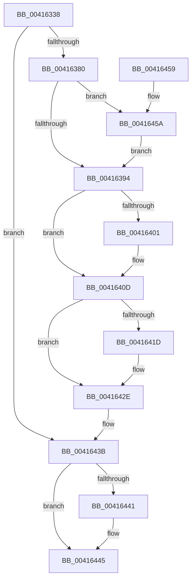

# ExpReleaseDisownedFastResourceShared

- RVA: `0x00416338`–`0x00416467` (길이 `303` bytes)
- VA: `0x0000000140416338`
- 실행 섹션: `.text`
- PDB 이름 있음: `예`; PDB Function 태그: `아니요`
- unwind 정보 RVA: `0x0009CA40`
- 디코드: `83`개 명령, `303/303` bytes 표시
- 미해석 바이트: `0` (있으면 어셈블리에 `.byte`로 보존)

> 이 문서는 커널 이미지의 기계어와 PDB 기호를 분석해 생성했습니다. 4번과 5번은 함수 원형과 자료형을 바이너리 사용 방식에서 추정한 C 해석이며 원본 소스 복구 결과는 아닙니다.

## 1. Dependencies

- 직접 호출 지점: **11**; 고유 호출 대상: **11**
- 직접 호출자로 확인된 함수: **2**
- RIP 상대 이미지 참조: **1**

### Outgoing calls
- `0x0041639C` → [KeAcquireInStackQueuedSpinLockAtDpcLevel](../27/KeAcquireInStackQueuedSpinLockAtDpcLevel_function_00275740.md) (function, `0x00275740`)
- `0x004163B9` → [ExpPrepareToWakeFastResourceShared](ExpPrepareToWakeFastResourceShared_function_004165A0.md) (function, `0x004165A0`)
- `0x004163C2` → [KeReleaseInStackQueuedSpinLockFromDpcLevel](../21/KeReleaseInStackQueuedSpinLockFromDpcLevel_function_002171B0.md) (function, `0x002171B0`)
- `0x004163D1` → [KeAcquireSpinLockAtDpcLevel](../20/KeAcquireSpinLockAtDpcLevel_function_00208430.md) (function, `0x00208430`)
- `0x004163D9` → [ExpRemoveFastOwnerEntryFromThreadList](ExpRemoveFastOwnerEntryFromThreadList_function_00416760.md) (function, `0x00416760`)
- `0x004163E6` → [KxReleaseSpinLock](../20/KxReleaseSpinLock_function_00206670.md) (function, `0x00206670`)
- `0x004163F3` → [ExpCommitWakeFastResource](../21/ExpCommitWakeFastResource_function_00219E80.md) (function, `0x00219E80`)
- `0x00416408` → [KiLowerIrqlProcessIrqlFlags](../4F/KiLowerIrqlProcessIrqlFlags_function_004F5698.md) (function, `0x004F5698`)
- `0x00416425` → [KeAbCrossThreadRelease](KeAbCrossThreadRelease_function_00416794.md) (function, `0x00416794`)
- `0x00416436` → [ObfDereferenceObjectWithTag](../2F/ObfDereferenceObjectWithTag_function_002F78E0.md) (function, `0x002F78E0`)
- `0x0041645D` → [KiRaiseIrqlProcessIrqlFlags](../4F/KiRaiseIrqlProcessIrqlFlags_function_004F56FC.md) (function, `0x004F56FC`)

### Direct callers
- [ExReleaseDisownedFastResource](ExReleaseDisownedFastResource_function_00416230.md) at `0x004162E1`
- [ExReleaseDisownedFastResourceShared](../65/ExReleaseDisownedFastResourceShared_function_006587C0.md) at `0x006588DA`

### Static image references
- `0x00416388` → RVA `0x00FC6D20` (`ALMOSTRO`; read)

## 2. Other-region calls and transfers

- 다른 실행 섹션으로 향하는 call: **0**
- 별도 외부 분기/꼬리 이동을 확인하지 못했습니다.

## 3. Assembly (complete function range)

```asm
00416338  48 89 5C 24 08                  mov qword ptr [rsp + 8], rbx
0041633D  55                              push rbp
0041633E  56                              push rsi
0041633F  57                              push rdi
00416340  41 56                           push r14
00416342  41 57                           push r15
00416344  48 8B EC                        mov rbp, rsp
00416347  48 83 EC 50                     sub rsp, 0x50
0041634B  48 8B 72 10                     mov rsi, qword ptr [rdx + 0x10]
0041634F  33 C0                           xor eax, eax
00416351  48 21 45 48                     and qword ptr [rbp + 0x48], rax
00416355  48 8B FA                        mov rdi, rdx
00416358  48 21 45 E0                     and qword ptr [rbp - 0x20], rax
0041635C  48 83 E6 FE                     and rsi, 0xfffffffffffffffe
00416360  21 45 40                        and dword ptr [rbp + 0x40], eax
00416363  0F 57 C0                        xorps xmm0, xmm0
00416366  21 45 38                        and dword ptr [rbp + 0x38], eax
00416369  8D 50 02                        lea edx, [rax + 2]
0041636C  4C 8B F9                        mov r15, rcx
0041636F  48 89 45 F8                     mov qword ptr [rbp - 8], rax
00416373  0F 11 45 E8                     movups xmmword ptr [rbp - 0x18], xmm0
00416377  39 57 20                        cmp dword ptr [rdi + 0x20], edx
0041637A  0F 8D BB 00 00 00               jge 0x14041643b
00416380  45 0F 20 C6                     mov r14, cr8
00416384  44 0F 22 C2                     mov cr8, rdx
00416388  39 05 92 09 BB 00               cmp dword ptr [rip + 0xbb0992], eax
0041638E  0F 85 C6 00 00 00               jne 0x14041645a
00416394  49 8D 4F 30                     lea rcx, [r15 + 0x30]
00416398  48 8D 55 E8                     lea rdx, [rbp - 0x18]
0041639C  E8 9F F3 E5 FF                  call 0x140275740
004163A1  48 8D 45 38                     lea rax, [rbp + 0x38]
004163A5  49 8B CF                        mov rcx, r15
004163A8  4C 8D 4D 40                     lea r9, [rbp + 0x40]
004163AC  48 89 44 24 20                  mov qword ptr [rsp + 0x20], rax
004163B1  4C 8D 45 E0                     lea r8, [rbp - 0x20]
004163B5  48 8D 55 48                     lea rdx, [rbp + 0x48]
004163B9  E8 E2 01 00 00                  call 0x1404165a0
004163BE  48 8D 4D E8                     lea rcx, [rbp - 0x18]
004163C2  E8 E9 0D E0 FF                  call 0x1402171b0
004163C7  48 8D 9E C8 06 00 00            lea rbx, [rsi + 0x6c8]
004163CE  48 8B CB                        mov rcx, rbx
004163D1  E8 5A 20 DF FF                  call 0x140208430
004163D6  48 8B CF                        mov rcx, rdi
004163D9  E8 82 03 00 00                  call 0x140416760
004163DE  48 83 67 18 00                  and qword ptr [rdi + 0x18], 0
004163E3  48 8B CB                        mov rcx, rbx
004163E6  E8 85 02 DF FF                  call 0x140206670
004163EB  44 8B 4D 38                     mov r9d, dword ptr [rbp + 0x38]
004163EF  48 8D 4D 48                     lea rcx, [rbp + 0x48]
004163F3  E8 88 3A E0 FF                  call 0x140219e80
004163F8  83 3D 21 09 BB 00 00            cmp dword ptr [rip + 0xbb0921], 0
004163FF  74 0C                           je 0x14041640d
00416401  44 0F 20 C1                     mov rcx, cr8
00416405  41 8A D6                        mov dl, r14b
00416408  E8 8B F2 0D 00                  call 0x1404f5698
0041640D  41 0F B6 C6                     movzx eax, r14b
00416411  44 0F 22 C0                     mov cr8, rax
00416415  0F B6 47 24                     movzx eax, byte ptr [rdi + 0x24]
00416419  84 C0                           test al, al
0041641B  74 11                           je 0x14041642e
0041641D  8B D0                           mov edx, eax
0041641F  4C 8B C6                        mov r8, rsi
00416422  49 8B CF                        mov rcx, r15
00416425  E8 6A 03 00 00                  call 0x140416794
0041642A  C6 47 24 00                     mov byte ptr [rdi + 0x24], 0
0041642E  BA 44 66 6C 74                  mov edx, 0x746c6644
00416433  48 8B CE                        mov rcx, rsi
00416436  E8 A5 14 EE FF                  call 0x1402f78e0
0041643B  83 6F 20 01                     sub dword ptr [rdi + 0x20], 1
0041643F  75 04                           jne 0x140416445
00416441  48 89 77 10                     mov qword ptr [rdi + 0x10], rsi
00416445  48 8B 9C 24 80 00 00 00         mov rbx, qword ptr [rsp + 0x80]
0041644D  48 83 C4 50                     add rsp, 0x50
00416451  41 5F                           pop r15
00416453  41 5E                           pop r14
00416455  5F                              pop rdi
00416456  5E                              pop rsi
00416457  5D                              pop rbp
00416458  C3                              ret
00416459  CC                              int3
0041645A  41 8A CE                        mov cl, r14b
0041645D  E8 9A F2 0D 00                  call 0x1404f56fc
00416462  E9 2D FF FF FF                  jmp 0x140416394
```

## 4. C-style interpretation (structured pseudocode)

```c
__int64 __fastcall ExpReleaseDisownedFastResourceShared(__int64 a1, __int64 a2)
{
    __int64 result;
    __int64 v_rsi;
    __int64 v_rsp;
    unsigned __int64 v_stack_m30;
    unsigned __int64 v_stack_m40;
    unsigned __int64 v_stack_m48;
    unsigned __int64 v_stack_m58;
    unsigned int v_stack_p10;
    unsigned int v_stack_p18;
    unsigned __int64 v_stack_p20;
    unsigned __int64 v_stack_p8;

    v_stack_p8 = v_rbx;
    v_rsp = (v_rsp) - (80);
    result = 0;
    v_rsi = (*(unsigned __int64 *)(a2 + 16)) & (-2);
    v_stack_m30 = 0;
    v_stack_m40 = v_xmm0;
    if ((*(unsigned int *)(a2 + 32)) >= ((unsigned int)(result + 2))) goto loc_0041643B;
    if ((*(unsigned int *)(v_rip + 12257682)) != 0) goto loc_0041645A;
loc_00416394:
    result = KeAcquireInStackQueuedSpinLockAtDpcLevel(a1 + 48, v_stack_m40, a3, a4);
    v_stack_m58 = v_stack_p10;
    result = ExpPrepareToWakeFastResourceShared(a1, v_stack_p20, v_stack_m48, v_stack_p18);
    result = KeReleaseInStackQueuedSpinLockFromDpcLevel(v_stack_m40, v_stack_p20, v_stack_m48, v_stack_p18);
    result = KeAcquireSpinLockAtDpcLevel(v_rsi + 1736, v_stack_p20, v_stack_m48, v_stack_p18);
    result = ExpRemoveFastOwnerEntryFromThreadList(a2, v_stack_p20, v_stack_m48, v_stack_p18);
    result = KxReleaseSpinLock(v_rsi + 1736, v_stack_p20, v_stack_m48, v_stack_p18);
    result = ExpCommitWakeFastResource(v_stack_p20, v_stack_p20, v_stack_m48, (unsigned int)(v_stack_p10));
    if ((*(unsigned int *)(v_rip + 12257569)) != 0) {
        a1 = result + 2;
        a2 = (unsigned __int8)(v_cr8);
        result = KiLowerIrqlProcessIrqlFlags(a1, a2, v_stack_m48, (unsigned int)(v_stack_p10));
    }
    result = *(unsigned __int8 *)(a2 + 36);
    if ((unsigned __int8)(*(unsigned __int8 *)(a2 + 36)) != 0) {
        a2 = (unsigned int)(*(unsigned __int8 *)(a2 + 36));
        a3 = v_rsi;
        a1 = a1;
        result = KeAbCrossThreadRelease(a1, a2, a3, (unsigned int)(v_stack_p10));
        *(unsigned __int8 *)(a2 + 36) = 0;
    }
    result = ObfDereferenceObjectWithTag(v_rsi, (unsigned int)(0x746C6644ULL), a3, (unsigned int)(v_stack_p10));
loc_0041643B:
    if ((unsigned __int8)(*(unsigned __int8 *)(a2 + 36)) == 0) {
        *(unsigned __int64 *)(a2 + 16) = v_rsi;
    }
    v_rsp = (v_rsp) + (80);
    return result;
loc_0041645A:
    result = KiRaiseIrqlProcessIrqlFlags((unsigned __int8)(v_cr8), (unsigned int)(0x746C6644ULL), a3, (unsigned int)(v_stack_p10));
    goto loc_00416394;
}
```

## 5. (Beta) C Style

```c
int64_t ExpReleaseDisownedFastResourceShared(void *Arg1, void *Arg2)
{
    uint8_t *arg1 = (uint8_t *)Arg1;
    uint8_t *arg2 = (uint8_t *)Arg2;

    int64_t result;
    int64_t local_rsi;
    int64_t local_rsp;
    uint64_t v_stack_m30;
    uint64_t v_stack_m40;
    uint64_t v_stack_m48;
    uint64_t v_stack_m58;
    uint32_t v_stack_p10;
    uint32_t v_stack_p18;
    uint64_t v_stack_p20;
    uint64_t v_stack_p8;

    v_stack_p8 = local_rbx;
    local_rsp = (local_rsp) - (80);
    result = 0;
    local_rsi = (*(uint64_t *)(arg2 + 0x10)) & (-2);
    v_stack_m30 = 0;
    v_stack_m40 = v_xmm0;
    if ((*(uint32_t *)(arg2 + 0x20)) >= ((uint32_t)(result + 2))) goto loc_0041643B;
    if ((*(uint32_t *)(v_rip + 0xBB0992)) != 0) goto loc_0041645A;
loc_00416394:
    result = KeAcquireInStackQueuedSpinLockAtDpcLevel(Arg1 + 48, v_stack_m40, a3, a4);
    v_stack_m58 = v_stack_p10;
    result = ExpPrepareToWakeFastResourceShared(Arg1, v_stack_p20, v_stack_m48, v_stack_p18);
    result = KeReleaseInStackQueuedSpinLockFromDpcLevel(v_stack_m40, v_stack_p20, v_stack_m48, v_stack_p18);
    result = KeAcquireSpinLockAtDpcLevel(local_rsi + 1736, v_stack_p20, v_stack_m48, v_stack_p18);
    result = ExpRemoveFastOwnerEntryFromThreadList(Arg2, v_stack_p20, v_stack_m48, v_stack_p18);
    result = KxReleaseSpinLock(local_rsi + 1736, v_stack_p20, v_stack_m48, v_stack_p18);
    result = ExpCommitWakeFastResource(v_stack_p20, v_stack_p20, v_stack_m48, (uint32_t)(v_stack_p10));
    if ((*(uint32_t *)(v_rip + 0xBB0921)) != 0) {
        Arg1 = result + 2;
        Arg2 = (uint8_t)(v_cr8);
        result = KiLowerIrqlProcessIrqlFlags(Arg1, Arg2, v_stack_m48, (uint32_t)(v_stack_p10));
    }
    result = *(uint8_t *)(arg2 + 0x24);
    if ((uint8_t)(*(uint8_t *)(arg2 + 0x24)) != 0) {
        Arg2 = (uint32_t)(*(uint8_t *)(arg2 + 0x24));
        a3 = local_rsi;
        Arg1 = Arg1;
        result = KeAbCrossThreadRelease(Arg1, Arg2, a3, (uint32_t)(v_stack_p10));
        *(uint8_t *)(arg2 + 0x24) = 0;
    }
    result = ObfDereferenceObjectWithTag(local_rsi, (uint32_t)(0x746C6644ULL), a3, (uint32_t)(v_stack_p10));
loc_0041643B:
    if ((uint8_t)(*(uint8_t *)(arg2 + 0x24)) == 0) {
        *(uint64_t *)(arg2 + 0x10) = local_rsi;
    }
    local_rsp = (local_rsp) + (80);
    return result;
loc_0041645A:
    result = KiRaiseIrqlProcessIrqlFlags((uint8_t)(v_cr8), (uint32_t)(0x746C6644ULL), a3, (uint32_t)(v_stack_p10));
    goto loc_00416394;
}
```

### 관측된 메모리 오프셋

구조체 형식이 확인되지 않은 접근은 인자 기준의 오프셋으로만 기록했습니다.

| 기준 인자 | 오프셋 표현 | 폭 (bit) | 접근 |
|---|---:|---:|---|
| `Arg1` | `+ 0x30` | `64` | `R` |
| `Arg2` | `+ 0x10` | `64` | `R` |
| `Arg2` | `+ 0x10` | `64` | `W` |
| `Arg2` | `+ 0x18` | `64` | `R/W` |
| `Arg2` | `+ 0x20` | `32` | `R` |
| `Arg2` | `+ 0x20` | `32` | `R/W` |
| `Arg2` | `+ 0x24` | `8` | `R` |
| `Arg2` | `+ 0x24` | `8` | `W` |

## 6. Execution-region graph

[열기: 2D/3D 그래프와 함수 탐색 컨트롤 패널](../../../control-panel.html?section=text&rva=0x00416338&view=graph)

- 2D 그래프는 위에서 아래로 흐르고, 3D 그래프는 빈 공간을 드래그해 회전합니다. Shift+드래그는 이동, 휠은 확대·축소, 함수 노드 선택은 대상 보고서 이동입니다.

### Static fallback


