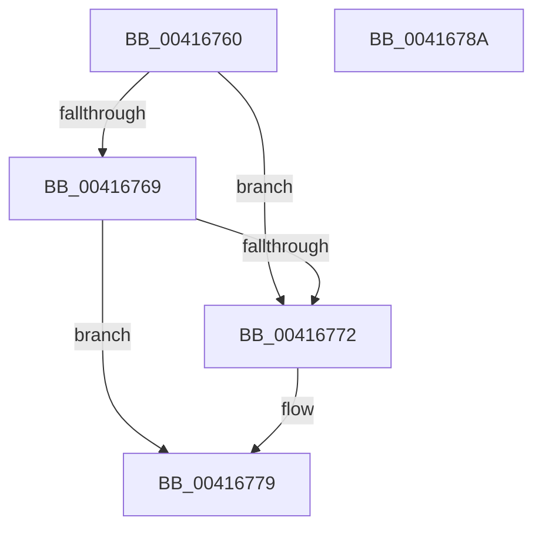

# ExpRemoveFastOwnerEntryFromThreadList

- RVA: `0x00416760`–`0x0041678B` (길이 `43` bytes)
- VA: `0x0000000140416760`
- 실행 섹션: `.text`
- PDB 이름 있음: `예`; PDB Function 태그: `아니요`
- unwind 정보 RVA: `0x000DB714`
- 디코드: `15`개 명령, `43/43` bytes 표시
- 미해석 바이트: `0` (있으면 어셈블리에 `.byte`로 보존)

> 이 문서는 커널 이미지의 기계어와 PDB 기호를 분석해 생성했습니다. 4번과 5번은 함수 원형과 자료형을 바이너리 사용 방식에서 추정한 C 해석이며 원본 소스 복구 결과는 아닙니다.

## 1. Dependencies

- 직접 호출 지점: **0**; 고유 호출 대상: **0**
- 직접 호출자로 확인된 함수: **6**
- RIP 상대 이미지 참조: **0**

### Outgoing calls
- 직접 디코드된 call 명령이 없습니다.

### Direct callers
- [ExpMoveSharedFastResourceOwnershipWithFlags](ExpMoveSharedFastResourceOwnershipWithFlags_function_00415C4C.md) at `0x00415E81`
- [ExpConvertFastResourceExclusiveToShared](ExpConvertFastResourceExclusiveToShared_function_00416110.md) at `0x0041615A`
- [ExpReleaseDisownedFastResourceShared](ExpReleaseDisownedFastResourceShared_function_00416338.md) at `0x004163D9`
- [ExpReleaseDisownedFastResourceExclusive](ExpReleaseDisownedFastResourceExclusive_function_00416470.md) at `0x004164F1`
- [ExDisownFastResource](../4A/ExDisownFastResource_function_004A2C10.md) at `0x004A2D06`
- [ExTryToConvertFastResourceSharedToExclusive](../65/ExTryToConvertFastResourceSharedToExclusive_function_00658A30.md) at `0x00658BF1`

### Static image references
- 디코드된 RIP-relative 메모리 참조가 없습니다.

## 2. Other-region calls and transfers

- 다른 실행 섹션으로 향하는 call: **0**
- 별도 외부 분기/꼬리 이동을 확인하지 못했습니다.

## 3. Assembly (complete function range)

```asm
00416760  48 8B 11                        mov rdx, qword ptr [rcx]
00416763  48 39 4A 08                     cmp qword ptr [rdx + 8], rcx
00416767  75 09                           jne 0x140416772
00416769  48 8B 41 08                     mov rax, qword ptr [rcx + 8]
0041676D  48 39 08                        cmp qword ptr [rax], rcx
00416770  74 07                           je 0x140416779
00416772  B9 03 00 00 00                  mov ecx, 3
00416777  CD 29                           int 0x29
00416779  48 89 10                        mov qword ptr [rax], rdx
0041677C  48 89 42 08                     mov qword ptr [rdx + 8], rax
00416780  33 C0                           xor eax, eax
00416782  48 89 01                        mov qword ptr [rcx], rax
00416785  48 89 41 08                     mov qword ptr [rcx + 8], rax
00416789  C3                              ret
0041678A  CC                              int3
```

## 4. C-style interpretation (structured pseudocode)

```c
__int64 __fastcall ExpRemoveFastOwnerEntryFromThreadList(__int64 a1)
{
    __int64 result;

    if ((*(unsigned __int64 *)(*(unsigned __int64 *)(a1) + 8)) != a1) goto loc_00416772;
    if ((*(unsigned __int64 *)(*(unsigned __int64 *)(a1 + 8))) != a1) {
        a1 = 3;
    }
    *(unsigned __int64 *)(*(unsigned __int64 *)(a1 + 8)) = *(unsigned __int64 *)(a1);
    *(unsigned __int64 *)(*(unsigned __int64 *)(a1) + 8) = *(unsigned __int64 *)(a1 + 8);
    result = 0;
    *(unsigned __int64 *)(a1) = 0;
    *(unsigned __int64 *)(a1 + 8) = 0;
    return result;
}
```

## 5. (Beta) C Style

```c
int64_t ExpRemoveFastOwnerEntryFromThreadList(void *Arg1)
{
    uint8_t *arg1 = (uint8_t *)Arg1;

    int64_t result;

    if ((*(uint64_t *)(*(uint64_t *)(arg1) + 0x8)) != Arg1) goto loc_00416772;
    if ((*(uint64_t *)(*(uint64_t *)(arg1 + 0x8))) != Arg1) {
        Arg1 = 3;
    }
    *(uint64_t *)(*(uint64_t *)(arg1 + 0x8)) = *(uint64_t *)(arg1);
    *(uint64_t *)(*(uint64_t *)(arg1) + 0x8) = *(uint64_t *)(arg1 + 0x8);
    result = 0;
    *(uint64_t *)(arg1) = 0;
    *(uint64_t *)(arg1 + 0x8) = 0;
    return result;
}
```

### 관측된 메모리 오프셋

구조체 형식이 확인되지 않은 접근은 인자 기준의 오프셋으로만 기록했습니다.

| 기준 인자 | 오프셋 표현 | 폭 (bit) | 접근 |
|---|---:|---:|---|
| `Arg1` | `+ 0x0` | `64` | `R` |
| `Arg1` | `+ 0x8` | `64` | `R` |

## 6. Execution-region graph

[열기: 2D/3D 그래프와 함수 탐색 컨트롤 패널](../../../control-panel.html?section=text&rva=0x00416760&view=graph)

- 2D 그래프는 위에서 아래로 흐르고, 3D 그래프는 빈 공간을 드래그해 회전합니다. Shift+드래그는 이동, 휠은 확대·축소, 함수 노드 선택은 대상 보고서 이동입니다.

### Static fallback


