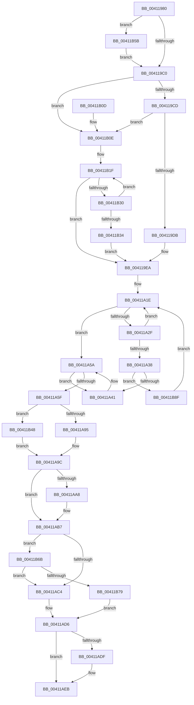

# ExpRemoveTagForBigPages

- RVA: `0x00411980`–`0x00411B9A` (길이 `538` bytes)
- VA: `0x0000000140411980`
- 실행 섹션: `.text`
- PDB 이름 있음: `예`; PDB Function 태그: `아니요`
- unwind 정보 RVA: `0x0009BE60`
- 디코드: `126`개 명령, `538/538` bytes 표시
- 미해석 바이트: `0` (있으면 어셈블리에 `.byte`로 보존)

> 이 문서는 커널 이미지의 기계어와 PDB 기호를 분석해 생성했습니다. 4번과 5번은 함수 원형과 자료형을 바이너리 사용 방식에서 추정한 C 해석이며 원본 소스 복구 결과는 아닙니다.

## 1. Dependencies

- 직접 호출 지점: **6**; 고유 호출 대상: **6**
- 직접 호출자로 확인된 함수: **3**
- RIP 상대 이미지 참조: **9**

### Outgoing calls
- `0x004119E5` → [ExpAcquireSpinLockSharedAtDpcLevelInstrumented](../27/ExpAcquireSpinLockSharedAtDpcLevelInstrumented_function_0027CD20.md) (function, `0x0027CD20`)
- `0x00411A54` → [KeBugCheckEx](../4F/KeBugCheckEx_function_004FD660.md) (function, `0x004FD660`)
- `0x00411AE6` → [KiLowerIrqlProcessIrqlFlags](../4F/KiLowerIrqlProcessIrqlFlags_function_004F5698.md) (function, `0x004F5698`)
- `0x00411B3E` → [ExpWaitForSpinLockSharedAndAcquire](../36/ExpWaitForSpinLockSharedAndAcquire_function_00362380.md) (function, `0x00362380`)
- `0x00411B61` → [KiRaiseIrqlProcessIrqlFlags](../4F/KiRaiseIrqlProcessIrqlFlags_function_004F56FC.md) (function, `0x004F56FC`)
- `0x00411B85` → [ExpReleaseSpinLockSharedFromDpcLevelInstrumented](../2F/ExpReleaseSpinLockSharedFromDpcLevelInstrumented_function_002F0F48.md) (function, `0x002F0F48`)

### Direct callers
- [ExQueryPoolBlockSize](../65/ExQueryPoolBlockSize_function_006566F0.md) at `0x0065676E`
- [ExpCleanupBigTag](../65/ExpCleanupBigTag_function_006567D4.md) at `0x00656824`
- [ExpSizeHeapPool](../65/ExpSizeHeapPool_function_0065C924.md) at `0x0065C97A`

### Static image references
- `0x004119B3` → RVA `0x00FC6D20` (`ALMOSTRO`; read)
- `0x004119C0` → RVA `0x00FC6B06` (`ALMOSTRO`; read)
- `0x004119CD` → RVA `0x00F0DE58` (`.data`; read)
- `0x004119DE` → RVA `0x00EFACF8` (`.data`; read)
- `0x004119EA` → RVA `0x00EFED38` (`.data`; read)
- `0x004119F4` → RVA `0x00EFED30` (`.data`; read)
- `0x00411AA8` → RVA `0x00FCF100` (`CACHEALI`; read/write)
- `0x00411AC4` → RVA `0x00EFACF8` (`.data`; read/write)
- `0x00411B4C` → RVA `0x00FC7228` (`ALMOSTRO`; read)

## 2. Other-region calls and transfers

- 다른 실행 섹션으로 향하는 call: **0**
- 별도 외부 분기/꼬리 이동을 확인하지 못했습니다.

## 3. Assembly (complete function range)

```asm
00411980  48 89 5C 24 08                  mov qword ptr [rsp + 8], rbx
00411985  48 89 6C 24 10                  mov qword ptr [rsp + 0x10], rbp
0041198A  48 89 74 24 18                  mov qword ptr [rsp + 0x18], rsi
0041198F  48 89 7C 24 20                  mov qword ptr [rsp + 0x20], rdi
00411994  41 56                           push r14
00411996  48 83 EC 30                     sub rsp, 0x30
0041199A  4D 8B F1                        mov r14, r9
0041199D  41 8B F0                        mov esi, r8d
004119A0  48 8B EA                        mov rbp, rdx
004119A3  48 8B F9                        mov rdi, rcx
004119A6  44 0F 20 C3                     mov rbx, cr8
004119AA  B8 02 00 00 00                  mov eax, 2
004119AF  44 0F 22 C0                     mov cr8, rax
004119B3  83 3D 66 53 BB 00 00            cmp dword ptr [rip + 0xbb5366], 0
004119BA  0F 85 9B 01 00 00               jne 0x140411b5b
004119C0  F6 05 3F 51 BB 00 21            test byte ptr [rip + 0xbb513f], 0x21
004119C7  0F 84 41 01 00 00               je 0x140411b0e
004119CD  8B 05 85 C4 AF 00               mov eax, dword ptr [rip + 0xafc485]
004119D3  85 C0                           test eax, eax
004119D5  0F 85 33 01 00 00               jne 0x140411b0e
004119DB  0F B6 D3                        movzx edx, bl
004119DE  48 8D 0D 13 93 AE 00            lea rcx, [rip + 0xae9313]
004119E5  E8 36 B3 E6 FF                  call 0x14027cd20
004119EA  4C 8B 0D 47 D3 AE 00            mov r9, qword ptr [rip + 0xaed347]
004119F1  48 8B C7                        mov rax, rdi
004119F4  4C 8B 05 35 D3 AE 00            mov r8, qword ptr [rip + 0xaed335]
004119FB  41 BA 01 00 00 00               mov r10d, 1
00411A01  48 C1 E8 0C                     shr rax, 0xc
00411A05  48 69 C8 5F 9E 00 00            imul rcx, rax, 0x9e5f
00411A0C  41 8D 41 FF                     lea eax, [r9 - 1]
00411A10  48 8B D1                        mov rdx, rcx
00411A13  48 C1 EA 20                     shr rdx, 0x20
00411A17  33 D1                           xor edx, ecx
00411A19  23 D0                           and edx, eax
00411A1B  45 33 DB                        xor r11d, r11d
00411A1E  8B C2                           mov eax, edx
00411A20  48 C1 E0 05                     shl rax, 5
00411A24  49 03 C0                        add rax, r8
00411A27  48 8B 08                        mov rcx, qword ptr [rax]
00411A2A  48 3B CF                        cmp rcx, rdi
00411A2D  74 2B                           je 0x140411a5a
00411A2F  FF C2                           inc edx
00411A31  8B C2                           mov eax, edx
00411A33  49 3B C1                        cmp rax, r9
00411A36  72 E6                           jb 0x140411a1e
00411A38  45 85 D2                        test r10d, r10d
00411A3B  0F 85 4E 01 00 00               jne 0x140411b8f
00411A41  BA 22 00 00 00                  mov edx, 0x22
00411A46  44 8B CD                        mov r9d, ebp
00411A49  4C 8B C7                        mov r8, rdi
00411A4C  4C 89 5C 24 20                  mov qword ptr [rsp + 0x20], r11
00411A51  8D 4A F7                        lea ecx, [rdx - 9]
00411A54  E8 07 BC 0E 00                  call 0x1404fd660
00411A59  CC                              int3
00411A5A  48 85 C0                        test rax, rax
00411A5D  74 E2                           je 0x140411a41
00411A5F  8B 48 08                        mov ecx, dword ptr [rax + 8]
00411A62  44 8B 40 0C                     mov r8d, dword ptr [rax + 0xc]
00411A66  41 8B D0                        mov edx, r8d
00411A69  48 C1 EA 08                     shr rdx, 8
00411A6D  81 E2 FF 0F 00 00               and edx, 0xfff
00411A73  41 89 0E                        mov dword ptr [r14], ecx
00411A76  48 8B 4C 24 60                  mov rcx, qword ptr [rsp + 0x60]
00411A7B  48 89 11                        mov qword ptr [rcx], rdx
00411A7E  48 8B 4C 24 68                  mov rcx, qword ptr [rsp + 0x68]
00411A83  48 8B 50 10                     mov rdx, qword ptr [rax + 0x10]
00411A87  48 89 11                        mov qword ptr [rcx], rdx
00411A8A  41 0F BA E0 08                  bt r8d, 8
00411A8F  0F 82 B3 00 00 00               jb 0x140411b48
00411A95  49 C7 C0 FF FF FF FF            mov r8, 0xffffffffffffffff
00411A9C  48 8B 4C 24 70                  mov rcx, qword ptr [rsp + 0x70]
00411AA1  4C 89 01                        mov qword ptr [rcx], r8
00411AA4  85 F6                           test esi, esi
00411AA6  74 0F                           je 0x140411ab7
00411AA8  F0 FF 0D 51 D6 BB 00            lock dec dword ptr [rip + 0xbbd651]
00411AAF  4C 89 58 18                     mov qword ptr [rax + 0x18], r11
00411AB3  F0 48 FF 00                     lock inc qword ptr [rax]
00411AB7  F6 05 48 50 BB 00 01            test byte ptr [rip + 0xbb5048], 1
00411ABE  0F 85 A7 00 00 00               jne 0x140411b6b
00411AC4  F0 81 25 29 92 AE 00 FF FF FF BF  lock and dword ptr [rip + 0xae9229], 0xbfffffff
00411ACF  F0 FF 0D 22 92 AE 00            lock dec dword ptr [rip + 0xae9222]
00411AD6  83 3D 43 52 BB 00 00            cmp dword ptr [rip + 0xbb5243], 0
00411ADD  74 0C                           je 0x140411aeb
00411ADF  44 0F 20 C1                     mov rcx, cr8
00411AE3  0F B6 D3                        movzx edx, bl
00411AE6  E8 AD 3B 0E 00                  call 0x1404f5698
00411AEB  0F B6 C3                        movzx eax, bl
00411AEE  44 0F 22 C0                     mov cr8, rax
00411AF2  48 8B 5C 24 40                  mov rbx, qword ptr [rsp + 0x40]
00411AF7  48 8B 6C 24 48                  mov rbp, qword ptr [rsp + 0x48]
00411AFC  48 8B 74 24 50                  mov rsi, qword ptr [rsp + 0x50]
00411B01  48 8B 7C 24 58                  mov rdi, qword ptr [rsp + 0x58]
00411B06  48 83 C4 30                     add rsp, 0x30
00411B0A  41 5E                           pop r14
00411B0C  C3                              ret
00411B0D  CC                              int3
00411B0E  0F 0D 0D E3 91 AE 00            prefetchw byte ptr [rip + 0xae91e3]
00411B15  8B 05 DD 91 AE 00               mov eax, dword ptr [rip + 0xae91dd]
00411B1B  0F BA F0 1F                     btr eax, 0x1f
00411B1F  8D 48 01                        lea ecx, [rax + 1]
00411B22  F0 0F B1 0D CE 91 AE 00         lock cmpxchg dword ptr [rip + 0xae91ce], ecx
00411B2A  0F 84 BA FE FF FF               je 0x1404119ea
00411B30  85 C0                           test eax, eax
00411B32  79 EB                           jns 0x140411b1f
00411B34  0F B6 D3                        movzx edx, bl
00411B37  48 8D 0D BA 91 AE 00            lea rcx, [rip + 0xae91ba]
00411B3E  E8 3D 08 F5 FF                  call 0x140362380
00411B43  E9 A2 FE FF FF                  jmp 0x1404119ea
00411B48  4C 8B 40 18                     mov r8, qword ptr [rax + 0x18]
00411B4C  4C 33 05 D5 56 BB 00            xor r8, qword ptr [rip + 0xbb56d5]
00411B53  4C 33 C7                        xor r8, rdi
00411B56  E9 41 FF FF FF                  jmp 0x140411a9c
00411B5B  0F B6 D0                        movzx edx, al
00411B5E  0F B6 CB                        movzx ecx, bl
00411B61  E8 96 3B 0E 00                  call 0x1404f56fc
00411B66  E9 55 FE FF FF                  jmp 0x1404119c0
00411B6B  8B 05 E7 C2 AF 00               mov eax, dword ptr [rip + 0xafc2e7]
00411B71  85 C0                           test eax, eax
00411B73  0F 85 4B FF FF FF               jne 0x140411ac4
00411B79  48 8B 54 24 38                  mov rdx, qword ptr [rsp + 0x38]
00411B7E  48 8D 0D 73 91 AE 00            lea rcx, [rip + 0xae9173]
00411B85  E8 BE F3 ED FF                  call 0x1402f0f48
00411B8A  E9 47 FF FF FF                  jmp 0x140411ad6
00411B8F  41 8B D3                        mov edx, r11d
00411B92  45 8B D3                        mov r10d, r11d
00411B95  E9 84 FE FF FF                  jmp 0x140411a1e
```

## 4. C-style interpretation (structured pseudocode)

```c
__int64 __fastcall ExpRemoveTagForBigPages(__int64 a1, __int64 a2, int a3, __int64 a4, __int64 a5, __int64 a6, __int64 a7)
{
    __int64 result;
    __int64 v_r11;
    __int64 v_rsp;
    unsigned __int64 v_stack_m18;
    unsigned __int64 v_stack_p10;
    unsigned __int64 v_stack_p18;
    unsigned __int64 v_stack_p20;
    unsigned __int64 v_stack_p38;
    unsigned __int64 v_stack_p8;

    v_stack_p8 = v_rbx;
    v_stack_p10 = v_rbp;
    v_stack_p18 = v_rsi;
    v_stack_p20 = v_rdi;
    v_rsp = (v_rsp) - (48);
    if ((*(unsigned int *)(v_rip + 12276582)) != 0) goto loc_00411B5B;
loc_004119C0:
    if (((*(unsigned __int8 *)(v_rip + 12276031)) & (33)) == 0) goto loc_00411B0E;
    if ((unsigned int)((unsigned int)(*(unsigned int *)(v_rip + 11519109))) != 0) goto loc_00411B0E;
    result = ExpAcquireSpinLockSharedAtDpcLevelInstrumented(v_rip + 11440915, (unsigned __int8)(v_cr8), a3, a4);
loc_004119EA:
    result = (a1) >> (12);
    a1 = (v_rip + 11440915) * (result);
    a2 = (a1) >> (32);
    a2 = (unsigned int)((a2) ^ ((unsigned int)(a1)));
    a2 = (unsigned int)((a2) & ((unsigned int)(*(unsigned __int64 *)(v_rip + 11457351) - 1)));
    v_r11 = 0;
loc_00411A1E:
    result = ((unsigned int)((unsigned int)(a2))) << (5);
    result = (result) + (*(unsigned __int64 *)(v_rip + 11457333));
    if ((*(unsigned __int64 *)(result)) == a1) goto loc_00411A5A;
    a2 = (unsigned int)((a2) + 1);
    if (((unsigned int)((unsigned int)(a2))) < (*(unsigned __int64 *)(v_rip + 11457351))) goto loc_00411A1E;
    if (1 != 0) goto loc_00411B8F;
loc_00411A41:
    v_stack_m18 = 0;
    result = KeBugCheckEx(34 - 9, 34, a1, (unsigned int)((unsigned int)(a2)));
loc_00411A5A:
    if (result == 0) goto loc_00411A41;
    a2 = ((unsigned int)((unsigned int)((unsigned int)(*(unsigned int *)(result + 12))))) >> (8);
    a2 = (unsigned int)((a2) & (0xFFFULL));
    *(unsigned int *)(a4) = (unsigned int)((unsigned int)(*(unsigned int *)(result + 8)));
    *(unsigned __int64 *)(a5) = a2;
    *(unsigned __int64 *)(a6) = *(unsigned __int64 *)(result + 16);
    if (condition_is_below) goto loc_00411B48;
loc_00411A9C:
    *(unsigned __int64 *)(a7) = -1;
    if ((unsigned int)((unsigned int)(a3)) != 0) {
        *(unsigned __int64 *)(result + 24) = 0;
    }
    if (((*(unsigned __int8 *)(v_rip + 12275784)) & (1)) != 0) goto loc_00411B6B;
loc_00411AC4:
loc_00411AD6:
    if ((*(unsigned int *)(v_rip + 12276291)) != 0) {
        a1 = 2;
        a2 = (unsigned __int8)(v_cr8);
        result = KiLowerIrqlProcessIrqlFlags(a1, a2, -1, (unsigned int)((unsigned int)(a2)));
    }
    v_rsp = (v_rsp) + (48);
    return (unsigned __int8)(v_cr8);
loc_00411B0E:
loc_00411B1F:
    if (condition_is_equal) goto loc_004119EA;
    if (!sign_flag) goto loc_00411B1F;
    result = ExpWaitForSpinLockSharedAndAcquire(v_rip + 11440570, (unsigned __int8)(v_stack_p8), -1, (unsigned int)((unsigned int)(a2)));
    goto loc_004119EA;
loc_00411B48:
    a3 = (*(unsigned __int64 *)(result + 24)) ^ (*(unsigned __int64 *)(v_rip + 12277461));
    a3 = (a3) ^ (v_stack_p20);
    goto loc_00411A9C;
loc_00411B5B:
    result = KiRaiseIrqlProcessIrqlFlags((unsigned __int8)(v_stack_p8), (unsigned __int8)(result), a3, (unsigned int)((unsigned int)(a2)));
    goto loc_004119C0;
loc_00411B6B:
    if ((unsigned int)((unsigned int)(*(unsigned int *)(v_rip + 11518695))) != 0) goto loc_00411AC4;
    result = ExpReleaseSpinLockSharedFromDpcLevelInstrumented(v_rip + 11440499, v_stack_p38, a3, (unsigned int)((unsigned int)(a2)));
    goto loc_00411AD6;
loc_00411B8F:
    goto loc_00411A1E;
}
```

## 5. (Beta) C Style

```c
int64_t ExpRemoveTagForBigPages(int64_t Arg1, int64_t Arg2, int32_t Arg3, void *Arg4, void *Arg5, void *Arg6, void *Arg7)
{
    uint8_t *arg4 = (uint8_t *)Arg4;
    uint8_t *arg5 = (uint8_t *)Arg5;
    uint8_t *arg6 = (uint8_t *)Arg6;
    uint8_t *arg7 = (uint8_t *)Arg7;

    int64_t result;
    int64_t local_r11;
    int64_t local_rsp;
    uint64_t v_stack_m18;
    uint64_t v_stack_p10;
    uint64_t v_stack_p18;
    uint64_t v_stack_p20;
    uint64_t v_stack_p38;
    uint64_t v_stack_p8;

    v_stack_p8 = local_rbx;
    v_stack_p10 = local_rbp;
    v_stack_p18 = local_rsi;
    v_stack_p20 = local_rdi;
    local_rsp = (local_rsp) - (48);
    if ((*(uint32_t *)(v_rip + 0xBB5366)) != 0) goto loc_00411B5B;
loc_004119C0:
    if (((*(uint8_t *)(v_rip + 0xBB513F)) & (33)) == 0) goto loc_00411B0E;
    if ((uint32_t)((uint32_t)(*(uint32_t *)(v_rip + 0xAFC485))) != 0) goto loc_00411B0E;
    result = ExpAcquireSpinLockSharedAtDpcLevelInstrumented(v_rip + 11440915, (uint8_t)(v_cr8), Arg3, Arg4);
loc_004119EA:
    result = (Arg1) >> (12);
    Arg1 = (v_rip + 11440915) * (result);
    Arg2 = (Arg1) >> (32);
    Arg2 = (uint32_t)((Arg2) ^ ((uint32_t)(Arg1)));
    Arg2 = (uint32_t)((Arg2) & ((uint32_t)(*(uint64_t *)(v_rip + 0xAED347) - 1)));
    local_r11 = 0;
loc_00411A1E:
    result = ((uint32_t)((uint32_t)(Arg2))) << (5);
    result = (result) + (*(uint64_t *)(v_rip + 0xAED335));
    if ((*(uint64_t *)(result)) == Arg1) goto loc_00411A5A;
    Arg2 = (uint32_t)((Arg2) + 1);
    if (((uint32_t)((uint32_t)(Arg2))) < (*(uint64_t *)(v_rip + 0xAED347))) goto loc_00411A1E;
    if (1 != 0) goto loc_00411B8F;
loc_00411A41:
    v_stack_m18 = 0;
    result = KeBugCheckEx(34 - 9, 34, Arg1, (uint32_t)((uint32_t)(Arg2)));
loc_00411A5A:
    if (result == 0) goto loc_00411A41;
    Arg2 = ((uint32_t)((uint32_t)((uint32_t)(*(uint32_t *)(result + 0xC))))) >> (8);
    Arg2 = (uint32_t)((Arg2) & (0xFFFULL));
    *(uint32_t *)(arg4) = (uint32_t)((uint32_t)(*(uint32_t *)(result + 0x8)));
    *(uint64_t *)(arg5) = Arg2;
    *(uint64_t *)(arg6) = *(uint64_t *)(result + 0x10);
    if (condition_is_below) goto loc_00411B48;
loc_00411A9C:
    *(uint64_t *)(arg7) = -1;
    if ((uint32_t)((uint32_t)(Arg3)) != 0) {
        *(uint64_t *)(result + 0x18) = 0;
    }
    if (((*(uint8_t *)(v_rip + 0xBB5048)) & (1)) != 0) goto loc_00411B6B;
loc_00411AC4:
loc_00411AD6:
    if ((*(uint32_t *)(v_rip + 0xBB5243)) != 0) {
        Arg1 = 2;
        Arg2 = (uint8_t)(v_cr8);
        result = KiLowerIrqlProcessIrqlFlags(Arg1, Arg2, -1, (uint32_t)((uint32_t)(Arg2)));
    }
    local_rsp = (local_rsp) + (48);
    return (uint8_t)(v_cr8);
loc_00411B0E:
loc_00411B1F:
    if (condition_is_equal) goto loc_004119EA;
    if (!sign_flag) goto loc_00411B1F;
    result = ExpWaitForSpinLockSharedAndAcquire(v_rip + 11440570, (uint8_t)(v_stack_p8), -1, (uint32_t)((uint32_t)(Arg2)));
    goto loc_004119EA;
loc_00411B48:
    Arg3 = (*(uint64_t *)(result + 0x18)) ^ (*(uint64_t *)(v_rip + 0xBB56D5));
    Arg3 = (Arg3) ^ (v_stack_p20);
    goto loc_00411A9C;
loc_00411B5B:
    result = KiRaiseIrqlProcessIrqlFlags((uint8_t)(v_stack_p8), (uint8_t)(result), Arg3, (uint32_t)((uint32_t)(Arg2)));
    goto loc_004119C0;
loc_00411B6B:
    if ((uint32_t)((uint32_t)(*(uint32_t *)(v_rip + 0xAFC2E7))) != 0) goto loc_00411AC4;
    result = ExpReleaseSpinLockSharedFromDpcLevelInstrumented(v_rip + 11440499, v_stack_p38, Arg3, (uint32_t)((uint32_t)(Arg2)));
    goto loc_00411AD6;
loc_00411B8F:
    goto loc_00411A1E;
}
```

### 관측된 메모리 오프셋

구조체 형식이 확인되지 않은 접근은 인자 기준의 오프셋으로만 기록했습니다.

| 기준 인자 | 오프셋 표현 | 폭 (bit) | 접근 |
|---|---:|---:|---|
| `Arg4` | `+ 0x0` | `32` | `W` |
| `Arg5` | `+ 0x0` | `64` | `W` |
| `Arg6` | `+ 0x0` | `64` | `W` |
| `Arg7` | `+ 0x0` | `64` | `W` |

## 6. Execution-region graph

[열기: 2D/3D 그래프와 함수 탐색 컨트롤 패널](../../../control-panel.html?section=text&rva=0x00411980&view=graph)

- 2D 그래프는 위에서 아래로 흐르고, 3D 그래프는 빈 공간을 드래그해 회전합니다. Shift+드래그는 이동, 휠은 확대·축소, 함수 노드 선택은 대상 보고서 이동입니다.

### Static fallback


