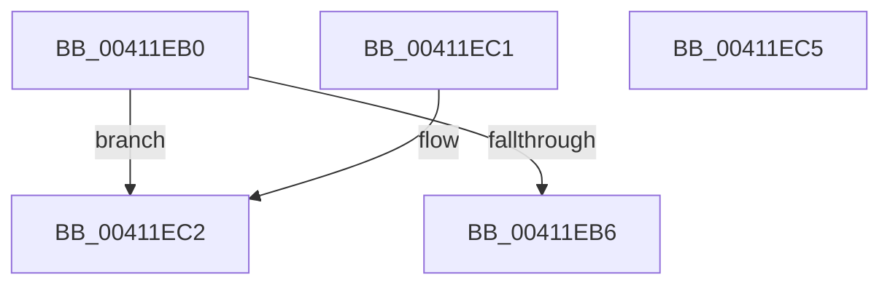

# ExpResourceEnforcesOwnershipTransfer

- RVA: `0x00411EB0`–`0x00411EC6` (길이 `22` bytes)
- VA: `0x0000000140411EB0`
- 실행 섹션: `.text`
- PDB 이름 있음: `예`; PDB Function 태그: `아니요`
- unwind 정보 RVA: `0x000DB714`
- 디코드: `9`개 명령, `22/22` bytes 표시
- 미해석 바이트: `0` (있으면 어셈블리에 `.byte`로 보존)

> 이 문서는 커널 이미지의 기계어와 PDB 기호를 분석해 생성했습니다. 4번과 5번은 함수 원형과 자료형을 바이너리 사용 방식에서 추정한 C 해석이며 원본 소스 복구 결과는 아닙니다.

## 1. Dependencies

- 직접 호출 지점: **0**; 고유 호출 대상: **0**
- 직접 호출자로 확인된 함수: **3**
- RIP 상대 이미지 참조: **1**

### Outgoing calls
- 직접 디코드된 call 명령이 없습니다.

### Direct callers
- [ExpSetResourceOwnerPointerEx](../34/ExpSetResourceOwnerPointerEx_function_00343E20.md) at `0x00344173`
- [sub_0038BBFB](../38/Unknown_function_0038BBFB.md) at `0x0038BBFE`
- [sub_0038BBFB](../38/Unknown_function_0038BBFB.md) at `0x0038BCB8`
- [sub_0038BEEF](../38/Unknown_function_0038BEEF.md) at `0x0038BF4C`

### Static image references
- `0x00411EB6` → RVA `0x00EFAC10` (`.data`; read)

## 2. Other-region calls and transfers

- 다른 실행 섹션으로 향하는 call: **0**
- 별도 외부 분기/꼬리 이동을 확인하지 못했습니다.

## 3. Assembly (complete function range)

```asm
00411EB0  F6 41 1A 01                     test byte ptr [rcx + 0x1a], 1
00411EB4  75 0C                           jne 0x140411ec2
00411EB6  83 3D 53 8D AE 00 00            cmp dword ptr [rip + 0xae8d53], 0
00411EBD  0F 95 C0                        setne al
00411EC0  C3                              ret
00411EC1  CC                              int3
00411EC2  B0 01                           mov al, 1
00411EC4  C3                              ret
00411EC5  CC                              int3
```

## 4. C-style interpretation (structured pseudocode)

```c
__int64 __fastcall ExpResourceEnforcesOwnershipTransfer(__int64 a1)
{
    __int64 result;

    if (((*(unsigned __int8 *)(a1 + 26)) & (1)) != 0) goto loc_00411EC2;
    result = ((*(unsigned int *)(v_rip + 11439443)) != 0) ? 1 : 0;
    return result;
loc_00411EC2:
    return 1;
}
```

## 5. (Beta) C Style

```c
int64_t ExpResourceEnforcesOwnershipTransfer(void *Arg1)
{
    uint8_t *arg1 = (uint8_t *)Arg1;

    int64_t result;

    if (((*(uint8_t *)(arg1 + 0x1A)) & (1)) != 0) goto loc_00411EC2;
    result = ((*(uint32_t *)(v_rip + 0xAE8D53)) != 0) ? 1 : 0;
    return result;
loc_00411EC2:
    return 1;
}
```

### 관측된 메모리 오프셋

구조체 형식이 확인되지 않은 접근은 인자 기준의 오프셋으로만 기록했습니다.

| 기준 인자 | 오프셋 표현 | 폭 (bit) | 접근 |
|---|---:|---:|---|
| `Arg1` | `+ 0x1A` | `8` | `R` |

## 6. Execution-region graph

[열기: 2D/3D 그래프와 함수 탐색 컨트롤 패널](../../../control-panel.html?section=text&rva=0x00411EB0&view=graph)

- 2D 그래프는 위에서 아래로 흐르고, 3D 그래프는 빈 공간을 드래그해 회전합니다. Shift+드래그는 이동, 휠은 확대·축소, 함수 노드 선택은 대상 보고서 이동입니다.

### Static fallback


