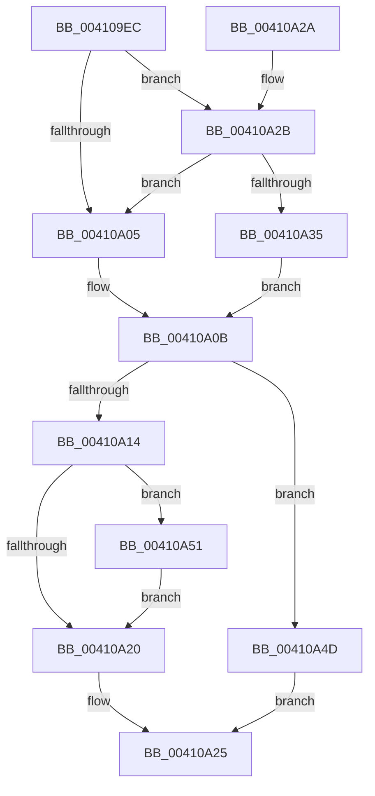

# ExpTryAcquireSpinLockSharedAtDpcLevelInstrumented

- RVA: `0x004109EC`–`0x00410A77` (길이 `139` bytes)
- VA: `0x00000001404109EC`
- 실행 섹션: `.text`
- PDB 이름 있음: `예`; PDB Function 태그: `아니요`
- unwind 정보 RVA: `0x0006E3E4`
- 디코드: `40`개 명령, `139/139` bytes 표시
- 미해석 바이트: `0` (있으면 어셈블리에 `.byte`로 보존)

> 이 문서는 커널 이미지의 기계어와 PDB 기호를 분석해 생성했습니다. 4번과 5번은 함수 원형과 자료형을 바이너리 사용 방식에서 추정한 C 해석이며 원본 소스 복구 결과는 아닙니다.

## 1. Dependencies

- 직접 호출 지점: **2**; 고유 호출 대상: **2**
- 직접 호출자로 확인된 함수: **1**
- RIP 상대 이미지 참조: **2**

### Outgoing calls
- `0x00410A0B` → [ExpTryAcquireSpinLockShared](ExpTryAcquireSpinLockShared_function_00410AC0.md) (function, `0x00410AC0`)
- `0x00410A70` → [PerfLogSpinLockAcquire](PerfLogSpinLockAcquire_function_00414FC4.md) (function, `0x00414FC4`)

### Direct callers
- [ExTryAcquireSpinLockSharedAtDpcLevel](ExTryAcquireSpinLockSharedAtDpcLevel_function_00410A80.md) at `0x00410AA5`

### Static image references
- `0x004109FC` → RVA `0x00FC6B06` (`ALMOSTRO`; read)
- `0x00410A2B` → RVA `0x00F0DE58` (`.data`; read)

## 2. Other-region calls and transfers

- 다른 실행 섹션으로 향하는 call: **0**
- 별도 외부 분기/꼬리 이동을 확인하지 못했습니다.

## 3. Assembly (complete function range)

```asm
004109EC  48 83 EC 38                     sub rsp, 0x38
004109F0  65 4C 8B 04 25 20 00 00 00      mov r8, qword ptr gs:[0x20]
004109F9  45 33 DB                        xor r11d, r11d
004109FC  F6 05 03 61 BB 00 01            test byte ptr [rip + 0xbb6103], 1
00410A03  75 26                           jne 0x140410a2b
00410A05  45 32 C9                        xor r9b, r9b
00410A08  45 33 D2                        xor r10d, r10d
00410A0B  E8 B0 00 00 00                  call 0x140410ac0
00410A10  84 C0                           test al, al
00410A12  74 39                           je 0x140410a4d
00410A14  41 FF 80 C0 8E 00 00            inc dword ptr [r8 + 0x8ec0]
00410A1B  45 84 C9                        test r9b, r9b
00410A1E  75 31                           jne 0x140410a51
00410A20  B8 01 00 00 00                  mov eax, 1
00410A25  48 83 C4 38                     add rsp, 0x38
00410A29  C3                              ret
00410A2A  CC                              int3
00410A2B  8B 05 27 D4 AF 00               mov eax, dword ptr [rip + 0xafd427]
00410A31  85 C0                           test eax, eax
00410A33  75 D0                           jne 0x140410a05
00410A35  41 B1 01                        mov r9b, 1
00410A38  0F 31                           rdtsc
00410A3A  45 8B 90 40 86 00 00            mov r10d, dword ptr [r8 + 0x8640]
00410A41  48 C1 E2 20                     shl rdx, 0x20
00410A45  48 0B C2                        or rax, rdx
00410A48  4C 8B D8                        mov r11, rax
00410A4B  EB BE                           jmp 0x140410a0b
00410A4D  33 C0                           xor eax, eax
00410A4F  EB D4                           jmp 0x140410a25
00410A51  0F 31                           rdtsc
00410A53  48 C1 E2 20                     shl rdx, 0x20
00410A57  45 33 C9                        xor r9d, r9d
00410A5A  48 0B C2                        or rax, rdx
00410A5D  C6 44 24 28 02                  mov byte ptr [rsp + 0x28], 2
00410A62  44 8B C0                        mov r8d, eax
00410A65  44 89 54 24 20                  mov dword ptr [rsp + 0x20], r10d
00410A6A  45 2B C3                        sub r8d, r11d
00410A6D  48 8B D0                        mov rdx, rax
00410A70  E8 4F 45 00 00                  call 0x140414fc4
00410A75  EB A9                           jmp 0x140410a20
```

## 4. C-style interpretation (structured pseudocode)

```c
__int64 __fastcall ExpTryAcquireSpinLockSharedAtDpcLevelInstrumented(__int64 a1, __int64 a2, __int64 a3, unsigned __int8 a4)
{
    __int64 result;
    __int64 v_r10;
    __int64 v_r11;
    __int64 v_rsp;
    unsigned int v_stack_p20;
    unsigned __int8 v_stack_p28;

    v_rsp = (v_rsp) - (56);
    v_r11 = 0;
    if (((*(unsigned __int8 *)(v_rip + 12280067)) & (1)) != 0) goto loc_00410A2B;
loc_00410A05:
    a4 = 0;
    v_r10 = 0;
loc_00410A0B:
    result = ExpTryAcquireSpinLockShared(a1, a2, *(unsigned __int64 *)(gs_base + (0 + 32)), a4);
    if ((unsigned __int8)(result) == 0) goto loc_00410A4D;
    if (0 != 0) goto loc_00410A51;
loc_00410A20:
loc_00410A25:
    v_rsp = (v_rsp) + (56);
    return 1;
loc_00410A2B:
    if ((unsigned int)((unsigned int)(*(unsigned int *)(v_rip + 11523111))) != 0) goto loc_00410A05;
    a2 = (a2) << (32);
    result = ((unsigned int)(*(unsigned int *)(v_rip + 11523111))) | (a2);
    goto loc_00410A0B;
loc_00410A4D:
    result = 0;
    goto loc_00410A25;
loc_00410A51:
    a2 = (a2) << (32);
    a4 = 0;
    result = (result) | (a2);
    v_stack_p28 = 2;
    v_stack_p20 = (unsigned int)((unsigned int)(*(unsigned int *)(*(unsigned __int64 *)(gs_base + (0 + 32)) + 34368)));
    a3 = (unsigned int)(((unsigned int)((unsigned int)(result))) - ((unsigned int)(result)));
    result = PerfLogSpinLockAcquire(a1, result, a3, a4);
    goto loc_00410A20;
}
```

## 5. (Beta) C Style

```c
int64_t ExpTryAcquireSpinLockSharedAtDpcLevelInstrumented(int64_t Arg1, int64_t Arg2, int64_t Arg3, uint8_t Arg4)
{
    int64_t result;
    int64_t local_r10;
    int64_t local_r11;
    int64_t local_rsp;
    uint32_t v_stack_p20;
    uint8_t v_stack_p28;

    local_rsp = (local_rsp) - (56);
    local_r11 = 0;
    if (((*(uint8_t *)(v_rip + 0xBB6103)) & (1)) != 0) goto loc_00410A2B;
loc_00410A05:
    Arg4 = 0;
    local_r10 = 0;
loc_00410A0B:
    result = ExpTryAcquireSpinLockShared(Arg1, Arg2, *(uint64_t *)(gs_base + (0 + 0x20)), Arg4);
    if ((uint8_t)(result) == 0) goto loc_00410A4D;
    if (0 != 0) goto loc_00410A51;
loc_00410A20:
loc_00410A25:
    local_rsp = (local_rsp) + (56);
    return 1;
loc_00410A2B:
    if ((uint32_t)((uint32_t)(*(uint32_t *)(v_rip + 0xAFD427))) != 0) goto loc_00410A05;
    Arg2 = (Arg2) << (32);
    result = ((uint32_t)(*(uint32_t *)(v_rip + 0xAFD427))) | (Arg2);
    goto loc_00410A0B;
loc_00410A4D:
    result = 0;
    goto loc_00410A25;
loc_00410A51:
    Arg2 = (Arg2) << (32);
    Arg4 = 0;
    result = (result) | (Arg2);
    v_stack_p28 = 2;
    v_stack_p20 = (uint32_t)((uint32_t)(*(uint32_t *)(*(uint64_t *)(gs_base + (0 + 0x20)) + 0x8640)));
    Arg3 = (uint32_t)(((uint32_t)((uint32_t)(result))) - ((uint32_t)(result)));
    result = PerfLogSpinLockAcquire(Arg1, result, Arg3, Arg4);
    goto loc_00410A20;
}
```

## 6. Execution-region graph

[열기: 2D/3D 그래프와 함수 탐색 컨트롤 패널](../../../control-panel.html?section=text&rva=0x004109EC&view=graph)

- 2D 그래프는 위에서 아래로 흐르고, 3D 그래프는 빈 공간을 드래그해 회전합니다. Shift+드래그는 이동, 휠은 확대·축소, 함수 노드 선택은 대상 보고서 이동입니다.

### Static fallback


