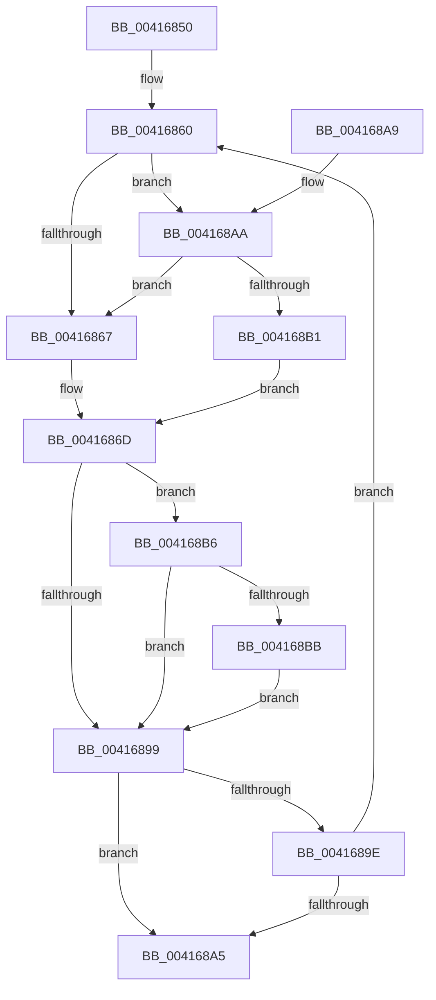

# ExpUpdateLockWordForRelease

- RVA: `0x00416850`–`0x004168C1` (길이 `113` bytes)
- VA: `0x0000000140416850`
- 실행 섹션: `.text`
- PDB 이름 있음: `예`; PDB Function 태그: `아니요`
- unwind 정보 RVA: `0x000DB714`
- 디코드: `36`개 명령, `113/113` bytes 표시
- 미해석 바이트: `0` (있으면 어셈블리에 `.byte`로 보존)

> 이 문서는 커널 이미지의 기계어와 PDB 기호를 분석해 생성했습니다. 4번과 5번은 함수 원형과 자료형을 바이너리 사용 방식에서 추정한 C 해석이며 원본 소스 복구 결과는 아닙니다.

## 1. Dependencies

- 직접 호출 지점: **0**; 고유 호출 대상: **0**
- 직접 호출자로 확인된 함수: **1**
- RIP 상대 이미지 참조: **0**

### Outgoing calls
- 직접 디코드된 call 명령이 없습니다.

### Direct callers
- [ExpConvertFastResourceExclusiveToShared](ExpConvertFastResourceExclusiveToShared_function_00416110.md) at `0x004161D7`

### Static image references
- 디코드된 RIP-relative 메모리 참조가 없습니다.

## 2. Other-region calls and transfers

- 다른 실행 섹션으로 향하는 call: **0**
- 별도 외부 분기/꼬리 이동을 확인하지 못했습니다.

## 3. Assembly (complete function range)

```asm
00416850  45 0F B6 D8                     movzx r11d, r8b
00416854  4C 63 D2                        movsxd r10, edx
00416857  4C 8B C9                        mov r9, rcx
0041685A  0F 0D 09                        prefetchw byte ptr [rcx]
0041685D  48 8B 01                        mov rax, qword ptr [rcx]
00416860  49 83 79 10 00                  cmp qword ptr [r9 + 0x10], 0
00416865  74 43                           je 0x1404168aa
00416867  41 B8 01 00 00 00               mov r8d, 1
0041686D  48 8B C8                        mov rcx, rax
00416870  48 8B D0                        mov rdx, rax
00416873  48 83 C9 02                     or rcx, 2
00416877  48 83 E2 FD                     and rdx, 0xfffffffffffffffd
0041687B  45 85 C0                        test r8d, r8d
0041687E  48 0F 45 D1                     cmovne rdx, rcx
00416882  4C 8B C2                        mov r8, rdx
00416885  49 83 E0 FE                     and r8, 0xfffffffffffffffe
00416889  45 84 DB                        test r11b, r11b
0041688C  4C 0F 44 C2                     cmove r8, rdx
00416890  49 8B C8                        mov rcx, r8
00416893  41 F6 C0 01                     test r8b, 1
00416897  74 1D                           je 0x1404168b6
00416899  48 3B C8                        cmp rcx, rax
0041689C  74 07                           je 0x1404168a5
0041689E  F0 49 0F B1 09                  lock cmpxchg qword ptr [r9], rcx
004168A3  75 BB                           jne 0x140416860
004168A5  48 8B C1                        mov rax, rcx
004168A8  C3                              ret
004168A9  CC                              int3
004168AA  41 83 79 38 00                  cmp dword ptr [r9 + 0x38], 0
004168AF  77 B6                           ja 0x140416867
004168B1  45 33 C0                        xor r8d, r8d
004168B4  EB B7                           jmp 0x14041686d
004168B6  45 85 D2                        test r10d, r10d
004168B9  74 DE                           je 0x140416899
004168BB  4B 8D 0C 90                     lea rcx, [r8 + r10*4]
004168BF  EB D8                           jmp 0x140416899
```

## 4. C-style interpretation (structured pseudocode)

```c
__int64 __fastcall ExpUpdateLockWordForRelease(__int64 a1, int a2, unsigned __int8 a3)
{
loc_00416860:
    if ((*(unsigned __int64 *)(a1 + 16)) == 0) goto loc_004168AA;
loc_00416867:
loc_0041686D:
    a1 = (*(unsigned __int64 *)(a1)) | (2);
    a2 = (*(unsigned __int64 *)(a1)) & (-3);
    if (1 != 0) { a2 = a1; }
    a3 = (a2) & (-2);
    if (a3 == 0) { a3 = a2; }
    if (((a3) & (1)) == 0) goto loc_004168B6;
loc_00416899:
    if (a3 == (*(unsigned __int64 *)(a1))) goto loc_004168A5;
    if (a3 != (*(unsigned __int64 *)(a1))) goto loc_00416860;
loc_004168A5:
    return a3;
loc_004168AA:
    if ((*(unsigned int *)(a1 + 56)) > 0) goto loc_00416867;
    a3 = 0;
    goto loc_0041686D;
loc_004168B6:
    if ((unsigned int)((int)(a2)) == 0) goto loc_00416899;
    goto loc_00416899;
}
```

## 5. (Beta) C Style

```c
int64_t ExpUpdateLockWordForRelease(void *Arg1, int32_t Arg2, uint8_t Arg3)
{
    uint8_t *arg1 = (uint8_t *)Arg1;

loc_00416860:
    if ((*(uint64_t *)(arg1 + 0x10)) == 0) goto loc_004168AA;
loc_00416867:
loc_0041686D:
    Arg1 = (*(uint64_t *)(arg1)) | (2);
    Arg2 = (*(uint64_t *)(arg1)) & (-3);
    if (1 != 0) { Arg2 = Arg1; }
    Arg3 = (Arg2) & (-2);
    if (Arg3 == 0) { Arg3 = Arg2; }
    if (((Arg3) & (1)) == 0) goto loc_004168B6;
loc_00416899:
    if (Arg3 == (*(uint64_t *)(arg1))) goto loc_004168A5;
    if (Arg3 != (*(uint64_t *)(arg1))) goto loc_00416860;
loc_004168A5:
    return Arg3;
loc_004168AA:
    if ((*(uint32_t *)(arg1 + 0x38)) > 0) goto loc_00416867;
    Arg3 = 0;
    goto loc_0041686D;
loc_004168B6:
    if ((uint32_t)((int32_t)(Arg2)) == 0) goto loc_00416899;
    goto loc_00416899;
}
```

### 관측된 메모리 오프셋

구조체 형식이 확인되지 않은 접근은 인자 기준의 오프셋으로만 기록했습니다.

| 기준 인자 | 오프셋 표현 | 폭 (bit) | 접근 |
|---|---:|---:|---|
| `Arg1` | `+ 0x0` | `8` | `R` |
| `Arg1` | `+ 0x0` | `64` | `R` |
| `Arg1` | `+ 0x10` | `64` | `R` |
| `Arg1` | `+ 0x38` | `32` | `R` |

## 6. Execution-region graph

[열기: 2D/3D 그래프와 함수 탐색 컨트롤 패널](../../../control-panel.html?section=text&rva=0x00416850&view=graph)

- 2D 그래프는 위에서 아래로 흐르고, 3D 그래프는 빈 공간을 드래그해 회전합니다. Shift+드래그는 이동, 휠은 확대·축소, 함수 노드 선택은 대상 보고서 이동입니다.

### Static fallback


