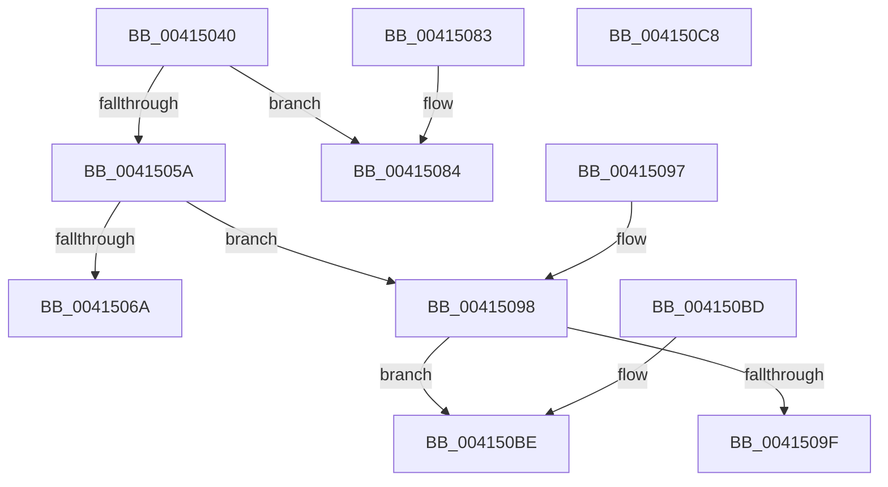

# FsRtlGetIoAtEof

- RVA: `0x00415040`–`0x004150C9` (길이 `137` bytes)
- VA: `0x0000000140415040`
- 실행 섹션: `.text`
- PDB 이름 있음: `예`; PDB Function 태그: `아니요`
- unwind 정보 RVA: `0x0009C1B8`
- 디코드: `43`개 명령, `137/137` bytes 표시
- 미해석 바이트: `0` (있으면 어셈블리에 `.byte`로 보존)

> 이 문서는 커널 이미지의 기계어와 PDB 기호를 분석해 생성했습니다. 4번과 5번은 함수 원형과 자료형을 바이너리 사용 방식에서 추정한 C 해석이며 원본 소스 복구 결과는 아닙니다.

## 1. Dependencies

- 직접 호출 지점: **1**; 고유 호출 대상: **1**
- 직접 호출자로 확인된 함수: **0**
- RIP 상대 이미지 참조: **0**

### Outgoing calls
- `0x004150A7` → [FsRtlpWaitForIoAtEof](FsRtlpWaitForIoAtEof_function_00415298.md) (function, `0x00415298`)

### Direct callers
- 이 함수 시작 RVA로 연결되는 직접 call은 확인되지 않았습니다. 간접 호출은 완전히 역산할 수 없습니다.

### Static image references
- 디코드된 RIP-relative 메모리 참조가 없습니다.

## 2. Other-region calls and transfers

- 다른 실행 섹션으로 향하는 call: **0**
- 별도 외부 분기/꼬리 이동을 확인하지 못했습니다.

## 3. Assembly (complete function range)

```asm
00415040  48 89 54 24 10                  mov qword ptr [rsp + 0x10], rdx
00415045  48 83 EC 28                     sub rsp, 0x28
00415049  65 48 8B 04 25 88 01 00 00      mov rax, qword ptr gs:[0x188]
00415052  48 8B 11                        mov rdx, qword ptr [rcx]
00415055  48 3B D0                        cmp rdx, rax
00415058  74 2A                           je 0x140415084
0041505A  4D 85 C0                        test r8, r8
0041505D  4F 8D 14 08                     lea r10, [r8 + r9]
00415061  4D 0F 48 D0                     cmovs r10, r8
00415065  48 85 D2                        test rdx, rdx
00415068  75 2E                           jne 0x140415098
0041506A  48 89 01                        mov qword ptr [rcx], rax
0041506D  48 8B 44 24 58                  mov rax, qword ptr [rsp + 0x58]
00415072  66 C7 41 26 01 00               mov word ptr [rcx + 0x26], 1
00415078  B1 01                           mov cl, 1
0041507A  88 08                           mov byte ptr [rax], cl
0041507C  33 C0                           xor eax, eax
0041507E  48 83 C4 28                     add rsp, 0x28
00415082  C3                              ret
00415083  CC                              int3
00415084  48 8B 44 24 58                  mov rax, qword ptr [rsp + 0x58]
00415089  66 FF 41 26                     inc word ptr [rcx + 0x26]
0041508D  C6 00 01                        mov byte ptr [rax], 1
00415090  33 C0                           xor eax, eax
00415092  48 83 C4 28                     add rsp, 0x28
00415096  C3                              ret
00415097  CC                              int3
00415098  80 7C 24 50 00                  cmp byte ptr [rsp + 0x50], 0
0041509D  74 1F                           je 0x1404150be
0041509F  48 8B 54 24 38                  mov rdx, qword ptr [rsp + 0x38]
004150A4  4D 8B C2                        mov r8, r10
004150A7  E8 EC 01 00 00                  call 0x140415298
004150AC  0F B6 C8                        movzx ecx, al
004150AF  48 8B 44 24 58                  mov rax, qword ptr [rsp + 0x58]
004150B4  88 08                           mov byte ptr [rax], cl
004150B6  33 C0                           xor eax, eax
004150B8  48 83 C4 28                     add rsp, 0x28
004150BC  C3                              ret
004150BD  CC                              int3
004150BE  B8 54 00 00 C0                  mov eax, 0xc0000054
004150C3  48 83 C4 28                     add rsp, 0x28
004150C7  C3                              ret
004150C8  CC                              int3
```

## 4. C-style interpretation (structured pseudocode)

```c
__int64 __fastcall FsRtlGetIoAtEof(__int64 a1, __int64 a2, __int64 a3, __int64 a4, unsigned __int8 a5, __int64 a6)
{
    __int64 result;
    __int64 v_r10;
    __int64 v_rsp;
    unsigned __int64 v_stack_p10;
    unsigned __int64 v_stack_p60;

    v_stack_p10 = a2;
    v_rsp = (v_rsp) - (40);
    if ((*(unsigned __int64 *)(a1)) == (*(unsigned __int64 *)(gs_base + (0 + 392)))) goto loc_00415084;
    v_r10 = a3 + a4 * 1;
    if (sign_flag) { v_r10 = a3; }
    if (*(unsigned __int64 *)(a1) != 0) goto loc_00415098;
    *(unsigned __int64 *)(a1) = *(unsigned __int64 *)(gs_base + (0 + 392));
    *(unsigned __int16 *)(a1 + 38) = 1;
    *(unsigned __int8 *)(a6) = 1;
    result = 0;
    v_rsp = (v_rsp) + (40);
    return result;
loc_00415084:
    *(unsigned __int8 *)(a6) = 1;
    result = 0;
    v_rsp = (v_rsp) + (40);
    return result;
loc_00415098:
    if (a5 == 0) goto loc_004150BE;
    result = FsRtlpWaitForIoAtEof(1, v_stack_p60, v_r10, a4);
    *(unsigned __int8 *)(a6) = (unsigned __int8)((unsigned __int8)(result));
    result = 0;
    v_rsp = (v_rsp) + (40);
    return result;
loc_004150BE:
    v_rsp = (v_rsp) + (40);
    return (unsigned int)(0xC0000054ULL);
}
```

## 5. (Beta) C Style

```c
int64_t FsRtlGetIoAtEof(void *Arg1, int64_t Arg2, int64_t Arg3, int64_t Arg4, uint8_t Arg5, void *Arg6)
{
    uint8_t *arg1 = (uint8_t *)Arg1;
    uint8_t *arg6 = (uint8_t *)Arg6;

    int64_t result;
    int64_t local_r10;
    int64_t local_rsp;
    uint64_t v_stack_p10;
    uint64_t v_stack_p60;

    v_stack_p10 = Arg2;
    local_rsp = (local_rsp) - (40);
    if ((*(uint64_t *)(arg1)) == (*(uint64_t *)(gs_base + (0 + 0x188)))) goto loc_00415084;
    local_r10 = Arg3 + Arg4 * 1;
    if (sign_flag) { local_r10 = Arg3; }
    if (*(uint64_t *)(arg1) != 0) goto loc_00415098;
    *(uint64_t *)(arg1) = *(uint64_t *)(gs_base + (0 + 0x188));
    *(uint16_t *)(arg1 + 0x26) = 1;
    *(uint8_t *)(arg6) = 1;
    result = 0;
    local_rsp = (local_rsp) + (40);
    return result;
loc_00415084:
    *(uint8_t *)(arg6) = 1;
    result = 0;
    local_rsp = (local_rsp) + (40);
    return result;
loc_00415098:
    if (Arg5 == 0) goto loc_004150BE;
    result = FsRtlpWaitForIoAtEof(1, v_stack_p60, local_r10, Arg4);
    *(uint8_t *)(arg6) = (uint8_t)((uint8_t)(result));
    result = 0;
    local_rsp = (local_rsp) + (40);
    return result;
loc_004150BE:
    local_rsp = (local_rsp) + (40);
    return (uint32_t)(0xC0000054ULL);
}
```

### 관측된 메모리 오프셋

구조체 형식이 확인되지 않은 접근은 인자 기준의 오프셋으로만 기록했습니다.

| 기준 인자 | 오프셋 표현 | 폭 (bit) | 접근 |
|---|---:|---:|---|
| `Arg1` | `+ 0x0` | `64` | `R` |
| `Arg1` | `+ 0x0` | `64` | `W` |
| `Arg1` | `+ 0x26` | `16` | `R/W` |
| `Arg1` | `+ 0x26` | `16` | `W` |
| `Arg6` | `+ 0x0` | `8` | `W` |

## 6. Execution-region graph

[열기: 2D/3D 그래프와 함수 탐색 컨트롤 패널](../../../control-panel.html?section=text&rva=0x00415040&view=graph)

- 2D 그래프는 위에서 아래로 흐르고, 3D 그래프는 빈 공간을 드래그해 회전합니다. Shift+드래그는 이동, 휠은 확대·축소, 함수 노드 선택은 대상 보고서 이동입니다.

### Static fallback


